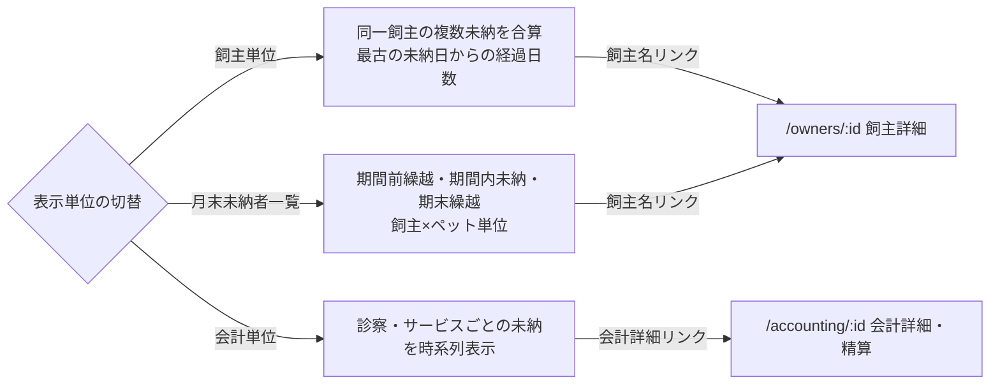

# 未納者一覧（売掛管理） 仕様書 (Unpaid List)

| 管理項目 | 記載 |
|:---|:---|
| 文書ID・種別 | page.accounting.unpaid-list／画面仕様 |
| 決定状態 | 既存本文は継承（決定根拠未確認）。初回〜第四群の決定状態は下記正本で区別 |
| 実装状態 | 既存記載を継承（再監査なし） |
| 実機検証状態 | 今回未実施。過去の記録と今回の文書確認を分ける |
| 文書確認日 | 2026-10-15（初回〜第四群への参照・現行との差分明示） |

## 今回合意と現行画面の区別

[初回5FRの業務正本](../lifecycle.md#accounting-agreement-first-five)・[合計66AC](../lifecycle.md#accounting-acceptance)に従う。同飼主の複数ペット／選択した未請求分の合算、元請求への任意額回収、未納／一部入金確定、理由付き訂正／取消／方法指定返金、締め後差分、根拠保存・単価手修正・割引併用は今回合意。[第二群](../lifecycle.md#accounting-agreement-second)で古い請求順／変更可・釣銭、予約前金、減額と実返金／訂正後表示、割合→金額と保険確認修正、帳票分離・再発行／旧履歴・過去未納表示、原請求日／実入出金日を合意。前金除外案は不採用で、充当時に新受領を作らない。[第三群](../lifecycle.md#accounting-agreement-third)で飼主単位預り金／予約任意・同飼主の別予約／ペット利用、割合合算→金額→割引後保険、同日作成順／理由付き保存後再配分、非現金超過の返金必要、別方法返金・金額追加承認なし、受領証／最終会計／返金元番号・再発行番号維持を合意。旧予約必須・未決表記は最新正本へ更新。[第四群](../lifecycle.md#accounting-agreement-fourth)で明細と会計全体の両割引、超過は入力エラーではなく警告し承認して進めた請求額は0円下限、会計取消時の預り金残高復元・実返金は別操作を合意。取消による解除・復元を残高へ反映する。残高式は業務正本へ従う。税／端数・併用順序／配賦等は未決。

以下の既存UI・API表・図・権限・計算式・旧FR／ACは現行／継承挙動の参照。単一ペット／カルテや全額支払の制約、返金理由／方法任意、割引選択・丸め等を今回の確定仕様にしない。新しい画面構成・帳票の詳細・未納filter／基準日・権限mappingは未確定。請求書／領収書の分離と旧帳票保持、今月売上なしの過去未納表示自体は合意済み。[現行との差分](../../../../design/domains/accounting/technical-spec.md#accounting-current-gap)を参照。今回の合意を現行実装済み／旧UAT合格と扱わない。

## 目的・対象範囲

| シナリオ | 業務上の価値 | 優先度・理由 |
|:---|:---|:---|
| 対象期間の未納を探す | 期間未指定を未納なしと誤認しない | 未決／要確認（既存文書に優先度の根拠なし） |

### 概要

- **画面の目的**: 指定した期間内に支払予定日がある未納の売掛金を把握し、督促や回収業務を支援するための管理ビュー。

## 利用者・権限・前提

- **アクセス権限**: 会計管理権限が必要（`ResourceAccounting`）

利用者の職種別の範囲は未記載／要確認。操作前提の詳細は本書の各操作・保存契約と関連正本を参照する。

## 入口・出口

- **URLパターン**: `/accounting?tab=unpaid`

#### 直接ナビゲーション

- **飼主詳細へ**: 飼主単位・月末未納者一覧表示で飼主名リンクをクリックすると、連絡先や全履歴を確認できる `/owners/:id` へ遷移します。
- **会計詳細へ**: 会計単位表示で飼主名セルの会計詳細リンクをクリックすると、精算処理を行える `/accounting/:id` へ直接遷移します。

| 入口／出口 | 契機 | 引継ぎ情報 | 根拠 |
|:---|:---|:---|:---|
| URLパターン | 画面を開く | 上記URL／既存導線。呼出元の網羅は要確認 | 本節の元記載 |
| 戻り先・他画面 | 本節の既存操作 | 記載が無い引継ぎ・戻り先は要確認 | 本節／関連フロー |

## 表示情報・入力項目

| 項目 | 意味 | 型／形式 | 必須／任意 | 初期値 | 候補元 | 制約／根拠 |
|:---|:---|:---|:---|:---|:---|:---|
| 開始日・終了日 | 支払予定日の抽出期間 | 日付（start_date／end_date） | 未指定時は既定を適用 | JST当月 | URL・期間入力 | 下記「管理ツールバー」 |
| 表示単位 | 集計軸 | group_by | 未記載／要確認 | 未記載／要確認 | 飼主／会計／月末未納者一覧 | 下記「管理ツールバー」「パフォーマンスと拡張性」 |
| ページ | 表示範囲 | 未記載／要確認 | 未記載／要確認 | 1ページ20件 | ローカルstate（URL非同期） | 下記「パフォーマンスと拡張性」 |

### 画面構成

#### 1. 売掛金サマリー

抽出された条件における財務リスクを即座に確認できます。
- **売掛金総額**: 税込の未納累計額。
- **対象件数 / 人数**: 該当する会計の総数と飼主の人数。

#### 2. 管理ツールバー

- **期間指定**: 開始日・終了日の2つの日付で支払予定日の範囲を絞り込み（飼主単位・会計単位・月末未納者一覧の全モード共通）。未指定時は JST 当月を既定にして API を発火する（空のまま「未納者はいません」と出さない）。
- **表示単位の切替**: 用途に応じて集計軸を変更。
    - **飼主単位**: 同一の飼主が抱える複数の未納分を合算。
    - **会計単位**: 個別の診察・サービスごとの未納分を時系列で表示。
    - **月末未納者一覧**: 期間前繰越・期間内未納・期末繰越を飼主×ペット単位で表示。

### 表示項目と操作

#### グルーピング別の詳細

- **飼主単位表示**: 最古の未納日から終了日までの経過日数を算出し、回収の優先順位判断を助けます。「最古未納日」「最新未納日」列（その飼主の未納会計の MIN/MAX(scheduled_date)、YYYY-MM-DD）を表示します。
- **会計単位表示**: ペット名や具体的な診療日を確認でき、詳細な内訳の把握に適しています。「最新未納日」列にその会計の scheduled_date（YYYY-MM-DD）を表示します。
- **月末未納者一覧表示**: 期間前繰越額（期間開始前の未納）・期間内発生した未納額・期末繰越額を飼主×ペット単位の一覧で確認できます。「最新未納日」列にその飼主×ペットグループの未納会計の MAX(scheduled_date)（YYYY-MM-DD、`GET /api/v1/accountings/unpaid-period` の `latest_scheduled`）を表示します。
    - **第二群の目標との相違**: [過去未納の表示](../lifecycle.md#requirement-fr-accounting-document-and-aged-debt)では今月売上なしでも対象。以下は現行抽出制約で、新合意を満たす条件ではない。
    - **対象飼主の条件 (EMR-228)**: 一覧・件数・サマリーは「期間内に非取消 (`status != cancelled`) の billing を持つ飼主」に限定されます。期間内に売上が無い飼主の期間外未納は一覧に出ません（`FindPeriodUnpaidCarryover`）。対象飼主の期間外未納は従来どおり繰越列として表示します。

## 操作・業務ルール・状態遷移

| 要件ID | 定義の所在 | 決定根拠 |
|:---|:---|:---|
| FR-accounting-unpaid-default-period | [既存の要件本文](#requirement-fr-accounting-unpaid-default-period) | 既存記載を継承。ID付与で合意済みにしない |

| 操作 | 実行条件 | 成功後状態／遷移 | 失敗挙動 | 根拠 |
|:---|:---|:---|:---|:---|
| 集計軸切替・詳細を開く | 会計管理権限・指定期間 | 対応集計・飼主詳細・会計詳細 | 未記載／要確認 | 表示入力節・入口出口節 |

## 保存・取消・再試行・同時編集

#### パフォーマンスと拡張性

- **URLパラメータ同期**: 期間（`start_date`/`end_date`）・表示単位（`group_by`）は URL と同期され、共有やブックマークが可能です。`group_by=period` が月末未納者一覧で、旧 `group_by=monthly` の URL はレガシーエイリアスとして同モードで開きます。
- **ページネーション**: `page` は URL ではなくローカル `useState` で管理し、1ページ20件で表示します。

## エラー・空状態

| 状況 | 検知／表示 | 利用者の次の操作 | 根拠 |
|:---|:---|:---|:---|
| 期間未指定 | JST当月を適用して取得 | 期間を確認・指定 | 管理ツールバー |
| 取得前・取得失敗・実際の0件 | 未記載／要確認 | 未記載／要確認 | 未指定のまま未納なしと表示しない既存契約。その他は要確認 |

## 受入条件

この表は既存仕様から抽出した代表条件。すべての入力・操作・異常系への要件IDと受入条件の網羅的対応は未記載／要確認。

| 条件ID | Given（前提） | When（操作） | Then（期待結果） | 独立確認 | 成功条件 | 確認手順／証跡 |
|:---|:---|:---|:---|:---|:---|:---|
| AC-accounting-unpaid-default-period | 期間が指定されていない | 未納一覧を開く | JST当月を既定にして取得する | 期間未指定の表示を確認 | 未取得のまま未納なしと案内しない | [要件](#requirement-fr-accounting-unpaid-default-period)・[既存UATの所在](../README.md#受入条件の所在)。実機未確認 |

## 未決事項・関連仕様・根拠

未記載の型・必須条件・初期値・エラー・受入結果は要確認。既存の未実装・判断待ち・臨床承認待ちは以下の元記載を維持する。今回の形式整理を合意や実装完了の根拠にしない。

[文書規約](../../../authoring-guide.md)・[ドメイン入口](../README.md)。根拠は整理前の既存仕様本文と、その本文が示す日付付き追記・関連資料。文書確認日は上記の構造確認日であり、過去の承認日を置き換えない。API表・コード名は参照情報で、wire型とDB定義の正本は文書規約に従う。

### 技術仕様

#### API連携

| メソッド | エンドポイント | 用途 | 必須権限 | 必須アクション |
|:---|:---|:---|:---|:---|
| GET | `/api/v1/accountings/unpaid` | 期間・表示単位に応じた未納データの集計取得 | `accounting` | `view` |
| GET | `/api/v1/accountings/unpaid-period` | 月末未納者一覧の期間集計（`start_date`/`end_date` 必須）取得 | `accounting` | `view` |
| GET | `/api/v1/accountings/unpaid-balance` | 特定飼主の未入金残高と件数の取得（本画面からは未呼出。実際は会計詳細画面 `/accounting/:id` の `OwnerUnpaidBalanceCard` から呼び出される） | `accounting` | `view` |

