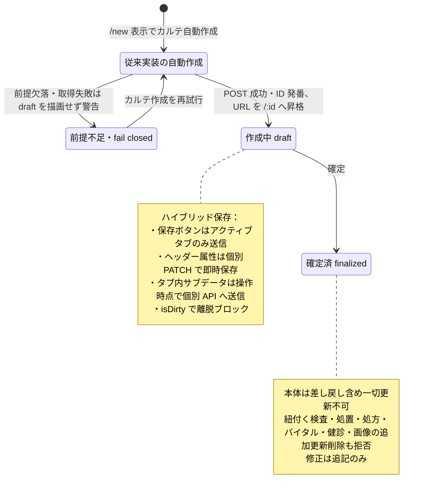

# カルテ登録・編集フロー詳細仕様 (Medical Record Lifecycle)

[17:17合意の診療前日付訂正](../reservations/pages/reservation-management.md#requirement-fr-reservations-preconsultation-date-record-correction)では、未記入カルテは確認して予約日へ合わせ、記入済みなら通常の日付変更を停止して内容確認の訂正へ渡す。以下の作成後日付固定・直接PATCH拒否は現行実装／通常更新の参照で、この合意の未記入・診療前の確認付き訂正を実装済みとする根拠ではない。確定済みカルテの変更禁止・追記による訂正、保存ルーティング契約は維持する。

17:23 JSTの[LINE予約6点合意](../../line/reservation-spec.md#line-agreement-1723)へ従う。公開された診療・トリミング・ホテルは予約対象、入院は医院相談。ホテルには医師指名・医師シフト・通常予約の同日制約を適用しない。受付制限・入力保持・受付前取消・必要設定不足の扱いと受入条件はLINE正本を参照する。ホテル受入基準は17:35合意の医院別同時宿泊頭数・全宿泊期間判定で、実装・実機受入は未確認。

17:17 JSTの院内予約8点一括合意は[予約入口の決定一覧](../reservations/README.md#internal-reservation-batch-1717)を参照する。誤取消／誤終了訂正、未終了予約保護、診療前の日付・カルテ整合、マスタ利用・名称履歴、休診日予約／日跨ぎ勤務、患者照合、ホテル担当時点／入院記録失敗の各正本と受入条件へ従う。LINE受付条件は17:23合意（ホテル受入基準は17:35合意、計算・保存方式は設計）、実装・実機受入は未確認。

| 管理項目 | 記載 |
|:---|:---|
| 文書ID・種別 | lifecycle.medical-records／保存契約 |
| 決定状態 | 2026-10-14初回5項目は部分合意。最新の業務正本はlifecycle初回合意節。対象外の既存決定状態を保持し、カルテ全体完了／実装受入にしない |
| 実装状態 | 合意と現実装は別。main ec4f7146a の必要箇所を静的照合し、差分は予約正本の残差一覧へ記録。実装変更なし |
| 実機検証状態 | 今回未実施。過去の記録と今回の文書確認を分ける |
| 文書確認日 | 2026-10-14（合意・参照・語彙の確認。実機受入日ではない） |

## 目的・対象範囲

| シナリオ | 業務上の価値 | 優先度・理由 |
|:---|:---|:---|
| 確定後に訂正追記する | 原記録の真正性を保つ | 未決／要確認（既存文書に優先度の根拠なし） |

### 概要

本システムにおける電子カルテ（Medical Record）は、臨床的な真正性と多種多様なサブリソースの整合性を維持するため、独自のライフサイクルと保存ロジック（ハイブリッド同期）を採用しています。

## 担当者・権限・前提

担当医以外の入力者・医師の確認／確定と編集者ログは[初回合意](#requirement-fr-medical-records-authorized-editor-audit)へ従う。実grantと医師判定の対応は要確認。保存・確定・訂正の操作権限は本書API参照表と [画面の権限前提](pages/medical-record-form.md#access-preconditions)、状態による保護は下記の既存契約を参照する。

## 契機・入口・出口

新規画面表示・ヘッダー変更・タブ内操作・保存・確定・訂正追記が契機。作成後のURL昇格は下記「登録と ID 確定のプロセス」。入口・出口の画面操作は [カルテ入力画面](pages/medical-record-form.md#navigation)が正本。

## 状態遷移・引継ぎデータ

下表は従来実装参照。新規画面表示だけの通常作成は最新受付接続へ変更し、確定者は初回合意の医院が認めた医師とする。現行経路の一般利用者記載を最新の医師確認の免除へ読み替えない。

| 要件ID | 定義の所在 | 決定根拠 |
|:---|:---|:---|
| FR-medical-records-finalized-addendum-only | [既存の要件本文](#requirement-fr-medical-records-finalized-addendum-only) | 既存記載を継承。ID付与で合意済みにしない |

| 担当者 | 前提 | 契機 | 前状態 | 後状態 | 引継ぎデータ | 異常系／根拠 |
|:---|:---|:---|:---|:---|:---|:---|
| 操作権限を持つ利用者（職種は要確認） | appointment・権限・対象状態 | 新規画面表示 | 未作成 | draft・ID確定 | appointment_id・カルテID | 下記「自動作成」「ID の発番と URL 昇格」 |
| 操作権限を持つ利用者 | 保存済み・会計確認等 | 確定 | draft | finalized | 確定状態・訂正追記の文脈 | 下記「ステータス管理と保護」 |

## カルテ初回5項目の合意（2026-10-14）

質問 Sentinel_c078319f28a48191bdce52f618e264ab と回答 Sentinel_1b70a4b2675c8191814931fd13762b54 が根拠。1は「担当医じゃなくても入力は可能。ただ誰が編集したのかのログは必要」、2は「必須なのは特にはないが、治療プランが全部終わってない場合は警告する必要あり」、3・4は「ok」、5は「手入力　臨床責任者はいません、医師です」。以下は通常診療カルテの部分合意で、実装・実機成立は未確認。語彙は[カルテ概念](../../ontology/medical-records.md)、実現方式と現行差分は[部分技術設計](../../../design/domains/medical-records/technical-spec.md)へ参照する。

### 1. 担当医以外の入力と編集者ログ

操作権限のあるスタッフは担当医本人でなくても入力・編集できる。既存のview/create/edit/delete等の操作権限・医院scope・確定ロックを保持し、担当医以外への入力許可を全スタッフへの無条件公開へ広げない。臨床内容の確認・カルテ確定・記録確認訂正の確認は医院が認めた医師が行い、担当医以外の医師も代行できる。編集者・確認医師・カルテ担当医・予約指名医師は別に保持し、編集だけで担当を自動交代しない。新たな「臨床責任者」職種・役割・grantは作らない。

成功した編集には誰が編集したか分かるログを必須とする。本体・ヘッダー・問診・治療プラン・治療／処方・バイタル・関連子入力・追記・許可された削除／過去入力を含め、actorを認証から記録し担当医IDで代用しない。記録項目と保存結果の対応・必要監査の保存方式は技術設計で、ログ未保存を「履歴あり」と扱わない。現行の通常更新best-effort監査だけを本合意の充足証拠にしない。

### 2. 明示確定・記載必須なし・治療プラン未完了警告

診療終了や精算だけで自動確定せず、医師が明示確定する。検査結果待ちで追加の通常入力が必要なら作成中を維持する。確定時に臨床記載の必須項目を追加しない。下書きはSOAP空欄でも保存可、主訴区分は任意という既存条件を保持する。認可・医院／患者／関連整合・保存成功・会計の医師確認・確定保護などの既存検査は臨床記載必須項目と別で、空欄可を検査免除へ読み替えない。

治療プランに未完了があれば、その内容を確定前に警告する。警告を確認した医師は未完了でも確定できる。警告を確定禁止や全プラン実施必須へ変えない。未完了の警告を確認して確定しても、プランを実施済みに更新しない。結果取得失敗／不明を「全部完了」と表示せず、再取得して判定する。未完了は[入力4項目合意の未実施・後日予定](pages/medical-record-form.md#requirement-fr-medical-records-plan-execution-states)。中止理由・実施記録者／記録時刻とチェックボックス／モーダル操作を守る。既存データの状態値との具体対応は調査・設計へ残し、診療終了／支払済みから推測しない。確定後は下記の本文・子入力ロックと追記訂正を保持する。

### 3. 空の誤作成削除・記入済み訂正・患者取り違え

空の誤作成で、請求等の関連データがない場合だけ削除を認める。draftという状態だけでは削除可と判定しない。臨床入力・見積／請求・検査・画像等の依存を含め空・関連なしを確認し、判定不能なら削除しない。受付予約リンクの存在だけを空判定と同義にせず、診療中の予約リンク保護・同一予約／記録保持等の既存契約も検査する。通常予約取消からの自動削除は依然禁止。

削除は現行の論理削除・履歴／関連保持を踏まえた仕様で、物理削除・ログ廃棄・無条件復元の新許可ではない。復元業務は[訂正・例外4項目](#medical-record-agreement-correction-four)で合意。専用UI・APIと現行実態の照合は残件。削除対象が記入済みなら履歴を残して訂正し、確定済みは追記のみ。患者取り違えは専用の訂正手順へ渡し、通常ヘッダー編集で患者を付け替えたり、記録を削除／再作成したりしない。患者取り違えは追加合意の必要内容転記・元／先対応に従う。具体的UI／保存対応と会計の返金／締め後手順は残件。理由・提案→医師確認→予約・記録・請求の整合確認という既合意を維持する。

### 4. 通常の受付接続と過去未登録診療の専用入力

通常は受付に紐づく同じカルテを開く。受付がない場合は受付登録へ案内する。記録一覧／別画面を開いたことだけで予約と診療中状態を自動作成しない。受付時の通常カルテ同時成功・既存ID再利用・準備／読込成功後の明示開始を維持する。予約変更は予約管理の入口へ渡す。

過去の未登録診療は、理由と医師確認を伴う専用の追加入力として扱う。実際の診療日・登録した時刻・入力者・確認医師を区別し、当日の受付／診療開始・予定時刻を偽装しない。既存記録の訂正・確定済みへのaddendumとは別の目的で、既存記録があるときの重複防止・患者確認・請求整合を守る。当日カードなし・自動課金なしは追加合意。専用UI・保存方式と全ownerの具体的対応は設計残件で、日数制限を推測して追加しない。移行例外の未紐付け記録を通常の受付なし作成の代用にしない。トリミング・入院／ホテルの専用記録本文・作成契約を本合意へ統合しない。

### 5. 評価不能時の医師確認・理由付き手入力

体重・動物種・薬量パラメータ等の不足で評価できない場合は、医師が確認し理由を記録して手入力できる。「評価不能」を表示し、安全域内／チェック済み／上限内と表示しない。確認医師・不足情報／評価不能理由・手入力値・手入力理由と編集者の対応を履歴へ残す。パラメータ取得エラーを単なる未設定／安全判定へ置換しない。認可・医院／患者／薬剤照合や必要取得依存の失敗、既存のspecies不一致等のfail-closedは維持し、通信失敗を手入力許可の根拠にしない。

これは評価不能時の手入力許可で、評価可能な絶対上限超過を理由や確認ダイアログで解除する許可ではない。評価可能な上限超過の拒否・下限未満／推奨値逸脱の理由条件は継承する。情報が変われば最新版で再評価し、評価可能な超過へ変わった値を旧確認で保存しない。対象薬・動物種・値・範囲・単位・出典の承認は医師が行う。#261の別工程は保持し、今回薬量数値・対象一覧を決めず、汎用「ok」やマスタ入力／Issue Closedを臨床数値承認の代用にしない。

入力まわりの追加4FR／15ACは[画面の合意正本](pages/medical-record-form.md#medical-record-agreement-input-four)。履歴複写とtemplate適用は問診ローカル入力／既存の治療個別保存へ接続し、保存§2を変更しない。診療マスタの当時内容保持・プラン状態を、全タブ一括保存や自動確定・自動課金へ読み替えない。

### 1. 登録と ID 確定のプロセス

2026-10-13の途中合意: 診察予約に連携する通常カルテの作成時点と受付の保存境界は[横断フロー](../../workflows/reservation-to-record-flow.md#requirement-fr-reservations-checkin-record-atomicity)が正本。予約時作成を行わず、受付時に同時成功とする。予約取消で既存カルテを自動削除しない契約は[予約正本](../reservations/pages/reservation-management.md#requirement-fr-reservations-cancel-history)。カルテから予約を変更しない。専用記録内部・一覧shortcutの経路整合は設計／実装検証として分ける。

#### 1.1 自動作成 (Auto Create)

**以下は従来の画面表示時自動作成・ID確定の実装参照**。診察予約の受付時作成へ追従済みではなく、この経路で予約時の通常カルテ作成を認める新たな合意ではない。受付後の既存カルテ再利用・未作成時作成／失敗時開始未確定は合意済み。従来の画面表示時作成経路との整合は実装設計・検証。

新規作成画面 (`/medical-records/new?petId=xxx`) に遷移すると、ページ表示と同時に `useMedicalRecordAutoCreate` がカルテを自動作成します（`POST /v1/medical-records`、`status: "draft"`）。当日業務の既定経路は必ず `appointment_id` を解決する（同日の未完了な一般診療予約を再利用し、なければ一般診療予約を自動作成）。同一 appointment の未削除通常カルテは最大 1 件。不変条件の正本は [reservation-to-record-flow.md](../../workflows/reservation-to-record-flow.md) §5 / [ADR-006](../../../architecture/adr/006-backend-domain-package-boundaries.md)。会計レコードはこの自動作成では作らない。（追記 2026-10-07 監査: 旧参照「§5.5」は存在しない節番号のため §5 に修正）

#### 1.2 ID の発番と URL 昇格

自動作成がバックエンドで成功した時点で、サーバー側で `medical_records.id` が発番されます。
- **作成前の fail-closed 表示**: `/new` で作成済み ID がない間は保存ボタンを表示しない。一般診療の予約区分など必須前提が欠落・取得失敗した場合は空の draft を描画せず、appointment phase の警告と「カルテ作成を再試行する」を表示する。前提が有効になるまで appointment／カルテの write は行わない。
- **URL 置換**: 作成成功と同時に、フロントエンドは `replace` ナビゲーションを実行し、ブラウザの URL を `/medical-records/:id` へ昇格させます。これにより、以後の保存が同一レコードに対して継続されます。

### 3. ステータス管理と保護

カルテには以下の 2 つの主要なフェーズが存在します。下の図は従来/new表示自動作成の実装参照で、最新の通常受付接続・医師明示確定の業務正本は初回合意節。

#### 3.1 作成中 (Draft)

- 作成中の入力・修正は[初回合意の担当医以外の入力・編集ログ](#requirement-fr-medical-records-authorized-editor-audit)へ従う。操作grant・医院scope・既存関連保護を保持する。
- 会計は別リソース。自動作成では billing を作らない。会計(医師確認)タブまたは会計画面から別経路で作成する。

#### 3.2 確定済 (Finalized)

- 臨床記録としての真正性を担保するため、**編集操作が物理的にロック**されます。
- **ロックの波及**: 確定されたカルテに紐付く「検査結果」「処置明細」「処方」「バイタル」「健診記録」「カルテ画像」への追加・更新・削除も、バックエンドで拒否されます（健診タブは UI 上も読み取り専用に切り替わります）。
- **修正**: 確定済カルテ本体は差し戻しを含め一切更新できません（バックエンドが拒否）。修正が必要な場合は「追記」（`MedicalRecordAddenda`、`POST /v1/medical-records/:id/addenda`）で訂正内容を追記します。

## 異常系・保存・取消

### 2. ハイブリッド保存ロジック (Hybrid Sync)

> **追記（2026-10-07 監査）**: 本節をカルテ保存ルーティング（メイン保存の送信先切替・ヘッダー属性の即時保存・タブ別サブデータの即時保存）の契約本文の**正本**とする。[medical-record-form.md §2.2](pages/medical-record-form.md) は本画面固有の操作仕様と正本参照に簡約済み。ルーティング契約の変更は本節のみを更新する。

カルテは 9 つのタブ（問診 / 診察・治療プラン / 治療 / 予防接種 / 定期健診 / 検査 / 画像 / 見積書 / 会計(医師確認)）に分かれた膨大なデータを扱うため、「カルテ本体」と「タブ別サブデータ」を独立して保存します。

1.  **メイン保存（アクティブタブ単位）**:
    - 「保存」ボタン（React 19 の `useActionState`）はアクティブタブの内容のみを保存します。問診タブは `PATCH /v1/medical-records/:id/inquiries`（主訴・主訴区分・治療方針）、診察/治療プランタブは `PATCH /v1/medical-records/:id/clinical-plan`（診断・治療方針）を送信します。EMR-308: カルテの「次回来院推奨日」フィールドは撤廃され、カルテ本体への追加 PATCH は行われません。
    - 担当医、来院種別、診療日は、ヘッダーでの変更と同時に個別 `PATCH /v1/medical-records/:id` で即時保存されます（保存ボタンを経由しません）。来院種別の成功後は詳細キャッシュを invalidate する。appointment 紐付き通常カルテの `date` は予約開始の JST 日付に固定され、変更と `appointment_id` 再紐付けは BE Conflict。未紐付け（移行例外）のみ date PATCH が成功する。EMR-308: ヘッダーの「次回予定」はカルテ PATCH ではなく `PUT/DELETE /v1/reservations/pets/:petId/next-visit-intent` でペットの tentative appointment（`status='tentative'`、`intended_date`）を upsert/削除します。権限・拠点・連続操作の write 契約は [reservation-to-record-flow.md](../../workflows/reservation-to-record-flow.md) §2.3 を正本とします。
2.  **タブ別サブデータの即時保存**:
    - メイン保存の成否とは独立して、各タブ内の操作（追加・編集・削除）が発生した時点で即座に個別 API へ送信されます（メイン保存完了を待つゲート処理ではありません）。
    - **治療 (Tab 3)**: 項目の追加・更新・削除はそれぞれ `POST`/`PATCH`/`DELETE /v1/medical-records/:id/treatments(/:treatmentId)`。ドラッグ&ドロップでの並び替えのみ `PUT /v1/medical-records/:id/treatments` で一括更新。
    - **バイタル**: タブではなく `VitalsModal`（モーダルダイアログ）から `POST /v1/medical-records/:id/vitals` で記録。
    - **検査 (Tab 6)**: 検査管理からの新規登録はペット選択後に `/examinations/new?petId=` を開く（`examinationCreateHref`）。既存のカルテ紐付き検査は一覧から `/medical-records/:id?tab=検査&examId=` へ遷移する。タブ上の「検査取り込み」は既存検査を `PATCH`（`medical_record_id`）で紐付ける。未紐付けの既存検査は `/examinations/:id` で参照・編集する。

### 4. 安全機能

- **離脱ブロック (`NavigationBlocker`)**: 未保存の変更（`isDirty=true`）がある状態でページを離れようとすると、破棄の確認を強制します。
- **二重送信防止**: React 19 の `useActionState` により、保存処理中の重複クリックを無効化します。

元の契約にない取消・再送・異常時のUI手順は未記載／要確認。画面固有の復帰操作は対応するpagesの保存・エラー節を参照し、ここに複製しない。

## 受入条件

この表は既存仕様から抽出した代表条件。すべての入力・操作・異常系への要件IDと受入条件の網羅的対応は未記載／要確認。

| 条件ID | Given（前提） | When（操作） | Then（期待結果） | 独立確認 | 成功条件 | 確認手順／証跡 |
|:---|:---|:---|:---|:---|:---|:---|
| AC-medical-records-finalized-addendum-only | カルテが確定済み | 記録の訂正が必要になる | 直接変更せず訂正追記を用いる | 確定済み記録の訂正経路を確認 | 確定済み本文の直接変更を拒否する | [要件](#requirement-fr-medical-records-finalized-addendum-only)・[カルテ入口の受入手順](README.md#受入条件の所在)。実機未確認 |
| AC-medical-records-non-attending-edit-audit | 担当医以外の権限あるスタッフ | 通常入力を保存 | 担当医一致だけで拒否せず実際の編集者ログを残す | 本ケースを単独確認 | 既合意の結果と保護を維持 | [FR](#requirement-fr-medical-records-authorized-editor-audit)。実機未確認 |
| AC-medical-records-edit-no-grant | 操作grantなし／別医院のスタッフ | 編集を送信 | 担当医以外可を無条件公開にせず拒否 | 本ケースを単独確認 | 既合意の結果と保護を維持 | [FR](#requirement-fr-medical-records-authorized-editor-audit)。実機未確認 |
| AC-medical-records-physician-confirmation | 医院が認めた担当医以外の医師 | 確定／訂正確認を行う | 必要権限と医師確認を満たせば代行可、担当医を自動交代しない | 本ケースを単独確認 | 既合意の結果と保護を維持 | [FR](#requirement-fr-medical-records-authorized-editor-audit)。実機未確認 |
| AC-medical-records-edit-audit-failure | 必要編集ログを保存できない | 保存結果を確定する | ログなし成功にせず業務writeと必須ログの結果を整合する | 本ケースを単独確認 | 既合意の結果と保護を維持 | [FR](#requirement-fr-medical-records-authorized-editor-audit)。実機未確認 |
| AC-medical-records-no-clinical-required | 臨床欄は空でも既存整合・保存・会計医師確認条件を満たす | 医師が確定 | 今回の臨床必須項目を追加しない | 本ケースを単独確認 | 既合意の結果と保護を維持 | [FR](#requirement-fr-medical-records-explicit-finalize-plan-warning)。実機未確認 |
| AC-medical-records-plan-incomplete-warning | 未完了の治療プランがある | 医師が確定を選び警告を確認 | 未完了内容を表示して確定可、プラン実施済みへ自動更新しない | 本ケースを単独確認 | 既合意の結果と保護を維持 | [FR](#requirement-fr-medical-records-explicit-finalize-plan-warning)。実機未確認 |
| AC-medical-records-plan-warning-cancel | 未完了警告を表示中 | 確認を取り消す | 確定せず入力とプランを保持 | 本ケースを単独確認 | 既合意の結果と保護を維持 | [FR](#requirement-fr-medical-records-explicit-finalize-plan-warning)。実機未確認 |
| AC-medical-records-pending-results-draft | 追加通常入力が必要な検査結果を待つ | 診療終了／精算する | 作成中を維持し自動確定しない | 本ケースを単独確認 | 既合意の結果と保護を維持 | [FR](#requirement-fr-medical-records-explicit-finalize-plan-warning)。実機未確認 |
| AC-medical-records-empty-delete | 空の誤作成で請求等依存なし、既存リンク保護も満たす | 削除権限で削除 | 論理削除と必要履歴を保持、物理削除や予約取消を代行しない | 本ケースを単独確認 | 既合意の結果と保護を維持 | [FR](#requirement-fr-medical-records-empty-delete-reviewed-correction)。実機未確認 |
| AC-medical-records-entered-delete-refusal | 記入済み／請求依存あり／判定不能 | 削除を試す | draftだけで許可せず訂正へ渡す | 本ケースを単独確認 | 既合意の結果と保護を維持 | [FR](#requirement-fr-medical-records-empty-delete-reviewed-correction)。実機未確認 |
| AC-medical-records-wrong-patient-correction | 記録に患者取り違えがある | 訂正を要求 | 専用確認手順へ渡し通常付替え・削除再作成をしない | 本ケースを単独確認 | 既合意の結果と保護を維持 | [FR](#requirement-fr-medical-records-empty-delete-reviewed-correction)。実機未確認 |
| AC-medical-records-no-reception-create | 通常新規入口に受付リンクなし | カルテを開く | 受付登録へ案内し表示だけで診療中予約を作らない | 本ケースを単独確認 | 既合意の結果と保護を維持 | [FR](#requirement-fr-medical-records-reception-and-retrospective-entry)。実機未確認 |
| AC-medical-records-retrospective-reason-physician | 過去未登録診療を入力する（死亡登録済みの生前診療を含む） | 専用追加入力を確定 | 理由・医師確認・実診療日と登録時刻を保持、死亡状態を戻さず保存可。当日の開始を偽装せず、実施時点不明は確認まで停止 | 本ケースを単独確認 | 既合意の結果と保護を維持 | [FR](#requirement-fr-medical-records-reception-and-retrospective-entry)。実機未確認 |
| AC-medical-records-unevaluable-manual | 体重等不足で薬量評価不能 | 医師確認と理由を記録して手入力 | 保存可だが評価不能の表示・確認／編集履歴を残す | 本ケースを単独確認 | 既合意の結果と保護を維持 | [FR](#requirement-fr-medical-records-unevaluable-dose-manual)。実機未確認 |
| AC-medical-records-unevaluable-no-confirmation | 薬量評価不能で理由／医師確認が欠落 | 手入力を保存 | 必要確認が揃うまで保存しない | 本ケースを単独確認 | 既合意の結果と保護を維持 | [FR](#requirement-fr-medical-records-unevaluable-dose-manual)。実機未確認 |
| AC-medical-records-evaluable-hard-limit | 評価可能で絶対上限を超える | 理由付き手入力を送る | 評価不能の許可を流用せず拒否 | 本ケースを単独確認 | 既合意の結果と保護を維持 | [FR](#requirement-fr-medical-records-unevaluable-dose-manual)。実機未確認 |

## 未決事項・関連仕様・根拠

決定状態・未決事項は既存本文を継承する。初回5項目・入力4項目・訂正／例外4項目は各合意正本へ従う。職種別grant実設定・専用訂正の具体的保存対応・治療プラン状態との対応・不足する異常系と受入網羅は要確認。API／モデル表は既存の参照情報であり、型・DB定義の第二正本ではない。根拠は整理前の既存本文と元の追記・関連資料。文書確認日は命名・形式・参照のみ。

[文書規約](../../authoring-guide.md)。

### API連携

| メソッド | エンドポイント | 用途 | 必須権限 | 必須アクション |
|:---|:---|:---|:---|:---|
| POST | `/api/v1/medical-records` | カルテの自動作成（新規作成画面表示時） | `medical-records` | `create` |
| PATCH | `/api/v1/medical-records/:id` | カルテ本体の属性を保存・更新 | `medical-records` | `edit` |
| PATCH | `/api/v1/medical-records/:id/inquiries` | 問診タブの保存（主訴・主訴区分・治療方針） | `medical-records` | `edit` |
| PATCH | `/api/v1/medical-records/:id/clinical-plan` | 診察/治療プランタブの保存（診断・治療方針） | `medical-records` | `edit` |
| POST | `/api/v1/medical-records/:id/addenda` | 確定済カルテへの追記（訂正） | `medical-records` | `edit` |
| POST | `/api/v1/medical-records/:id/treatments` | 治療明細の個別追加 | `medical-records` | `create` |
| PATCH | `/api/v1/medical-records/:id/treatments/:treatmentId` | 治療明細の個別更新 | `medical-records` | `edit` |
| DELETE | `/api/v1/medical-records/:id/treatments/:treatmentId` | 治療明細の個別削除 | `medical-records` | `delete` |
| PUT | `/api/v1/medical-records/:id/treatments` | 治療明細の並び替え（一括） | `medical-records` | `edit` |
| POST | `/api/v1/medical-records/:id/vitals` | バイタル測定結果の記録（`VitalsModal`） | `medical-records` | `edit` |
| PATCH | `/api/v1/examinations/:id` | 既存検査記録をカルテへ紐付け（取り込み） | `examinations` | `edit` |

## 訂正・例外操作4項目の追加合意

2026-10-14、質問 Sentinel_8692363061908191a27f52baf0acc030 に対する Sentinel_d24ee1395f8c819196572baa20a16cd5 の「ok」に基づく4FR／14AC。業務判断の部分合意で、実装・実機受入済みを表さない。初回5項目・入力4項目・保存§2・確定済み原記録の保護を継承する。

### 治療項目の実施済み取消

実施済みの誤記は取消モーダルで理由を入力して戻す。取消前後の状態・操作したスタッフ・記録時刻・理由を履歴に残す。モーダル取消や保存失敗は状態を変更せず、チェック解除だけで無条件に戻さない。戻す対象と変更前後を明示し、不明な旧状態を推測しない。

確定済みカルテに関わる場合は本文・子入力を直接変更せず訂正追記へ、請求に影響する場合は会計の訂正手続きへ接続する。治療項目の実施取消は予約の診療終了Undoとは別で、精算確定歴のある予約の通常Undo禁止を解除しない。請求取消・返金・未納消去を自動実行しない。

### 患者取り違えの記録訂正

記入済み記録の患者IDを直接付け替えない。元記録の誤記と理由を履歴に残し、医師確認のうえ、必要な内容を正しい患者の記録へ転記する。元記録と転記先を対応付け、元記録・元患者との関係を保持する。全内容の自動複写・元記録の削除・別患者への無条件の関連移動で代用しない。

確定済み原記録は訂正追記や対応履歴を用い本文・元日付を保持する。転記先も認可・医院／患者照合・確定ロック・保存と臨床安全条件に従う。請求・検査・画像など別ownerの関連を勝手に付け替えず、影響する訂正先へ引き継ぐ。転記だけで新しい治療実施や請求を作らない。

### 死亡登録後の生前診療記録への適用

2026-10-15の死亡後取扱い確認（Sentinel_2b63d8f5aad88191aa2b4dff79fb5ac2）に対するユーザー「ok」（Sentinel_45be2cab0fe4819188c7c0f9a211358c）により、死亡状態を戻さず、生前診療の後日入力・誤記訂正を理由と履歴付きで行える。過去診療の専用入力・医師確認・当日カードなし／自動課金なしは既決であり、今回の初回承認として数え直さない。実診療日、現在の入力時刻、入力者、確認医師、元記録との関係を識別し、生前分であることが不明なら確認する。既存記録への誤記訂正は原記録・確定時内容を保持する専用訂正／追記へ渡す。死亡後の新しい医療行為・未来の予約／実施は認めず、死亡登録を取り消して通常作成を通す方法で代用しない。

退院処理はD05、精算はD10の理由・履歴付き経路へ渡す。後日入力／訂正だけで自動課金・返金・在庫戻しを行わない。現行死亡gate・全owner adapterの適合は別工程で、今回実装済み・実機PASSを意味しない。

### 過去診療の専用追加入力

理由と医師確認を伴う専用入力で、実際の診療日と現在の入力日時を分ける。当日の受付カードを作らず、自動課金しない。請求が必要なら会計で別途確認する。患者・既存記録の照合と重複防止を保持し、既存の確定済み記録の訂正は訂正追記に接続する。

この例外を通常診療の受付なし作成・自動開始の代用にしない。通常の選択日受付・同一記録・準備／読込成功後の明示開始、専用記録の既存境界を維持する。過去入力成功をカルテ自動確定・当日の診療開始へ変換しない。

### 空の誤作成の非表示と復元

空で、請求等の関連がなく既存の削除保護を満たす誤作成だけを、履歴を残して非表示にする。物理削除・履歴廃棄ではない。記入済み・確定済み・依存不明の記録をこの手順で非表示にしない。受付ボードのスタッフ個人の表示設定とは別のカルテ操作として扱う。

権限のあるスタッフは理由を記録して対象を復元できる。元IDと履歴を保持し、現在の医院／患者・関連・一意性を再照合する。競合する既存記録や判定不能な依存があれば停止して照合し、別IDの複製で代用しない。復元だけで診療開始・受付状態変更・課金・カルテ自動確定を行わない。復元に新たな医師確認必須を追加せず、既存の操作認可・医院scopeを維持する。

### 追加受入条件（実機未確認）

| ID | Given | When | Then | 検証 | 状態 | 正本 |
|:---|:---|:---|:---|:---|:---|:---|
| AC-medical-records-execution-undo-reason | 実施済み項目 | 理由付き取消を保存 | 変更前後・理由・操作主体・時刻を保持して戻す | 本ケースを個別確認 | 実機未確認 | [FR](#requirement-fr-medical-records-reasoned-plan-execution-undo) |
| AC-medical-records-execution-undo-cancel | 実施済み項目 | モーダルを取消／理由なし送信 | 状態を変更せず、理由なし保存を認めない | 本ケースを個別確認 | 実機未確認 | [FR](#requirement-fr-medical-records-reasoned-plan-execution-undo) |
| AC-medical-records-execution-undo-finalized | 確定済み記録の項目 | 実施取消 | 原本文・子入力を変更せず訂正追記へ接続 | 本ケースを個別確認 | 実機未確認 | [FR](#requirement-fr-medical-records-reasoned-plan-execution-undo) |
| AC-medical-records-execution-undo-billing | 請求影響または予約精算確定歴あり | 項目を訂正 | 請求影響ありは会計訂正へ渡す。精算確定歴だけで項目取消を診療終了Undoと同一視せず、通常Undo禁止・自動返金なしを保持 | 本ケースを個別確認 | 実機未確認 | [FR](#requirement-fr-medical-records-reasoned-plan-execution-undo) |
| AC-medical-records-wrong-patient-transfer | 記入済み取り違え記録 | 医師が必要内容の転記を確認 | 誤記・理由と元／先対応を保持、必要内容だけを正しい患者へ転記 | 本ケースを個別確認 | 実機未確認 | [FR](#requirement-fr-medical-records-wrong-patient-linked-transfer) |
| AC-medical-records-wrong-patient-no-reassign | 記入済み取り違え記録 | 通常患者編集／元記録削除で修正しようとする | 患者ID付替え・元記録削除で代用しない | 本ケースを個別確認 | 実機未確認 | [FR](#requirement-fr-medical-records-wrong-patient-linked-transfer) |
| AC-medical-records-wrong-patient-target-guard | 医院／患者不一致または確認前・確定済み転記先 | 転記要求 | 認可・照合・確認・確定保護を保持し直接上書きしない | 本ケースを個別確認 | 実機未確認 | [FR](#requirement-fr-medical-records-wrong-patient-linked-transfer) |
| AC-medical-records-retrospective-dates | 過去未登録診療 | 理由・医師確認付き専用入力 | 実診療日と現在入力日時を別に保持 | 本ケースを個別確認 | 実機未確認 | [FR](#requirement-fr-medical-records-retrospective-no-card-no-billing) |
| AC-medical-records-retrospective-no-reception-billing | 過去未登録診療 | 追加入力成功 | 当日カード・診療開始・自動課金を生成せず請求は会計で別途確認 | 本ケースを個別確認 | 実機未確認 | [FR](#requirement-fr-medical-records-retrospective-no-card-no-billing) |
| AC-medical-records-retrospective-existing | 既存記録または確定済み記録あり（死亡登録済みを含む） | 追加入力・誤記訂正を要求 | 照合し重複作成で代用せず、確定済み訂正は理由・履歴付き追記へ。死亡状態・原記録を保持 | 本ケースを個別確認 | 実機未確認 | [FR](#requirement-fr-medical-records-retrospective-no-card-no-billing) |
| AC-medical-records-empty-hide-history | 空・関連なし・削除保護充足の誤作成 | 非表示操作 | 元ID・履歴を保持し通常一覧から非表示、物理削除しない | 本ケースを個別確認 | 実機未確認 | [FR](#requirement-fr-medical-records-empty-record-hide-restore) |
| AC-medical-records-empty-restore-authorized | 復元対象と理由があり権限・現在整合を充足 | 復元 | 同じIDを復元し履歴を残す、診療開始・自動課金なし | 本ケースを個別確認 | 実機未確認 | [FR](#requirement-fr-medical-records-empty-record-hide-restore) |
| AC-medical-records-empty-restore-conflict | 関連競合／scope不一致／権限なし／理由なし | 復元 | 停止し別ID再作成・無条件復元を行わない | 本ケースを個別確認 | 実機未確認 | [FR](#requirement-fr-medical-records-empty-record-hide-restore) |
| AC-medical-records-empty-hide-entered-refusal | 記入済み／確定済み／依存判定不能 | 空誤作成の非表示を要求 | 非表示せず既存訂正・追記保護を維持 | 本ケースを個別確認 | 実機未確認 | [FR](#requirement-fr-medical-records-empty-record-hide-restore) |

## 後日結果・画像印刷・訂正影響の参照

[追加3項目の正本](pages/medical-record-form.md#medical-record-agreement-integration-three)へ従う。確定済みカルテの後日結果は元記載／参照版を保持して追記し、通常子入力writeや確定解除で代用しない。保存§2の送信先・個別保存は変更しない。検査画面とカルテで結果・履歴のownerを共有し、会計／在庫への影響表示と案内を自動訂正へ変換しない。画像D&Dは同じ検証を通し、印刷範囲選択は無断保存・飼主自動公開なし。

## 最終照合と利用開始の境界

[実API／DTO・互換・全writer](../../../design/domains/medical-records/technical-spec.md#medical-record-reconciled-contract)と[空／旧値／専用intent](../../../design/domains/medical-records/technical-spec.md#medical-record-legacy-and-special-contract)へ接続する。現deleteのdraft／見積保護だけを空誤作成条件の充足としない。現在医師判定・必要編集ログ・依存版／receipt・旧consumer対応未確認なら、新しい専用操作の利用開始を止める。保存§2、原記録・元日付・同ID・確定後追記、別ownerの処理境界を維持する。文書整理の完了は実装／実機／薬量具体値の医師承認を表さない。
