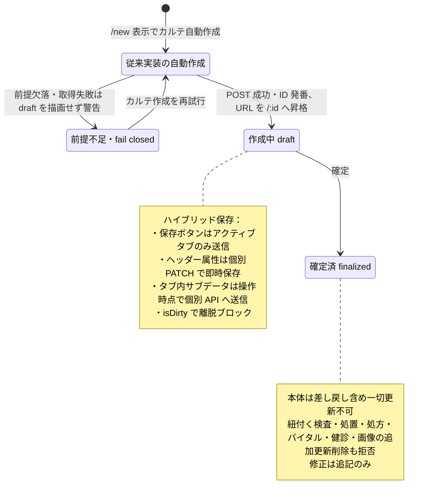

# カルテ登録・編集フロー詳細仕様 (Medical Record Lifecycle)

診断・バイタルの[2026-10-15追加2項目](pages/medical-record-form.md#medical-record-agreement-diagnosis-vitals-20261015)は画面正本へ接続する。第1・第2それぞれの複数診断と測定時刻付き最新値・同日の以前の測定履歴を追加しても、本書の自動保存／個別送信先、終了後通常編集、入力復元・以前の保存版／必要ログ・目的別保護は維持する。バイタル測定履歴は終了済みカルテのスタッフ診療履歴と別で、診療中も当該カルテの以前の測定を参照できる。

## 2026-10-18追加合意：同一カルテの同時編集禁止と強制取得

### FR-medical-records-single-editor：同じカルテの編集権とヘッダー表示

10/13議事録の「複数端末での編集ロックですが、ヘッダーとかでわかるようにするべき」と、2026-10-18 01:54:38 UTCの本人回答「編集を禁止します」（Sentinel_011d0b88cb348191a9fa3cb102f0f2a4）により、同一カルテを他端末で編集中の場合は同時編集を禁止し、その状態をカルテヘッダーに表示する。入力を止めず注意表示だけにする案は採用しない。旧Slackの排他ロック不在は当時の実装説明であり、この目標を満たす根拠ではない。

対象は同一カルテの編集であり、閲覧禁止や同じ患者の全カルテ一括ロック、他ペット・他医院・独立した会計全体の排他へ拡張しない。現行の医院・患者・スタッフ権限と各ownerの保存境界を維持し、認可外の編集者情報を公開しない。同一カルテの別タブ・別経路からの変更で同時編集禁止を迂回させず、どの画面／writeをこのカルテの編集として保護するかの技術対応表を設計する。同じユーザーの別端末も、ユーザー名が同じというだけで同時編集禁止を迂回させない。端末・セッションの具体識別は未選定。

通常編集・診療終了後の編集可と自動保存の既決は撤回しない。編集権を持ち他の既存条件も満たす端末では、従来hybridの自動／即時保存・タブ保存を維持する。編集禁止側を保存ボタン方式へ切り替えたり、その入力を勝手に他の編集へ混ぜたりしない。既存の版競合・結果不明照合・必要監査・元記録の履歴、医師確認と会計の同期／差異／専用訂正の条件も保持する。編集権を得たことだけで確定会計や他ownerの目的別保護を解除しない。

2026-10-18 01:55:32 UTCの本人回答「ただ、別の編集を強制して取得することは可能にしましょう」（Sentinel_077f6d111b6c81918d75a2cc20de8e5e）により、他端末が持つ同一カルテの編集権を強制取得できるようにする。これは同時に二つの編集権を認める例外ではなく、編集権を移す操作である。2026-10-18 02:12:40 UTCの本人回答「ok」（Sentinel_e0cb63decddc8191ab55ed7b83e973e1）により、既存の医院スコープと当該カルテの編集権限を満たすスタッフなら誰でも、確認メッセージを経て編集権を強制取得できる。管理者限定にしない。確認を取消した場合は取得せず、元の編集権と編集・保存状態をこの取消だけで変更しない。閲覧権限だけの利用者や認可外医院・カルテには許可しない。確認表示だけを安全性の根拠にせず、取得成立時にも現在の医院・対象カルテ・編集権限と編集権の状態を照合する。取得・通常解除・切断時停止・復帰の業務挙動は下記04:38:21 UTC承認で確定する。確認の具体文面や技術処理は未選定で、追加理由の必須化は採用していない。

2026-10-18 01:56:09 UTCの本人回答「yes」（Sentinel_cc6064527c60819191edc84fda086820）により、強制取得後は元端末の編集・保存を停止し、「別の端末に編集権が移りました」と表示する。元端末の未保存入力は消さず保持し、自動上書き保存しない。元端末で強制取得前に送信待ちになった保存や、切断中に残った遅延送信も、移転後に現在の編集へ無断で適用しない。ヘッダー表示・操作停止だけでなく、保存の受理境界でも編集権の移転を照合する。移転前に既に成立した保存は無断で取り消さず、既存の保存結果・現在版と区別して照合する。

再読み込み後の復元可能性と再取得後の最新内容比較・明示選択適用は下記承認で確定する。保持方式・保持期限・保管場所、比較・選択UIの技術方式は未選定である。権利を取り戻すだけで古い入力を自動再送・自動上書きしない。復元時の既存最新内容・元請求等への依存照合を含めて方式を設計し、今回の入力保持を版競合保護の免除にしない。

| 条件ID | 前提／操作 | 期待結果 | 根拠・検証状態 |
|:---|:---|:---|:---|
| AC-medical-records-single-editor-header | 端末Aが同一カルテを編集中に、認可された端末Bから同じカルテを編集しようとする | Bに他端末で編集中であることをヘッダー表示し、同時編集を許可しない。注意表示だけで書込み可能にはしない | 2026-10-18本人回答、取得方式は設計・未実施 |
| AC-medical-records-single-editor-read-scope | Aが編集中にBが認可範囲の同一カルテを閲覧し、同じ患者の別カルテや別患者を開く | 同時編集禁止を閲覧禁止や患者全カルテ一括ロックへ広げない。各対象の既存権限・独自保護を維持する | 採用範囲と既存scope。未実施 |
| AC-medical-records-single-editor-autosave | 編集権を持つ認可端末が通常カルテを編集・自動保存し、別タブ／端末から同時編集を試みる | 編集権側では既存hybrid保存・履歴を維持し、別経路や同じユーザー名を使って同時編集禁止を迂回しない。旧finalizedだけを理由に通常編集を禁止する規則は復活させない | 従来自動保存と新排他の併存。未実施 |
| AC-medical-records-single-editor-force-acquire | 別端末で編集中の同一カルテについて、既存の医院scopeと当該カルテ編集権限を満たすスタッフが確認後に編集権を強制取得する | 強制取得の経路があり、同時に二つの編集権を成立させない。管理者限定にせず、既存scope／当該カルテ編集権限と確認を満たす。確認の取消では取得せず、下記の承認済み移転後挙動を満たす | 01:55:32／02:12:40 UTC本人回答。技術方式等は未選定・未実施 |
| AC-medical-records-editor-transfer-stops-stale-save | Aの編集権をBが強制取得し、Aの送信待ち／切断後の遅延保存を到着させる | Aの編集・保存を停止し「別の端末に編集権が移りました」と表示する。Aの遅延保存でBの現在内容を上書きせず、移転前に成立した保存と未成立の入力を区別する | 01:56:09 UTC本人yes、権利保持中の既存自動保存は維持。未実施 |
| AC-medical-records-editor-transfer-keeps-draft | 強制取得により元端末Aの編集権を失わせ、未保存入力がある状態を確認する | 元端末の未保存入力を消さず保持し、自動保存・自動上書きしない。権利再取得だけを理由に保持入力を自動再送しない。再読み込み後も復元可能とし、再取得後は最新内容と比較して明示選択適用する。保持方式／期限／比較UIの技術設計は未選定と区別する | 本人yesと既存競合・入力保護。未実施 |
| AC-medical-records-force-acquire-editor-permission | 対象医院・カルテの編集権限を持つ一般スタッフ／管理者と、閲覧のみ／認可外の利用者から強制取得を試す | 管理者限定にせず編集権限保持者は確認を経て取得できる。閲覧のみ・認可外は取得できず、確認時から取得成立時までの権限／状態変化を確認表示だけで無視しない | 02:12:40 UTC本人okと既存認可。未実施 |
| AC-medical-records-force-acquire-confirm-cancel | 他端末編集中の同一カルテで、編集権限保持者が強制取得の確認メッセージを取消する | 編集権を取得せず、取消だけで元端末の編集・保存を停止したり、権利移動済み表示・入力消去を起こしたりしない。確認して取得が成立した場合には既承認の移転後停止・入力保持・遅延保存拒否を適用する | 本人確認付き取得と取消時非取得。未実施 |

### 04:38 UTC追加承認：閲覧・編集開始・離脱・切断・入力復元

2026-10-18 04:38:21 UTC、本人が質問 Sentinel_7ee3c7e894fc8191a14204b48e3fe079 に「ok」（回答 Sentinel_a52e29c839d08191b385801d23ca032a）と答えた次の3点を採用する。詳細提案全体の一括承認ではない。

1. カルテを開くだけなら閲覧で編集権を取得しない。「編集を開始」で編集権を取得し、同じカルテ内のタブ移動では維持する。この操作は編集権の取得であり、全項目を新たな保存ボタン待ちにはしない。
2. 別画面へ移る際は保存結果を確認して編集権を解放する。通信切断時は入力を保持して編集・送信を停止し、再接続時に現在の編集権と直前の保存結果を確認する。単なる無操作では解放しない。失敗・結果不明は成功とせず、既存の照合・再試行と入力保護を維持する。
3. 再読み込み後も未保存入力を復元可能にする。編集権を再取得した後、最新の保存内容と比較し、必要な入力を明示的に選んで適用する。自動上書きや自動破棄はしない。再取得だけで保持入力を自動再送しない。

既存の強制取得権限・確認と取消、旧端末の編集停止・保存受理時の失権照合・遅延保存拒否を維持する。移転前に成立した保存と未成立／結果不明の入力を区別する。現在版、患者・医院・編集権限、各ownerの保護を照合し、飼主原文・確定会計等の保護を解除しない。

具体API、端末／セッション識別、取得・解除の原子性、切断時の失効・回収方式、タイムアウト秒数、保持方式・保存場所・保持期間、比較選択UIは未選定。切断後一定時間での自動解放、追加の離脱選択肢、端末間の下書き共有、新しい理由必須化は今回選定していない。業務上の「単なる無操作では解放しない」を技術方式で撤回しない。

追加8ACは同じFR-medical-records-single-editorに属し、既存8ACと合わせ16AC。実装・実機検証は未実施。

| 条件ID | 前提／操作 | 期待結果 | 根拠・検証状態 |
|:---|:---|:---|:---|
| AC-medical-records-editor-view-no-acquire | 認可された同一カルテを開き閲覧する | 開くだけでは編集権を取得しない。閲覧権限だけで編集可能にしない | 04:38:21 UTC本人ok、文書条件・実機未実施 |
| AC-medical-records-editor-explicit-start | 当該カルテ編集権限を持つ端末で「編集を開始」を操作する | 編集権の取得成立後に編集できる。他端末保持中は既存の確認付き強制取得条件を満たし、同時取得を認めない | 04:38:21 UTC本人ok、文書条件・実機未実施 |
| AC-medical-records-editor-tab-and-idle | 編集権を持ち同じカルテのタブを移動し、単に無操作となる | 同一カルテのタブ移動と単なる無操作では編集権を解放しない。既存hybrid保存を維持する | 04:38:21 UTC本人ok、文書条件・実機未実施 |
| AC-medical-records-editor-leave-result | 編集権を持つカルテから別画面へ移動する | 保存結果を確認してから編集権を解放する。失敗・結果不明を成功表示せず、入力保持と既存の結果照合を行う | 04:38:21 UTC本人ok、文書条件・実機未実施 |
| AC-medical-records-editor-disconnect-stop | 未保存入力又は送信中操作のある端末が通信切断する | 入力を保持し編集・送信を停止する。切断中の遅延送信や旧端末の入力を無断適用しない | 04:38:21 UTC本人ok、文書条件・実機未実施 |
| AC-medical-records-editor-reconnect-check | 通信切断した端末が再接続する | 現在の編集権と直前の保存結果を照合する。再接続だけで再送・編集再開せず、失権時は既存の停止・移転表示を維持する | 04:38:21 UTC本人ok、文書条件・実機未実施 |
| AC-medical-records-editor-reload-recover | 未保存入力を保持するカルテを再読み込みする | 未保存入力を復元可能とし、現在の保存内容と区別する。再読み込みだけで自動上書き又は自動破棄しない | 04:38:21 UTC本人ok、文書条件・実機未実施 |
| AC-medical-records-editor-reacquire-select | 未保存入力を保持した端末が編集権を再取得する | 最新の保存内容と比較し、必要な入力を明示的に選んで適用する。取得だけで自動再送・一括上書き・破棄せず、既存版競合・owner保護を維持する | 04:38:21 UTC本人ok、文書条件・実機未実施 |

### 12:53 UTC追加決定：logout後も本人専用下書きを保持

質問 Sentinel_78cd352c4c14819196c27eac9109ed6a（2026-10-18 12:44 UTC、分精度）への本人回答 Sentinel_247ecbc4fd888191bc3293478f7f7c4b（同日12:53 UTC、分精度）「1 A／2 A／3 A」の第1項Aを採用する。ログアウト後も未保存入力を本人専用の下書きとして保持し、同じ本人が再ログインした場合だけ回収する。他のスタッフには表示・引渡ししない。logout時の破棄確認・了承消去という第1項Bは採用しない。

回収時は現在の認証主体・医院／患者／カルテ・閲覧編集権限を再照合し、元の対象だけへ結び付ける。別患者や別主体へ回収しない。回収は保存・編集権取得の成功ではなく、既決の保存結果照会・編集権再取得・最新比較・明示選択適用へ接続し、自動保存／上書き／破棄を起動しない。同じ名前・退職者の再作成accountを同じ本人と推測しない。

保持期限・自動破棄・端末間共有は今回追加しない。具体的保存場所・保護方式・quota時の回復等は技術設計と実装検証へ。これまでの16ACに対する追加3ACであり、実装済みを意味しない。

| 条件ID | 前提／操作 | 期待結果 | 根拠・検証状態 |
|:---|:---|:---|:---|
| AC-medical-records-draft-logout-retain | 未保存入力を持つ本人がログアウトし、同じ本人が再ログインする | 本人専用下書きを保持・回収でき、logoutで破棄確認や自動消去を追加しない | 12:53 UTC第1項A、未実施 |
| AC-medical-records-draft-same-actor-recovery | 別staff又は同名の別accountでログインする | 他者の下書きを表示／引渡ししない。同じ本人への現在認可付き回収と区別 | 同回答・既存認可、未実施 |
| AC-medical-records-draft-context-isolation | 同じ本人が別医院／患者／カルテへ切り替え、元下書きを回収する | 元対象と現在権限を照合し、別患者へ適用しない。保存不明・失権は先に照会し、最新比較・明示選択なしに再送しない | 同回答・既存復元契約、未実施 |

## 2026-10-15最新合意：通常編集・自動保存維持・タブクリア／複製取消

初回質問 Sentinel_9a29cd61be04819188b76ade8dddfafd と回答 Sentinel_e99d06bd6f0c8191b7bd18fd34d562f9 で、通常カルテは診療終了後も通常編集でき、画面の終了操作で会計待ちへ進むことを合意した。その後の回答 Sentinel_ffce3491042481918ffb701f9d84547b「やはり自動保存は残しましょう 入力内容クリアだけ入れましょう、あと履歴から複製した際の取り消しも」で、保存ボタン方式への変更を撤回した。

クリア／取消の基準は、質問 Sentinel_be87b5fa73088191b11da2e166da6659 への回答 Sentinel_6583182163e881919433829835fa137e「ok」により「そのタブを開いた時点」「複製直前」と確定した。以前の「未保存変更を最後の保存値へ戻す」はこの最新基準に置き換える。スタッフ向け診療履歴は質問 Sentinel_6c374f62ed6c8191bc8da84631b884bd／回答 Sentinel_8199a97373348191a766a6af966812ff「ok」により診療終了したカルテを対象とし、診療中の途中保存は載せない。未実施プラン警告は質問 Sentinel_39c5943da8988191bfc956c465d8d931／回答 Sentinel_f9547be22d788191aba3e379a3b77e35「ok」により診療終了時に表示し、確認すれば終了可能とする。

最新合意は通常カルテの医師確定ボタン・確定後だけの訂正入口を置き換える。以前の保存済み版・必要監査・患者照合・薬量安全条件・確定済み会計の保護は保持する。D05/D06専用記録、D07検査結果自体の確定／訂正、D11見積の[提示済み原本保護](../estimates/business-rules.md#estimate-price-presentation-agreement-20261015)（返答待ち含む。未提示下書きは対象外）、会計・在庫の実行は各ownerの正本を維持する。旧FR／AC・anchorは追跡用に保持する。API／DB／コード／設定は未変更、実装・実機受入は未確認。

| 以前の契約 | 最新の扱い |
|:---|:---|
| 医師の明示確定・finalized後の通常編集禁止 | 通常カルテは診療終了後も通常編集可能。確定ボタンを設けず、保存履歴を保持 |
| 確定後はaddendumだけ | 通常本文修正の唯一の入口という制限を置換。以前の保存版・追記・訂正履歴と目的別の確認は保持 |
| 明示保存へ変更する途中提案 | 撤回。既存hybridの自動／即時保存と既存タブ保存を維持。全入力を新たな一括保存待ちにしない |
| 入力内容クリア | そのタブを開いた時点へ戻す。最後の自動保存値へ戻すこととは異なる |
| 履歴から複製した操作の取消 | 対象の複製直前へ戻す。複製元や他操作・他者の変更を巻き戻さない |
| 未完了プランの確定前警告 | 自動保存時でなく診療終了時に警告。確認後は未完了でも終了可、全項目完了へ変換しない |
| スタッフ向け診療履歴 | 医師確定でなく診療終了を掲載条件とする。診療中の途中保存は非掲載 |

### FR-medical-records-normal-edit-after-end — 診療終了後も通常編集

操作権限と医院／患者scopeを満たすスタッフは、診療終了後も同じ通常カルテを通常画面で編集できる。カルテ確定ボタンをなくし、終了済み又は旧finalizedであることだけを通常編集不可・addendum専用とする目標は採用しない。新しい医師確認の必須操作を通常保存へ移植しない。薬量評価不能の医師確認、患者取り違えの必要内容転記、予約側の記録確認訂正など目的別の既決確認は残す。

以前の保存済み内容と変更を追跡できる版・実編集者・時刻・必要履歴を保持し、既存addendum・訂正関係・確定時参照版を破壊しない。通常画面から現在の記録を更新することと、過去の保存版を消去することを区別する。旧finalizedの履歴付き通常編集へのadapter／移行は技術設計であり、全レコードのdraft化・確定履歴削除を選定しない。旧finalizedに由来するロックは未追従差分として扱う。同一カルテの端末間編集権は[2026-10-18追加合意](#medical-record-edit-exclusivity-20261018)で別に定義し、いずれも実装・利用開始済みとしない。

### FR-medical-records-preserve-autosave — 自動保存を維持

保存ボタン方式への変更は取り下げ、既存の自動／即時保存を残す。[保存§2](#hybrid-sync)のアクティブタブ保存・ヘッダー即時PATCH・子リソース個別保存は現行の保存境界として保持する。「自動保存を残す」は既に明示保存のある問診等を未承認で全自動化したり、全タブを一括保存したりする追加許可ではない。

自動保存の成功・未送信・送信中・失敗・版競合・結果不明を区別し、成功した範囲だけを保存済みと表示する。失敗した入力を保持し、他者変更を無断で上書きしない。結果不明なら同じ操作を照合して重複保存／複製を防ぐ。自動保存で既に永続化された変更も、下記のタブクリア／複製取消が対象にできるため、「未保存だけをローカルに消す」で完了したことにしない。

### FR-medical-records-clear-tab-open-state — そのタブを開いた時点へ戻す

「入力内容クリア」は操作したタブの入力を、そのタブを開いた時点の状態へ戻す。保存済み値があったタブならその時点の値、空だったタブならその時点の空状態を基準にする。直前の自動保存済み値や毎回の再取得値で基準を差し替えない。同じ医院・患者・記録・タブ・開いた時点の版を識別し、他タブの入力・未保存変更・履歴は変更しない。タブ外の患者識別コンテキストや予約状態をクリアしない。

未送信の変更だけならローカル復帰、自動保存済みの対象があるなら現在版と元の操作を照合した復元として扱い、成功後に再読込しても基準状態であることを確認する。以前の保存版・編集／復元履歴・既存関連は保持し、物理削除や監査廃棄で戻さない。保存済み明細・画像の扱いはC05の論理状態とownerの保護に従い、objectや元記録を無条件に削除しない。

そのタブを開いてからの自分の操作と、他者の編集、関連ownerの確定、後続の実施・会計・在庫等の作用を照合する。他者編集又は後続作用を検出した場合は、それらを無警告で巻き戻さない。影響と復元できない対象を表示し、必要な確認／owner訂正へ渡す。実入金・返金・在庫増減・検査確定・診療終了・既送信通知をクリアの副作用として取り消さない。対象版が不明、保存中又は保存結果不明なら照合までクリア成功を返さず、失敗時は現在表示と基準を保持して再試行を可能にする。

### FR-medical-records-history-copy-undo — 履歴複製を複製直前へ戻す

履歴から問診・治療明細等を複製した操作には取り消しを設け、対象の複製直前の状態へ戻せる。複製元は変更しない。複製対象・直前の値／版・実際に成功した対象IDと操作結果を対応付け、他タブや対象外の入力、別の複製・手編集・他者変更をまとめて巻き戻さない。

問診のローカル変更と、治療明細の逐次POST等で自動保存済みの変更を区別する。途中成功ならその複製の既知成功分を対象にし、未送信・失敗・結果不明を成功分と混同しない。不明な送信は元操作を照合し、取消の再送で二重削除／二重復元・新しい複製を生まない。取消そのものの前後・actor・時刻・元複製との対応を必要履歴へ残す。

複製後の対象が手編集済み、他者更新済み又はowner処理に使われた場合は、その変更を無警告で消さず競合・影響を表示する。取消だけで在庫・請求・入金・検査確定等を逆実行しない。安全に照合できない対象は停止し、取消済みと表示しない。タブクリアの基準は「タブを開いた時点」、複製取消の基準は「対象複製の直前」であり、同じUndoとして混用しない。

### FR-medical-records-screen-consultation-end — 通常カルテ画面の診療終了

通常カルテ画面に明示的な終了操作を設け、開いている記録に対応する同じ予約を診療中から会計待ちへ進める。予約／患者／医院と記録リンクを照合し、予約ownerの既存認可・終了可能状態・二重操作／失敗保護に従う。未実施・後日予定の治療プランがあれば終了時に警告し、操作権限のあるスタッフが確認すれば未完了でも終了できる。通常の終了を新たに医師限定へ変更しない。

警告取消は終了を確定せず、入力とプランを保持する。必要なプラン状態・依存の取得失敗／不明を「完了」にせず再確認する。確認後に依存が変われば最新状態を再確認し、古い確認で終了しない。自動保存時はこの未実施警告を出さず、警告確認・診療終了でプランを実施済みに変換しない。

終了だけで記録・会計・入金を確定せず、未送信入力や結果不明の保存を成功扱いにしない。画面を開く／閉じるだけでは終了しない。会計待ちカードから同じ既存カルテを開け、新規作成・複製・診療再開始を発火しない。リンク不明・読込失敗は理由表示と再照合へ渡し、別記録を生成しない。トリミングの開始・終了／専用記録導線はD01/D02/D06の正本で、通常カルテへ変換しない。

### FR-medical-records-ended-record-history — 診療終了したカルテを履歴へ

スタッフ向けの診療履歴は、医師が確定したことではなく診療終了した通常カルテを表示対象とする。診療中の途中保存を履歴へ載せず、自動保存成功・入金・会計確定を診療終了の代用にしない。終了後の通常編集も保存版・変更履歴を識別できるようにし、古い確定記録だけへ表示対象を固定しない。

受付／予約ownerの終了状態と同じ記録リンクを参照する。終了取消で診療中へ戻った対象は診療中の途中保存を履歴掲載しない条件に従い、履歴の保存事実を削除する意味にはしない。終了状態／記録関連が不明なら掲載対象を推測しない。過去診療の専用入力や移行記録に不足する終了根拠を、架空の当日受付・終了やfinalizedの単純変換で補完しない。スタッフ履歴の変更を飼主への公開許可へ広げない。

### 追加受入条件（実装・実機未確認）

| ID | Given | When | Then | 正本 |
|:---|:---|:---|:---|:---|
| AC-medical-records-normal-edit-after-end | 診療終了後の同じ通常カルテ、編集権限あり | 通常編集 | 旧finalizedだけで拒否せず保存でき、以前の版・追記・実編集者履歴を保持 | [FR](#requirement-fr-medical-records-normal-edit-after-end) |
| AC-medical-records-no-finalize-button | 通常カルテを開く | 操作群を確認 | カルテ確定ボタンはなく、保存状態・クリア・複製取消・診療終了を区別 | [FR](#requirement-fr-medical-records-normal-edit-after-end) |
| AC-medical-records-autosave-preserved | 既存の即時保存対象を編集 | 保存処理が走る | 従来の送信境界を維持し、新しい保存ボタン待ち／全タブ一括保存にしない | [FR](#requirement-fr-medical-records-preserve-autosave) |
| AC-medical-records-clear-tab-open | タブ開始時に保存済み値があり編集が自動保存済み | 入力内容クリア | 最後の自動保存値でなくタブ開始時の値へ戻り、再読込でも一致。前後履歴を保持 | [FR](#requirement-fr-medical-records-clear-tab-open-state) |
| AC-medical-records-clear-empty-open | タブ開始時は空で、その後入力・保存した | 入力内容クリア | 開いた時の空状態へ戻し、識別コンテキスト・元版・監査を保持。物理削除なし | [FR](#requirement-fr-medical-records-clear-tab-open-state) |
| AC-medical-records-clear-other-tabs | 別タブにも保存済み／未保存変更あり | 現タブをクリア | 他タブは不変 | [FR](#requirement-fr-medical-records-clear-tab-open-state) |
| AC-medical-records-clear-conflict | タブ開始後に他者が同対象を変更 | クリア | 無警告で他者版を上書きせず競合と対象を示し、未解消を成功表示しない | [FR](#requirement-fr-medical-records-clear-tab-open-state) |
| AC-medical-records-clear-pending-unknown | 対象の保存が送信中／結果不明 | クリア | 元操作を照合し遅延応答との逆転を防ぐ。未照合の復元を成功表示しない | [FR](#requirement-fr-medical-records-clear-tab-open-state) |
| AC-medical-records-copy-undo-before-copy | 複製が入力／保存へ適用済み | その複製を取り消す | 複製直前へ戻し元記録・対象外変更は不変、取消履歴を保持 | [FR](#requirement-fr-medical-records-history-copy-undo) |
| AC-medical-records-copy-undo-partial | 複製の一部成功・失敗／未送信／結果不明あり | 複製取消／再試行 | 同じ複製の成功分と元状態を照合し二重取消・成功分再複製なし | [FR](#requirement-fr-medical-records-history-copy-undo) |
| AC-medical-records-copy-undo-later-edit | 複製後に対象の手編集／他者変更／別owner利用あり | 複製取消 | 後続変更・副作用を無警告で消さず対象・影響を表示し、必要なowner訂正へ渡す | [FR](#requirement-fr-medical-records-history-copy-undo) |
| AC-medical-records-revert-keeps-owner-effects | 確定請求・入金・在庫・検査確定等が関連 | クリア／複製取消 | 金銭・在庫・検査等の実行を自動で逆実行せず、元版・履歴を保持 | [クリア](#requirement-fr-medical-records-clear-tab-open-state)・[取消](#requirement-fr-medical-records-history-copy-undo) |
| AC-medical-records-revert-failure-keeps-state | 復元の保存／必須監査が失敗又は結果不明 | 結果表示／再試行 | 現在入力・復元基準を保持し未完了を成功にせず、同じ操作を照合 | [クリア](#requirement-fr-medical-records-clear-tab-open-state)・[取消](#requirement-fr-medical-records-history-copy-undo) |
| AC-medical-records-screen-end-waiting | 同じ予約・通常カルテで診療中 | カルテ画面から終了 | 同じ予約が会計待ちへ進み、記録・会計・入金を確定せず新規記録なし | [FR](#requirement-fr-medical-records-screen-consultation-end) |
| AC-medical-records-waiting-opens-existing | 会計待ちのカードに既存recordリンクあり | カードから開く | 同じ既存カルテを開き、作成／複製／診療再開始なし | [FR](#requirement-fr-medical-records-screen-consultation-end) |
| AC-medical-records-ended-history-only | 診療中の途中保存と診療終了記録がある | スタッフ向け履歴を表示 | 終了記録を対象とし、途中保存は載せない。finalizedや入金で代用しない | [FR](#requirement-fr-medical-records-ended-record-history) |
| AC-medical-records-ended-history-edit | 履歴対象の終了済み通常カルテ | 終了後に通常編集して再表示 | 対象は終了条件で維持し、保存版・変更履歴を識別可能にする | [FR](#requirement-fr-medical-records-ended-record-history) |
| AC-medical-records-no-plan-warning-on-autosave | 未実施／後日予定のプランあり | 自動保存 | 診療終了時の未実施警告を自動保存ごとに出さず、状態を完了へ変えない | [FR](#requirement-fr-medical-records-screen-consultation-end) |

[17:17合意の診療前日付訂正](../reservations/pages/reservation-management.md#requirement-fr-reservations-preconsultation-date-record-correction)では、未記入カルテは確認して予約日へ合わせ、記入済みなら通常の日付変更を停止して内容確認の訂正へ渡す。以下の作成後日付固定・直接PATCH拒否は現行実装／通常更新の参照で、この合意の未記入・診療前の確認付き訂正を実装済みとする根拠ではない。通常カルテの通常編集は[2026-10-15最新合意](#medical-record-agreement-autosave-20261015)へ置換する。保存§2の自動／即時保存と予約日訂正・患者関連・保存済み履歴の保護は維持する。

17:23 JSTの[LINE予約6点合意](../../line/reservation-spec.md#line-agreement-1723)へ従う。公開された診療・トリミング・ホテルは予約対象、入院は医院相談。ホテルには医師指名・医師シフト・通常予約の同日制約を適用しない。受付制限・入力保持・受付前取消・必要設定不足の扱いと受入条件はLINE正本を参照する。ホテル受入基準は17:35合意の医院別同時宿泊頭数・全宿泊期間判定で、実装・実機受入は未確認。

17:17 JSTの院内予約8点一括合意は[予約入口の決定一覧](../reservations/README.md#internal-reservation-batch-1717)を参照する。誤取消／誤終了訂正、未終了予約保護、診療前の日付・カルテ整合、マスタ利用・名称履歴、休診日予約／日跨ぎ勤務、患者照合、ホテル担当時点／入院記録失敗の各正本と受入条件へ従う。LINE受付条件は17:23合意（ホテル受入基準は17:35合意、計算・保存方式は設計）、実装・実機受入は未確認。

| 管理項目 | 記載 |
|:---|:---|
| 文書ID・種別 | lifecycle.medical-records／保存契約 |
| 決定状態 | 2026-10-14初回5項目は部分合意。通常編集・自動保存維持・クリア／複製取消・終了と履歴掲載は2026-10-15最新合意を優先。初回合意の非変更部分は維持。対象外の既存決定状態を保持し、カルテ全体完了／実装受入にしない |
| 実装状態 | 合意と現実装は別。main ec4f7146a の必要箇所を静的照合し、差分は予約正本の残差一覧へ記録。実装変更なし |
| 実機検証状態 | 今回未実施。過去の記録と今回の文書確認を分ける |
| 文書確認日 | 2026-10-14（合意・参照・語彙の確認。実機受入日ではない） |

## 目的・対象範囲

| シナリオ | 業務上の価値 | 優先度・理由 |
|:---|:---|:---|
| 診療終了後も通常編集し履歴を保持する | 保存版・実編集者を追跡しながら修正できる | 2026-10-15最新合意。優先順位の追加判定なし |

### 概要

本システムにおける電子カルテ（Medical Record）は、臨床的な真正性と多種多様なサブリソースの整合性を維持するため、独自のライフサイクルと保存ロジック（ハイブリッド同期）を採用しています。

## 担当者・権限・前提

担当医以外の入力者・目的別の医師確認と編集者ログは[初回合意](#requirement-fr-medical-records-authorized-editor-audit)へ従う。実grantと医師判定の対応は要確認。保存・復元・目的別訂正の操作権限は本書API参照表と [画面の権限前提](pages/medical-record-form.md#access-preconditions)、状態による保護は下記の既存契約を参照する。

## 契機・入口・出口

入力・保存・タブクリア・履歴複製取消・画面からの診療終了・目的別訂正が契機。作成後のURL昇格は下記「登録と ID 確定のプロセス」。入口・出口の画面操作は [カルテ入力画面](pages/medical-record-form.md#navigation)が正本。

## 状態遷移・引継ぎデータ

下表は従来実装参照。新規画面表示だけの通常作成は最新受付接続へ変更する。医師確定／finalized遷移は現在の目標ではなく、旧状態と移行対象の説明。目的別に残る医師確認は免除しない。

| 要件ID | 定義の所在 | 決定根拠 |
|:---|:---|:---|
| FR-medical-records-finalized-addendum-only | [旧IDの置換先／実装差](#requirement-fr-medical-records-finalized-addendum-only) | 2026-10-15合意で通常編集へ置換。旧保存版・追記履歴は保持 |

| 担当者 | 前提 | 契機 | 前状態 | 後状態 | 引継ぎデータ | 異常系／根拠 |
|:---|:---|:---|:---|:---|:---|:---|
| 操作権限を持つ利用者（職種は要確認） | appointment・権限・対象状態 | 新規画面表示 | 未作成 | draft・ID確定 | appointment_id・カルテID | 下記「自動作成」「ID の発番と URL 昇格」 |
| 操作権限を持つ利用者 | 保存済み・会計確認等 | 確定 | draft | finalized | 確定状態・訂正追記の文脈 | 下記「ステータス管理と保護」 |

## カルテ初回5項目の合意（2026-10-14）

質問 Sentinel_c078319f28a48191bdce52f618e264ab と回答 Sentinel_1b70a4b2675c8191814931fd13762b54 が根拠。1は「担当医じゃなくても入力は可能。ただ誰が編集したのかのログは必要」、2は「必須なのは特にはないが、治療プランが全部終わってない場合は警告する必要あり」、3・4は「ok」、5は「手入力　臨床責任者はいません、医師です」。以下は通常診療カルテの部分合意で、実装・実機成立は未確認。語彙は[カルテ概念](../../ontology/medical-records.md)、実現方式と現行差分は[部分技術設計](../../../design/domains/medical-records/technical-spec.md)へ参照する。

### 1. 担当医以外の入力と編集者ログ

操作権限のあるスタッフは担当医本人でなくても入力・編集できる。既存のview/create/edit/delete等の操作権限・医院scope・保存済み履歴を保持し、担当医以外への入力許可を全スタッフへの無条件公開へ広げない。臨床内容の目的別確認・記録確認訂正の確認は医院が認めた医師が行い、担当医以外の医師も代行できる。編集者・確認医師・カルテ担当医・予約指名医師は別に保持し、編集だけで担当を自動交代しない。新たな「臨床責任者」職種・役割・grantは作らない。

成功した編集には誰が編集したか分かるログを必須とする。本体・ヘッダー・問診・治療プラン・治療／処方・バイタル・関連子入力・追記・許可された削除／過去入力を含め、actorを認証から記録し担当医IDで代用しない。記録項目と保存結果の対応・必要監査の保存方式は技術設計で、ログ未保存を「履歴あり」と扱わない。現行の通常更新best-effort監査だけを本合意の充足証拠にしない。

### 2. 明示確定・記載必須なし・治療プラン未完了警告

旧IDと見出しを参照互換のため保持する。2026-10-15に医師確定ボタン・確定後の通常編集禁止は[通常編集](#requirement-fr-medical-records-normal-edit-after-end)へ置換された。臨床欄の新しい必須項目は追加しない。通常保存を会計医師確認済み条件や新しい医師確定の代用にしない。

未実施・後日予定のプランは自動保存時ではなく[診療終了時](#requirement-fr-medical-records-screen-consultation-end)に警告する。操作権限を持つスタッフが確認すれば未完了でも終了でき、医師限定や全プラン実施必須へ変えない。警告取消は終了せず入力とプランを保持する。取得失敗／不明を全部完了と表示せず再確認する。警告確認・保存・終了でプランを実施済みに更新しない。中止理由・実記録者／時刻と目的別の実施取消は保持する。

### 3. 空の誤作成削除・記入済み訂正・患者取り違え

空の誤作成で、請求等の関連データがない場合だけ削除を認める。draftという状態だけでは削除可と判定しない。臨床入力・見積／請求・検査・画像等の依存を含め空・関連なしを確認し、判定不能なら削除しない。受付予約リンクの存在だけを空判定と同義にせず、診療中の予約リンク保護・同一予約／記録保持等の既存契約も検査する。通常予約取消からの自動削除は依然禁止。

削除は現行の論理削除・履歴／関連保持を踏まえた仕様で、物理削除・ログ廃棄・無条件復元の新許可ではない。復元業務は[訂正・例外4項目](#medical-record-agreement-correction-four)で合意。専用UI・APIと現行実態の照合は残件。削除対象が記入済みなら削除せず履歴を残して訂正する。通常本文修正は最新の通常編集へ、患者取り違え等は目的別の専用手順へ渡す。既存追記履歴は保持する。患者取り違えは専用の訂正手順へ渡し、通常ヘッダー編集で患者を付け替えたり、記録を削除／再作成したりしない。患者取り違えは追加合意の必要内容転記・元／先対応に従う。具体的UI／保存対応と会計の返金／締め後手順は残件。理由・提案→医師確認→予約・記録・請求の整合確認という既合意を維持する。

### 4. 通常の受付接続と過去未登録診療の専用入力

通常は受付に紐づく同じカルテを開く。受付がない場合は受付登録へ案内する。記録一覧／別画面を開いたことだけで予約と診療中状態を自動作成しない。受付時の通常カルテ同時成功・既存ID再利用・準備／読込成功後の明示開始を維持する。予約変更は予約管理の入口へ渡す。

過去の未登録診療は、理由と医師確認を伴う専用の追加入力として扱う。実際の診療日・登録した時刻・入力者・確認医師を区別し、当日の受付／診療開始・予定時刻を偽装しない。既存記録の訂正・確定済みへのaddendumとは別の目的で、既存記録があるときの重複防止・患者確認・請求整合を守る。当日カードなし・自動課金なしは追加合意。専用UI・保存方式と全ownerの具体的対応は設計残件で、日数制限を推測して追加しない。移行例外の未紐付け記録を通常の受付なし作成の代用にしない。トリミング・入院／ホテルの専用記録本文・作成契約を本合意へ統合しない。

### 5. 評価不能時の医師確認・理由付き手入力

体重・動物種・薬量パラメータ等の不足で評価できない場合は、医師が確認し理由を記録して手入力できる。「評価不能」を表示し、安全域内／チェック済み／上限内と表示しない。確認医師・不足情報／評価不能理由・手入力値・手入力理由と編集者の対応を履歴へ残す。パラメータ取得エラーを単なる未設定／安全判定へ置換しない。認可・医院／患者／薬剤照合や必要取得依存の失敗、既存のspecies不一致等のfail-closedは維持し、通信失敗を手入力許可の根拠にしない。

これは評価不能時の手入力許可で、評価可能な絶対上限超過を理由や確認ダイアログで解除する許可ではない。評価可能な上限超過の拒否・下限未満／推奨値逸脱の理由条件は継承する。情報が変われば最新版で再評価し、評価可能な超過へ変わった値を旧確認で保存しない。対象薬・動物種・値・範囲・単位・出典の承認は医師が行う。#261の別工程は保持し、今回薬量数値・対象一覧を決めず、汎用「ok」やマスタ入力／Issue Closedを臨床数値承認の代用にしない。

入力まわりの追加4FR／15ACは[画面の合意正本](pages/medical-record-form.md#medical-record-agreement-input-four)。履歴複写とtemplate適用は問診ローカル入力／既存の治療個別保存へ接続し、保存§2を変更しない。診療マスタの当時内容保持・プラン状態を、全タブ一括保存や自動確定・自動課金へ読み替えない。

### 1. 登録と ID 確定のプロセス

2026-10-13の途中合意: 診察予約に連携する通常カルテの作成時点と受付の保存境界は[横断フロー](../../workflows/reservation-to-record-flow.md#requirement-fr-reservations-checkin-record-atomicity)が正本。予約時作成を行わず、受付時に同時成功とする。予約取消で既存カルテを自動削除しない契約は[予約正本](../reservations/pages/reservation-management.md#requirement-fr-reservations-cancel-history)。カルテから予約を変更しない。専用記録内部・一覧shortcutの経路整合は設計／実装検証として分ける。

#### 1.1 自動作成 (Auto Create)

**以下は従来の画面表示時自動作成・ID確定の実装参照**。診察予約の受付時作成へ追従済みではなく、この経路で予約時の通常カルテ作成を認める新たな合意ではない。受付後の既存カルテ再利用・未作成時作成／失敗時開始未確定は合意済み。従来の画面表示時作成経路との整合は実装設計・検証。

新規作成画面 (`/medical-records/new?petId=xxx`) に遷移すると、ページ表示と同時に `useMedicalRecordAutoCreate` がカルテを自動作成します（`POST /v1/medical-records`、`status: "draft"`）。当日業務の既定経路は必ず `appointment_id` を解決する（同日の未完了な一般診療予約を再利用し、なければ一般診療予約を自動作成）。同一 appointment の未削除通常カルテは最大 1 件。不変条件の正本は [reservation-to-record-flow.md](../../workflows/reservation-to-record-flow.md) §5 / [ADR-006](../../../architecture/adr/006-backend-domain-package-boundaries.md)。会計レコードはこの自動作成では作らない。（追記 2026-10-07 監査: 旧参照「§5.5」は存在しない節番号のため §5 に修正）

#### 1.2 ID の発番と URL 昇格

自動作成がバックエンドで成功した時点で、サーバー側で `medical_records.id` が発番されます。
- **作成前の fail-closed 表示**: `/new` で作成済み ID がない間は保存ボタンを表示しない。一般診療の予約区分など必須前提が欠落・取得失敗した場合は空の draft を描画せず、appointment phase の警告と「カルテ作成を再試行する」を表示する。前提が有効になるまで appointment／カルテの write は行わない。
- **URL 置換**: 作成成功と同時に、フロントエンドは `replace` ナビゲーションを実行し、ブラウザの URL を `/medical-records/:id` へ昇格させます。これにより、以後の保存が同一レコードに対して継続されます。

### 3. ステータス管理と保護

カルテには以下の 2 つの主要なフェーズが存在します。下の図は従来/new表示自動作成の実装参照で、最新の通常受付接続は初回合意節、通常編集・自動保存維持は2026-10-15最新合意が正本。

#### 3.1 作成中 (Draft)

- 作成中の入力・修正は[初回合意の担当医以外の入力・編集ログ](#requirement-fr-medical-records-authorized-editor-audit)へ従う。操作grant・医院scope・既存関連保護を保持する。
- 会計は別リソース。自動作成では billing を作らない。会計(医師確認)タブまたは会計画面から別経路で作成する。

#### 3.2 確定済 (Finalized)

旧ID／anchorを保持する。以下のロック・追記限定と図は現行実装参照で、通常カルテの目標ではない。[最新合意](#requirement-fr-medical-records-normal-edit-after-end)は履歴を保持した通常編集へ置換する。旧finalizedの元版・既存追記を削除しない移行が必要であり、APIのunfinalizeを新設したことにはしない。

- 臨床記録としての真正性を担保するため、**編集操作が物理的にロック**されます。
- **ロックの波及**: 確定されたカルテに紐付く「検査結果」「処置明細」「処方」「バイタル」「健診記録」「カルテ画像」への追加・更新・削除も、バックエンドで拒否されます（健診タブは UI 上も読み取り専用に切り替わります）。
- **修正**: 確定済カルテ本体は差し戻しを含め一切更新できません（バックエンドが拒否）。修正が必要な場合は「追記」（`MedicalRecordAddenda`、`POST /v1/medical-records/:id/addenda`）で訂正内容を追記します。

## 異常系・保存・取消

### 2. ハイブリッド保存ロジック (Hybrid Sync)

2026-10-15の[自動保存維持](#requirement-fr-medical-records-preserve-autosave)により、以下の保存ルーティングを維持する。途中提案の「医療記録本文を新しい保存ボタンまで永続化しない」は撤回済み。[タブクリア](#requirement-fr-medical-records-clear-tab-open-state)と[複製取消](#requirement-fr-medical-records-history-copy-undo)は自動保存済みの変更も基準版へ復元する追加操作であり、ローカルdirtyの消去だけで代用しない。

> **追記（2026-10-07 監査）**: 本節をカルテ保存ルーティング（メイン保存の送信先切替・ヘッダー属性の即時保存・タブ別サブデータの即時保存）の契約本文の**正本**とする。[medical-record-form.md §2.2](pages/medical-record-form.md) は本画面固有の操作仕様と正本参照に簡約済み。ルーティング契約の変更は本節のみを更新する。

問診は2026-10-17決定で治療プランへ統合する。カルテ本体とサブデータの既存個別保存先は維持するが、統合画面の保存単位は設計で接続する。以下の問診／診察タブ名・Tab番号は統合前の保存ルーティング参照であり、旧9タブの画面を目標として維持する意味ではない。飼主事前問診の原文は予約・ペット単位の別保存とし、スタッフ保存・クリア・複写へ含めない。

1.  **メイン保存（アクティブタブ単位）**:
    - 「保存」ボタン（React 19 の `useActionState`）はアクティブタブの内容のみを保存します。問診タブは `PATCH /v1/medical-records/:id/inquiries`（主訴・主訴区分・治療方針）、診察/治療プランタブは `PATCH /v1/medical-records/:id/clinical-plan`（診断・治療方針）を送信します。EMR-308: カルテの「次回来院推奨日」フィールドは撤廃され、カルテ本体への追加 PATCH は行われません。
    - 担当医、来院種別、診療日は、ヘッダーでの変更と同時に個別 `PATCH /v1/medical-records/:id` で即時保存されます（保存ボタンを経由しません）。来院種別の成功後は詳細キャッシュを invalidate する。appointment 紐付き通常カルテの `date` は予約開始の JST 日付に固定され、変更と `appointment_id` 再紐付けは BE Conflict。未紐付け（移行例外）のみ date PATCH が成功する。EMR-308: ヘッダーの「次回予定」はカルテ PATCH ではなく `PUT/DELETE /v1/reservations/pets/:petId/next-visit-intent` でペットの tentative appointment（`status='tentative'`、`intended_date`）を upsert/削除します。権限・拠点・連続操作の write 契約は [reservation-to-record-flow.md](../../workflows/reservation-to-record-flow.md) §2.3 を正本とします。
2.  **タブ別サブデータの即時保存**:
    - メイン保存の成否とは独立して、各タブ内の操作（追加・編集・削除）が発生した時点で即座に個別 API へ送信されます（メイン保存完了を待つゲート処理ではありません）。
    - **治療 (Tab 3)**: 項目の追加・更新・削除はそれぞれ `POST`/`PATCH`/`DELETE /v1/medical-records/:id/treatments(/:treatmentId)`。ドラッグ&ドロップでの並び替えのみ `PUT /v1/medical-records/:id/treatments` で一括更新。
    - **バイタル**: タブではなく `VitalsModal`（モーダルダイアログ）から `POST /v1/medical-records/:id/vitals` で記録。
    - **検査 (Tab 6)**: 検査管理からの新規登録はペット選択後に `/examinations/new?petId=` を開く（`examinationCreateHref`）。既存のカルテ紐付き検査は一覧から `/medical-records/:id?tab=検査&examId=` へ遷移する。タブ上の「検査取り込み」は既存検査を `PATCH`（`medical_record_id`）で紐付ける。未紐付けの既存検査は `/examinations/:id` で参照・編集する。

### 4. 安全機能

- **離脱ブロック (`NavigationBlocker`)**: 未保存の変更（`isDirty=true`）がある状態でページを離れようとすると、破棄の確認を強制します。
- **二重送信防止**: React 19 の `useActionState` により、保存処理中の重複クリックを無効化します。

タブクリア・複製取消の基準と結果不明時保護は最新合意へ従う。具体的UI配置と複数ownerの復元実装は技術設計。画面固有の復帰操作は対応するpagesの保存・エラー節を参照し、ここに複製しない。

## 受入条件

この表は既存仕様から抽出した代表条件。すべての入力・操作・異常系への要件IDと受入条件の網羅的対応は未記載／要確認。

| 条件ID | Given（前提） | When（操作） | Then（期待結果） | 独立確認 | 成功条件 | 確認手順／証跡 |
|:---|:---|:---|:---|:---|:---|:---|
| AC-medical-records-finalized-addendum-only | 旧finalizedの通常カルテと保存済み版／追記あり | 通常編集 | 最新合意に従い通常編集可能、旧保存版・追記・監査を保持 | 旧addendum限定からの置換 | 履歴破壊なし | [最新FR](#requirement-fr-medical-records-normal-edit-after-end)。旧ID保持、実機未確認 |
| AC-medical-records-non-attending-edit-audit | 担当医以外の権限あるスタッフ | 通常入力を保存 | 担当医一致だけで拒否せず実際の編集者ログを残す | 本ケースを単独確認 | 既合意の結果と保護を維持 | [FR](#requirement-fr-medical-records-authorized-editor-audit)。実機未確認 |
| AC-medical-records-edit-no-grant | 操作grantなし／別医院のスタッフ | 編集を送信 | 担当医以外可を無条件公開にせず拒否 | 本ケースを単独確認 | 既合意の結果と保護を維持 | [FR](#requirement-fr-medical-records-authorized-editor-audit)。実機未確認 |
| AC-medical-records-physician-confirmation | 医院が認めた担当医以外の医師 | 目的別に必要な訂正／薬量等の確認 | 必要権限と医師確認を満たせば代行可。通常保存／終了に新しい医師確定を要求しない | 確認目的と通常保存を分離 | 担当医を自動交代しない | [FR](#requirement-fr-medical-records-authorized-editor-audit)。実機未確認 |
| AC-medical-records-edit-audit-failure | 必要編集ログを保存できない | 保存結果を確定する | ログなし成功にせず業務writeと必須ログの結果を整合する | 本ケースを単独確認 | 既合意の結果と保護を維持 | [FR](#requirement-fr-medical-records-authorized-editor-audit)。実機未確認 |
| AC-medical-records-no-clinical-required | 臨床欄は空で既存整合・認可条件を満たす | 通常カルテを保存 | 臨床必須項目や医師確定・会計確認条件を追加しない | 保存と会計を分離 | 既存臨床安全条件は維持 | [FR](#requirement-fr-medical-records-preserve-autosave)。旧ID保持、実機未確認 |
| AC-medical-records-plan-incomplete-warning | 未実施／後日予定プランあり | 終了操作の警告を権限あるスタッフが確認 | 未完了内容を警告し確認後は終了可、項目は自動完了にしない | 終了時の警告を確認 | 医師限定／全実施必須へ変えない | [FR](#requirement-fr-medical-records-screen-consultation-end)。旧ID保持、実機未確認 |
| AC-medical-records-plan-warning-cancel | 終了時の未完了警告を表示中 | 確認を取り消す | 終了せず入力とプランを保持 | 取消の副作用を確認 | 終了状態不変 | [FR](#requirement-fr-medical-records-screen-consultation-end)。旧ID保持、実機未確認 |
| AC-medical-records-pending-results-draft | 後日通常入力が必要な結果待ち | 診療終了／精算する | 通常編集可能性を保持し記録を自動確定しない | 診療状態と入力状態を分離 | 結果待ちを完了と推測しない | [FR](#requirement-fr-medical-records-normal-edit-after-end)。旧ID保持、実機未確認 |
| AC-medical-records-empty-delete | 空の誤作成で請求等依存なし、既存リンク保護も満たす | 削除権限で削除 | 論理削除と必要履歴を保持、物理削除や予約取消を代行しない | 本ケースを単独確認 | 既合意の結果と保護を維持 | [FR](#requirement-fr-medical-records-empty-delete-reviewed-correction)。実機未確認 |
| AC-medical-records-entered-delete-refusal | 記入済み／請求依存あり／判定不能 | 削除を試す | draftだけで許可せず訂正へ渡す | 本ケースを単独確認 | 既合意の結果と保護を維持 | [FR](#requirement-fr-medical-records-empty-delete-reviewed-correction)。実機未確認 |
| AC-medical-records-wrong-patient-correction | 記録に患者取り違えがある | 訂正を要求 | 専用確認手順へ渡し通常付替え・削除再作成をしない | 本ケースを単独確認 | 既合意の結果と保護を維持 | [FR](#requirement-fr-medical-records-empty-delete-reviewed-correction)。実機未確認 |
| AC-medical-records-no-reception-create | 通常新規入口に受付リンクなし | カルテを開く | 受付登録へ案内し表示だけで診療中予約を作らない | 本ケースを単独確認 | 既合意の結果と保護を維持 | [FR](#requirement-fr-medical-records-reception-and-retrospective-entry)。実機未確認 |
| AC-medical-records-retrospective-reason-physician | 過去未登録診療を入力する（死亡登録済みの生前診療を含む） | 専用追加入力を確定 | 理由・医師確認・実診療日と登録時刻を保持、死亡状態を戻さず保存可。当日の開始を偽装せず、実施時点不明は確認まで停止 | 本ケースを単独確認 | 既合意の結果と保護を維持 | [FR](#requirement-fr-medical-records-reception-and-retrospective-entry)。実機未確認 |
| AC-medical-records-unevaluable-manual | 体重等不足で薬量評価不能 | 医師確認と理由を記録して手入力 | 保存可だが評価不能の表示・確認／編集履歴を残す | 本ケースを単独確認 | 既合意の結果と保護を維持 | [FR](#requirement-fr-medical-records-unevaluable-dose-manual)。実機未確認 |
| AC-medical-records-unevaluable-no-confirmation | 薬量評価不能で理由／医師確認が欠落 | 手入力を保存 | 必要確認が揃うまで保存しない | 本ケースを単独確認 | 既合意の結果と保護を維持 | [FR](#requirement-fr-medical-records-unevaluable-dose-manual)。実機未確認 |
| AC-medical-records-evaluable-hard-limit | 評価可能で絶対上限を超える | 理由付き手入力を送る | 評価不能の許可を流用せず拒否 | 本ケースを単独確認 | 既合意の結果と保護を維持 | [FR](#requirement-fr-medical-records-unevaluable-dose-manual)。実機未確認 |

## 未決事項・関連仕様・根拠

決定状態・未決事項は既存本文を継承する。初回5項目・入力4項目・訂正／例外4項目は各合意正本へ従う。職種別grant実設定・専用訂正の具体的保存対応・治療プラン状態との対応・不足する異常系と受入網羅は要確認。API／モデル表は既存の参照情報であり、型・DB定義の第二正本ではない。根拠は整理前の既存本文と元の追記・関連資料。文書確認日は命名・形式・参照のみ。

[文書規約](../../authoring-guide.md)。

### API連携

| メソッド | エンドポイント | 用途 | 必須権限 | 必須アクション |
|:---|:---|:---|:---|:---|
| POST | `/api/v1/medical-records` | カルテの自動作成（新規作成画面表示時） | `medical-records` | `create` |
| PATCH | `/api/v1/medical-records/:id` | カルテ本体の属性を保存・更新 | `medical-records` | `edit` |
| PATCH | `/api/v1/medical-records/:id/inquiries` | 問診タブの保存（主訴・主訴区分・治療方針） | `medical-records` | `edit` |
| PATCH | `/api/v1/medical-records/:id/clinical-plan` | 診察/治療プランタブの保存（診断・治療方針） | `medical-records` | `edit` |
| POST | `/api/v1/medical-records/:id/addenda` | 確定済カルテへの追記（訂正） | `medical-records` | `edit` |
| POST | `/api/v1/medical-records/:id/treatments` | 治療明細の個別追加 | `medical-records` | `create` |
| PATCH | `/api/v1/medical-records/:id/treatments/:treatmentId` | 治療明細の個別更新 | `medical-records` | `edit` |
| DELETE | `/api/v1/medical-records/:id/treatments/:treatmentId` | 治療明細の個別削除 | `medical-records` | `delete` |
| PUT | `/api/v1/medical-records/:id/treatments` | 治療明細の並び替え（一括） | `medical-records` | `edit` |
| POST | `/api/v1/medical-records/:id/vitals` | バイタル測定結果の記録（`VitalsModal`） | `medical-records` | `edit` |
| PATCH | `/api/v1/examinations/:id` | 既存検査記録をカルテへ紐付け（取り込み） | `examinations` | `edit` |

## 訂正・例外操作4項目の追加合意

2026-10-14、質問 Sentinel_8692363061908191a27f52baf0acc030 に対する Sentinel_d24ee1395f8c819196572baa20a16cd5 の「ok」に基づく4FR／14AC。業務判断の部分合意で、実装・実機受入済みを表さない。初回5項目・入力4項目のうち最新合意で変更していない保護と保存§2を継承する。通常編集は2026-10-15合意へ置換し、以前の保存版・履歴は保持する。

### 治療項目の実施済み取消

実施済みの誤記は取消モーダルで理由を入力して戻す。取消前後の状態・操作したスタッフ・記録時刻・理由を履歴に残す。モーダル取消や保存失敗は状態を変更せず、チェック解除だけで無条件に戻さない。戻す対象と変更前後を明示し、不明な旧状態を推測しない。

実施取消は理由・前後状態・履歴を残す目的別操作として維持する。旧finalizedだけを理由に追記専用へ限定しない。以前の保存版・追記を保持し、請求への影響は会計の訂正手続きへ接続する。治療項目の実施取消は予約の診療終了Undoとは別で、精算確定歴のある予約の通常Undo禁止を解除しない。請求取消・返金・未納消去を自動実行しない。

### 患者取り違えの記録訂正

記入済み記録の患者IDを直接付け替えない。元記録の誤記と理由を履歴に残し、医師確認のうえ、必要な内容を正しい患者の記録へ転記する。元記録と転記先を対応付け、元記録・元患者との関係を保持する。全内容の自動複写・元記録の削除・別患者への無条件の関連移動で代用しない。

患者取り違えでは元の保存版・本文・元日付と対応履歴を保持する。転記先も認可・医院／患者照合・保存履歴と臨床安全条件に従う。通常編集可能化は患者ID付替えを許可しない。請求・検査・画像など別ownerの関連を勝手に付け替えず、影響する訂正先へ引き継ぐ。転記だけで新しい治療実施や請求を作らない。

### 死亡登録後の生前診療記録への適用

2026-10-15の死亡後取扱い確認（Sentinel_2b63d8f5aad88191aa2b4dff79fb5ac2）に対するユーザー「ok」（Sentinel_45be2cab0fe4819188c7c0f9a211358c）により、死亡状態を戻さず、生前診療の後日入力・誤記訂正を理由と履歴付きで行える。過去診療の専用入力・医師確認・当日カードなし／自動課金なしは既決であり、今回の初回承認として数え直さない。実診療日、現在の入力時刻、入力者、確認医師、元記録との関係を識別し、生前分であることが不明なら確認する。死亡後の誤記訂正は生前事実・理由・履歴を確認する目的別条件を維持し、原記録・旧確定時内容を保存版として保持する。通常編集可能化を死亡後の新規行為へ拡張しない。死亡後の新しい医療行為・未来の予約／実施は認めず、死亡登録を取り消して通常作成を通す方法で代用しない。

退院処理はD05、精算はD10の理由・履歴付き経路へ渡す。後日入力／訂正だけで自動課金・返金・在庫戻しを行わない。現行死亡gate・全owner adapterの適合は別工程で、今回実装済み・実機PASSを意味しない。

### 過去診療の専用追加入力

理由と医師確認を伴う専用入力で、実際の診療日と現在の入力日時を分ける。当日の受付カードを作らず、自動課金しない。請求が必要なら会計で別途確認する。患者・既存記録の照合と重複防止を保持し、既存記録の訂正は最新の通常編集と目的別確認条件へ接続し、以前の保存版・追記履歴を保持する。

この例外を通常診療の受付なし作成・自動開始の代用にしない。通常の選択日受付・同一記録・準備／読込成功後の明示開始、専用記録の既存境界を維持する。過去入力成功をカルテ自動確定・当日の診療開始へ変換しない。

### 空の誤作成の非表示と復元

空で、請求等の関連がなく既存の削除保護を満たす誤作成だけを、履歴を残して非表示にする。物理削除・履歴廃棄ではない。記入済み・確定済み・依存不明の記録をこの手順で非表示にしない。受付ボードのスタッフ個人の表示設定とは別のカルテ操作として扱う。

権限のあるスタッフは理由を記録して対象を復元できる。元IDと履歴を保持し、現在の医院／患者・関連・一意性を再照合する。競合する既存記録や判定不能な依存があれば停止して照合し、別IDの複製で代用しない。復元だけで診療開始・受付状態変更・課金・カルテ自動確定を行わない。復元に新たな医師確認必須を追加せず、既存の操作認可・医院scopeを維持する。

### 追加受入条件（実機未確認）

| ID | Given | When | Then | 検証 | 状態 | 正本 |
|:---|:---|:---|:---|:---|:---|:---|
| AC-medical-records-execution-undo-reason | 実施済み項目 | 理由付き取消を保存 | 変更前後・理由・操作主体・時刻を保持して戻す | 本ケースを個別確認 | 実機未確認 | [FR](#requirement-fr-medical-records-reasoned-plan-execution-undo) |
| AC-medical-records-execution-undo-cancel | 実施済み項目 | モーダルを取消／理由なし送信 | 状態を変更せず、理由なし保存を認めない | 本ケースを個別確認 | 実機未確認 | [FR](#requirement-fr-medical-records-reasoned-plan-execution-undo) |
| AC-medical-records-execution-undo-finalized | 旧finalizedの通常カルテに実施済み項目あり | 理由付き実施取消 | 旧finalizedだけで追記専用にせず、元の保存版・前後状態・理由／実編集者を保持 | 個別条件を確認 | 実機未確認 | [FR](#requirement-fr-medical-records-reasoned-plan-execution-undo) |
| AC-medical-records-execution-undo-billing | 請求影響または予約精算確定歴あり | 項目を訂正 | 請求影響ありは会計訂正へ渡す。精算確定歴だけで項目取消を診療終了Undoと同一視せず、通常Undo禁止・自動返金なしを保持 | 本ケースを個別確認 | 実機未確認 | [FR](#requirement-fr-medical-records-reasoned-plan-execution-undo) |
| AC-medical-records-wrong-patient-transfer | 記入済み取り違え記録 | 医師が必要内容の転記を確認 | 誤記・理由と元／先対応を保持、必要内容だけを正しい患者へ転記 | 本ケースを個別確認 | 実機未確認 | [FR](#requirement-fr-medical-records-wrong-patient-linked-transfer) |
| AC-medical-records-wrong-patient-no-reassign | 記入済み取り違え記録 | 通常患者編集／元記録削除で修正しようとする | 患者ID付替え・元記録削除で代用しない | 本ケースを個別確認 | 実機未確認 | [FR](#requirement-fr-medical-records-wrong-patient-linked-transfer) |
| AC-medical-records-wrong-patient-target-guard | 医院／患者不一致又は必要な確認前の転記先 | 転記要求 | 認可・対象照合・目的別確認を守り、以前の保存版を破壊しない。旧finalizedだけで通常入力を拒否する制限は置換 | 本ケースを個別確認 | 実機未確認 | [FR](#requirement-fr-medical-records-wrong-patient-linked-transfer) |
| AC-medical-records-retrospective-dates | 過去未登録診療 | 理由・医師確認付き専用入力 | 実診療日と現在入力日時を別に保持 | 本ケースを個別確認 | 実機未確認 | [FR](#requirement-fr-medical-records-retrospective-no-card-no-billing) |
| AC-medical-records-retrospective-no-reception-billing | 過去未登録診療 | 追加入力成功 | 当日カード・診療開始・自動課金を生成せず請求は会計で別途確認 | 本ケースを個別確認 | 実機未確認 | [FR](#requirement-fr-medical-records-retrospective-no-card-no-billing) |
| AC-medical-records-retrospective-existing | 既存記録あり（旧finalized・死亡登録済みを含む） | 追加入力・誤記訂正を要求 | 重複作成で代用せず、目的別の理由・医師確認・履歴を保持。旧finalizedだけの追記限定は置換し、死亡状態・以前の保存版を保持 | 本ケースを個別確認 | 実機未確認 | [FR](#requirement-fr-medical-records-retrospective-no-card-no-billing) |
| AC-medical-records-empty-hide-history | 空・関連なし・削除保護充足の誤作成 | 非表示操作 | 元ID・履歴を保持し通常一覧から非表示、物理削除しない | 本ケースを個別確認 | 実機未確認 | [FR](#requirement-fr-medical-records-empty-record-hide-restore) |
| AC-medical-records-empty-restore-authorized | 復元対象と理由があり権限・現在整合を充足 | 復元 | 同じIDを復元し履歴を残す、診療開始・自動課金なし | 本ケースを個別確認 | 実機未確認 | [FR](#requirement-fr-medical-records-empty-record-hide-restore) |
| AC-medical-records-empty-restore-conflict | 関連競合／scope不一致／権限なし／理由なし | 復元 | 停止し別ID再作成・無条件復元を行わない | 本ケースを個別確認 | 実機未確認 | [FR](#requirement-fr-medical-records-empty-record-hide-restore) |
| AC-medical-records-empty-hide-entered-refusal | 記入済み／確定済み／依存判定不能 | 空誤作成の非表示を要求 | 非表示せず既存訂正・追記保護を維持 | 本ケースを個別確認 | 実機未確認 | [FR](#requirement-fr-medical-records-empty-record-hide-restore) |

## 後日結果・画像印刷・訂正影響の参照

[追加3項目の正本](pages/medical-record-form.md#medical-record-agreement-integration-three)へ従う。通常カルテは旧finalizedでも後日結果を現在版へ反映できる。元の保存版／参照版・追記履歴を保持し、検査ownerの独自確定／訂正を通常子入力で迂回しない。保存§2の送信先・個別保存は変更しない。検査画面とカルテで結果・履歴のownerを共有し、会計／在庫への影響表示と案内を自動訂正へ変換しない。画像D&Dは同じ検証を通し、印刷範囲選択は無断保存・飼主自動公開なし。

## 最終照合と利用開始の境界

[実API／DTO・互換・全writer](../../../design/domains/medical-records/technical-spec.md#medical-record-reconciled-contract)と[空／旧値／専用intent](../../../design/domains/medical-records/technical-spec.md#medical-record-legacy-and-special-contract)へ接続する。現deleteのdraft／見積保護だけを空誤作成条件の充足としない。現在医師判定・必要編集ログ・依存版／receipt・旧consumer対応未確認なら、新しい専用操作の利用開始を止める。保存§2、以前の保存版・元日付・同ID・既存追記履歴と別ownerの処理境界を維持する。通常編集・クリア／複製取消・終了警告は2026-10-15最新合意へ従う。文書整理の完了は実装／実機／薬量具体値の医師承認を表さない。

## 薬量原資料からの追加採用（2026-10-15）

[薬用量原資料DOCX](https://docs.google.com/document/d/1PbKqhZg-Y5tc7CxLucHnYUWlJSDin78Z/edit)・[原資料PDF](https://drive.google.com/file/d/1slw60X9-2I0LPIe333CZxia1y29eiZpq/view)との照合に対するユーザーの2項目yes（Sentinel_e1272a0f140c8191a2cd465e822364d4）は次の機能範囲の採用である。資料中の具体的な投薬値・OCR・手書き追記の臨床承認ではない。

1. 自動計算は犬・猫の確認済み体重と承認済み単純体重用量から1回製剤量を求める範囲とする。用量basis、単位、製剤含量、必要な回数を明示検証する。1日量basisなら承認された投与回数によって1回量へ変換し、総日数分の処方総量と混同しない。欠落単位・頻度を推定しない。
2. 同じ薬剤・動物種でも目的／投与経路別に複数の用量パターンを登録し、今回のパターンを明示選択できる。先頭・最近使用・薬名だけから自動確定しない。選択した承認済みパターンと計算条件・結果の当時内容を追跡する。

他種、体表面積m²、CRI、検査値依存は自動範囲外として医師確認・理由付き手入力へ渡す。mg/kgの記載があっても固定量・体重帯・初期／維持・漸減・累積上限・併用／前投与依存・効果調節を新たに自動化しない。複雑protocolを目的／経路別パターン選択で自動実行する許可ではない。吸入の噴霧回数と呼吸回数も独立した手順情報であり、噴霧量×回数×呼吸回数という計算へ変換しない。

[評価不能時の既存境界](#requirement-fr-medical-records-unevaluable-dose-manual)を継承する。評価可能な絶対上限超過は丸め後も拒否、下限／逸脱理由条件は保持する。通信失敗・認可／医院／患者／薬剤不一致を医師手入力で迂回しない。対象薬・種・数値・範囲・単位・出典の承認#261は別工程のままで、今回のyesを代用しない。初診問診の旧感染症既定値は真の結果へ自動変換しない。

既存FR-medical-records-unevaluable-dose-manualの追加受入（実機未実施）：

| AC | Given / When | Then |
|:---|:---|:---|
| AC-dose-source-simple-scope | 犬猫・承認済み単純体重用量・整合した単位／含量／必要回数で計算する | 選択条件から1回製剤量を得て、根拠と当時版を追跡する。総処方量と区別する |
| AC-dose-source-outside-scope | 他種／m²／CRI／検査依存／複雑protocolの値を入力する | 自動安全評価済みとせず既存の医師確認・理由付き手入力へ渡す。取得失敗や照合不一致は迂回しない |
| AC-dose-source-pattern-choice | 同薬同種に目的／経路の異なる承認済みパターンがある | 明示選択まで自動確定しない。目的・経路・版の違いを保持し、master改訂で過去結果を変えない |
| AC-dose-source-approval-limit | 未承認値・丸め後上限超過・必要単位欠落がある | yesや登録操作を数値承認と扱わず、既存の承認／評価不能／拒否境界を維持する |

## 問診統合・会話要約・薬剤表示と単価（2026-10-17）

[決定根拠・適用範囲](../SPECIFICATION_PROGRESS.md#confirmed-business-decisions-20261017)：ユーザーの2026-10-16〜17 JSTの直接決定、文書更新承認は10月17日03:20 JST。以下は目標仕様・未実行の受入条件であり、実装・実機合格を示さない。

### FR-medical-records-integrated-plan — 問診と既存履歴を治療プランへ移設

独立した問診タブを治療プランへ統合し、旧「別タブ維持／統合不採用／9タブ前提」を置換する。初診問診の採用項目とスタッフ記録を保持し、予約・ペット単位の飼主事前問診は別データ・別区画として表示する。飼主原文・日時・訂正履歴はスタッフ編集不可。電話・受付後の補足はスタッフ記録へ残す。

既存右側の過去カルテ履歴欄も移設し、入力と同時参照・選択コピーを維持する。履歴対象・閲覧認可、終了済み条件、取消・削除除外、今回価格照合、上書き確認、複製直前への取消、元記録保持、他者編集・金銭・在庫等を無断で巻き戻さない安全条件は維持する。診療中の途中保存を終了履歴へ無条件追加しない。専用比較画面、全履歴横並び、全タブ一括コピーは追加しない。

クリア／過去カルテ複写は飼主原文・旧回答を消去・転用しない。今回未回答なら未回答を維持する。スタッフ入力に対するタブ開始時への復元・既存保存先／個別保存は維持し、統合だけで全データ一括保存・全自動保存を確定しない。統合画面の保存単位・未保存入力・同時更新は設計で具体化する。

### FR-medical-records-conversation-summary — 来院カルテ単位の要約保存項目

音声入力・外部サービス連携はPhase2。今回に含めるのは来院カルテ単位の会話要約専用保存項目のみで、画面非表示。文字起こし全文保存・手動入力／貼付フォームは設けず、所見・診断・治療方針等の既存診療記録を自動上書きしない。外部サービス選定、API・テーブル／カラムの具体構造は未選定。

### FR-medical-records-dose-display-unit-price — 投与と価格の表示・修正

薬剤行に「1回量（錠・mL等の製剤量）」「用法（1日何回・何日おき等）」「処方総量（今回渡す総量）」を区別して常時表示する。体重・mg/kg等の計算根拠は詳細で確認する。用法文テンプレート新設、投与日数から総量の自動計算は追加しない。

犬猫の確認済み体重と医師承認済み単純体重用量、目的／経路別パターン明示選択、単位・製剤含量・回数の検証、当時根拠保持は既決を維持。欠損単位／頻度は推定せず、評価不能時の医師確認・理由付き手入力、評価可能な絶対上限超過拒否・下限／逸脱理由を維持。他種・体表面積・CRI・検査依存・固定量／体重帯・初期維持・漸減・累積・併用前投与・効果調節等を追加自動化しない。通信失敗や認可・医院・患者・薬剤不一致を手入力で迂回しない。

薬剤・処置・検査・物販は、マスタ単価入り明細も編集権限のあるスタッフが実施前後に単価修正できる。マスタ価格は不変。通常の単価・割引変更理由は任意とし、変更者・日時・前後値を記録する。手入力「その他」行追加、実施取消、提示済み見積の後継訂正、確定済み会計訂正の既存理由必須は維持し、確定請求を自動変更しない。

### 受入条件

| 条件ID | 前提／操作 | 期待結果 | 確認手順／証跡 |
|:---|:---|:---|:---|
| AC-medical-records-integrated-history | 統合画面で入力中に履歴参照・選択複写 | 移設した履歴欄を同時利用し既存の認可・価格照合・取消・終了条件保持 | 既存複写ACと併せ確認、未実施 |
| AC-medical-records-owner-intake-protected | 今回回答済／未回答でクリア・過去複写 | 飼主原文を消去・コピーせず今回未回答も維持。スタッフ補足別保存 | 両状態の保存前後比較、未実施 |
| AC-medical-records-summary-hidden | 来院の要約保存を設計・読戻し | 来院単位で診療記録と分離、非表示、全文／手動フォームなし、自動上書きなし | 保存契約・画面確認、未実施 |
| AC-medical-records-dose-three-values | 薬剤行と詳細を開く | 1回量・用法・処方総量を常時区別し根拠は詳細。新テンプレート・総量計算追加なし | 既決薬量安全ACも確認、未実施 |
| AC-medical-records-priced-line-edit | 権限あり／なし、実施前後の価格入り4種明細 | 権限内で単価変更、通常理由任意、変更者・日時・前後値保存、マスタ不変 | 4種・境界と必要理由の例外確認、未実施 |

## EMR-368／452の確定範囲への接続

最初の実入力者／最終更新者は[カルテ本体の保存時氏名契約とAC](pages/medical-record-form.md#medical-record-main-author-name-display)へ従う。正常保存時の氏名とIDを保持し、改名で保存済み名を追従させず、旧欠落を現在名で埋めない。担当医・受付者・空カルテ作成者との区別、監査・同時保存保護は継続する。

[EMR-452](https://app.plane.so/baritechllc/browse/EMR-452/)の本人回答により、飼主原文の独立reader EMR-477は今回phaseの対象。EMR-476の予約／pet結合とEMR-472の認可へ依存し、原文・版・回答日時を独立に参照する。スタッフによる原文編集・コピー・クリア・Undoへ取り込まない。音声入力／外部連携EMR-320・322全体はPhase2のままであり、readerの採用を理由に前倒ししない。保存項目の存在をreader・認可・画面の実装済みとはしない。
