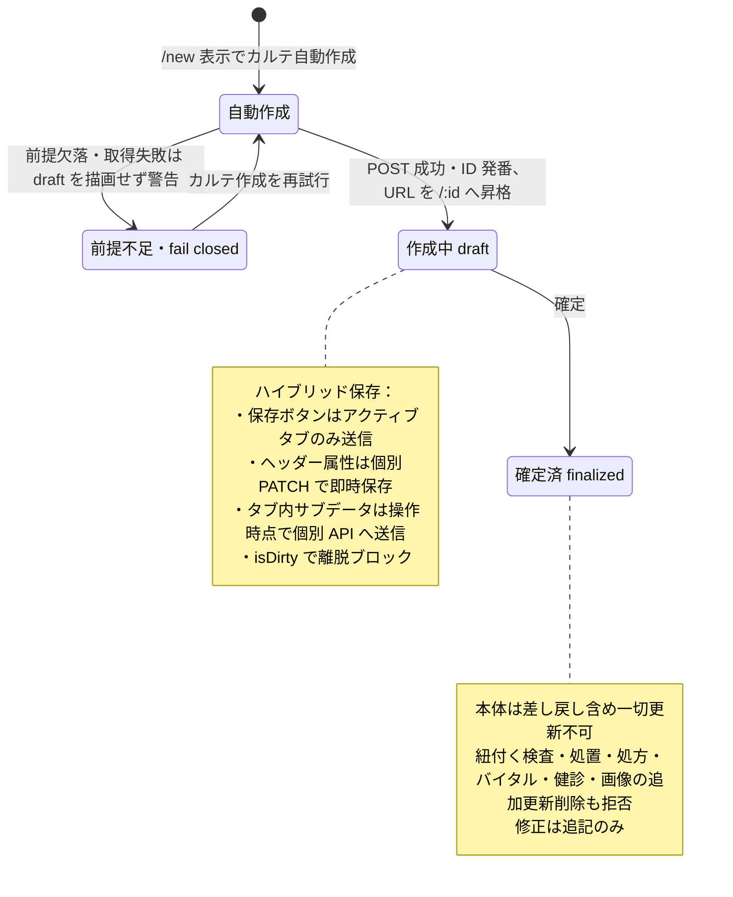

# カルテ登録・編集フロー詳細仕様 (Medical Record Lifecycle)

| 管理項目 | 記載 |
|:---|:---|
| 文書ID・種別 | lifecycle.medical-records／保存契約 |
| 決定状態 | 既存記載を継承（決定根拠は未確認）。個別の合意・未決記述は本文のまま |
| 実装状態 | 既存記載を継承（再監査なし） |
| 実機検証状態 | 今回未実施。過去の記録と今回の文書確認を分ける |
| 文書確認日 | 2026-10-13（命名・形式・参照・本文保全のみ） |

## 目的・対象範囲

| シナリオ | 業務上の価値 | 優先度・理由 |
|:---|:---|:---|
| 確定後に訂正追記する | 原記録の真正性を保つ | 未決／要確認（既存文書に優先度の根拠なし） |

### 概要

本システムにおける電子カルテ（Medical Record）は、臨床的な真正性と多種多様なサブリソースの整合性を維持するため、独自のライフサイクルと保存ロジック（ハイブリッド同期）を採用しています。

## 担当者・権限・前提

職種別担当者は未記載／要確認。保存・確定・訂正の操作権限は本書API参照表と [画面の権限前提](pages/medical-record-form.md#access-preconditions)、状態による保護は下記の既存契約を参照する。

## 契機・入口・出口

新規画面表示・ヘッダー変更・タブ内操作・保存・確定・訂正追記が契機。作成後のURL昇格は下記「登録と ID 確定のプロセス」。入口・出口の画面操作は [カルテ入力画面](pages/medical-record-form.md#navigation)が正本。

## 状態遷移・引継ぎデータ

| 要件ID | 定義の所在 | 決定根拠 |
|:---|:---|:---|
| FR-medical-records-finalized-addendum-only | [既存の要件本文](#requirement-fr-medical-records-finalized-addendum-only) | 既存記載を継承。ID付与で合意済みにしない |

| 担当者 | 前提 | 契機 | 前状態 | 後状態 | 引継ぎデータ | 異常系／根拠 |
|:---|:---|:---|:---|:---|:---|:---|
| 操作権限を持つ利用者（職種は要確認） | appointment・権限・対象状態 | 新規画面表示 | 未作成 | draft・ID確定 | appointment_id・カルテID | 下記「自動作成」「ID の発番と URL 昇格」 |
| 操作権限を持つ利用者 | 保存済み・会計確認等 | 確定 | draft | finalized | 確定状態・訂正追記の文脈 | 下記「ステータス管理と保護」 |

### 1. 登録と ID 確定のプロセス

#### 1.1 自動作成 (Auto Create)

新規作成画面 (`/medical-records/new?petId=xxx`) に遷移すると、ページ表示と同時に `useMedicalRecordAutoCreate` がカルテを自動作成します（`POST /v1/medical-records`、`status: "draft"`）。当日業務の既定経路は必ず `appointment_id` を解決する（同日の未完了な一般診療予約を再利用し、なければ一般診療予約を自動作成）。同一 appointment の未削除通常カルテは最大 1 件。不変条件の正本は [reservation-to-record-flow.md](../../workflows/reservation-to-record-flow.md) §5 / [ADR-006](../../../architecture/adr/006-backend-domain-package-boundaries.md)。会計レコードはこの自動作成では作らない。（追記 2026-10-07 監査: 旧参照「§5.5」は存在しない節番号のため §5 に修正）

#### 1.2 ID の発番と URL 昇格

自動作成がバックエンドで成功した時点で、サーバー側で `medical_records.id` が発番されます。
- **作成前の fail-closed 表示**: `/new` で作成済み ID がない間は保存ボタンを表示しない。一般診療の予約区分など必須前提が欠落・取得失敗した場合は空の draft を描画せず、appointment phase の警告と「カルテ作成を再試行する」を表示する。前提が有効になるまで appointment／カルテの write は行わない。
- **URL 置換**: 作成成功と同時に、フロントエンドは `replace` ナビゲーションを実行し、ブラウザの URL を `/medical-records/:id` へ昇格させます。これにより、以後の保存が同一レコードに対して継続されます。

### 3. ステータス管理と保護

カルテには以下の 2 つの主要なフェーズが存在します。

#### 3.1 作成中 (Draft)

- スタッフによる自由な追記・修正が可能です。
- 会計は別リソース。自動作成では billing を作らない。会計(医師確認)タブまたは会計画面から別経路で作成する。

#### 3.2 確定済 (Finalized)

- 臨床記録としての真正性を担保するため、**編集操作が物理的にロック**されます。
- **ロックの波及**: 確定されたカルテに紐付く「検査結果」「処置明細」「処方」「バイタル」「健診記録」「カルテ画像」への追加・更新・削除も、バックエンドで拒否されます（健診タブは UI 上も読み取り専用に切り替わります）。
- **修正**: 確定済カルテ本体は差し戻しを含め一切更新できません（バックエンドが拒否）。修正が必要な場合は「追記」（`MedicalRecordAddenda`、`POST /v1/medical-records/:id/addenda`）で訂正内容を追記します。

## 異常系・保存・取消

### 2. ハイブリッド保存ロジック (Hybrid Sync)

> **追記（2026-10-07 監査）**: 本節をカルテ保存ルーティング（メイン保存の送信先切替・ヘッダー属性の即時保存・タブ別サブデータの即時保存）の契約本文の**正本**とする。[medical-record-form.md §2.2](pages/medical-record-form.md) は本画面固有の操作仕様と正本参照に簡約済み。ルーティング契約の変更は本節のみを更新する。

カルテは 9 つのタブ（問診 / 診察・治療プラン / 治療 / 予防接種 / 定期健診 / 検査 / 画像 / 見積書 / 会計(医師確認)）に分かれた膨大なデータを扱うため、「カルテ本体」と「タブ別サブデータ」を独立して保存します。

1.  **メイン保存（アクティブタブ単位）**:
    - 「保存」ボタン（React 19 の `useActionState`）はアクティブタブの内容のみを保存します。問診タブは `PATCH /v1/medical-records/:id/inquiries`（主訴・主訴区分・治療方針）、診察/治療プランタブは `PATCH /v1/medical-records/:id/clinical-plan`（診断・治療方針）を送信します。EMR-308: カルテの「次回来院推奨日」フィールドは撤廃され、カルテ本体への追加 PATCH は行われません。
    - 担当医、来院種別、診療日は、ヘッダーでの変更と同時に個別 `PATCH /v1/medical-records/:id` で即時保存されます（保存ボタンを経由しません）。来院種別の成功後は詳細キャッシュを invalidate する。appointment 紐付き通常カルテの `date` は予約開始の JST 日付に固定され、変更と `appointment_id` 再紐付けは BE Conflict。未紐付け（移行例外）のみ date PATCH が成功する。EMR-308: ヘッダーの「次回予定」はカルテ PATCH ではなく `PUT/DELETE /v1/reservations/pets/:petId/next-visit-intent` でペットの tentative appointment（`status='tentative'`、`intended_date`）を upsert/削除します。権限・拠点・連続操作の write 契約は [reservation-to-record-flow.md](../../workflows/reservation-to-record-flow.md) §2.3 を正本とします。
2.  **タブ別サブデータの即時保存**:
    - メイン保存の成否とは独立して、各タブ内の操作（追加・編集・削除）が発生した時点で即座に個別 API へ送信されます（メイン保存完了を待つゲート処理ではありません）。
    - **治療 (Tab 3)**: 項目の追加・更新・削除はそれぞれ `POST`/`PATCH`/`DELETE /v1/medical-records/:id/treatments(/:treatmentId)`。ドラッグ&ドロップでの並び替えのみ `PUT /v1/medical-records/:id/treatments` で一括更新。
    - **バイタル**: タブではなく `VitalsModal`（モーダルダイアログ）から `POST /v1/medical-records/:id/vitals` で記録。
    - **検査 (Tab 6)**: 検査管理からの新規登録はペット選択後に `/examinations/new?petId=` を開く（`examinationCreateHref`）。既存のカルテ紐付き検査は一覧から `/medical-records/:id?tab=検査&examId=` へ遷移する。タブ上の「検査取り込み」は既存検査を `PATCH`（`medical_record_id`）で紐付ける。未紐付けの既存検査は `/examinations/:id` で参照・編集する。

### 4. 安全機能

- **離脱ブロック (`NavigationBlocker`)**: 未保存の変更（`isDirty=true`）がある状態でページを離れようとすると、破棄の確認を強制します。
- **二重送信防止**: React 19 の `useActionState` により、保存処理中の重複クリックを無効化します。

元の契約にない取消・再送・異常時のUI手順は未記載／要確認。画面固有の復帰操作は対応するpagesの保存・エラー節を参照し、ここに複製しない。

## 受入条件

この表は既存仕様から抽出した代表条件。すべての入力・操作・異常系への要件IDと受入条件の網羅的対応は未記載／要確認。

| 条件ID | Given（前提） | When（操作） | Then（期待結果） | 独立確認 | 成功条件 | 確認手順／証跡 |
|:---|:---|:---|:---|:---|:---|:---|
| AC-medical-records-finalized-addendum-only | カルテが確定済み | 記録の訂正が必要になる | 直接変更せず訂正追記を用いる | 確定済み記録の訂正経路を確認 | 確定済み本文の直接変更を拒否する | [要件](#requirement-fr-medical-records-finalized-addendum-only)・[カルテ入口の受入手順](README.md#受入条件の所在)。実機未確認 |

## 未決事項・関連仕様・根拠

決定状態・未決事項は既存本文を継承する。職種別担当者・不足する異常系・受入条件の網羅性は未記載／要確認。API／モデル表は既存の参照情報であり、型・DB定義の第二正本ではない。根拠は整理前の既存本文と元の追記・関連資料。文書確認日は命名・形式・参照のみ。

[文書規約](../../authoring-guide.md)。

### API連携

| メソッド | エンドポイント | 用途 | 必須権限 | 必須アクション |
|:---|:---|:---|:---|:---|
| POST | `/api/v1/medical-records` | カルテの自動作成（新規作成画面表示時） | `medical-records` | `create` |
| PATCH | `/api/v1/medical-records/:id` | カルテ本体の属性を保存・更新 | `medical-records` | `edit` |
| PATCH | `/api/v1/medical-records/:id/inquiries` | 問診タブの保存（主訴・主訴区分・治療方針） | `medical-records` | `edit` |
| PATCH | `/api/v1/medical-records/:id/clinical-plan` | 診察/治療プランタブの保存（診断・治療方針） | `medical-records` | `edit` |
| POST | `/api/v1/medical-records/:id/addenda` | 確定済カルテへの追記（訂正） | `medical-records` | `edit` |
| POST | `/api/v1/medical-records/:id/treatments` | 治療明細の個別追加 | `medical-records` | `create` |
| PATCH | `/api/v1/medical-records/:id/treatments/:treatmentId` | 治療明細の個別更新 | `medical-records` | `edit` |
| DELETE | `/api/v1/medical-records/:id/treatments/:treatmentId` | 治療明細の個別削除 | `medical-records` | `delete` |
| PUT | `/api/v1/medical-records/:id/treatments` | 治療明細の並び替え（一括） | `medical-records` | `edit` |
| POST | `/api/v1/medical-records/:id/vitals` | バイタル測定結果の記録（`VitalsModal`） | `medical-records` | `edit` |
| PATCH | `/api/v1/examinations/:id` | 既存検査記録をカルテへ紐付け（取り込み） | `examinations` | `edit` |

