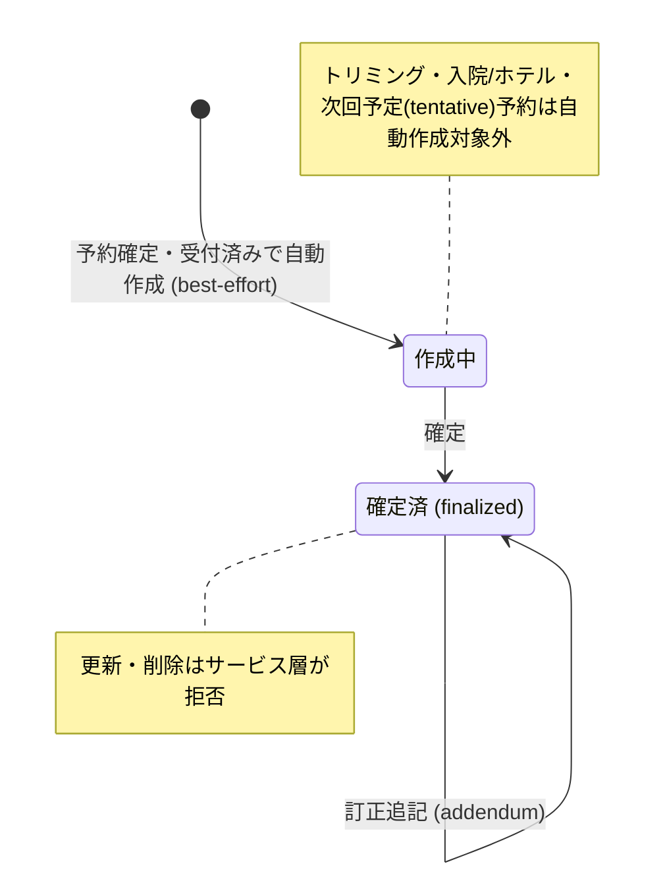

# カルテ一覧 仕様書 (Medical Records List)

| 管理項目 | 記載 |
|:---|:---|
| 文書ID・種別 | page.medical-records.medical-record-list／画面仕様 |
| 決定状態 | 既存記載を継承（決定根拠は未確認）。個別の合意・未決記述は本文のまま |
| 実装状態 | 既存記載を継承（再監査なし） |
| 実機検証状態 | 今回未実施。過去の記録と今回の文書確認を分ける |
| 文書確認日 | 2026-10-13（命名・形式・参照・本文保全のみ） |

## 目的・対象範囲

| シナリオ | 業務上の価値 | 優先度・理由 |
|:---|:---|:---|
| 記録に関連する会計を開く | 関連会計の有無を一覧から識別する | 未決／要確認（既存文書に優先度の根拠なし） |

### 概要

- **画面の目的**: 院内で行われた全カルテ（診療記録）の時系列検索、および診察内容の参照。

## 利用者・権限・前提

- **アクセス権限**: `medical-records:view`（`RequirePermission` によるルートガード。デフォルト action は `view`）。行編集・削除・新規カルテ登録は `usePermission` によりさらに `edit`/`delete`/`create` 権限で出し分け。

利用者の職種別の範囲は未記載／要確認。操作前提の詳細は本書の各操作・保存契約と関連正本を参照する。

## 入口・出口

- **URLパターン**: `/medical-records`

### 2. 主要な臨床連携フロー

- **診察室への誘導**: 予約が「予約確定」または「受付済み」になった時点でカルテが best-effort で自動作成され（トリミング・入院/ホテル予約、および次回予定 `status='tentative'` を除く）、この一覧にも「作成中」として最上位に出現。次回予定（tentative appointment）はカルテではないため本一覧には出ない。一覧・確定の管理面は予約管理画面（[reservation-management.md](../../reservations/pages/reservation-management.md)）が担う。
- **過去履歴の参照**: 診察中に同ペットの過去カルテをサイドパネルで開き、これまでの経過を確認しながら当日の記録を付けることが可能です。
- **会計への橋渡し**: カルテの「会計(医師確認)」タブで診療内容・費用の医師確認（チェック完了）を行います。

| 入口／出口 | 契機 | 引継ぎ情報 | 根拠 |
|:---|:---|:---|:---|
| URLパターン | 画面を開く | 上記URL／既存導線。呼出元の網羅は要確認 | 本節の元記載 |
| 戻り先・他画面 | 本節の既存操作 | 記載が無い引継ぎ・戻り先は要確認 | 本節／関連フロー |

## 表示情報・入力項目

| 項目 | 意味 | 型／形式 | 必須／任意 | 初期値 | 候補元 | 制約／根拠 |
|:---|:---|:---|:---|:---|:---|:---|
| 検索キーワード | 診療履歴を検索 | 未記載／要確認 | 未記載／要確認 | 未記載／要確認 | 飼主名・ペット名・カルテNo・主訴 | 下記「インテリジェント検索・フィルタ」 |
| 期間・担当医・動物種・状態 | 診療履歴を抽出 | 未記載／要確認 | 未記載／要確認 | 未記載／要確認 | 作成中／確定済など、候補取得元は要確認 | 下記「インテリジェント検索・フィルタ」 |
| 並び順・医院・ページ・pet_id | 一覧の対象・順序 | 未記載／要確認 | 未記載／要確認 | 診療日降順 | date／owner_name／pet_name／status | 下記「インテリジェント検索・フィルタ」 |

### 1. 画面構成

#### 1.1 インテリジェント検索・フィルタ (`PropertyFilter`)

- **全文検索**: 飼主名（かな）、ペット名（かな）、カルテNo、主訴による横断検索（サーバサイド。病名・治療内容・治療メモ・治療マスタ名は検索対象外）。検索・担当医・種・期間・ステータスはローカル state（URL 非同期）。
- **時系列フィルタ**: 診療実施期間での絞り込み。
- **属性フィルタ**: 担当医、動物種、ステータス（作成中/確定済）による抽出。
- **医院横断フィルタ (`ClinicScopeFilter`)**: 複数医院所属ユーザーのみ、`?clinics=` で選択医院を横断表示。
- **URL**: `page` / `sort` / `order` / `pet_id` / `clinics`。サーバソートは `date` / `owner_name` / `pet_name` / `status`。既定順は診療日降順。

#### 1.2 診療履歴テーブル (`DataTable`)

| カラム | 説明 |
|:---|:---|
| **診療日** | 診療が行われた日付。 |
| **飼主名 / ペット名 / 種** | 飼主名、ペット名、動物種（それぞれ独立カラム）。 |
| **主訴 (CC)** | 来院理由の要約。 |
| **関連** | 会計レコードが紐付く場合は「会計」ボタンを表示し、会計詳細へ遷移。未紐付けは「—」表示。 |
| **担当医** | 診察を実施した獣医師。 |
| **ステータス** | **「作成中」**: 臨床内容の追記が可能。 / **「確定済」**: 内容がロックされた法的記録。 |
| **医院** | 複数医院所属時のみ。 |
| **操作** | 編集・削除（権限時）。 |

#### 3.2 パフォーマンス

- **データローディング**: TanStack Query によるキャッシュ管理により、リストと詳細の往復を高速化。
- **ページネーション**: ページ単位の分割表示により、大量の履歴データでも一覧の応答性を維持。

## 操作・業務ルール・状態遷移

| 要件ID | 定義の所在 | 決定根拠 |
|:---|:---|:---|
| FR-medical-records-accounting-link-visibility | [既存の要件本文](#requirement-fr-medical-records-accounting-link-visibility) | 既存記載を継承。ID付与で合意済みにしない |

| 操作 | 実行条件 | 成功後状態／遷移 | 失敗挙動 | 根拠 |
|:---|:---|:---|:---|:---|
| 参照・新規・編集・削除 | view／create／edit／delete、確定状態 | 記録入力・過去履歴・会計確認へ | 確定済み更新／削除を拒否 | 下記「信頼性と真正性」、入口出口節 |

#### 3.1 信頼性と真正性

- **ステータス・ロック**: ステータスが `finalized` となった記録は、サービス層（`medical_record_crud.go`）が更新・削除リクエストを拒否（更新: `確定済みカルテは編集できません。訂正追記 (addendum) を使用してください`／削除: `確定済みまたは下書き以外のカルテは削除できません`）。DB レベルの制約ではなくアプリケーション側のガードであり、訂正が必要な場合は訂正追記（addendum）で対応する。

**カルテのステータス遷移:**

## 保存・取消・再試行・同時編集

該当なし（本一覧の検索・表示にレコード確定用の保存操作はない）。記録や精算の更新は遷移先仕様を参照する。検索条件の復元・取得失敗時の再試行について、既存本文にない条件は未記載／要確認。

## エラー・空状態

| 状況 | 検知／表示 | 利用者の次の操作 | 根拠 |
|:---|:---|:---|:---|
| 会計未紐付け | — 表示 | 該当なし（関連ボタンなし） | 診療履歴テーブル |
| 確定済の編集・削除 | サービス層が拒否 | 訂正はaddendum | 操作節「信頼性と真正性」 |
| 検索0件・通信失敗 | 未記載／要確認 | 未記載／要確認 | 要確認 |

## 受入条件

この表は既存仕様から抽出した代表条件。すべての入力・操作・異常系への要件IDと受入条件の網羅的対応は未記載／要確認。

| 条件ID | Given（前提） | When（操作） | Then（期待結果） | 独立確認 | 成功条件 | 確認手順／証跡 |
|:---|:---|:---|:---|:---|:---|:---|
| AC-medical-records-accounting-link-visibility | 会計が紐付く記録と未紐付けの記録がある | 一覧の関連列を確認する | 紐付く記録は会計ボタン、未紐付けは—表示 | 関連列の2つの状態だけを確認 | 会計の有無に応じて導線が識別できる | [要件](#requirement-fr-medical-records-accounting-link-visibility)・[既存UATの所在](../README.md#受入条件の所在)。実機未確認 |

## 未決事項・関連仕様・根拠

未記載の型・必須条件・初期値・エラー・受入結果は要確認。既存の未実装・判断待ち・臨床承認待ちは以下の元記載を維持する。今回の形式整理を合意や実装完了の根拠にしない。

[文書規約](../../../authoring-guide.md)・[ドメイン入口](../README.md)。根拠は整理前の既存仕様本文と、その本文が示す日付付き追記・関連資料。文書確認日は上記の構造確認日であり、過去の承認日を置き換えない。API表・コード名は参照情報で、wire型とDB定義の正本は文書規約に従う。

### 3. 技術仕様

#### API連携

| メソッド | エンドポイント | 用途 | 必須権限 | 必須アクション |
|:---|:---|:---|:---|:---|
| GET | `/api/v1/medical-records` | 条件に応じたカルテの一括取得 | `medical-records` | `view` |
| DELETE | `/api/v1/medical-records/:id` | 誤作成カルテの論理削除 | `medical-records` | `delete` |

