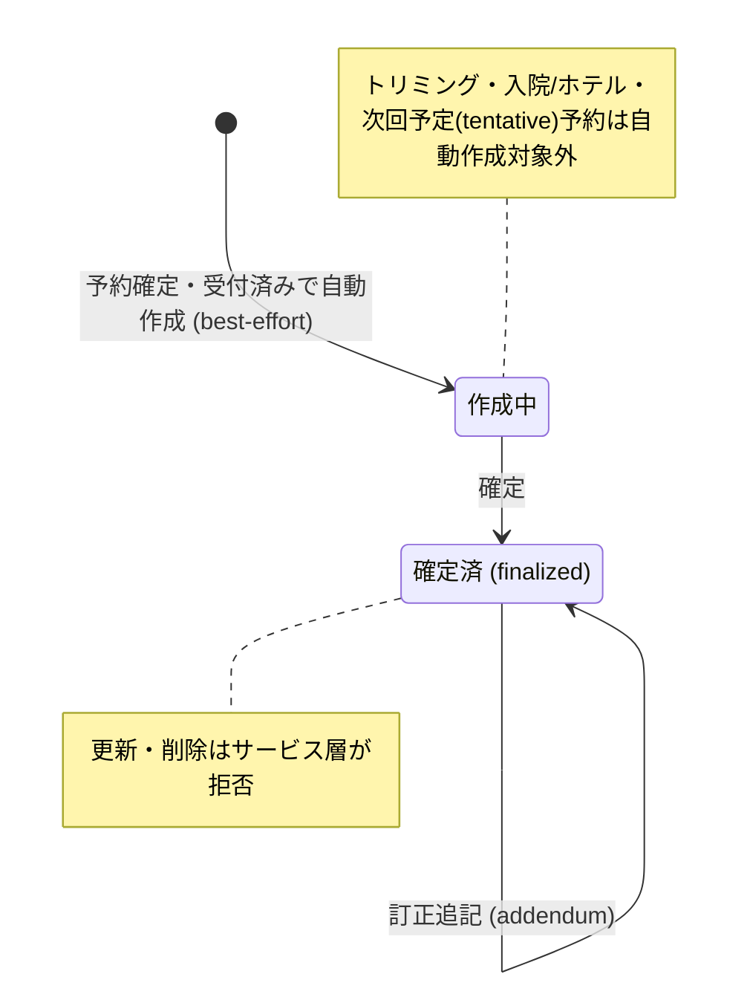

# カルテ一覧 仕様書 (Medical Records List)

[2026-10-15最新合意](../lifecycle.md#medical-record-agreement-autosave-20261015)により、通常カルテは診療終了後も通常編集できる。スタッフ向け診療履歴の掲載条件は医師確定でなく診療終了で、診療中の途中保存は載せない。本一覧の通常管理・検索と、スタッフ向け診療履歴の掲載条件を混同し、診療中カルテへの管理上のアクセスまで消さない。旧draft／finalizedの表示は現行モデルの参照であり、旧finalizedだけを編集禁止や履歴掲載可の根拠にしない。

| 管理項目 | 記載 |
|:---|:---|
| 文書ID・種別 | page.medical-records.medical-record-list／画面仕様 |
| 決定状態 | 2026-10-17追加決定は末尾と進捗入口を参照。従来：2026-10-14初回5項目は部分合意。最新の業務正本はlifecycle初回合意節。対象外の既存決定状態を保持し、カルテ全体完了／実装受入にしない |
| 実装状態 | 合意と現実装は別。main ec4f7146a の必要箇所を静的照合し、差分は予約正本の残差一覧へ記録。実装変更なし |
| 実機検証状態 | 今回未実施。過去の記録と今回の文書確認を分ける |
| 文書確認日 | 2026-10-13（途中合意・関連参照・静的差分を反映。実機受入日ではない） |

## 目的・対象範囲

| シナリオ | 業務上の価値 | 優先度・理由 |
|:---|:---|:---|
| 記録に関連する会計を開く | 関連会計の有無を一覧から識別する | 未決／要確認（既存文書に優先度の根拠なし） |

### 概要

- **画面の目的**: 院内で行われた全カルテ（診療記録）の時系列検索、および診察内容の参照。

## 利用者・権限・前提

- **アクセス権限**: `medical-records:view`（`RequirePermission` によるルートガード。デフォルト action は `view`）。行編集・削除・新規カルテ登録は `usePermission` によりさらに `edit`/`delete`/`create` 権限で出し分け。

担当医以外でも操作grant・医院scopeを満たす入力者を許可し、実編集者ログを必要とする[初回合意](../lifecycle.md#medical-record-agreement-first-five)へ従う。操作前提の詳細は本書の各操作・保存契約と関連正本を参照する。

## 入口・出口

- **URLパターン**: `/medical-records`

### 2. 主要な臨床連携フロー

- **診察室への誘導**: 診察予約の通常カルテは[受付時の同時成功契約](../../../workflows/reservation-to-record-flow.md#requirement-fr-reservations-checkin-record-atomicity)へ変更し、予約確定時には作成しない。現実装のconfirmed／checked_inでのbest-effort自動作成は追従前の差分。通常の受付リンクなし新規は受付登録へ案内、過去未登録診療は理由・医師確認付き専用入力へ。専用記録は別ownerで整理する。次回予定tentativeはカルテではなく本一覧に載らず、管理面は[予約管理](../../reservations/pages/reservation-management.md)が担う。
- **過去履歴の参照**: 診察中に同ペットの過去カルテをサイドパネルで開き、これまでの経過を確認しながら当日の記録を付けることが可能です。
- **会計への橋渡し**: カルテの「会計(医師確認)」タブで診療内容・費用の医師確認（チェック完了）を行います。

| 入口／出口 | 契機 | 引継ぎ情報 | 根拠 |
|:---|:---|:---|:---|
| URLパターン | 画面を開く | 上記URL／既存導線。呼出元の網羅は要確認 | 本節の元記載 |
| 戻り先・他画面 | 本節の既存操作 | 記載が無い引継ぎ・戻り先は要確認 | 本節／関連フロー |

## 表示情報・入力項目

| 項目 | 意味 | 型／形式 | 必須／任意 | 初期値 | 候補元 | 制約／根拠 |
|:---|:---|:---|:---|:---|:---|:---|
| 検索キーワード | 診療履歴を検索 | 未記載／要確認 | 未記載／要確認 | 未記載／要確認 | 飼主名・ペット名・カルテNo・主訴 | 下記「インテリジェント検索・フィルタ」 |
| 期間・担当医・動物種・状態 | 診療履歴を抽出 | 未記載／要確認 | 未記載／要確認 | 未記載／要確認 | 作成中／確定済など、候補取得元は要確認 | 下記「インテリジェント検索・フィルタ」 |
| 並び順・医院・ページ・pet_id | 一覧の対象・順序 | 未記載／要確認 | 未記載／要確認 | 診療日降順 | date／owner_name／pet_name／status | 下記「インテリジェント検索・フィルタ」 |

### 1. 画面構成

#### 1.1 インテリジェント検索・フィルタ (`PropertyFilter`)

- **全文検索**: 飼主名（かな）、ペット名（かな）、カルテNo、主訴による横断検索（サーバサイド。病名・治療内容・治療メモ・治療マスタ名は検索対象外）。検索・担当医・種・期間・ステータスはローカル state（URL 非同期）。
- **時系列フィルタ**: 診療実施期間での絞り込み。
- **属性フィルタ**: 担当医、動物種、ステータス（作成中/確定済）による抽出。
- **医院横断フィルタ (`ClinicScopeFilter`)**: 複数医院所属ユーザーのみ、`?clinics=` で選択医院を横断表示。
- **URL**: `page` / `sort` / `order` / `pet_id` / `clinics`。サーバソートは `date` / `owner_name` / `pet_name` / `status`。既定順は診療日降順。

#### 1.2 診療履歴テーブル (`DataTable`)

| カラム | 説明 |
|:---|:---|
| **診療日** | 診療が行われた日付。 |
| **飼主名 / ペット名 / 種** | 飼主名、ペット名、動物種（それぞれ独立カラム）。 |
| **主訴 (CC)** | 来院理由の要約。 |
| **関連** | 会計レコードが紐付く場合は「会計」ボタンを表示し、会計詳細へ遷移。未紐付けは「—」表示。 |
| **担当医** | 診察を実施した獣医師。 |
| **ステータス** | 現実装はdraft／finalizedを表示する。目標では通常カルテは終了後も編集可で、保存履歴と診療終了状態を別に識別する。法的適合をstatus名だけで保証しない。 |
| **医院** | 複数医院所属時のみ。 |
| **操作** | 編集・削除（権限時）。 |

#### 3.2 パフォーマンス

- **データローディング**: TanStack Query によるキャッシュ管理により、リストと詳細の往復を高速化。
- **ページネーション**: ページ単位の分割表示により、大量の履歴データでも一覧の応答性を維持。

## 操作・業務ルール・状態遷移

| 要件ID | 定義の所在 | 決定根拠 |
|:---|:---|:---|
| FR-medical-records-accounting-link-visibility | [既存の要件本文](#requirement-fr-medical-records-accounting-link-visibility) | 既存記載を継承。ID付与で合意済みにしない |

| 操作 | 実行条件 | 成功後状態／遷移 | 失敗挙動 | 根拠 |
|:---|:---|:---|:---|:---|
| 参照・新規・編集・削除 | view／create／edit／delete、医院／患者・対象版・既存関連保護 | 同じ記録入力・過去履歴・会計確認へ | 通常編集は終了後も可能。削除は空誤作成・依存等の既存保護に従う | 最新合意、入口出口節 |

#### 3.1 信頼性と真正性

最新の[空の誤作成だけの削除・記入済み訂正](../lifecycle.md#requirement-fr-medical-records-empty-delete-reviewed-correction)を満たすことを確認する。draftだけで削除可としない。以下のサービスガードと図のbest-effort自動作成は現行実装参照で、最新受付時作成や初回5項目への追従を示さない。

- **従来実装参照：ステータス・ロック（通常編集禁止は置換対象）**: ステータスが `finalized` となった記録は、サービス層（`medical_record_crud.go`）が更新・削除リクエストを拒否（更新: `確定済みカルテは編集できません。訂正追記 (addendum) を使用してください`／削除: `確定済みまたは下書き以外のカルテは削除できません`）。DB レベルの制約ではなくアプリケーション側のガードであり、訂正が必要な場合は訂正追記（addendum）で対応する。

**カルテのステータス遷移:**

この図は従来実装の状態参照。最新の通常受付・終了後通常編集とスタッフ履歴掲載の正本は冒頭リンクを参照する。

## 保存・取消・再試行・同時編集

該当なし（本一覧の検索・表示にレコード確定用の保存操作はない）。記録や精算の更新は遷移先仕様を参照する。検索条件の復元・取得失敗時の再試行について、既存本文にない条件は未記載／要確認。

## エラー・空状態

| 状況 | 検知／表示 | 利用者の次の操作 | 根拠 |
|:---|:---|:---|:---|
| 会計未紐付け | — 表示 | 該当なし（関連ボタンなし） | 診療履歴テーブル |
| 旧finalizedの通常編集 | 現実装の拒否は未追従差分 | 目標は同じ通常画面で編集し保存履歴を保持。削除は別の既存保護へ | 最新の通常編集契約 |
| 検索0件・通信失敗 | 未記載／要確認 | 未記載／要確認 | 要確認 |

## 受入条件

この表は既存仕様から抽出した代表条件。すべての入力・操作・異常系への要件IDと受入条件の網羅的対応は未記載／要確認。

| 条件ID | Given（前提） | When（操作） | Then（期待結果） | 独立確認 | 成功条件 | 確認手順／証跡 |
|:---|:---|:---|:---|:---|:---|:---|
| AC-medical-records-accounting-link-visibility | 会計が紐付く記録と未紐付けの記録がある | 一覧の関連列を確認する | 紐付く記録は会計ボタン、未紐付けは—表示 | 関連列の2つの状態だけを確認 | 会計の有無に応じて導線が識別できる | [要件](#requirement-fr-medical-records-accounting-link-visibility)・[既存UATの所在](../README.md#受入条件の所在)。実機未確認 |

## 未決事項・関連仕様・根拠

未記載の型・必須条件・初期値・エラー・受入結果は要確認。既存の未実装・判断待ち・臨床承認待ちは以下の元記載を維持する。今回の形式整理を合意や実装完了の根拠にしない。

[文書規約](../../../authoring-guide.md)・[ドメイン入口](../README.md)。根拠は整理前の既存仕様本文と、その本文が示す日付付き追記・関連資料。文書確認日は上記の構造確認日であり、過去の承認日を置き換えない。API表・コード名は参照情報で、wire型とDB定義の正本は文書規約に従う。

### 3. 技術仕様

#### API連携

| メソッド | エンドポイント | 用途 | 必須権限 | 必須アクション |
|:---|:---|:---|:---|:---|
| GET | `/api/v1/medical-records` | 条件に応じたカルテの一括取得 | `medical-records` | `view` |
| DELETE | `/api/v1/medical-records/:id` | 誤作成カルテの論理削除 | `medical-records` | `delete` |

## 空誤作成の非表示・復元の入口

[訂正／例外4項目](../lifecycle.md#requirement-fr-medical-records-empty-record-hide-restore)の非表示は履歴を保持するカルテ操作。通常一覧では非表示とし、許可された復元は理由・元ID・現在の関連を照合する。受付の個人表示設定とは別。記入済みの取り違え記録は非表示／削除で代用せず、[患者訂正](../lifecycle.md#requirement-fr-medical-records-wrong-patient-linked-transfer)へ渡す。画面配置と復元APIは未実装／未検証で、既存一覧の表示だけを受入証拠にしない。

## 一覧条件の確定（2026-10-17）

[決定根拠・適用範囲](../../SPECIFICATION_PROGRESS.md#confirmed-business-decisions-20261017)：ユーザーの2026-10-16〜17 JSTの直接決定、文書更新承認は10月17日03:20 JST。以下は目標仕様・未実行の受入条件であり、実装・実機合格を示さない。

[一覧の共通正本・4受入条件](../../../shared/ui-contracts.md#list-filter-contract-20261017)へ従う。台帳・カルテ履歴の初回医院は権限内全医院で次回選択保持。日付付き通常業務6一覧はメニュー当日・詳細復帰で条件保持、行ペットはID指定・日付解除全期間・医院維持。入院ホテル／見積は当日初期化除外、受付は選択日、未納は繰越表示、台帳マスタは当日対象外。表示ページだけを全期間検索結果としない。

## Backlog原条文の補足受入条件

保存済み原Q/Aと既存業務契約の照合による補足。対応済みという旧回答は実装・実機検証の合格証明に用いない。後続の本人合意、医院scope、権限、履歴・会計訂正の既存条件を維持する。

### 検索・一覧取得

| 条件ID | 受入条件 | 根拠 | 検証状態 |
|:---|:---|:---|:---|
| AC-medical-records-list-search-preserves-results | 飼主名／ペット名の漢字・カタカナ検索語を入力して取得中も直前の一覧と入力語を保持し、取得成功後に対象結果を反映する。再取得中のローディングで検索語を初期化しない。薬剤名検索や当該ペット履歴検索と区別する。 | Phase1 F52:G52 | 未実施 |

## 10/19後続承認：同種操作・検索ボタン方式

本画面の既存キーワード欄は[適用台帳 L02](../../../shared/interaction-scope.md)と[共通FR/8AC](../../../shared/ui-contracts.md#interaction-consistency-20261019)へ従う。入力中/適用済みを分け、入力/待機/消去だけでは検索せず検索ボタンで適用。既存の明示リセット、独立filter、詳細復帰、認可・検索対象・取得上限/ページ内制限を保持し、全件検索や一律の保存方式へ変えない。取得中/0件/失敗と遅延応答を分け、検索で選択/保存/コピー/送信を確定しない。旧defer/debounceの記載は入力即適用の目標に用いず、適用後の描画最適化と区別する。[S14手順](../../../../ops/testing/scenarios/S14-search-and-multi-word.md#cross-ui-search-20261019)を各対象IDで実施する受入条件とし、実装適合・実機は未確認。
