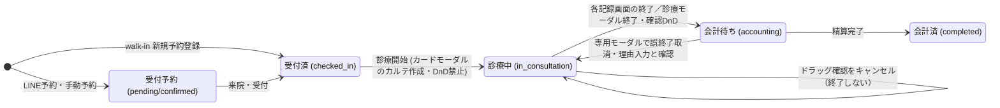

# 当日の受付 仕様書 (Reception Kanban)

未来院からの同一予約再受付は[18:26の担当再確認・手動修正とカルテ再利用](../../../workflows/reservation-to-record-flow.md#no-show-recheck-1826)へ従う。受付後の業務分類をまたぐ変更は[通常編集では不可・記録確認訂正](../../reservations/pages/reservation-management.md#requirement-fr-reservations-cross-business-type-change)。

17:23 JSTの[LINE予約6点合意](../../../line/reservation-spec.md#line-agreement-1723)へ従う。公開された診療・トリミング・ホテルは予約対象、入院は医院相談。ホテルには医師指名・医師シフト・通常予約の同日制約を適用しない。受付制限・入力保持・受付前取消・必要設定不足の扱いと受入条件はLINE正本を参照する。ホテル受入基準は17:35合意の医院別同時宿泊頭数・全宿泊期間判定で、実装・実機受入は未確認。

17:17 JSTの院内予約8点一括合意は[予約入口の決定一覧](../../reservations/README.md#internal-reservation-batch-1717)を参照する。誤取消／誤終了訂正、未終了予約保護、診療前の日付・カルテ整合、マスタ利用・名称履歴、休診日予約／日跨ぎ勤務、患者照合、ホテル担当時点／入院記録失敗の各正本と受入条件へ従う。LINE受付条件は17:23合意（ホテル受入基準は17:35合意、計算・保存方式は設計）、実装・実機受入は未確認。

17:10合意の[診療前の誤取消からの復元](../../reservations/pages/reservation-management.md#requirement-fr-reservations-restore-preconsultation-cancellation)へ従う。同じ予約を復元し、復元時点の指名医師の医院別対応可否・勤務等を再確認する。作成済み通常カルテは同じものを再利用し、予約・カルテを重複作成しない。診療後・支払い確定後の訂正や誤終了取消へ広げず、復元先状態と不適格時の手動修正は17:17合意。保存方式は設計。受入条件は予約正本へ置き、実装・実機受入は未確認。

| 管理項目 | 記載 |
|:---|:---|
| 文書ID・種別 | page.reception.reception-board／画面仕様 |
| 決定状態 | 2026-10-17追加決定は末尾と進捗入口を参照。従来：予約の合意は各正本を継承。受付3点は2026-10-14の Sentinel_ea8569c91d8c8191b70e7b2cf8df8db6（2・3）／Sentinel_daeb79f859f48191a38d3a61f4f725d8（1）で承認。非表示設定は Sentinel_67648c4b0030819193d97aacb34e9b16／Sentinel_7fc2cd6f8c708191b6ab1d9160cb836b でスタッフ別ブラウザ保持を追加承認。表示・通信／競合・受入の具体化は Sentinel_6bdf54904d3881918fb3e884820adfea によりdocs限定選定。受付文書整理の現在状態は入口・技術契約で判定し、専用内部の一括承認ではない。実装・実機状態とは別 |
| 実装状態 | 合意と現実装は別。main ec4f7146a の必要箇所を静的照合し、差分は予約正本の残差一覧へ記録。実装変更なし |
| 実機検証状態 | 今回未実施。過去の記録と今回の文書確認を分ける |
| 文書確認日 | 2026-10-17追加差分（従来確認2026-10-15）（会議追加2の反映。実機受入日ではない） |

12:22合意の[医師交代時の判定時間と診療延長警告](../../reservations/pages/reservation-management.md#handoff-time-and-extension)に従う。診療延長による自然な時間経過は警告し、自動終了・自動交代しない。保護対象の既指名予約を不適格にするシフト編集の保存禁止とは別であり、警告を編集保存の許可にしない。実装対応・実機受入は未確認。

用語・概念関係は[予約オントロジーの語彙正本](../../../ontology/reservations.md#reservation-ontology)へ統一する。予約区分、予約区分グループ（表示用）、予約区分の業務分類を区別し、担当者の総称と画面の指名医師／担当トリマー、職種と個人の対応可能予約区分を同義にしない。画面ラベル・引用・コード識別子は継承し、用語整理から未決業務を確定しない。

16:36合意の[入院開始の明示確定と二重登録防止](../../../screens/settings/master-reservation-type.md#requirement-fr-reservation-types-inpatient-start-confirm)へ従う。予定入院は予約だけで入院中にせず、来院後にスタッフが「入院開始」を確定する。診察後の入院決定も同じ入院管理へつなぎ、同じ入院を二重登録しない。担当医・入院記録は16:44合意の段階条件へ従う。具体的画面配置・重複防止の技術方式・記録作成失敗時の開始未確定・理由表示・再試行は17:17合意。具体的保存方式は設計として分ける。受入条件は区分マスタ正本へ置き、実装・実機受入は未確認。

16:44合意の[入院担当医と開始時の入院記録](../../../screens/settings/master-reservation-type.md#inpatient-doctor-and-record-at-start)へ従う。予定入院予約時は指名医師未定可、入院開始までに入院担当医決定、スタッフによる開始確定時に入院記録を作成する。予定入院・診察後の両入口を維持し、同じ入院を二重登録しない。予約の指名医師から担当医を自動確定せず、記録作成失敗時の開始未確定・理由表示・再試行は17:17合意。具体的UI・保存方式は実装設計とする。実装・実機受入は未確認。

## 目的・対象範囲

| シナリオ | 業務上の価値 | 優先度・理由 |
|:---|:---|:---|
| 受付から診療を開始する | 記録作成を経た進行を保つ | 未決／要確認（既存文書に優先度の根拠なし） |

### 概要

- **画面の目的**: 院内全体の稼働状況を30秒間隔の定期同期で把握・管理するためのカンバンボード型ホーム画面。

## 利用者・権限・前提

- **アクセス権限**: `reception:view`（`RequirePermission` によるルートガード。デフォルト action は `view`）。個別アクション（新規予約・カルテ作成・会計・入院登録・取消）はさらに各リソースの `create`/`edit`/`delete` 権限で制御される。

操作は既存resource／actionの[目的別grant](../../../../design/domains/reservations/technical-spec.md#reservation-api-closed-contract)へ対応する。職種名から一律に権限を付与せず、片付けは本人の閲覧表示設定。実医院のgrant・認可検証は未確認。

## 入口・出口

- **URLパターン**: `/`（EMR-243: `/?date=YYYY-MM-DD` で任意日の受付状況を表示可。未指定・空・形式不正・非存在の暦日は当日 JST へフォールバック。ヘッダーの日付入力（`aria-label="表示日"`）からも切替えられる）。

#### 進行・ナビゲーション

- **ヘッダー「新規予約登録」**: 当日表示時は walk-in（`?reception=1`）。status=`checked_in`・経路=`reception` で受付済列に載る（`reservations:create` が必要）。非本日表示時は `?newReservation=1&date=<選択日>` の通常予約作成になる（EMR-243）。
- **受付予約列の「+」**: 通常予約（`?newReservation=1`、status=`confirmed`、非本日では `&date=<選択日>` 付き）。**受付済列の「+」**は当日受付 walk-in（`?reception=1`）で、非本日表示では非表示。診療中・会計待ち・会計済列に追加ボタンは無い。
- **受付済→診療中**: DnD禁止は既存記載を継承。受付時のカルテ作成と診療開始は別状態。開始・終了は[スタッフの実業務に基づく明示確定](../../../workflows/reservation-to-record-flow.md#requirement-fr-reservations-manual-consultation-state)を正とし、予定開始・終了時刻で自動遷移しない。開始は[10:07 JST合意の当日カードモーダル「カルテ作成」](../../../workflows/reservation-to-record-flow.md#consultation-start-card-modal)が兼ねる。別の開始ボタンへ分離しない。終了は[10:12合意の同じカードモーダル「診察を終了する」](../../../workflows/reservation-to-record-flow.md#consultation-end-card-modal)で確定する。受付時作成済みのカルテがあれば[10:17合意に従い、そのカルテを開いて診療開始を確定し重複作成しない](../../../workflows/reservation-to-record-flow.md#requirement-fr-reservations-checkin-record-reuse)。終了には[確認付きの診療中→会計待ちドラッグ](../../../workflows/reservation-to-record-flow.md#requirement-fr-reservations-confirmed-drag-consultation-end)も10:43に合意。キャンセルなら診療中を維持する。未作成なら作成し、作成／読み込み失敗時は開始を確定せず理由を表示して再試行できる[10:59契約](../../../workflows/reservation-to-record-flow.md#requirement-fr-reservations-start-record-failure-retry)に従う。誤終了は[11:56合意のモーダル「診療終了を取り消す」](../../../workflows/reservation-to-record-flow.md#requirement-fr-reservations-undo-consultation-end)で理由入力・確認を行い、診療中へ戻す。12:07合意により支払い確定前は受付操作可能なスタッフが取消でき、日付制限は設けず理由を記録する。誤終了を戻す逆方向ドラッグは設けず、カルテ・会計を保持する。会計確定後の訂正内部は会計ドメインへ引き継ぐ。未収／分割／0円を含むUndo停止境界とその他逆遷移の記録確認は[業務5点の正本](../../../workflows/reservation-to-record-flow.md#five-business-decisions)、既存grant対応は[技術契約](../../../../design/domains/reservations/technical-spec.md#reservation-api-closed-contract)へ従い、再び未決にしない。現実装はカード／詳細のカルテ作成・トリミング記録とadvanceStatus、入院系の「診察を開始する」を持つ。これは新合意への適合証拠ではなく、[会議追加2](#reception-meeting-start-end)の施術開始列・各記録画面終了・会計待ちからの既存記録参照へ追従を要する。
- **会計済カードの片付け**: [表示のみの非表示・再表示契約](#requirement-fr-reception-completed-card-visibility)へ従う。片付け操作で会計・来院状態を再確定せず、データを削除しない。端末内除外・再読込復帰は下記の現実装参照であり、新しい医院×スタッフ別ブラウザ保持への実装追従は未検証。
- **詳細表示**: カードモーダルで来院詳細を確認する。当日の「受付予約」から「受付する」で同じ予約を受付済へ進める契約は[横断フロー](../../../workflows/reservation-to-record-flow.md#checkin-contract)。予約変更は「予約を変更」から[予約管理の対象編集モーダル](../../reservations/pages/reservation-management.md#requirement-fr-reservations-edit-entry)へ遷移し、受付内の独立編集にしない。受付済みで診療前なら従来の変更範囲を維持する。診療開始後／会計完了後の通常操作は[23:21 JSTの予約正本](../../reservations/pages/reservation-management.md#requirement-fr-reservations-post-consultation-edit-limits)へ従い、日時・区分変更と取消は不可、メモ編集は可。別医師への変更は[23:43 JSTの引継ぎ契約](../../reservations/pages/reservation-management.md#requirement-fr-reservations-doctor-handoff)に従い、予約管理で診療終了まで可、終了後の通常操作では不可。終了操作は10:12合意のカードモーダルボタンに加え、会議追加2の通常カルテ／専用トリミング画面からも行う。交代先は11:15合意に従い引継ぎ後の担当時間で判定し、過去全体の勤務を要求しない。指名なしへの変更も終了まで可、終了後の通常変更は不可。誤終了取消の既存grant・会計確定境界は[技術契約](../../../../design/domains/reservations/technical-spec.md#reservation-api-closed-contract)・横断正本へ従う。その他の逆方向／遷移は[記録確認訂正](../../../workflows/reservation-to-record-flow.md#requirement-fr-reservations-controlled-reverse-transition)へ渡し、具体的な訂正・精算内部は各ownerへ残す。診療前の誤取消復元は17:10合意へ従い、復元先状態・手動修正は17:17合意、具体的UI・保存方式は設計。開始操作は10:07合意に従い、受付時作成済みカルテの再利用は10:17合意済み。未作成時の作成と作成／読み込み失敗時の開始未確定・理由表示・再試行は10:59合意済み。飼主・ペット詳細と特記表示などその他の既存動作は継承する。現実装のonEditはReservationFormModalを直接開き、合意へ未追従。取消は既存reservations:deleteと状態境界へ従い、具体的UI・実認可検証は別。[予約側の取消・カルテ保持契約](../../reservations/pages/reservation-management.md#requirement-fr-reservations-cancel-history)へ反する自動削除を行わない。 [12:22合意の判定時間・延長警告](../../reservations/pages/reservation-management.md#handoff-time-and-extension)へ従う。
「飼主詳細」は `ownerId` がある予約は `/owners/:id` へ、未連携（`ownerId` 不在）の予約は `/owners?search=<飼主名>` の一覧検索へ遷移します。

受付詳細のペット名から、対象ペットの既存詳細を現在の閲覧権限で開く。権限がなければリンクにせず、未確定の患者IDを推測しない。「予防接種」からは対象ペットの予防履歴を閲覧でき、履歴を見るだけで新しいカルテ・接種記録や診療開始を作らない。既存の医院・患者scopeと対象view grant・選択日への戻り先を維持する。根拠は[Backlog Phase1 No.68、No.71](https://docs.google.com/spreadsheets/d/17jaFBv7NmbPzk88lZx94vFxa_G1shGNX2O_lFGt4QdQ/edit)、2026-10-15曽我回答。これらの対応完了報告を今回の実機受入済みとはしない。

患者情報セクション（`ReceptionDialogBody`）にも同じ `DangerBadge` マークを表示: ペット名横に特記アイコンバッジ（高=赤い八角形/中=黄い三角形、文言なし・Popover で補足メモ）、飼主名横に文言なしの赤い八角形アイコン（`is_dangerous`、代替名「特記」）。

現実装の操作権限は取消がreservations:delete、編集がreservations:edit。今回の権限変更は未合意。

- **クイックリンク (ミニアクション、`AppointmentCard`)**: 表示条件はカラム・診療区分により異なります。[会議追加2](#reception-meeting-start-end)の既存記録導線を優先し、以下の旧新規URLを会計待ちからの参照に流用しません。いずれの遷移も `state.from` に `"/?date=<選択日>"`（当日は `"/"`）を渡す。
    - **カルテ作成/施術・記録を開く**: 通常診療・トリミングは受付済／診療中で各既存記録の作成・再利用条件へ従う。会計待ちでは同じ予約に明示的に関連付いた既存の通常カルテ／トリミング記録を開く。`/medical-records/new`／`/trimming/new`への旧新規導線を会計待ちへコピーせず、対象ref・医院・view権限を確認する。参照なし・失敗は再取得／確認し、新規作成や状態再開を行わない。
    - **会計**: 「診療中」列以外で表示。`petId` があれば `/accounting/new?petId=...`、なければ `/accounting/new` へ遷移。
    - **入院**: 「診療中」列以外、かつ診療区分に入院/ホテルが含まれる場合のみ表示。`/hospitalization/new` へ遷移。

| 入口／出口 | 契機 | 引継ぎ情報 | 根拠 |
|:---|:---|:---|:---|
| URLパターン | 画面を開く | 上記URL／既存導線。呼出元の網羅は要確認 | 本節の元記載 |
| 戻り先・他画面 | 本節の既存操作 | 記載が無い引継ぎ・戻り先は要確認 | 本節／関連フロー |

## 表示情報・入力項目

| 項目 | 意味 | 型／形式 | 必須／任意 | 初期値 | 候補元 | 制約／根拠 |
|:---|:---|:---|:---|:---|:---|:---|
| 表示日 | 表示する受付日 | YYYY-MM-DD | 未指定可 | 不正・空・未指定はJST当日 | ヘッダー日付入力・dateクエリ | 下記「表示日の切替え」 |
| 分類・予約担当・来院種別 | 表示だけの絞り込み | 分類enum／予約staff ID／first・revisit | filter指定任意 | 全分類・全担当・全来院種別 | 認可済み明示分類・担当候補 | [表示配置](#reception-display-layout)。専用実担当を推定しない |

#### 2. 患者カード (`AppointmentCard`)

一目で「誰が・いつ・何で」来院しているかを把握するための情報が集約されています。

| 項目 | 説明 |
|:---|:---|
| **時刻** | 予約時刻（HH:mm）。 |
| **予約内容（来院理由）** | 予約のnotesをカードに1行、受付詳細に全文表示する。LINEの飼主事前問診7項目の原文とは別データのまま扱い、notesへ原文を複写しない。根拠はBacklog Phase1 No.67、2026-10-15曽我回答。 |
| **トリミングの仕上がり要望** | 同じトリミング予約・ペットに対応するスタイル要望を当日の受付カードへ表示する。通常の予約notesとは区別する。[今回採用の本文・受入条件](#requirement-fr-reception-trimming-style-request)を参照。 |
| **患者・飼主** | 飼主名が上、続けて `種 - ペット名`。死亡は【死亡】バッジを表示し、DnD／クリック不可。特記マークは共有 `DangerBadge`（EMR-173/231）: ペット `danger_level` 高=赤い八角形アイコン・中=黄い三角形アイコン（文言なし、Popover で補足メモ、カード操作へ伝播しない）、低・未設定は非表示。飼主 `is_dangerous` は飼主名横に文言なしの赤い八角形アイコン（代替名「特記」）。 |
| **区分バッジ** | 初診/再診、および診療区分（一般診察、ワクチン、トリミング等）。 |
| **分類別担当** | 診療の指名医師・trimの担当トリマー、ホテル／入院の専用管理上の担当を分離。[配置](#reception-display-layout)へ従い、医師未設定を全分類へ出さない。 |

### 表示配置・カード・filterの具体化

Sentinel_6bdf54904d3881918fb3e884820adfea により既合意を実現するUI詳細を選定。5列の順序「受付予約 → 受付済 → 診療中 → 会計待ち → 会計済」は維持し、各列内を診療・トリミング・入院・ホテルの分類見出し／badgeで区別する。分類見出しは空なら省略する。新しい業務status・来院カードを表示の都合で作らない。

| 分類 | 列への投影・識別 | カード／modalの主な導線 |
|:---|:---|:---|
| 診療 | 既存5列の予約status対応。受付済→診療中の直接DnDなし | 受付、同じカードの「カルテ作成」、終了／確認DnD、専用Undo、予約管理の変更、会計。各正本の状態・権限で可否を検査 |
| トリミング | pending/confirmedは受付予約、checked_inは受付済。明示開始後のin_consultationは「診療中」列の施術中badge。accounting/completedは会計待ち／会計済 | 同じ専用記録へ接続し、専用画面の明示終了で会計待ちへ。会計待ちは既存記録を開く。通常カルテの自動生成や臨床Undoの一律流用は行わない |
| 入院／ホテル | 予約statusのpending/confirmed・checked_in・accounting/completedだけを対応列へ投影。宿泊・入院の専用状態はbadge／詳細で別表示し、予約statusを変換しない | 「入院管理」／「ホテル管理」で明示linked対象へ。管理対象未確定は既存の選択／登録導線へ渡し、自動作成・患者日時による推定リンクをしない |
| 分類未確認／不一致 | 分類不明、ホテル／入院のin_consultation等は5列の上に同じ選択日の「状態要確認」小区画へ表示。新しい6列目にはしない | 理由と分類／状態確認・専用管理への導線。通常の臨床DnDを無効化し、診療中・受付済等の業務状態へ自動変換しない |

カード母集団は認可された選択日の予約IDに限定する。未linked入院管理行・宿泊期間重複・診察後入院決定からカード／予約を自動追加しない。診察後入院は既存診療カードの関連導線から同じ入院管理へ進み、元の分類やIDを自動変更しない。「状態要確認」はその母集団内の例外表示であり、前日未完了の残件案内ではない。

各group内は予定開始・予約IDの安定順で並べる。カードには予定時刻、患者／飼主、区分・業務分類、実状態badge、分類に沿う担当表示、既存死亡／特記マークを置く。患者名未記録は「未記録」と表示し、架空名を保存しない。診療は「指名医師」、トリミングは「担当トリマー」。ホテルに予約指名医師の未設定警告を出さず、任意の宿泊担当医師を管理側で確認。入院は予約指名と入院担当医を別項目にし、予約指名から実担当を自動確定しない。未決定／未取得／非表示権限を混同しない。カード色・badgeだけに意味を依存させず文字ラベルを併記する。

filterはヘッダーの既存「フィルター」内に、分類（全分類／診療／トリミング／入院／ホテル）、担当（全て／スタッフ／予約担当未定）、初診／再診をまとめる。初期値は全分類・全担当・全来院種別。旧「トリミングのみ」は分類filterのトリミングとして維持する。予約担当filterは予約の明示担当だけを対象にし、ホテル任意担当医師・入院実担当を推定して絞り込まない。分類未確認は全分類で確認でき、理由を示す。filterは列や専用業務状態を変更せず、全体件数／待ち統計にも影響しない。

「片付けたカードも表示」は会計済列の見出し横にcheckboxとして置く。初期OFF、ONで対象日の本人scopeの片付け済みカードを表示し「片付け済み」と「表示を戻す」を示す。各会計済カードの「片付ける」は非破壊操作の文言で、会計確定ボタンと分離する。toggleの確認表示で非表示状態を全解除しない。browser保存失敗はその場に非破壊errorを示し、保存成功と誤表示しない。

「受付予約」の＋は選択日の通常予約、受付済の＋・当日walk-inは当日限定の既存入口を保持。日付経過で表示日を自動移動せず、当日専用追加の可否は現在JST日付で再確認する。その他の過去日操作を一律に禁止せず、Undo等の各正本の条件を守る。小画面は5列を横スクロールで保持し、列名・分類・現在状態を読めるようにする。キーボード／タッチではカードmodalの同じ操作を使用でき、DnDだけに終了操作を依存させない。

#### 3. 受付テレメトリ (`ReceptionTelemetryStrip`)

ヘッダー直下に表示日の受付状況サマリーを常時表示します。
- **本日受付 / 対象日の受付**: フィルタ非適用の全体件数（認可済み選択日snapshotを予約IDで整合後、filter・片付けoverlayを適用する前の母集団から算出。同じpetの別予約は別件）。現実装のcolumns／filteredColumnsは技術参照であり、browser非表示で全体件数を減らす正本ではない。非本日表示ではラベルが「対象日の受付」になります（EMR-243）。
- **平均待ち／最長待ち**: `checked_in_at` を用いた待ち時間統計（当日表示時のみ。対象0件時は「—」表示。60秒間隔でローカル再計算）。待ち時間は現在時刻基準のため、非本日表示では表示しません（EMR-243）。

#### フィルタリング

分類・担当・来院種別の候補と初期値は[表示配置](#reception-display-layout)へ従う。操作は表示のみで、業務状態・全体件数・待ち統計を変えない。

## 操作・業務ルール・状態遷移

| 要件ID | 定義の所在 | 決定根拠 |
|:---|:---|:---|
| FR-reception-dnd-start-restriction | [既存の要件本文](#requirement-fr-reception-dnd-start-restriction) | 既存記載を継承。ID付与で合意済みにしない |
| FR-reception-business-class-handoff | [分類別確認・専用管理](#requirement-fr-reception-business-class-handoff) | Sentinel_daeb79f859f48191a38d3a61f4f725d8 |
| FR-reception-selected-day-only | [選択日限定](#requirement-fr-reception-selected-day-only) | Sentinel_ea8569c91d8c8191b70e7b2cf8df8db6 の2への回答 |
| FR-reception-completed-card-visibility | [片付けと再表示](#requirement-fr-reception-completed-card-visibility) | 同回答の3への「ok」 |
| FR-reception-trimming-style-request | [仕上がり要望のカード表示](#requirement-fr-reception-trimming-style-request) | Sentinel_bf552e5fdbc48191a68d56ceba35611b の「A」 |

| 操作 | 実行条件 | 成功後状態／遷移 | 失敗挙動 | 根拠 |
|:---|:---|:---|:---|:---|
| 来院受付・記録作成 | 各操作権限・診療区分・日付 | 下記カンバン状態／各記録画面 | 受付済→診療中のDnDは拒否 | 下記「患者フロー」「進行・ナビゲーション」 |

### 受付3点の業務正本と承認範囲

2・3はユーザー Sentinel_ea8569c91d8c8191b70e7b2cf8df8db6「2 前日のデータは当日には表示するべきではないです、日付を前日にしたら見れるぐらいで／3 ok」、1は Sentinel_daeb79f859f48191a38d3a61f4f725d8「ok」を根拠とする。日付表示について、当日から過去残件を確認する先の提案は採用せず、次の選択日限定を正とする。

#### FR-reception-business-class-handoff：分類別の確認と専用管理への引継ぎ

診療・トリミング・入院・ホテルを受付で確認できるようにし、診療以外はそれぞれの専用管理へつなぐ。選択日の受付対象と既存医院／患者／権限scopeを保持し、分類を増やしたことを別日データの持越し表示の理由にしない。

診療は既存の受付・通常カルテ・明示開始／終了契約へ接続する。トリミングは施術・専用記録、ホテル／入院は同じ宿泊・入院管理へ渡し、通常カルテへ変換しない。ホテル／入院を機械的に診療中へ割り当てない。各分類の列・区画・filter配置は[表示具体化](#reception-display-layout)、トリミングの開始列・専用画面終了と会計待ち記録導線は[会議追加2](#reception-meeting-start-end)へ従う。専用記録本文・ホテル／入院の開始終了・担当人数を一律に確定しない。

予約で確定した[分類別接続と担当条件](../../../screens/settings/master-reservation-type.md#requirement-fr-reservation-types-hotel-inpatient-entry)、[入院開始と担当医・開始時記録](../../../screens/settings/master-reservation-type.md#requirement-fr-reservation-types-inpatient-start-confirm)、ホテル担当医師任意の最新条件を保持する。予定入院を日付や受付表示だけで入院中にせず、記録作成失敗時は開始未確定・同じ対象を再試行する。ホテル予約に医師指名／医師勤務を追加必須にせず、任意担当医師の参照は宿泊管理側の条件へ渡す。

#### 会議追加2：トリミングの診療中表示と記録画面の終了入口

2026-10-15、質問 Sentinel_9a29cd61be04819188b76ade8dddfafd の第2項へのユーザー Sentinel_e99d06bd6f0c8191b7bd18fd34d562f9「2 ok」を根拠とし、FR-reception-business-class-handoff／FR-reception-dnd-start-restrictionの既存IDを保って補完する。

- トリミングも明示的な施術開始で同じ予約を診療中列へ移す。旧「受付済の施術中badge」配置を置き換え、分類badgeは保持する。表示だけで開始せず、予定時刻や途中保存から自動遷移しない。
- 通常カルテ画面・専用トリミング画面から、それぞれの対象の終了操作で同じ予約を会計待ちへ進める。従来の通常診療カードモーダル・確認DnDは維持する。臨床の開始／Undoを専用分類へ無条件に流用せず、各ownerの状態・認可・版・結果不明保護へ接続する。
- 終了操作に記録保存／確定・請求確定・入金を束ねない。通常カルテの既存自動保存はD03の最新合意どおり維持し、「保存して終了／破棄して終了」は追加しない。表示列を変えただけで処理成功とせず、終了成功確認後に再取得する。未保存入力を失わず、終了失敗から記録削除・別記録作成・自動Undoを行わない。
- 会計待ちカードは同じ医院・予約の明示linked通常カルテ／トリミング記録を開く。新規作成・診療／施術再開は兼ねない。同一患者・日付から推測せず、参照欠落・権限不足・取得失敗なら確認／再取得に留める。終了時も予約リンクがない／不明ならownerの対象確認へ止め、架空予約を自動生成しない。

[施術正本](../../trimming/lifecycle.md#trimming-meeting-start-end)と[D03正本](../../medical-records/lifecycle.md)へ接続する。保存・編集の新合意はD03が所有し、終了を記録確定に置き換えない。通常カルテの治療プラン未実施警告は自動保存時ではなく診療終了時に表示し、確認すれば終了できる最新合意へ従う。D03の警告をトリミングの完了必須条件へ自動的に広げない。D06終了時は別途承認された[実担当・施術内容の記録](../../trimming/lifecycle.md#trimming-end-recorded-performance)を確認し、条件不足／取得不明なら会計待ちへ先行させない。コース未選択でも既存オプション等の明細があれば終了可能で、担当／コース未定の途中保存は維持する。追加の画面／API適合・実機受入は未確認。

#### FR-reception-selected-day-only：選択日だけの受付表示

前日以前のデータは未完了であっても当日の受付に表示しない。対象日へ日付を切り替えたときに、その日の受付データを確認できる。単に前日データであることを理由に対象日の閲覧から消さず、取消等の既存表示除外・医院／権限条件は維持する。

当日に前日以前のデータを表示する残件案内・未完了一覧・持越しカードは新設しない。日付変更・日付経過を理由に、自動終了・未来院化・予約日移動を行わない。カード・モーダル・一覧集計は選択日の受付対象に基づき、当日へ前日未完了を混ぜない。非本日の待ち統計非表示と戻り先の日付保持の既存契約を維持する。

#### FR-reception-completed-card-visibility：会計済カードの片付けと再表示

会計済カードの「片付け」は表示を隠すだけの操作とし、再表示できるようにする。予約・来院・記録・会計・監査履歴を削除せず、会計や支払い状態・来院状態を変更しない。会計確定の再実行や医院共通の退室確定として扱わない。

再表示は同じカード・業務IDを表示へ戻すことであり、予約／会計の再作成・取消復元・再受付を行わない。日付を変えたり当日へ持ち越したりせず、そのカードの対象日で表示する。非表示状態はスタッフごとのブラウザ保存とする。2026-10-14、Sentinel_67648c4b0030819193d97aacb34e9b16 がスタッフ別・他スタッフ影響なし・再ログイン継承・「片付けたカードも表示」での確認／表示復元を承認し、続く Sentinel_7fc2cd6f8c708191b6ab1d9160cb836b がブラウザ保存を指定した。この補足を保存方式の正とする。

同じブラウザでは再ログイン後も非表示状態を引き継ぐ。保存scopeは医院ID×認証済みスタッフID、対象は同医院のカードIDとし、同じブラウザでも他スタッフ／別医院の表示へ適用しない。別端末／別ブラウザには同期せず、サーバー保存・端末間同期を前提としない。logoutで他スタッフへ適用せず、戻った本人のscopeで再読込する。設定の保持はブラウザ内データが残る範囲で、法的無期限保存義務・永久的復元保証へ広げない。

ブラウザへ保存するのは必要最小限の表示用識別子（医院・スタッフ・カードのID）と非表示状態のみ。患者名・飼主名・pet/owner ID・カルテ本文・会計内容・認証token等を複製しない。通常データを認可付きで取得した後、一致する医院／スタッフ／カードIDの会計済カードだけへ適用し、保存済IDだけで対象取得や閲覧権限を与えない。保存値は表示設定であり、予約・カルテ・会計状態を上書きしない。

「片付けたカードも表示」で選択日・現在医院・本人scopeの片付けたカードを確認でき、表示を復元できる。確認のために表示することと、カードの非表示状態を解除して通常表示へ戻すことを区別する。対象日以外のカードを当日に混ぜず、復元は同じIDの表示設定だけを変更する。ボタン配置は[表示具体化](#reception-display-layout)、browser storage API・保存値検査は[技術契約](../../../../design/domains/reception/technical-spec.md#reception-browser-storage-contract)で選定し、実装／検証は未実施。

ブラウザデータの削除、保存不可・読み取り失敗・不正な保存値で非表示設定が失われても、予約・来院・記録・会計・監査履歴は変化しない。保存されていない設定を再ログイン後も保持できると表示せず、設定がなければ通常の認可／選択日条件でカードを表示する。保存失敗を会計失敗や会計再実行へ変換しない。

#### 表示日の切替え（EMR-243）

- クエリ `date` は `resolveReceptionDateParam`（`reception-model.ts`）で `YYYY-MM-DD` 形式 + 実在暦日を検証し、解決した日付だけを `useGetReception(date)` で取得する（選択日以外のクエリは発行しない）。
- **非本日表示の制約**: 当日受付（`checked_in`）を作る導線は当日のみ。受付済列の「＋」ボタンは非本日では非表示（`canAddColumnEntryOnDate`）。受付予約列の「＋」は残り、`?newReservation=1&date=<選択日>` で選択日・現在時刻15分丸めの予約 stub を作る。ヘッダー「新規予約登録」も非本日では `newReservation=1&date=<選択日>` になる。`?reception=1` 経路は `date` が付いていても常に当日の `checked_in` stub を作る（意味を変えない）。
- **戻り先の保持**: 受付ボード発の全ページ遷移（予約作成・詳細モーダル/カードの各導線）は `location.state.from = "/?date=<選択日>"`（当日は `"/"`）を渡し、遷移先の「戻る」・保存後リダイレクトは `useBackNavigation`/`useBackPath`（`parseInternalPath` で内部パス検証）経由で選択日のボードへ戻る。往復回帰は UAT `S40` で検証する。
- **テレメトリ**: 非本日では件数ラベルが「対象日の受付」になり、待ち時間統計（平均待ち/最長待ち）は「今からの経過」に基づくため表示しない（`ReceptionTelemetryStrip` の `isToday`）。

### 主要機能

#### 1. 患者フローの管理 (Kanban)

診療とトリミングの状態対応を下記5カラムで示します。全分類をこの対応へ一律に当てはめず、[分類別確認・専用管理](#requirement-fr-reception-business-class-handoff)の承認を適用します。一部の隣接遷移はドラッグ&ドロップ（DnD）で進めますが、受付済→診療中は DnD 禁止です。

| カラム名 | 説明 | 対応ステータス |
|:---|:---|:---|
| **受付予約** | 選択日の来院予定。LINE予約（source=line）と手動予約が含まれます。 | `pending`, `confirmed` |
| **受付済** | 患者が来院し、待合室で待機している状態。 | `checked_in` |
| **診療中** | 医師が診療中、またはトリマーが施術中の状態。業務分類をbadgeで区別する。 | `in_consultation` |
| **会計待ち** | 診療／施術が終了し会計を待つ状態。終了だけで記録・請求・入金を確定しない。 | `accounting` |
| **会計済** | 会計確定が完了した状態。実退室・入院開始の確定とは別。 | `completed` |

[2026-10-15の次回予定合意](../../../workflows/reservation-to-record-flow.md#next-visit-intent-agreement-20261015)に従う。日付のみの次回予定（EMR-308の既存status='tentative'／sentinel）は予約枠を確保せず、当日の受付ボードのどの列にも出さない。日時が決まって実予約へ確定した後に通常の対象日条件で表示する。同じペットの別件来院だけでは自動昇格・消化しない。スタッフが「今回の来院で消化するか」を対象予定と来院を確認して選び、選択なし／消化しない場合は元予定を残す。既存の今回予約・カルテがある場合は同じ対象を使い、重複作成しない。

次回予定由来の予約を取り消しても元予定を自動復活させず、必要ならスタッフが設定し直す。had_intended_date／onTentativeCancelled等の再設定案内だけでは保存しない。旧createOrPromoteTentativeの自動吸収説明は目標仕様への追従対象。版競合・結果不明では予定を先に消さず、[同じ操作の照合](../../../../design/domains/reservations/technical-spec.md#reservation-visit-history-intent-contract)へ従う。

初診／再診バッジは[ペットの実受診歴による候補とスタッフ訂正](../../reservations/pages/reservation-management.md#requirement-fr-reservations-pet-history-visit-type)の保存値を使い、登録済みという理由で再診へ置換しない。対象種別は通常診療・ワクチン・健診を含み、トリミング・ホテルだけの利用を含めない。受入は予約／横断フローの当該ACへtraceし、受付固有ACへ重複計上しない。

**カラム遷移イメージ:**

### 操作詳細

## 保存・取消・再試行・同時編集

受付時の通常カルテ作成・同時成功・再試行・重複防止は[受付契約](../../../workflows/reservation-to-record-flow.md#requirement-fr-reservations-checkin-record-atomicity)、予約同時編集は[予約正本](../../reservations/pages/reservation-management.md#requirement-fr-reservations-concurrent-edit)。既存の詳細カルテ作成・advanceStatus等は実装参照であり、新しい受付／診療開始の完了証拠ではない。

#### 会計済片付けの現実装との区別

限定静的読取ではuse-reception-kanbanのterminal操作はcompleted更新と端末内除外を組み合わせている。従来文書は再読込で当日のcompletedが再表示されると記載していた。これは今回の表示のみ契約への適合証拠ではなく、業務状態writeを伴わない非表示／再表示と医院×スタッフ別ブラウザ保持の追従・検証が必要。既存会計完了のtransactionや予約確定履歴を変更する承認ではない。

### 通信異常・競合時の利用者動作

[受付技術契約](../../../../design/domains/reception/technical-spec.md#reception-operation-contract)へ詳細を分ける。画面では、初回取得中、正常0件、filter結果0件、初回取得失敗、同じscopeの更新失敗、業務write送信中、結果不明、版競合を別表示する。

初回取得失敗はerrorと「再取得」を表示し、0件の正常表示へ置換しない。同じ医院・スタッフ・表示日の更新失敗では直近正常表示に「更新できていません」・最終成功時刻を付け、再取得成功まで業務状態変更を止める。別医院／別表示日の旧データを新日として表示しない。snapshotの取得不完了・上限超過も失敗で、途中の件数を全件として確定しない。

操作中は同じ試行の二重送信を抑制し、確認キャンセルはwriteなし。成功確認後に対象snapshotを再取得する。版競合は利用者の入力・理由を保持して現在との差を示し、確認後に再適用する。警告根拠変更は再確認し、禁止へ変われば停止する。通信断／timeout・画面離脱後の結果不明は同じ操作キーを照会し、別予約／記録作成・自動Undo・自動上書きで救済しない。カルテ準備／読込失敗なら診療開始を確定せず、同じ記録を使って再試行する。

患者入力はmemory内で保持し、pollで上書きしない。医院／スタッフ／日付を切り替えるときは未保存案の保持／破棄を確認し、移動先へ旧scopeの患者dataを混ぜない。認証・権限失効は患者表示・操作を閉じて再認証／権限再取得へ。戻り先は対象医院の選択日受付で、患者名・理由・tokenをURL／browser保存に載せない。未linked患者・専用対象は既存選択導線へ渡し、IDを推定しない。

片付け／復元は業務writeとは別で、browser保存不可でも来院・会計は変化しない。保存に失敗した表示設定は保持成功としない。具体的なscope・保存値・複数tabは[ブラウザ契約](../../../../design/domains/reception/technical-spec.md#reception-browser-storage-contract)を参照する。

#### 状態管理と通信

- **DnD エンジン**: `dnd-kit` を使用。物理的な移動距離（8px以上）に基づきドラッグを開始。ドロップ確定時のみステータス更新 API を呼ぶ（`onDragOver` でのライブ更新は行わない）。
- **同期方式**: 30秒pollとfocus再取得を保持。業務変更成功後は対象scopeのsnapshotを再取得する。browser非表示はlocal overlayの再読込のみでserver同期しない。scope・遅延応答の分離は[技術契約](../../../../design/domains/reception/technical-spec.md#reception-read-scope)へ従う。現コード名は下記の実装参照。

## エラー・空状態

| 状況 | 検知／表示 | 利用者の次の操作 | 根拠 |
|:---|:---|:---|:---|
| 受付済→診療中のDnD | トースト「カルテ作成が必要です」 | 記録作成等の既存導線 | 入口出口節 |
| 待ち統計対象0件 | — 表示 | 該当なし（統計表示） | 受付テレメトリ |
| 正常0件／filter0件 | 対象日の受付なし／条件に一致なしを区別 | filter解除・必要なら通常予約作成 | [通信契約](#reception-network-contract) |
| 初回取得失敗／snapshot不完了 | error、業務件数を確定しない | 再取得 | 同契約 |
| 同scope再取得失敗 | 更新失敗・最終成功時刻、状態write停止 | 再取得。未保存案は保持 | 同契約 |
| 版／警告競合 | 現在との差・確認し直す条件 | 案を保持して比較・確認後再適用 | 同契約 |
| write結果不明 | 結果を確認中、失敗と断定しない | 元scope同key照会／再送 | 同契約 |
| 認証／grant失効 | 患者表示と操作を閉じる | 再認証・scope／grant再取得 | 既存認可契約 |
| browser保存不可 | 表示設定を保持できない旨 | 直前overlayで再試行、業務writeなし | browser契約 |

## 受入条件

この表は既存代表条件と今回の受付3点の受入条件。受付全体の入力・操作・異常系の網羅や実機受入完了は意味しない。

| 条件ID | Given（前提） | When（操作） | Then（期待結果） | 独立確認 | 成功条件 | 確認手順／証跡 |
|:---|:---|:---|:---|:---|:---|:---|
| AC-reception-dnd-start-restriction | 患者が受付済の列にいる | 診療中へドラッグする | 遷移せず「カルテ作成が必要です」を表示 | このDnD操作だけを確認 | 記録作成を経ない診療開始が拒否される | [要件](#requirement-fr-reception-dnd-start-restriction)・[既存UATの所在](../README.md#受入条件の所在)。実機未確認 |
| AC-reception-reservation-notes-display | 予約内容notesに複数行の内容がある | カードと受付詳細を開く | カードは1行、詳細は全文を表示する。飼主事前問診原文をnotesへ統合・編集しない | 両面を比較 | 保存済み内容と原文分離を保持 | Backlog Phase1 No.67、本書「患者カード」。実機未実施 |
| AC-reception-pet-detail-read | 対象ペットが確定しview権限がある／ない | 受付詳細のペット名を操作する | 権限ありは同じ対象の既存詳細へ進み選択日へ戻れる。なしはリンクにせず、閲覧から記録作成・状態変更をしない | 権限有無を別確認 | 本人選択と認可・戻り先維持 | Backlog Phase1 No.68、本書「詳細表示」。実機未実施 |
| AC-reception-prevention-history-read | 対象ペットと予防履歴view権限がある | 受付詳細の「予防接種」から履歴を開く | 対象履歴を閲覧し、新しいカルテ・接種記録や診療開始を作らない。医院／患者scope・権限・戻り先を保持 | 保存副作用なしを単独確認 | 閲覧と記録作成を分離 | Backlog Phase1 No.71、本書「詳細表示」。実機未実施 |
| AC-reception-business-class-visible | 同医院の選択日に4分類の受付対象がある | 受付を確認する | 診療・トリミング・入院・ホテルを確認できる。ホテル／入院を一律に診療中へ割り当てない | 分類表示のみ | 分類別確認と専用状態を混同しない | [FR](#requirement-fr-reception-business-class-handoff)。実機未確認 |
| AC-reception-specialized-handoff | 選択日に診療以外の受付対象がある | 専用管理へ進む | トリミングは専用記録、ホテル／入院は同じ管理対象へ接続。通常カルテへ変換せず、既合意の担当・明示開始・記録時点と失敗時未確定を保持 | 引継ぎ境界のみ | 表示から専用業務を自動開始しない | [FR](#requirement-fr-reception-business-class-handoff)・予約正本。実機未確認 |
| AC-reception-exclude-previous-unfinished | 前日以前に未完了がある | 当日の受付を表示する | そのデータをカード・モーダル・件数へ混ぜず、当日の残件案内／持越し表示も作らない | 当日表示のみ | 未完了を理由に日付境界を迂回しない | [FR](#requirement-fr-reception-selected-day-only)。実機未確認 |
| AC-reception-view-target-day-without-mutation | 対象日に表示条件を満たす過去未完了がある | 対象日へ切り替え、当日へ戻る | 対象日では確認でき当日では表示しない。日付操作で状態・予約日を変更／自動終了／未来院化しない | 日付操作のみ | 閲覧と業務変更を分離 | [FR](#requirement-fr-reception-selected-day-only)。実機未確認 |
| AC-reception-hide-completed-without-mutation | 会計済カードを表示している | 片付ける | カードを非表示にするだけ。予約・来院・カルテ・会計・支払状態・履歴を変更／削除せず、医院共通の退室確定もしない | 非表示操作のみ | 表示整理と会計確定を分離 | [FR](#requirement-fr-reception-completed-card-visibility)。ブラウザの医院×スタッフscope・実機未確認 |
| AC-reception-redisplay-same-card | 会計済カードを片付けた | 再表示する | 同じ業務IDのカードを対象日で表示。再作成・取消復元・再受付・会計変更は行わない | 再表示のみ | 非表示は取り返せ、業務データは同一 | [FR](#requirement-fr-reception-completed-card-visibility)。再表示UI設計・実機未確認 |
| AC-reception-hide-staff-clinic-isolation | 同じブラウザでスタッフAが医院Xの会計済カードを片付けた | スタッフBで医院Xを開く、またはAで医院Yを開く | A×Xの非表示状態をB／Yへ適用しない。認可付き通常データ取得後に本人・医院・カードID一致を照合し、業務状態は不変 | scope分離のみ | 他スタッフ・別医院の表示に影響しない | [FR](#requirement-fr-reception-completed-card-visibility)。実機未確認 |
| AC-reception-hide-browser-relogin | Aが医院Xのカードを片付けブラウザ保存が成功しデータが残っている | 同じブラウザで再ログイン、別端末／別ブラウザでログインする | 同じブラウザのA×Xでは保持。別端末／別ブラウザへ同期しない。対象日以外を当日に出さない | 保持範囲のみ | browser保存をサーバー同期と混同しない | [FR](#requirement-fr-reception-completed-card-visibility)。実機未確認 |
| AC-reception-show-hidden-and-restore | A×Xに対象日の片付けたカードがある | 「片付けたカードも表示」で確認し、表示を復元する | 対象日の同じカードを確認でき、本人scopeの非表示状態を解除して通常表示へ戻せる。確認表示だけで別スタッフ／医院の設定を変えず、業務状態・ID・日付を変更しない | 確認と表示復元のみ | 過去対象日の閲覧と表示設定を保つ | [FR](#requirement-fr-reception-completed-card-visibility)。実機未確認 |
| AC-reception-browser-preference-loss | 保存済設定がある、または片付け時にブラウザ保存できない | ブラウザデータ削除・保存不可・読み取り失敗が起きる | 非表示設定が失われても業務データは不変。設定がなければ通常scope／対象日で表示。未保存を保持成功としない。患者／認証情報を保存せず、会計再実行もしない | 保存境界のみ | browser設定喪失と業務損失を分離 | [FR](#requirement-fr-reception-completed-card-visibility)。実機未確認 |
| AC-reception-layout-classification | 選択日の4分類と専用状態不一致がある | 受付を表示する | 5列を維持して分類別に識別。trim施術中は診療中列のbadge、hotel／入院不一致は状態要確認で、業務statusは変えない | 表示投影のみ | 不一致を臨床状態に変換しない | [配置](#reception-display-layout)。実機未確認 |
| AC-reception-filter-overlay-total | 同じpetの別予約2件と片付けた会計済がある | 分類filter・確認表示toggleを操作する | 予約ID単位の全体件数と待ち母集団は変わらず、カード表示だけ変わる。未linked滞在からカードを追加しない | 表示と集計のみ | 片付けを業務件数変更にしない | [配置](#reception-display-layout)・[read契約](../../../../design/domains/reception/technical-spec.md#reception-read-scope)。実機未確認 |
| AC-reception-read-state-distinction | 正常0件・filter0件・初回取得失敗・snapshot不完了がある | 一覧を取得する | 4状態を別表示し、失敗／不完了を0件や完全件数へ置換しない。再取得できる | 取得表示のみ | 不明を正常空一覧にしない | [通信契約](#reception-network-contract)。実機未確認 |
| AC-reception-context-late-result | 旧contextでread／writeを発行し、日付・医院・staffを変更した | 旧応答やrollbackが遅れて返る | 新ボード・modal・browser設定・戻り先へ旧患者dataを反映しない。Abortだけで元業務失敗と決めない | context隔離のみ | 表示scopeと操作scopeを混同しない | [技術契約](../../../../design/domains/reception/technical-spec.md#reception-operation-contract)。実機未確認 |
| AC-reception-stale-read-safety | 同じcontextの成功snapshotがあり再取得失敗した | 古い一覧を参照する | 更新失敗・最終成功時刻を表示し、再取得成功まで状態writeを止める。入力案をpollで消さず別scopeへ持ち込まない | 再取得失敗のみ | 古い表示を最新確定としない | [通信契約](#reception-network-contract)。実機未確認 |
| AC-reception-version-conflict-draft | 入力中に他者が対象版を更新した | 操作が409で拒否される | 元案・理由を保持し現在との差を比較。確認後のみ再適用、警告根拠変更は再確認、自動overwriteなし | 競合だけ | 最新版と入力案を区別 | [通信契約](#reception-network-contract)・予約再送契約。実機未確認 |
| AC-reception-unknown-operation-replay | 操作が通信断／timeoutで結果不明 | 結果を照会／再試行する | 同医院actor intent key・同内容で照合。初回結果と現在状態を分け、別key再作成・自動Undo・別記録作成をしない。reloadでkey消失・readが0件でも先行処理の遅延commitを失敗と見なさず、同一業務ID・履歴を確実に照合できる場合だけ既存対象へ接続し、照合不能は結果不明のまま自動再作成停止 | 結果不明・reload後のkey消失 | 二重業務writeを防ぐ | [技術契約](../../../../design/domains/reception/technical-spec.md#reception-operation-contract)。実機未確認 |
| AC-reception-start-prepare-read-failure | 受付済で通常記録を準備／再利用した | 同じ「カルテ作成」で読込に失敗する | 開始を確定せず理由・再試行を表示、同じrecord refを保持。start結果不明は先に照合し自動Undoなし | 開始段階のみ | 準備成功と診療開始成功を混同しない | [通信契約](#reception-network-contract)・横断正本。実機未確認 |
| AC-reception-grant-navigation | 入口viewはあるが対象操作grantがない、または切替後失効した | 操作／遷移／戻るを試す | 無権限write・本文取得なし。対象医院と選択日を再確認、内部戻り先を保持。患者情報・理由・tokenをURL／browser保存に入れない | 認可と戻り先のみ | reception:viewを全業務権限にしない | [技術契約](../../../../design/domains/reception/technical-spec.md#reception-operation-contract)。実機未確認 |
| AC-reception-local-storage-tab-failure | 同scope別tabが異なるカードを片付け、またはstorage writeが失敗する | 片付け／表示復元する | 1カード1entryで他カードを上書きせず再照合。失敗は直前overlay保持とerror、全storage削除や会計再実行なし | local保存だけ | browser障害を業務変更へしない | [browser契約](../../../../design/domains/reception/technical-spec.md#reception-browser-storage-contract)。実機未確認 |
| AC-reception-record-form-end | 通常診療／トリミングの進行中記録を各画面で開いている | 対象画面の終了操作が成功する | 同じ予約が会計待ちになり、記録保存／確定・請求確定・入金は終了だけで行わない | 両画面を別々に確認 | 新入口と状態・金銭境界を保持 | [会議追加2](#reception-meeting-start-end)。実機未確認 |
| AC-reception-waiting-open-existing | 会計待ち予約に明示linked通常カルテ／専用トリミング記録がある | カードの記録導線を開く | 同じ既存記録を対象grantで開き、新規作成・診療／施術再開をしない | 両分類を別々に確認 | 同じ医院・予約・記録を保持 | [会議追加2](#reception-meeting-start-end)。実機未確認 |
| AC-reception-waiting-missing-record | 会計待ちの記録ref欠落・読取失敗・grant不足がある | 記録導線を使う | 確認／再取得へ渡し、同一pet・日付で推測接続せず新規作成にfallbackしない | 3異常を別確認 | 欠落と取得失敗を混同しない | [会議追加2](#reception-meeting-start-end)。実機未確認 |
| AC-reception-end-failure-preserves-input | 記録画面から終了して版競合・通信断が起きる | 結果確認／再試行する | 保存済み記録・未保存入力を保持。同じ対象・操作を照合し、成功未確認で列移動を確定しない | 終了と保存を別確認 | 自動Undo・記録再作成なし | [会議追加2](#reception-meeting-start-end)・既存通信契約。実機未確認 |
| AC-reception-end-target-and-result | 終了操作に必要な予約／記録リンクがない・不明、または終了成功後に結果を再取得する | 対象を解決し終了結果を照合する | リンク不明はowner確認まで止め、架空予約／推測リンクを作らない。成功は同じ予約・型付き記録ref・確定版・終了receiptと現在状態を対応付ける | 不明リンクと成功を別確認 | 履歴読取へ渡す終了結果を保存／入金と分離 | [会議追加2](#reception-meeting-start-end)・予約技術契約。実機未確認 |

## 未決事項・関連仕様・根拠

### 現行の開始・終了導線の静的確認（2026-10-14）

以下はmain ec4f7146aの既存仕様とコードを読み取った事実。開始は10:07 JST合意で当日の受付カードモーダル「カルテ作成」を採用したが、10:17 JSTに受付時作成済みカルテの再利用・重複なしを合意した。未作成時の作成・作成／読み込み失敗時の開始未確定と再試行は10:59合意済み。実装の保存挙動と実機受入は未確認。終了は10:12 JST合意で同じモーダル「診察を終了する」を採用した。10:43 JSTに診療中→会計待ちの確認付きドラッグ終了も合意。確認キャンセル時は診療中を維持する。実機・DBは未確認。

- 受付詳細の一般診療・受付済みでは[現アクション表示](../../../../../frontend/src/features/reception/components/ReceptionDialogActionButtons.tsx)の「カルテ作成」がステータス進行とカルテ画面遷移を呼ぶ。他の対象では「診察を開始する」が表示される。カルテ作成と受付成功の同時確定を検証した意味ではない。
- 診療中の詳細に「診察を終了する」があり、[現進行処理](../../../../../frontend/src/features/reception/hooks/use-reception-kanban.ts)は診療中から会計待ちへ更新する。受付済み→診療中の直接ドラッグは拒否する一方、診療中→会計待ちのドラッグも状態更新経路を持つ。[詳細ハンドラ](../../../../../frontend/src/features/reception/hooks/use-reception-modal-handlers.ts)は同じ進行処理を呼ぶ。
- [カルテ新規画面の現作成処理](../../../../../frontend/src/features/medical-records/hooks/use-medical-record-auto-create.ts)は条件が揃うと画面側で作成を開始し、既存予約を使えない場合は診療中の予約を作る経路を持つ。これを採用済みの診療開始確定操作にしない。

確認した受付の進行ハンドラは利用者操作から状態更新を呼び、予定開始・終了時刻の比較による診療遷移を根拠にしていない。ただし全サーバー処理・自動ジョブの不在を検証したものではない。保存失敗・並行操作の整合、誤終了取消の専用操作は11:56合意。当時の未決案内は、現在の[その他逆遷移の記録確認](../../../workflows/reservation-to-record-flow.md#requirement-fr-reservations-controlled-reverse-transition)と[既存grant対応](../../../../design/domains/reservations/technical-spec.md#reservation-api-closed-contract)へ追従する。訂正内部は関連ownerへ残す。通信断の結果不明・版競合・開始準備／読込は[受付通信契約](#reception-network-contract)と技術設計へ具体化した。実装・実機成立は未確認。受入条件は[横断正本](../../../workflows/reservation-to-record-flow.md#acceptance)へ置く。現行コードのドラッグ更新経路が存在することだけでは、新合意の終了確認・キャンセル維持が実装済みとは確認できない。 [12:22合意の判定時間・延長警告](../../reservations/pages/reservation-management.md#handoff-time-and-extension)へ従う。

表示・異常時契約の型／初期値・error・受入条件は本改訂と[受付技術仕様](../../../../design/domains/reception/technical-spec.md)へ具体化。実データ・API正本反映・受入結果は未確認。既存の未実装・判断待ち・臨床承認待ちは以下の元記載を維持する。今回の形式整理を合意や実装完了の根拠にしない。

[文書規約](../../../authoring-guide.md)・[ドメイン入口](../README.md)。根拠は整理前の既存仕様本文と、その本文が示す日付付き追記・関連資料。文書確認日は上記の構造確認日であり、過去の承認日を置き換えない。API表・コード名は参照情報で、wire型とDB定義の正本は文書規約に従う。

16:07合意の[ホテル担当と入院の両入口](../../../screens/settings/master-reservation-type.md#requirement-fr-reservation-types-hotel-inpatient-entry)に従う。ホテル予約は指名医師を選ばず、宿泊管理の担当医師は任意。入院は予約区分からの予定入院と診察後の入院決定の両方を入院管理へつなぐ。入院開始は16:36合意の来院後スタッフ明示確定で、同じ入院を二重登録しない。予定入院の予約時は指名医師未定可、開始までに担当医決定、開始確定時に入院記録作成は16:44合意。旧17:17合意のホテル受入前担当必須条件は2026-10-15最新承認で任意へ更新済み。別責任担当・非医師担当・一名必須を追加しない。具体的画面・宿泊管理内部は設計／関連領域へ残す。既存の診療カルテ作成・関連保持の契約は維持し、受入条件は区分マスタ正本へ置く。

13:14合意の[予約区分の業務分類と担当者・記録接続](../../../screens/settings/master-reservation-type.md#requirement-fr-reservation-types-business-routing)を参照する。表示グループとは別に区分へ設定し、診療は指名医師・通常カルテ、トリミングはトリマー・トリミング記録、ホテルは宿泊管理へ接続する。診療の受付時カルテ作成・同時成功・再利用と個人対応区分／勤務等の既存条件を維持する。[14:14合意](../../../screens/settings/master-reservation-type.md#requirement-fr-reservation-types-business-classification-lock)により過去を含む既存予約がある区分の分類変更は不可で、別分類は新しい区分を作成する。既存予約・担当者・作成済み記録の関連を保持する。名称・表示グループは別契約に従う。[15:58合意](../../../screens/settings/master-reservation-type.md#requirement-fr-reservation-types-business-classification-initialization)により未使用区分は分類変更可、未設定区分は新規選択不可で理由表示、既存予約・記録がある未設定区分は内容確認後に補完し、担当者・記録を自動変換／再作成しない。旧マスタの確認・補完担当は[確定正本](../../../screens/settings/master-reservation-type.md#requirement-fr-reservation-types-legacy-review)へ、具体的接続の返却型・保存／参加方式は[技術契約](../../../../design/domains/reservations/technical-spec.md#reservation-receiving-contracts)へ従う。画面の具体化・実装／検証と専用管理／専用記録内部は各領域の残り。受入条件は区分マスタ正本へ置き、実装・実機受入は未確認。

## 技術仕様

将来の技術正本は[受付技術仕様](../../../../design/domains/reception/technical-spec.md)。以下のコンポーネント・API表は現実装参照であり、目的別API／版／再送・browser保存へ追従済みとは扱わない。

#### 使用コンポーネント

- **`Reception`**: メインページコンテナ。
- **`useReceptionKanban`**: DnD ロジックとフィルタリングを統合したカスタムフック。
- **`ReceptionFilterPanel`**: フィルターパネル（指名・初診/再診・トリミング限定）。
- **`ReceptionTelemetryStrip`**: 受付件数・待ち時間サマリー表示。
- **`ReceptionDetailModal`**: ステータスに応じた動的アクションボタンを提供。

#### API連携

| メソッド | エンドポイント | 用途 | 必須権限 | 必須アクション |
|:---|:---|:---|:---|:---|
| GET | `/api/v1/reservations` | 表示日の予約・受付状況一覧の取得（`?date=` の選択日、既定は当日） | `reservations` | `view` |
| PATCH | `/api/v1/reservations/:id` | 予約・受付ステータスの更新 | `reservations` | `edit` |
| GET | `/api/v1/masters/staffs` | 担当医フィルター用スタッフマスタ取得 | `master-staff` | `view` |

## トリミング開始後・実施なし中止の表示

[D06の実施なし中止](../../trimming/lifecycle.md#requirement-fr-trimming-zero-performance-abort)に従い、請求ありは同じ予約を会計待ちへ進める。請求なしは中止結果を識別し、診療中の未完了として残し続けない。施術完了・会計済み・入金済みへの読み替えは行わず、理由と元専用記録を確認できるようにする。

別診療や既存請求の会計／回収が残る場合、その対象や導線を中止表示によって失わせない。D06の専用中止結果を表示し、通常の開始Undo・逆方向ドラッグや任意status変更を新たに許可しない。列・表示の具体方式は既存状態と中止結果を識別できる設計とし、この追記で新enumや固定列を確定しない。

## 2026-10-17確定仕様との接続

[決定根拠・適用範囲](../../SPECIFICATION_PROGRESS.md#confirmed-business-decisions-20261017)：ユーザーの2026-10-16〜17 JSTの直接決定、文書更新承認は10月17日03:20 JST。以下は目標仕様・未実行の受入条件であり、実装・実機合格を示さない。

[業務正本・受入条件](../../accounting/lifecycle.md#doctor-review-sync-billing-20261017)。会計ページは医師確認前から準備し待ち・金額未確定を表示する。確定精算は医師確認後。会計タブチェックが医師確認、診療終了で会計待ちへ進み、受付カードの確認状態は別軸とする。確認後の金額だけの変更は警告了承で可、薬剤処置追加削除・数量変更は再確認まで停止。未確定未手修正はプラン自動同期、手修正済みは値保護と差異判断、確定後は専用訂正。会計からプランへの自動逆書換えなし。通常請求対象は実施済み、持帰薬物販は内容数量確定・準備完了で、予定・実引渡し・在庫出庫と分離する。

## 追加決定：トリミングの仕上がり要望を受付カードへ表示

Backlog Phase1 No.99（F100:G100）の10月15日回答は、通常の予約メモ表示を対応済み、スタイルリクエスト表示を追加検討として区別していた。2026-10-17、曽我稔への質問 Sentinel_0e74a3558abc819180c4beebc54716f2「トリミングの『仕上がりの要望』も、当日の受付カードに表示しますか？」の選択肢A「今回、受付カードにも表示する」に対し、ユーザー Sentinel_bf552e5fdbc48191a68d56ceba35611b が「A」と回答したため、今回採用とする。Phase2見送り・採否未決とは扱わない。これは目標仕様の確定であり、実装・実機合格の報告ではない。

FR-reception-trimming-style-request: 受付スタッフが当日のカード上でトリミングの仕上がり要望を確認できるよう、同じ予約・ペットに対応する既存のスタイル要望を表示する。別画面への確認・受付への再入力を要しない表示とし、通常の予約notesと識別できるようにする。予約メモへ要望を複写・統合せず、既存スタイル要望の所有・保存契約を維持する。表示のために新しい予約・施術記録を生成しない。

カードの対象日・医院scope・閲覧権限と同一予約／ペットの照合を維持する。他の日・予約・ペットの要望や過去施術を推測表示しない。要望未記入と取得不能を同一視せず、取得失敗時は既存の異常時表示契約へ従う。要望表示の採用から、希望画像のカード掲載・受付内での要望編集・詳細モーダルの新表示・リアルタイム同期方式・表示行数を追加決定しない。

### 仕上がり要望表示の受入条件

| 条件ID | 前提／操作 | 期待結果 | 検証状態 |
|:---|:---|:---|:---|
| AC-reception-trimming-style-display | 同じトリミング予約に通常notesと仕上がり要望を異なる内容で保存し、対象日の受付カードを表示する | カード上で仕上がり要望を確認でき、通常notesと取り違えない。要望をnotesへ複写せず、既存保存値を保持する | 未実施 |
| AC-reception-trimming-style-target | 同一飼主の別ペット・別予約・別日、認可外医院の要望もある状態で対象カードを表示する | 対象日・認可内の同じ予約／ペットの要望だけを表示し、他の対象へ混在させない。表示だけで予約・施術記録を作らない | 未実施 |
| AC-reception-trimming-style-empty-failure | 対象の要望が未記入の場合と取得失敗の場合をそれぞれ確認する | 未記入を通常notes・過去要望で補完しない。取得失敗は未記入と断定せず既存の異常時表示へ渡し、原値を変更しない | 未実施 |
