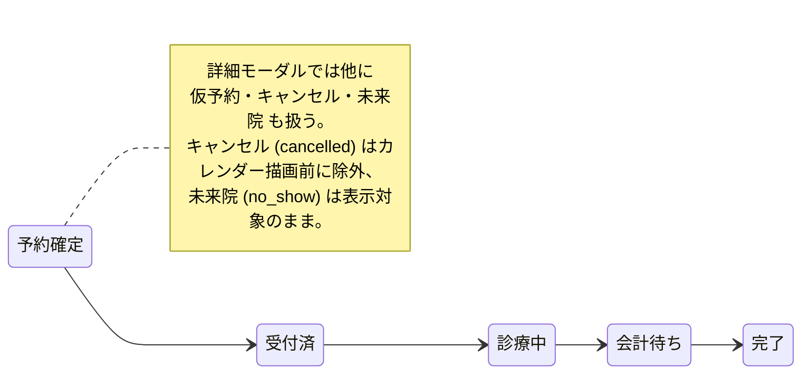

# 予約管理 仕様書 (Reservations)

> 確定仕様の適用範囲：今回の予約ドメイン合意と本書の接続境界。承認日は各FR要件表・根拠節（2026-10-13〜2026-10-14 17:35）、追加合意は各補足節を参照。[確定FR索引](../README.md#approved-reservation-scope)に掲載した箇所のみを確定情報として扱う。対象外の継承本文・未承認案・現行実装説明は一括確定しない。実装・実機状態は別管理。

17:35合意の[ホテル受付上限](../../../line/reservation-spec.md#requirement-fr-line-reservations-hotel-concurrent-stay-limit)は、医院別の同時宿泊頭数を宿泊期間全体で判定し、未設定・超過時はLINE確定せず医院相談へ案内する。ケージと世話担当は宿泊管理側で割り当て、医師指名／医師シフトで代用しない。技術方式は設計、実装・実機受入は未確認。

17:23 JSTの[LINE予約6点合意](../../../line/reservation-spec.md#line-agreement-1723)へ従う。公開された診療・トリミング・ホテルは予約対象、入院は医院相談。ホテルには医師指名・医師シフト・通常予約の同日制約を適用しない。受付制限・入力保持・受付前取消・必要設定不足の扱いと受入条件はLINE正本を参照する。ホテル受入基準は17:35合意の医院別同時宿泊頭数・全宿泊期間判定で、実装・実機受入は未確認。

17:17 JSTの院内予約8点一括合意は[予約入口の決定一覧](../README.md#internal-reservation-batch-1717)を参照する。誤取消／誤終了訂正、未終了予約保護、診療前の日付・カルテ整合、マスタ利用・名称履歴、休診日予約／日跨ぎ勤務、患者照合、ホテル担当時点／入院記録失敗の各正本と受入条件へ従う。LINE受付条件は17:23合意（ホテル受入基準は17:35合意、計算・保存方式は設計）、実装・実機受入は未確認。

17:04 JSTに文書反映を個別許可された[一医院での勤務終了と指名停止](../../../screens/settings/master-staff.md#requirement-fr-staff-clinic-departure-booking-guard)へ従う。A院の今後の指名予約を別の適格医師または未定へ手動変更してからA院での指名を停止し、B院の勤務・指名予約は継続する。現在診療中の既存保護、自動解除しない方針、完了済み履歴保持を維持し、全体退職と区別する。医院別の予約区分対応可否は既合意、具体的設定・保存方式は未決。受入条件は担当者マスタ正本へ置き、実装・実機受入は未確認。

| 管理項目 | 記載 |
|:---|:---|
| 文書ID・種別 | page.reservations.reservation-management／画面仕様 |
| 決定状態 | 今回の予約ドメイン合意は2026-10-14 17:35まで反映し、正本間の記述レビュー完了。対象外は既存決定状態を継承。実装・移行・実機検証とは別。完了範囲は予約入口の最終レビュー参照 |
| 実装状態 | 合意と現実装は別。main ec4f7146a の必要箇所を静的照合し、差分は予約正本の残差一覧へ記録。実装変更なし |
| 実機検証状態 | 今回未実施。過去の記録と今回の文書確認を分ける |
| 文書確認日 | 2026-10-14（合意・参照・語彙の確認。実機受入日ではない） |

用語・概念関係は[予約オントロジーの語彙正本](../../../ontology/reservations.md#reservation-ontology)へ統一する。予約区分、予約区分グループ（表示用）、予約区分の業務分類を区別し、担当者の総称と画面の指名医師／担当トリマー、職種と個人の対応可能予約区分を同義にしない。画面ラベル・引用・コード識別子は継承し、用語整理から未決業務を確定しない。

16:36合意の[入院開始の明示確定と二重登録防止](../../../screens/settings/master-reservation-type.md#requirement-fr-reservation-types-inpatient-start-confirm)へ従う。予定入院は予約だけで入院中にせず、来院後にスタッフが「入院開始」を確定する。診察後の入院決定も同じ入院管理へつなぎ、同じ入院を二重登録しない。担当医・入院記録は16:44合意の段階条件へ従う。具体的画面配置・重複防止の技術方式・記録作成失敗時の開始未確定・理由表示・再試行は17:17合意。具体的保存方式は設計として分ける。受入条件は区分マスタ正本へ置き、実装・実機受入は未確認。

16:44合意の[入院担当医と開始時の入院記録](../../../screens/settings/master-reservation-type.md#inpatient-doctor-and-record-at-start)へ従う。予定入院予約時は指名医師未定可、入院開始までに入院担当医決定、スタッフによる開始確定時に入院記録を作成する。予定入院・診察後の両入口を維持し、同じ入院を二重登録しない。予約の指名医師から担当医を自動確定せず、記録作成失敗時の開始未確定・理由表示・再試行は17:17合意。具体的UI・保存方式は実装設計とする。実装・実機受入は未確認。

## 目的・対象範囲

| シナリオ | 業務上の価値 | 優先度・理由 |
|:---|:---|:---|
| 患者を特定し予約から受付へ引き継ぐ | 必要な予約情報を保ち、同じ来院・記録を重複させない | 優先度は未決。2026-10-13の途中合意 |

### 概要

- **画面の目的**: 診療、トリミング、手術等の全予約をカレンダー形式で統合管理する。

対象は院内予約の登録・カレンダー・変更・取消と受付への引継ぎ。予約ドメインの確認範囲には予約区分マスタ、担当者の対応区分、シフト管理と予約への影響・依存契約も含む。追加対話で決まった共通ルールは各マスタ正本へ反映し、未決の依存を残す。共通マスタの本文を予約内へ複製しない。LIFFの予約規制とホテル・入院・トリミングの専用記録は本合意で変更しない。

## 利用者・権限・前提

- **アクセス権限**: `reservations:view`（`RequirePermission` によるルートガード。デフォルト action は `view`）。作成/編集/削除は `usePermission` によりさらに `create`/`edit`/`delete` 権限で出し分け。

利用者の職種別の範囲は未記載／要確認。操作前提の詳細は本書の各操作・保存契約と関連正本を参照する。

## 入口・出口

- **URLパターン**: `/reservations`

| 入口／出口 | 契機 | 引継ぎ情報 | 根拠 |
|:---|:---|:---|:---|
| URLパターン | 画面を開く | 上記URL／既存導線。呼出元の網羅は要確認 | 本節の元記載 |
| 当日受付から予約変更 | カードモーダルの「予約を変更」 | 同じ予約を特定し、予約管理の対象編集モーダルを開く。URL等の方式は未決 | [変更入口](#requirement-fr-reservations-edit-entry) |

## 表示情報・入力項目

| 項目 | 意味 | 型／形式 | 必須／任意 | 初期値 | 候補元 | 制約／根拠 |
|:---|:---|:---|:---|:---|:---|:---|
| 患者 | 予約対象の特定 | 既存患者選択／新規飼主・ペット登録 | 対象患者の特定が必要。新規入力の必須は下記 | 選択・入口による | 飼主・ペット検索 | 死亡ペット保護は維持 |
| 新規飼主名・動物種 | 同時登録する飼主とペットの特定 | 型・文字数は既存マスタ契約／未確認 | この2項目のみ必須 | 未記載／要確認 | 入力・動物種マスタ | [最小入力](#requirement-fr-reservations-new-patient-minimum) |
| 新規電話・ペット名・主訴 | 任意の補足情報 | 型・文字数は未確認 | 任意。予約時に空欄可 | 未記載／要確認 | 入力 | 来院時の照合・同名だけで自動統合なし・任意補完は17:17合意。導線は設計 |
| 予約日・開始時刻 | 来院日時 | 通常の時間指定予約は開始・終了が同日 | 必須 | カレンダークリック日時 | 入力・カレンダー | [同日予定](#requirement-fr-reservations-same-day-schedule) |
| 終了時刻 | 予約終了 | 通常の時間指定予約は開始と同日 | 必須、開始より後 | 開始＋予約区分の所要時間 | 自動入力後に手動編集可 | [終了保持](#requirement-fr-reservations-end-time-preservation)・[同日予定](#requirement-fr-reservations-same-day-schedule) |
| 予約区分 | 予約の種類と所要時間・対応適格性 | 共通予約区分マスタ参照 | 必須。区分無効・所属グループ無効は新規選択不可 | 未記載／要確認 | [マスタ正本](../../../screens/settings/master-reservation-type.md#requirement-fr-reservation-types-group-disable-new-use) | 未来日を含む保存済み予約・履歴は保持。LINE条件は[現正本](../../../line/reservation-spec.md#line-scheduled-slot-basis)へ従う。設定不足・新規選択不可の業務は合意済み、実装／検証は別 |
| 担当者・指名 | 区分に応じた指名 | 共通スタッフ・シフト参照 | 指名なし可。非勤務者は選択不可 | 列担当者（適格時）／未定列は空欄 | [時間全体の適格性](#requirement-fr-reservations-duty-staff-selection) | [区分別ラベル](#requirement-fr-reservations-staff-role-label)。全アプリの一括renameはしない |
| 来院区分 | 初診／再診の区分 | 既存仕様参照 | 本対話では変更なし | 作成モード別（下記詳細） | 初診／再診 | 既存の初診／再診入力支援・引継ぎを維持。経路の実装整合は検証 |
| 予約内容 | 予約に付随する内容（notes） | 型・文字数は未確認 | 通常予約では任意（現実装）。新規主訴も任意へ合意 | 既存値を表示 | 入力 | 下記「予約詳細の入力」 |
| 予約経路 | 入口の記録 | 既存仕様参照 | 未記載／要確認（編集モードのみ表示） | 未記載／要確認 | LINE／電話／受付／診察室／記録入力 | 下記「予約詳細の入力」 |

### 画面構成とビュー

#### 1. カレンダービュー

用途に応じて2つの表示形式を切り替え可能です。
- **月表示 (`MonthView`)**: 日付ごとの予約件数と概要を把握。セルクリックで該当日の週表示へ遷移。
- **週表示**: [担当者別カレンダー](#requirement-fr-reservations-staff-calendar)を採用。従来の5日/7日切替・URLと月表示の扱いは今回の合意で変更していない。時間外の追加は[院内警告確認](#requirement-fr-reservations-internal-warning-override)を参照し、LIFFの制限解除へ拡張しない。

#### 担当者別カレンダー（合意済み）

日ごとに担当者別の列と「担当者未定」列を置き、各予約をその担当者の列へ表示する。空白ホバーで15分単位のクリック位置ブロックを表示し、クリック日時と適格な列担当者をモーダルへ初期入力する。未定列では担当者空欄。15分はクリック位置の単位で予約長固定ではない。所要時間の[5分刻み](../../../screens/settings/master-reservation-type.md#requirement-fr-reservation-types-duration-step)とは別に扱う。非勤務者の予約指名は[候補契約](#requirement-fr-reservations-duty-staff-selection)で防ぎ、休みなのに予約がある列を警告付きで残す案は不採用。タッチの空白選択、未登録日の列構成、データ不整合救済、月表示への適用詳細は未決。

#### 2. インテリジェント・ツールバー

- **動的カラー凡例**: 色は[グループ側の共通マスタ](../../../screens/settings/master-reservation-type.md#requirement-fr-reservation-types-group-inheritance)を継承し、グループ名称も表示する。未所属は共通標準色。10presetとRGBの正本はマスタ側、正確値は未決。
- **マルチソース・フィルタ**: 「手動予約」と「LINE予約（source=line）」を切り替えて表示可能。
- **担当医フィルタ**: 特定の医師のスケジュールのみを抽出。
- **取消済みの表示**: [取消・履歴保持](#requirement-fr-reservations-cancel-history)に従い、通常カレンダーでは非表示、「取消済み表示」で確認できる。未来院の表示条件は既存記載を継承し、診療前の誤取消は[同じ予約の復元契約](#requirement-fr-reservations-restore-preconsultation-cancellation)に従う。その他の訂正は[記録確認訂正](../../../workflows/reservation-to-record-flow.md#requirement-fr-reservations-record-reviewed-correction)へ渡し、内部手順は関連設計。

### 予約登録フロー (`ReservationFormModal`)

デスクトップでは「患者選択」パネルと「予約情報」パネルを左右分割で同時表示します（モバイルのみ、`StepIndicator` による Step1/Step2 タブ切替。両タブは自由に行き来可能で、順序を強制するゲートではありません）。

#### 患者の特定（臨床安全ガード）

- **高速検索**: 飼主名、ペット名によるリアルタイム検索。
- **死亡ペットの保護**: ステータスが「死亡」のペットは一覧でグレーアウトされ、選択が物理的に無効化されます（`PatientSelectionTable.tsx`）。
- **結果スクロール**（EMR-318）: 患者結果パネルを高さ制約内のスクロール領域とし、キーボードでフォーカスできる。Windows の実際のスクロールは別途受入で確認する。
- **飼主詳細からの受付追加**（EMR-318）: 予約管理側の受付導線は残す。同一予約・受付の増殖を防ぐ契約と主導線は[横断フロー](../../../workflows/reservation-to-record-flow.md#checkin-contract)を参照。現実装は当日予約の再取得・更新日時照合・二重作成ガードを持つが、未来院の再受付と通常カルテ作成までの同時成功は合意との差分。実DB並行要求の受入は未確認。

#### 新規飼主・ペットの最小入力（合意済み）

同時登録では飼主名と動物種のみ必須。電話番号・ペット名・主訴は任意で、空欄のまま予約できる。予約日、開始・終了時刻、予約区分の必須を解除する指示ではない。来院時照合と既存患者再利用・同名だけで自動統合なし・任意補完は17:17合意。具体的照合方式・補完導線は設計。

#### 予約詳細の入力

- **来院区分の入力支援**（EMR-274）: 通常の新規作成では、新規飼主モードを「初診」、既存ペット選択中を「再診」に固定し、表示値と送信値を一致させる。同一飼主の複数ペット選択・別飼主への切替も再診、新規飼主への切替は初診となる。患者未選択時は選択制限なし。予約編集・次回予定の確定では既存値を維持し、来院区分を変更可能。新規飼主の登録成功後、予約保存のみ失敗した場合も新規飼主モードを維持して初診を送信する。
  - この入力支援は受診履歴の判定やAPI制約を追加しない。未受診でも登録済みペットを選べば再診となる。予約の来院区分は予約連携カルテ作成時の初診ウェルカム通知判定へ伝わる。一方、3日後・7日後フォローは飼主の最初のカルテ日による別判定（EMR-276の通知条件整備は別票）。訂正は予約編集で行う。
  - 予約フォーム内に既存飼主への新規ペット追加機能はない。飼主詳細等で登録後、既存ペットとして選択する場合も再診扱い。
- **予約内容**（EMR-275）: 作成・編集フォームと予約詳細は同じ表示名称を使う。既存値を表示・保存し、DB/APIの項目名は `notes` のまま。受付側（EMR-278）も表示名称は「予約内容」。
- **スマート・スナップ**: カレンダーのクリック位置は15分単位。[担当者別カレンダー](#requirement-fr-reservations-staff-calendar)が合意仕様。空き枠API中心の候補・15分fallbackは現実装の情報であり、新しい院内仕様の正本ではない。

- **終了時刻の自動入力と保持**（合意済み）: 開始＋予約区分の所要時間を自動入力し、手動編集を可能にする。終了フォームに「自動入力されるが編集できる」ことを説明する。終了を手動編集した後は、予約区分・開始を変更しても終了を維持する。維持した終了が開始以前なら修正を促す。所要時間未設定の区分は設定完了まで新規選択不可で、仮の既定時間を採用しない。保存時の警告・検査方式は[技術契約](../../../../design/domains/reservations/technical-spec.md#reservation-api-closed-contract)、実consumer検証は別。表示方法の未承認案は[設計資料](../../../../work/design/reservations/pending-and-design.md#end-time-explanation-proposal)を参照する。

#### 通常の時間指定予約は同日内（合意済み）

通常診療・トリミングなどの時間指定予約は、終了日時が開始日時より後で、開始と終了を同じ予約日に限定する。既存の予約業務の日付基準（JST）で同日とし、日跨ぎの予定は保存できない。時間外・満員・同一担当者重複の警告確認を、この同日制約の免除に使わない。

終了の自動入力は開始＋予約区分所要時間という合意を維持する。その結果が翌日になる場合は同日内に収まる日時へ修正を促し、翌日値のまま保存しない。この合意だけで所要時間の自動短縮・切詰めや別日への分割登録を実行する仕様にはしない。手動終了の編集・保持は維持し、開始以前または別日になった場合は修正を促す。

宿泊を伴うホテル・入院は、通常予約を日跨ぎにする代わりに[別ドメインの期間管理](../../../screens/09-hospitalization-form.md)で扱う。来院・チェックイン枠と宿泊期間を区別し、期間設定や連携の詳細はこの合意で確定しない。ホテル・入院の既存本文は変更しない。

これは予約予定の入力制約であり、実際の診療が深夜へ延長したときに強制終了する契約ではない。[予定終了超過でも現在診療中の予約保護](../../../workflows/reservation-to-record-flow.md#consultation-overtime)を維持し、予約時間の自動延長も承認しない。既存の日跨ぎデータの有無・扱い、日跨ぎ勤務の具体的保存・表示方式、宿泊期間連携の詳細は未確認／未決で、既存時刻を自動修正しない。

決定者はユーザー、2026-10-13 22:09 JSTに「通常診療・トリミングなどは同日、宿泊ホテル・入院は別期間管理」の質問へ「ok」と回答。実装・実機受入の完了ではない。

- **院内の追加判断**（合意済み）: 満員・時間外でも警告を確認して追加できる。空き枠や残り枠数の表示概念は採用しない。LIFFの空き枠・予約規制には適用しない。警告の詳細条件・文言、時間外判定の基準マスタは未決。

- **同一担当者の重複警告**（合意済み）: 同じ担当者の時間重複はフォーム内で警告し、確認後に登録できる。保存を一律拒否しない。担当者未定同士について担当者重複警告は不要。登録・編集・ドラッグ変更に警告確認を維持する。
- **指名**: 区分別の表示名と時間全体の勤務・休憩適格性は下記FR。既存予約との時間重複は警告確認で許可するが、非勤務・休憩非適格者を指名する合意ではない。
- **予約経路** (`ReservationRouteSelect`、編集モードのみ): LINE/電話/受付/診察室/記録入力のいずれかを選択・記録。メインの保存操作とは独立して即時保存される。

#### 区分別の指名表示名（合意済み）

診察では「指名医師」、トリミングでは「担当トリマー」など区分に応じた表示名を使う。その他区分の具体的名称とマッピングは未決。全アプリのstaffや共通スタッフ属性を医師へ一括改名しない。

#### 全時間の勤務・休憩適格性（合意済み）

担当者は[個人の対応可能区分](../../../screens/settings/master-staff.md#requirement-fr-staff-positive-reservation-capabilities)を持ち、予約時間全体が勤務内で休憩と重ならない人だけを指名候補にする。非勤務者は選択不可。既存予約との重複はフォーム内で警告し確認登録を許す。休憩中の人は日付見出しの対応可能人数から除く。休憩端点の重複判定は下記の21:52合意に従う。通常予約の勤務開始／終了の端点、日跨ぎ勤務登録可・医院別判定は合意済み、勤務端点等の具体的な判定方式は設計。診療中の医師引継ぎは[23:43 JSTの契約](#requirement-fr-reservations-doctor-handoff)へ従い、交代先は引継ぎ後の担当時間で判定する。過去全体の勤務は要求せず、[12:22合意の判定時間・延長警告](#handoff-time-and-extension)へ従う。

#### 休憩端点と正の時間幅の重複（合意済み）

予約が休憩開始ちょうどに終了する場合、または休憩終了ちょうどに開始する場合は、休憩との重複に当たらない。予約と休憩が正の時間幅で重なる場合は指名不可。勤務時間全体に収まることと、個人対応区分等の他の指名条件は維持する。既存予約同士の重複を警告確認で許す契約とは別で、休憩非適格を警告確認で免除しない。

勤務9:00〜18:00、休憩12:00〜13:00で、他の指名条件を満たす前提の合意例:

| 予約時間 | 指名判定 | 根拠 |
|:---|:---|:---|
| 11:30〜12:00 | 可能 | 休憩開始ちょうどに終了し、正の重複幅がない |
| 13:00〜13:30 | 可能 | 休憩終了ちょうどに開始し、正の重複幅がない |
| 11:45〜12:15 | 不可 | 12:00〜12:15が休憩と正の時間幅で重なる |

決定者はユーザー、2026-10-13 21:52 JSTにこの3例の質問へ「ok」と回答。勤務外の予約を指名可能にしたり、他の適格条件を免除したりする合意ではない。実機受入は未確認。

#### 未登録・勤務なしの指名なし予約（合意済み）

対象範囲の当日シフトが全て未登録なら指名候補を出さず、指名なしで予約できる。シフト登録後に指名を設定する。能力判定は「判定不可」と表示し、登録済みで勤務者が0人の場合と区別する。勤務者なしの時間外でも院内は指名なしで警告確認登録できる。一部未登録は下記22:21合意で区別する。未登録検出方式・未登録検出の対象母集団・他院勤務情報の取得方法、未登録日の列構成と救済は未決。

標準所要時間の[必須・5〜480分・5分刻み](../../../screens/settings/master-reservation-type.md#requirement-fr-reservation-types-duration-range)は予約区分マスタの契約。実予約の終了時刻は上記の手動編集・保持契約を維持し、その時間長へマスタ範囲を勝手に適用しない。既存所要時間未設定への自動補完なし・一覧提示は21:35合意済み。新規選択不可は21:41合意済みで、補完担当は[マスタ正本](../../../screens/settings/master-reservation-type.md#requirement-fr-reservation-types-legacy-review)で確定。判定方法・設定時期・導線は設計。

#### 予約先医院の勤務情報に基づく対象範囲（合意済み）

指名候補と対応可能人数の不足判定は、予約先医院へ出勤するスタッフだけを対象にする。同じ時間に別の医院へ出勤している人は、指名候補にも対応可能人数にも含めない。主所属や所属医院の一覧だけで出勤先を推測しない。

有効スタッフ・個人の対応可能区分・予約時間全体の勤務内・休憩非重複と、登録済み情報に基づく判定など既存条件も維持する。未登録者の勤務を推測せず、全未登録と部分登録の区別は保持する。

決定者はユーザー、2026-10-13 22:31 JSTにこの予約先医院・他院同時間勤務除外の提案へ「ok」と回答。医院間で勤務時間が重なるシフトの新規登録・更新を保存不可にし、相手医院名と重複時間を示すことは[22:44 JSTのシフト合意](../../../screens/24-shift-calendar.md#requirement-fr-shifts-cross-clinic-overlap)による。受入条件はシフト正本に置く。予約同士の重複警告後の保存許容とは別に扱う。移動時間は[22:57 JSTのシフト登録者による手動確保](../../../screens/24-shift-calendar.md#requirement-fr-shifts-manual-travel-gap)に従い、自動計算や固定1時間の必須値は採用しない。他院勤務情報の取得・同一人物照合の具体的方法は未決。既存の矛盾した勤務情報の解消方式や既存予約の自動変更を、この回答から推定しない。

#### 一部シフト未登録時の候補と能力判定（合意済み）

当日のシフトが一部だけ未登録の場合、シフト登録済みの人だけを指名候補にし、未登録者を候補に出さない。有効スタッフ・個人の対応可能区分・予約時間全体が勤務内・休憩非重複など、他の既存条件も満たすことが前提。シフトが登録されているだけで休日・非適格者を指名可能にしない。

候補人数と対応能力の不足判定は登録済み情報だけに基づく。一部未登録の状況で不足警告を出す場合は「シフト未登録者がいるため、登録済みの情報で判定しています」と表示する。未登録者の勤務を推測せず、未登録を休日や全体の確定ゼロと同一視しない。

全未登録時の「判定不可」と区別する。部分未登録で登録済み情報の候補人数が0でも、それだけで未登録者を含む全体の勤務者が0と確定しない。指名なしの警告確認登録、同一担当者重複警告、自動割当なしの契約は維持する。

決定者はユーザー、2026-10-13 22:21 JSTにこの登録済み限定・不足警告への説明追加の提案へ「ok」と回答。未登録の検出方式・未登録検出の対象母集団・他院勤務情報の取得方法、取得失敗と未登録を区別する方法、区分混在を含む能力計算の詳細は調査／未決で、実装・実機受入を完了扱いにしない。

#### 日付見出しの対応能力警告（合意済み・計算詳細は未決）

シフト管理の勤務情報と該当予約区分の担当適格性を使い、対応能力を超える時間帯を日付見出しに警告する。既存の担当者指定予約で埋まった担当者を重複計上せず、担当者未定予約が残る適格担当者で対応可能かを判定する。予約を自動割当しない。警告があっても登録できる。

合意例: 15–16時にA/Bが勤務・該当区分に対応可能で、A指定1件＋担当者未定2件なら1件超過を警告する。全未登録は「判定不可」で登録済み勤務0人と区別する。一部未登録時は[登録済み情報ベースの判定と説明](#requirement-fr-reservations-partial-shift-evaluation)に従う。

設計注意: 区分混在・担当適格性の組合せ・時間の部分重複では単純総数が正しくない。休憩中を除外することは合意済みだが、全体アルゴリズム、未登録検出方式・未登録検出の対象母集団・他院勤務情報の取得方法、勤務の端点・複数医院・日跨ぎ勤務は17:17合意で登録可、保存・表示方式は設計。休憩重複の端点は[合意例](#break-boundary)に従う。医院間勤務時間重複の保存拒否は[シフト正本](../../../screens/24-shift-calendar.md#requirement-fr-shifts-cross-clinic-overlap)で合意済み。合意例から未確認方式を推定しない。

#### 院内の所要時間未設定案内（合意済み）

新規予約入力では、[所要時間未設定の区分を設定完了まで選択不可](../../../screens/settings/master-reservation-type.md#requirement-fr-reservation-types-unset-duration-new-use)とし、「所要時間が未設定です」と予約区分の設定画面へ進むボタンを表示する。登録済み予約の扱いは変えず、所要時間設定だけで個別／グループ無効を解除しない。対象区分への引継ぎ方法、権限不足時の案内、設定からの戻り方と設定時期は設計。補完担当は[旧マスタ確認・補完](../../../screens/settings/master-reservation-type.md#requirement-fr-reservation-types-legacy-review)で確定。LINE利用者にこの管理画面ボタンを出す仕様へ拡張しない。

#### ユーザーインタラクション

- **ドラッグ&ドロップ**（合意済み）: 既存予約の日時を変更し、他担当者の列へ移動した場合は担当者も変更する。保存前に変更内容を確認し、同一担当者重複の警告確認を行う。日時変更の可否は[診療段階別の通常操作制限](#requirement-fr-reservations-post-consultation-edit-limits)へ従う。未定列へ戻す操作と移動取消の詳細は未決。別医師への変更は[診療終了までの引継ぎ契約](#requirement-fr-reservations-doctor-handoff)へ従う。記録確認訂正の主体・整合確認は横断正本へ。具体的訂正内部は関連設計。次回予定のsentinelを通常予約と同じドラッグ対象にする合意ではない。 [12:22合意の判定時間・延長警告](#handoff-time-and-extension)へ従う。
- **レスポンシブ**: デスクトップ環境を優先しつつ、タブレット端末での視認性も確保。

## 操作・業務ルール・状態遷移

| 要件ID | 定義の所在 | 決定根拠 |
|:---|:---|:---|
| FR-reservations-deceased-pet-exclusion | [既存の要件本文](#requirement-fr-reservations-deceased-pet-exclusion) | 既存記載を継承。ID付与で合意済みにしない |
| FR-reservations-preconsultation-date-record-correction | [診療前の日付訂正とカルテ](#requirement-fr-reservations-preconsultation-date-record-correction) | 合意済み。2026-10-14 17:17 JST「ok」。具体的保存・表示は設計 |
| FR-reservations-staff-role-label | [区分別の指名表示名](#requirement-fr-reservations-staff-role-label) | 合意済み。2026-10-13、追加対話 |
| FR-reservations-duty-staff-selection | [全時間の勤務・休憩適格性](#requirement-fr-reservations-duty-staff-selection) | 合意済み。2026-10-13、追加対話 |
| FR-reservations-unassigned-without-duty | [未登録・勤務なしの指名なし予約](#requirement-fr-reservations-unassigned-without-duty) | 合意済み。2026-10-13、追加対話 |
| FR-reservations-partial-shift-evaluation | [一部未登録時の候補・判定](#requirement-fr-reservations-partial-shift-evaluation) | 合意済み。2026-10-13 22:21 JST、ユーザー「ok」。検出方式・対象範囲は未決 |
| FR-reservations-clinic-duty-scope | [予約先医院の勤務先判定](#requirement-fr-reservations-clinic-duty-scope) | 合意済み。2026-10-13 22:31 JST、ユーザー「ok」。医院間重複シフトの保存不可は[シフト正本](../../../screens/24-shift-calendar.md#requirement-fr-shifts-cross-clinic-overlap)、移動時間は[登録者が手動確保](../../../screens/24-shift-calendar.md#requirement-fr-shifts-manual-travel-gap) |
| FR-reservations-new-patient-minimum | [最小入力](#requirement-fr-reservations-new-patient-minimum) | 合意済み。2026-10-13、ユーザー対話。[決定根拠](#agreement-2026-10-13) |
| FR-reservations-internal-warning-override | [院内警告確認](#requirement-fr-reservations-internal-warning-override) | 合意済み。2026-10-13、ユーザー対話。[決定根拠](#agreement-2026-10-13) |
| FR-reservations-staff-calendar | [担当者別カレンダー](#requirement-fr-reservations-staff-calendar) | 合意済み。2026-10-13、ユーザー対話。[決定根拠](#agreement-2026-10-13) |
| FR-reservations-end-time-preservation | [終了時刻](#requirement-fr-reservations-end-time-preservation) | 合意済み。2026-10-13、ユーザー対話。[決定根拠](#agreement-2026-10-13) |
| FR-reservations-same-day-schedule | [通常時間指定予約の同日制約](#requirement-fr-reservations-same-day-schedule) | 合意済み。2026-10-13 22:09 JST、ユーザー「ok」 |
| FR-reservations-staff-overlap-warning | [担当者重複](#requirement-fr-reservations-staff-overlap-warning) | 合意済み。2026-10-13、ユーザー対話。[決定根拠](#agreement-2026-10-13) |
| FR-reservations-capacity-warning | [対応能力](#requirement-fr-reservations-capacity-warning) | 合意済み。2026-10-13、ユーザー対話。[決定根拠](#agreement-2026-10-13) |
| FR-reservations-drag-confirmation | [ドラッグ確認](#requirement-fr-reservations-drag-confirmation) | 合意済み。2026-10-13、ユーザー対話。[決定根拠](#agreement-2026-10-13) |
| FR-reservations-cancel-history | [取消履歴](#requirement-fr-reservations-cancel-history) | 合意済み。2026-10-13、ユーザー対話。[決定根拠](#agreement-2026-10-13) |
| FR-reservations-restore-preconsultation-cancellation | [診療前の誤取消からの復元](#requirement-fr-reservations-restore-preconsultation-cancellation) | 合意済み。2026-10-14 17:10 JST「ok」。復元先・手動修正は17:17合意、保存方式は設計 |
| FR-reservations-edit-entry | [予約変更入口](#requirement-fr-reservations-edit-entry) | 合意済み。2026-10-13、ユーザー対話。[決定根拠](#agreement-2026-10-13) |
| FR-reservations-post-consultation-edit-limits | [診療開始後・会計完了後の通常操作](#requirement-fr-reservations-post-consultation-edit-limits) | 合意済み。2026-10-13 23:21 JST、ユーザー「ok」。別医師変更は[23:43合意](#requirement-fr-reservations-doctor-handoff)。記録確認訂正の主体・整合確認は横断正本へ。具体的訂正内部・段階判定方式は関連設計。[12:22合意の判定時間・延長警告](#handoff-time-and-extension)へ従う |
| FR-reservations-cross-business-type-change | [受付前後の業務分類跨ぎ変更](#requirement-fr-reservations-cross-business-type-change) | 合意済み。2026-10-14 18:26 JST、一括「ok」。記録確認訂正の具体的方式は関連領域へ |
| FR-reservations-doctor-handoff | [診療終了までの医師変更・引継ぎ](#requirement-fr-reservations-doctor-handoff) | 合意済み。2026-10-13 23:43 JST、ユーザー「ok」。11:15に引継ぎ後の担当時間と指名なし変更を合意。[12:22合意の判定時間・延長警告](#handoff-time-and-extension)へ従う |
| FR-reservations-concurrent-edit | [同時編集](#requirement-fr-reservations-concurrent-edit) | 合意済み。2026-10-13、ユーザー対話。[決定根拠](#agreement-2026-10-13) |
| FR-reservations-checkin-idempotency | [受付導線・重複防止](../../../workflows/reservation-to-record-flow.md#requirement-fr-reservations-checkin-idempotency) | 合意済み。2026-10-13、ユーザー対話 |
| FR-reservations-manual-no-show | [手動未来院・再受付](../../../workflows/reservation-to-record-flow.md#requirement-fr-reservations-manual-no-show) | 合意済み。2026-10-13、ユーザー対話 |
| FR-reservations-checkin-record-atomicity | [受付と通常カルテの同時成功](../../../workflows/reservation-to-record-flow.md#requirement-fr-reservations-checkin-record-atomicity) | 合意済み。2026-10-13、ユーザー対話 |

| 操作 | 実行条件 | 成功後状態／遷移 | 失敗挙動 | 根拠 |
|:---|:---|:---|:---|:---|
| 作成・編集・取消 | [既存grantの目的別対応](../../../../design/domains/reservations/technical-spec.md#reservation-api-closed-contract)を選定済み。新権限の拡張なし、API反映・実認可検証は別 | 警告確認・変更確認・履歴保持は本書の合意要件 | 入力保持と変更通知。下記保存契約 | 各FRと[実装残差](#implementation-gaps) |
| 次回予定を確定 | reservations:edit、生存ペット | 実予約へ昇格 | 未記載／要確認 | 状態節・[次回予定契約](../../../workflows/reservation-to-record-flow.md#next-visit-intent) |

### 取消と履歴保持（合意済み）

取消前に確認し、予約履歴を保持する。通常カレンダーからは隠し、「取消済み表示」で確認できる。受付済みでも診療前の予約は予約管理から取消できる。診療開始後・会計完了後の通常操作での取消は[23:21 JSTの段階別制限](#requirement-fr-reservations-post-consultation-edit-limits)により不可。既作成カルテは自動削除せず保持する。診療前の誤取消は下記17:10合意で同じ予約を復元し、担当適格性を再確認して既存カルテを再利用する。その他訂正の入口は[記録確認訂正](../../../workflows/reservation-to-record-flow.md#requirement-fr-reservations-record-reviewed-correction)、カルテ内部操作は関連設計。

### 診療前に誤って取り消した予約の復元（17:10合意）

診療前に誤って取り消した予約は、同じ予約として復元できる。予約を新規作成・複製して置き換えず、取消履歴・同一予約の関連を保持する。作成済みの通常カルテがあれば、その同じカルテを再利用し、新しいカルテを重複作成しない。取消時にカルテを自動削除しない既存契約を維持する。カルテがない場合に復元操作だけで作成する判断は含めず、[受付時作成・同時成功契約](../../../workflows/reservation-to-record-flow.md#checkin-contract)と診療開始時の既存契約へ従う。

復元時点で、指名医師の対応可否・勤務を再確認する。予約先医院ごとの対応可能区分、個人の有効性、予約時間全体が同院の勤務内かつ休憩外等の既存適格性を照合し、取消前に選べたという事実だけで現在も適格と扱わない。医院別指名停止や全員／一部シフト未登録の既存条件も維持する。適格性再確認を省略した指名復活や、医師・指名の自動差替え／自動解除は今回承認しない。17:17合意により不適格な指名は別の対応可能な医師または未定へ手動変更して復元する。既存の指名なし許容、予約重複の警告確認、無効区分を保持する既存予約の編集契約も解除しない。

対象は診療前の誤取消。診療開始後・診療後・支払い確定後の訂正へ拡張しない。[誤った診療終了の取消](../../../workflows/reservation-to-record-flow.md#requirement-fr-reservations-undo-consultation-end)とは別操作であり、そちらの支払い前・受付操作可能スタッフ・日付非制限・理由入力確認を予約復元へ自動適用しない。復元先は17:17合意で取消前の状態とする。実行者・日付制限等は既存の認可・予約契約を照合し、UI、保存・再試行・履歴の技術方式は設計へ分ける。復元だけで診療開始／終了を自動確定せず、作成済みカルテ・会計・専用記録の自動変換／削除を行わない。

決定者はユーザー。質問「次に、診療前に誤って取り消した予約は、同じ予約として復元できるようにしてよいですか？ 復元時に指名医師の対応可否・勤務を再確認し、作成済みカルテがあれば再利用する案です。」（Sentinel_d949f07438cc81919622bce586559268）への2026-10-14 17:10 JST「ok」（Sentinel_c8520295cd648191978c0c031f8a87c9）が根拠。本更新は個別合意の文書反映で、定時報告は引き続き読み取りのみ。実装・実機受入は未確認、予約ドメイン全体は未完了。

### 予約変更の入口（合意済み）

予約変更は予約管理へ集約する。当日受付カードモーダルに「予約を変更」を置き、予約管理の同じ予約の編集モーダルを開く。受付済みで診療前なら従来の変更範囲を維持する。診療開始後・会計完了後は[通常操作制限](#requirement-fr-reservations-post-consultation-edit-limits)に従い、日時・予約区分変更は不可、メモ編集は可。指名医師変更は[診療終了までの引継ぎ契約](#requirement-fr-reservations-doctor-handoff)へ従う。カルテから予約を変更しない。予約ID等の引継ぎ方式・戻り先は設計。記録確認訂正の主体・手順は[横断正本](../../../workflows/reservation-to-record-flow.md#requirement-fr-reservations-record-reviewed-correction)で確定。

### 診療開始後・会計完了後の通常予約操作（合意済み）

院内の通常予約変更操作では、診療開始後は予約日時・予約区分を変更できず、予約取消もできない。予約のメモ（予約内容）は編集できる。会計完了後も同じ制限を適用する。受付済みでも診療前であれば、これまで合意した変更・取消を認める範囲を維持する。ただし業務分類をまたぐ区分変更は18:26合意の下記専用境界へ従い、受付後の通常編集では不可。既存権限・適格性・履歴保持など他の条件は免除しない。

| 業務段階 | 日時・予約区分の変更 | 予約取消 | メモ編集 | 指名医師の変更・指名解除 |
|:---|:---|:---|:---|:---|
| 診療開始前（受付済みを含む） | 既存条件に従い可。受付後の業務分類跨ぎは通常変更不可 | 既存の取消条件に従い可 | 既存の編集条件に従い可 | 既存の指名条件に従う |
| 診療中（診療終了まで） | 不可 | 不可 | 可 | 適格な医師への変更・指名なしへの変更可。[引継ぎ契約](#requirement-fr-reservations-doctor-handoff) |
| 診療終了後 | 不可 | 不可 | 可 | 通常操作では不可 |
| 会計完了後 | 不可 | 不可 | 可 | 診療終了の境界に従う。診療終了後は不可 |

日時変更を伴うドラッグにもこの制限を適用する。この23:21の提案に含まれていなかった別医師への指名変更は[23:43の引継ぎ契約](#requirement-fr-reservations-doctor-handoff)で決定した。会計完了を診療終了の判定操作へ読み替えず、指名なしへの変更も同契約の11:15合意に従い、診療終了まで可、終了後の通常解除は不可。開始・終了は[カードモーダルでの明示確定](../../../workflows/reservation-to-record-flow.md#requirement-fr-reservations-manual-consultation-state)へ従う。[確認付きドラッグ終了](../../../workflows/reservation-to-record-flow.md#requirement-fr-reservations-confirmed-drag-consultation-end)も採用。誤終了取消は[11:56の専用モーダル操作](../../../workflows/reservation-to-record-flow.md#requirement-fr-reservations-undo-consultation-end)へ従い、通常の予約内容変更と区別する。記録確認訂正の主体・整合確認、その他逆遷移、会計確定境界は[業務5点合意](../../../workflows/reservation-to-record-flow.md#five-business-decisions)へ従う。権限識別子・専用訂正内部は関連設計。診療前の誤取消復元は17:10・17:17合意済み。現在の状態コードだけでそれらの定義を確定しない。LINE固有の変更・取消条件は今回決めない。

決定者はユーザー。2026-10-13 23:21 JSTに「診療開始後は日時・予約区分の変更や取消を制限し、メモ修正可能。会計完了後も同様。受付済みで診療前なら従来どおり変更可能」という直前提案へ「ok」と回答。実装対応・実機受入は未確認。

### 業務分類をまたぐ予約区分変更（18:26合意）

予約区分マスタ自身の業務分類変更と、予約で別の予約区分を選ぶ操作を区別する。受付前は、業務分類をまたぐ予約区分変更も担当者・時間等を再確認して変更できる。選択先の有効状態、医院・対応可能区分、勤務・休憩、日時・所要時間、同日制約やホテル期間等の分類別既存条件を維持する。担当種類や接続先を旧分類から推測せず、医師指名をホテル世話担当へ自動転記しない。

受付後は、業務分類をまたぐ変更を通常の予約編集では認めず、スタッフが記録を確認する訂正として扱う。既存カルテ・記録を自動削除・変換しない。同じ分類内の区分変更も、診療段階・有効状態・担当適格性等の既存制限を維持する。診療開始後の通常区分変更禁止、支払い確定後の会計訂正境界も免除しない。訂正は[受付担当の理由・変更案と記録担当の確認](../../../workflows/reservation-to-record-flow.md#requirement-fr-reservations-record-reviewed-correction)で確定し、予約・記録・請求を整合させる。具体的権限識別子・画面・記録内部／保存方式は関連領域の設計で、内部変更を追加許可しない。

| 状態／変更 | 通常編集での扱い | 担当・記録の扱い |
|:---|:---|:---|
| 受付前・同じ業務分類内 | 既存条件に従い変更可 | 有効状態・担当者・時間等の既存条件を確認 |
| 受付前・業務分類をまたぐ | 担当者・時間等を再確認して変更可 | 変更先分類の担当・期間・接続条件を確認。既存記録を自動変換・削除しない |
| 受付後・同じ業務分類内 | 既存の診療段階制限に従う | 診療開始後は通常区分変更不可 |
| 受付後・業務分類をまたぐ | 通常の予約編集では不可 | スタッフが記録を確認する訂正へ。既存カルテを自動削除・変換しない |

決定者はユーザー。4案と文書不整合3点をまとめた質問（Sentinel_71abdb50fcec8191988196aeb8e25f04）への2026-10-14 18:26 JST「ok」（Sentinel_4e15997c948081918e456378427a7091）が根拠。定時報告とは別の個別承認編集。実装・移行・実機受入は未確認。

記入済み日付訂正と受付後分類変更の申請・記録担当確認・予約／記録／請求の整合確認は[横断正本の記録確認訂正](../../../workflows/reservation-to-record-flow.md#requirement-fr-reservations-record-reviewed-correction)へ従う。確定済み記録は追記訂正。その他の逆遷移は[専用訂正への境界](../../../workflows/reservation-to-record-flow.md#requirement-fr-reservations-controlled-reverse-transition)、会計確定後の通常Undo停止は[会計境界](../../../workflows/reservation-to-record-flow.md#accounting-finalization-undo-boundary)を参照する。

### 診療終了までの指名医師変更と引継ぎ（合意済み）

院内予約の指名医師は、診療中の引継ぎに備え、診療終了までは変更できる。診療終了後は通常操作で別の医師へ変更できない。変更先は勤務・休憩と個人の対応可能区分など既存の適格条件を満たす医師に限る。非勤務や対応不可の医師を引継ぎ先として許可しない。

変更は[予約管理の同じ予約](#requirement-fr-reservations-edit-entry)で行う。カルテ編集に予約変更機能を追加する合意ではなく、診療開始後の日時・予約区分変更や取消を許可するものでもない。

診療中の交代先は、引継ぎ後に担当する時間の勤務・休憩・対応可能区分で判定する。過去の予約時間全体について交代先に勤務を要求しない。新規予約・診療前の通常指名の[全時間の勤務・休憩条件](#requirement-fr-reservations-duty-staff-selection)と区別する。[12:22合意の判定時間・延長警告](#handoff-time-and-extension)へ従う。勤務・休憩・対応区分という条件自体は維持し、開始・終了は[実業務に基づくスタッフの明示確定](../../../workflows/reservation-to-record-flow.md#requirement-fr-reservations-manual-consultation-state)を正とし、予定開始・終了時刻で自動遷移しない。開始は[当日カードモーダル「カルテ作成」](../../../workflows/reservation-to-record-flow.md#consultation-start-card-modal)を採用。終了は[同じカードモーダル「診察を終了する」](../../../workflows/reservation-to-record-flow.md#consultation-end-card-modal)で確定。[確認付きの診療中→会計待ちドラッグ](../../../workflows/reservation-to-record-flow.md#requirement-fr-reservations-confirmed-drag-consultation-end)での終了も採用し、キャンセルなら診療中を維持する。誤終了取消は[11:56の専用操作](../../../workflows/reservation-to-record-flow.md#requirement-fr-reservations-undo-consultation-end)へ従う。その他逆遷移は[専用訂正の正本](../../../workflows/reservation-to-record-flow.md#requirement-fr-reservations-controlled-reverse-transition)、権限識別子・訂正内部は関連設計。受付時作成済みカルテは[10:17合意で再利用して開き、診療開始を確定し重複作成しない](../../../workflows/reservation-to-record-flow.md#requirement-fr-reservations-checkin-record-reuse)。未作成なら作成し、作成／読み込み失敗時は開始を確定せず理由表示・再試行とする[10:59契約](../../../workflows/reservation-to-record-flow.md#requirement-fr-reservations-start-record-failure-retry)へ従う。

11:15合意により、診療終了までは予約管理で指名なしへの変更もできる。終了後は通常操作での医師変更・指名解除を認めない。[未来・現在診療中の影響予約保護](../../../workflows/reservation-to-record-flow.md#requirement-fr-reservations-future-assignment-protection)を別の適格者または指名なしへの変更で解消する既存合意も維持する。誤終了取消は[11:56の専用状態訂正](../../../workflows/reservation-to-record-flow.md#requirement-fr-reservations-undo-consultation-end)として扱い、終了後の通常変更不可を解除する一般操作にしない。終了取消は12:07合意の支払い確定前・受付操作可能なスタッフ・日付制限なし・理由記録に従う。会計確定後の通常Undo停止は[最新の会計境界](../../../workflows/reservation-to-record-flow.md#accounting-finalization-undo-boundary)に従う。確定後訂正内部と具体的権限識別子は関連領域の設計。LINE固有条件やトリミング等の別担当者変更へ自動的に拡張しない。

決定者はユーザー。2026-10-13 23:43 JSTに「指名医師の変更は診療中の引継ぎに備えて診療終了までは可能、診療終了後は通常操作では変更不可。変更先は勤務・対応区分の条件を満たす医師に限る」という質問へ「ok」と回答。2026-10-14 11:15 JSTに、交代先を引継ぎ後の担当時間で判定すること、診療終了まで指名なしへの変更も可・終了後の通常変更不可を追加合意。11:23 JSTの再開確認へのユーザー「ok」（Sentinel_206abfedca1c81919fc117c11bdc8d7a）は文書反映の再開許可として記録し、新しい業務判断にしない。その他の有効性・医院・対応区分・権限・予約管理の入口は維持する。実装対応・実機受入は未確認。

#### 医師交代時の判定時間と診療延長（12:22合意）

診療中で未終了の予約の医師交代は、交代時の現在時刻から予約の予定終了まで勤務内・休憩非重複で対応できる医師を選択する。過去の予約時間の勤務を要求しない。予定終了を過ぎている場合は、交代時点で勤務・休憩の条件を満たして対応可能かを確認する。予定終了ちょうども現在時点の対応可否を確認し、長さゼロの区間だから全員適格とは扱わない。

時間区間の休憩端点は[既存の非重複条件](#break-boundary)を維持する。現在時点の判定では、勤務開始ちょうど・休憩終了ちょうどは対応可能な側、勤務終了ちょうど・休憩開始ちょうどは対応できない側として扱う。例えば休憩12:00〜13:00なら、現在12:00は休憩中、現在13:00は休憩外。区間が休憩開始ちょうどに終わる場合の非重複と、休憩開始時点の対応不可を混同しない。

どちらの判定でも、医師としての適格性・個人の対応可能区分・有効性・予約の診療施設での勤務と所属等の既存条件を維持し、同時刻の他院勤務者を候補にしない。予定終了超過をこれらの免除や、将来の勤務外まで対応可能と保証する根拠にしない。通常の新規予約・診療前の指名は従来の予約時間全体の条件に従う。

実際の診療が延び、担当医師の勤務終了・休憩開始を迎える場合は警告する。自然な時間経過による警告で診療状態や指名を自動変更せず、自動終了・自動交代はしない。スタッフが実業務に合わせて終了または適格な医師への交代を明示操作する。予約の予定終了の自動延長も追加承認しない。警告の配置・再通知頻度等は実装設計とし、独断で新しい確認文言や追加の業務制限を確定しない。

一方、[シフト編集](../../../screens/24-shift-calendar.md#requirement-fr-shifts-protect-assigned-bookings)等で保護対象の既指名予約を不適格にする変更は、別の適格者または指名なしへ変更して解消するまで保存不可という既存契約を維持する。自然経過の警告を、シフト編集の警告確認による保存許可へ読み替えない。予定終了を過ぎても現在診療中は[保護対象](../../../workflows/reservation-to-record-flow.md#consultation-overtime)に残し、影響しない編集は一律拒否しない。具体的な影響時間幅の計算は実装設計として区別する。

決定者はユーザー。2026-10-14 12:22 JSTの質問「医師交代と診療延長は、次の扱いでよいですか？ 交代時は、現在時刻から予約の予定終了まで対応できる医師を選択／予定終了を過ぎている場合は、交代時点で対応可能かを確認／診療が延びて勤務終了・休憩に入る場合は警告し、自動終了や自動交代はしない」（Sentinel_237600816f14819193d6169052fa3b98）への明示返信「ok」（Sentinel_f53539e0631c8191bfbb58695fc9f1fc）が根拠。現在時刻の一致は上記の既存端点と矛盾しない比較として整理した。勤務外担当医の誤終了取消と継続前の手動担当修正は17:17合意。支払い確定後の特別訂正やLINE固有条件は未承認／関連領域へ残す。実装対応・実機受入は未確認。

### ステータス管理と連携

予約詳細（`ReservationDetailModal`）から、来院後のステータスをシームレスに更新できます。

- **ステータス**: 来院後の主経路は予約確定→受付済→診療中→会計待ち→完了。未来院は[手動変更と再受付](../../../workflows/reservation-to-record-flow.md#requirement-fr-reservations-manual-no-show)、受付は[受付契約](../../../workflows/reservation-to-record-flow.md#checkin-contract)が正本。詳細画面で全状態へ自由に変更できる合意ではない。
- **tentative（EMR-308）**: `status='tentative'` の appointment は「次回予定・未予約」— 日付のみ確定（`intended_date`）で時間・枠・担当医は未定。カレンダー（`MonthView`/`WeekViewAppointmentCard`）は色ではなく明示テキスト「次回予定・未予約」（`TENTATIVE_APPOINTMENT_LABEL`）で識別し、空き枠・定員を消費しない。カルテヘッダーの「次回予定」ボタン（`PUT/DELETE /v1/reservations/pets/:petId/next-visit-intent`）で作成・取消され、詳細モーダルではステータス変更でなく「予約を確定」で実予約へ昇格する。当日受付への昇格は [reservation-to-record-flow.md](../../../workflows/reservation-to-record-flow.md) を参照。
- **期限超過の次回予定一覧（EMR-308）**: `use-reservation-management` が `GET /v1/reservations` に `status=tentative` の等値フィルタを付けて tentative を取得し、`ExpiredTentativePanel` が `intended_date` が JST 当日より前の行を actionable list として表示する。各行の「確定」は `POST /v1/reservations/:id/confirm-tentative`（`reservations:edit`）で実予約へ昇格し、死亡ペットでは確定ボタンを出さない。次回予定の管理面は LINE reminder ではなくこの院内 API/画面が担う。
- **受付への反映**: プッシュではない。受付側の 30 秒ポーリングとフォーカス再取得。
- **レコード作成**: 診察予約の通常カルテは[受付時の同時成功契約](../../../workflows/reservation-to-record-flow.md#requirement-fr-reservations-checkin-record-atomicity)へ変更する。予約時には作成しない。ホテル・入院・トリミングの専用記録は別途仕様整理。

**来院後の主経路:**

## 保存・取消・再試行・同時編集

予約経路の即時保存は既存記載を継承。受付失敗と再試行は[横断フロー](../../../workflows/reservation-to-record-flow.md#requirement-fr-reservations-checkin-record-atomicity)、取消は[履歴保持](#requirement-fr-reservations-cancel-history)を参照。通常予約の保存結果不明時、通信切断・再読込後の再送手順は未決。

### 同一予約の同時編集（合意済み）

先に保存した変更を後の保存で上書きしない。後の保存者へ予約が変更されたことを通知し、その人の入力を残して最新内容を確認できるようにする。比較画面や再適用・破棄の具体的操作、版管理方式は未決。

## エラー・空状態

| 状況 | 検知／表示 | 利用者の次の操作 | 根拠 |
|:---|:---|:---|:---|
| 満員・時間外／担当者重複 | 院内では警告し確認後に登録可。空き枠・残数を表示しない | 警告内容を確認して保存、または入力を修正 | 院内警告確認・担当者重複FR。LIFFは対象外 |
| 受付とカルテ作成の失敗 | エラーを表示し両方未確定、入力を保持 | 再試行。予約・カルテを増殖させない | [受付契約](../../../workflows/reservation-to-record-flow.md#checkin-contract) |
| 当日シフトが全未登録 | 候補なし・判定不可。登録済み勤務0人と区別 | 指名なし登録可。勤務・マスタの確認へ | 未登録・勤務なしFR。検出方式／対象範囲は未決 |
| 当日シフトが一部未登録 | 登録済みで他条件を満たす人だけ候補。不足警告に登録済み情報で判定中の説明 | 未登録者の勤務を推測せず、登録済み情報で確認 | [一部未登録FR](#requirement-fr-reservations-partial-shift-evaluation) |
| 手動終了が開始以前 | 修正を促す | 終了時刻を修正 | 終了時刻FR |
| 通常予約の終了が別日 | 同日内への修正を促し、日跨ぎのまま保存しない | 開始／終了等の日時を修正。自動短縮しない | [同日予定FR](#requirement-fr-reservations-same-day-schedule) |
| 同時編集の後保存 | 変更通知、自分の入力を保持、先保存を保護 | 最新内容を確認 | 同時編集FR |
| 診療開始後／会計完了後の日時・区分変更または取消 | 通常操作では不可とし、対象の変更・取消を保存しない | メモ編集は可。記録確認訂正の主体・手順は横断正本、内部は関連設計。別医師変更は[引継ぎ契約](#requirement-fr-reservations-doctor-handoff) | [段階別制限FR](#requirement-fr-reservations-post-consultation-edit-limits)。表示文言・方式は未決 |
| 検索0件・その他通信失敗 | 未記載／要確認 | 未記載／要確認 | 個別仕様は要確認 |
| 所要時間未設定の区分を新規利用 | 選択不可。「所要時間が未設定です」と設定ボタン | 区分設定へ進む。権限不足等の詳細は未決 | [院内案内](#unset-duration-guidance)・マスタの新規利用停止FR |

### 誤取消の復元先と不適格な指名の手動修正（17:17一括合意）

診療前の誤取消は、同じ予約を取消前の状態へ戻す。復元だけで診療を自動開始しない。復元時点の指名医師が医院別対応可否・勤務・休憩等の既存条件を満たさなければ、別の対応可能な医師または未定へ手動変更して復元する。自動差替え・自動解除はしない。作成済みカルテの再利用・取消履歴保持は17:10合意を維持する。診療後・支払い確定後の訂正へ広げず、理由／確認のUI・保存方式は設計へ分ける。

要件は [FR](#requirement-fr-reservations-restore-preconsultation-cancellation)。決定者はユーザー。院内予約8点を明示した一括確認「この8点を仕様に反映してよいですか？変更したい番号だけでも大丈夫です。その後、LINE予約をまとめて確認します。」（Sentinel_99085f0f5aa4819187183153215846b9）への2026-10-14 17:17 JST「ok」（Sentinel_5010e24570b88191a4d6bd204ab00163）が根拠。個別承認編集であり、定時報告は読み取りのみ。この17:17時点でLINE案は未承認だった。現在は17:23合意に従う。実装・実機受入は未確認、予約ドメイン全体は未完了。

### 診療前の予約日訂正とカルテ日付（17:17一括合意）

診療前でカルテが未記入なら、確認して予約日とカルテ日付を合わせる。記入済みなら通常の日付変更を止め、内容を確認する訂正として扱う。予約日だけを変更して記入済みカルテの日付・内容を自動書換えしない。同じ予約・カルテと変更履歴を保持し、削除・再作成しない。診療開始後の通常日時変更禁止は維持し、診療後・支払い確定後の訂正は関連領域へ渡す。未記入の判定対象・画面・保存方式・監査の表現はこの業務結果を満たす設計とし、別の臨床状態の例外を追加許可しない。

要件は [FR](#requirement-fr-reservations-preconsultation-date-record-correction)。決定者はユーザー。院内予約8点を明示した一括確認「この8点を仕様に反映してよいですか？変更したい番号だけでも大丈夫です。その後、LINE予約をまとめて確認します。」（Sentinel_99085f0f5aa4819187183153215846b9）への2026-10-14 17:17 JST「ok」（Sentinel_5010e24570b88191a4d6bd204ab00163）が根拠。個別承認編集であり、定時報告は読み取りのみ。この17:17時点でLINE案は未承認だった。現在は17:23合意に従う。実装・実機受入は未確認、予約ドメイン全体は未完了。

### 休診日の院内予約（17:17一括合意）

院内では休診日も、警告確認後に指名未定で予約できる。休診日を理由に一律拒否しないが、非勤務医師を指名可能にはしない。休診日変更時の既存予約警告・確認と、予約／シフトを自動取消・削除しない契約を維持する。院内の例外許容をLINEの受付条件に適用しない。警告表示・日時比較・保存方式は設計へ分ける。

要件は [FR](#requirement-fr-reservations-internal-warning-override)。決定者はユーザー。院内予約8点を明示した一括確認「この8点を仕様に反映してよいですか？変更したい番号だけでも大丈夫です。その後、LINE予約をまとめて確認します。」（Sentinel_99085f0f5aa4819187183153215846b9）への2026-10-14 17:17 JST「ok」（Sentinel_5010e24570b88191a4d6bd204ab00163）が根拠。個別承認編集であり、定時報告は読み取りのみ。この17:17時点でLINE案は未承認だった。現在は17:23合意に従う。実装・実機受入は未確認、予約ドメイン全体は未完了。

### 来院時の患者照合と任意補完（17:17一括合意）

来院時に飼主・動物情報を照合し、既存患者ならその情報を使う。同名だけで自動統合しない。ペット名・電話等の追加入力は任意とし、空欄だけを理由に予約・受付を拒否したり必須項目を追加したりしない。既存患者の照合は予約・カルテを自動統合／削除する許可ではない。候補表示・識別情報の見せ方・補完導線・内部照合方式は設計へ分け、判断材料が不足する患者の同一性を推測で確定しない。

要件は [FR](#requirement-fr-reservations-new-patient-minimum)。決定者はユーザー。院内予約8点を明示した一括確認「この8点を仕様に反映してよいですか？変更したい番号だけでも大丈夫です。その後、LINE予約をまとめて確認します。」（Sentinel_99085f0f5aa4819187183153215846b9）への2026-10-14 17:17 JST「ok」（Sentinel_5010e24570b88191a4d6bd204ab00163）が根拠。個別承認編集であり、定時報告は読み取りのみ。この17:17時点でLINE案は未承認だった。現在は17:23合意に従う。実装・実機受入は未確認、予約ドメイン全体は未完了。

## 受入条件

この表は既存仕様から抽出した代表条件。すべての入力・操作・異常系への要件IDと受入条件の網羅的対応は未記載／要確認。診療開始・終了の[予定時刻で自動遷移しない／スタッフが実業務で明示確定する受入条件](../../../workflows/reservation-to-record-flow.md#acceptance)は横断正本を参照する。医院間勤務重複の新規登録・更新拒否と相手医院名／重複時間表示は[シフト正本の受入条件](../../../screens/24-shift-calendar.md#追加合意の受入条件)で確認し、本書へ複製しない。

| 条件ID | Given（前提） | When（操作） | Then（期待結果） | 独立確認 | 成功条件 | 確認手順／証跡 |
|:---|:---|:---|:---|:---|:---|:---|
| AC-reservations-deceased-pet-exclusion | 検索結果に死亡ペットが表示されている | そのペットを選ぼうとする | 選択が無効で予約対象にできない | 患者選択のこの条件を単独で確認 | 死亡ペットを選択できない | [要件](#requirement-fr-reservations-deceased-pet-exclusion)・[既存UATの所在](../README.md#受入条件の所在)。実機未確認 |
| AC-reservations-staff-role-label | 診察／トリミングの予約区分がある | 指名入力を表示する | 診察は指名医師、トリミングは担当トリマーと表示し、共通staffを一括改名しない | この条件を単独確認 | Thenの業務結果 | [FR](#requirement-fr-reservations-staff-role-label)。実機未確認 |
| AC-reservations-duty-staff-selection | 新規予約または診療前の指名選択で、適格者の勤務・休憩と予約全時間がある | 指名候補を表示し、勤務外／休憩重複と既存予約重複を確認する | 全時間勤務内・休憩非重複だけ候補。既存予約重複は警告確認可。休憩中は能力人数から除く | この条件を単独確認 | Thenの業務結果 | [FR](#requirement-fr-reservations-duty-staff-selection)。実機未確認 |
| AC-reservations-duty-staff-selection-break-touch | 勤務9:00〜18:00・休憩12:00〜13:00で他の指名条件を満たす | 11:30〜12:00と13:00〜13:30の予約で指名候補を確認する | 休憩端点に接するだけで重複とせず、指名可能になる | 両端の接触を単独確認 | 正の休憩重複がない予約を拒否しない | [FR](#requirement-fr-reservations-duty-staff-selection)・[合意例](#break-boundary)。実機未確認 |
| AC-reservations-duty-staff-selection-break-overlap | 同じ勤務・休憩で他の指名条件を満たす | 11:45〜12:15の予約で指名候補を確認する | 正の休憩重複があるため指名不可。既存予約重複の警告許容で免除しない | 正幅の重複を単独確認 | 休憩重複の非適格と予約重複警告を区別する | [FR](#requirement-fr-reservations-duty-staff-selection)・[合意例](#break-boundary)。実機未確認 |
| AC-reservations-unassigned-without-duty | 対象範囲の全未登録日と、登録済み勤務0人の時間帯がある | 予約を追加する | 全未登録は候補なし・判定不可で指名なし登録可。登録済み勤務0人の時間外は警告確認で指名なし登録可 | この条件を単独確認 | 未登録と確定した勤務0人を区別する | [FR](#requirement-fr-reservations-unassigned-without-duty)。実機未確認・対象範囲は未決 |
| AC-reservations-partial-shift-evaluation | 当日シフトが一部未登録で、有効性・個人対応・勤務全時間・休憩等を満たす登録済みスタッフがいる | 指名候補と能力不足警告を確認する | 候補は登録済みの適格者だけ。人数は登録済み情報に基づき、警告へ指定文言を表示する。未登録者の勤務を推測しない | 部分登録を単独確認 | 登録済み基準と情報不足の説明を両立 | [FR](#requirement-fr-reservations-partial-shift-evaluation)。実機未確認 |
| AC-reservations-clinic-duty-scope | 予約先A医院に勤務する適格者と、同時間にB医院へ勤務する人がいる | A医院予約の指名候補と人数不足判定を確認する | A勤務で既存適格条件を満たす人だけ候補・人数に含め、B勤務者は両方から除く | 医院ごとの範囲を単独確認 | 別医院への同時間出勤を自院人数へ加算しない | [FR](#requirement-fr-reservations-clinic-duty-scope)。実機未確認 |
| AC-reservations-clinic-duty-scope-membership-only | スタッフがA医院へ所属するが、Aでの予約時間帯の勤務は確認できない／他院勤務である | A医院の候補・人数を判定する | 所属だけでA勤務を推測しない。未登録の区別は維持し、他院同時間勤務者を自院候補・人数へ含めない | 所属と出勤先を単独確認 | 所属情報を勤務情報の代用にしない | [FR](#requirement-fr-reservations-clinic-duty-scope)。実機未確認・検出方法は調査事項 |
| AC-reservations-partial-shift-evaluation-zero | 全未登録の場合と、一部未登録で登録済み情報の候補人数が0の場合がある | 判定表示を比較する | 全未登録は判定不可。部分登録は登録済み情報で判定中と示し、全体の勤務者を確定ゼロや休日と扱わない | 全／部分未登録を単独確認 | 未登録と登録済み情報の0人を混同しない | [FR](#requirement-fr-reservations-partial-shift-evaluation)。実機未確認・対象範囲は未決 |
| AC-reservations-new-patient-minimum | 新規飼主名・動物種と予約の必須情報があり、電話・ペット名・主訴が空欄 | 予約を登録する | 任意3項目の空欄だけを理由に拒否しない | 最小入力を単独確認 | Thenの業務結果 | [FR](#requirement-fr-reservations-new-patient-minimum)。実機未確認 |
| AC-reservations-internal-warning-override | 院内で満員または時間外の予約を入力した | 警告を確認して追加する | 登録でき、空き枠・残数表示を採用しない | 院内追加を単独確認 | Thenの業務結果 | [FR](#requirement-fr-reservations-internal-warning-override)。実機未確認 |
| AC-reservations-staff-calendar | 日付と担当者別列／未定列が表示されている | 空白をホバーし15分単位の位置をクリックする | 日時と列担当者がモーダル初期値となり、未定列は担当者空欄 | カレンダー入口を単独確認 | Thenの業務結果 | [FR](#requirement-fr-reservations-staff-calendar)。実機未確認 |
| AC-reservations-end-time-preservation | 開始と所要時間があり、自動入力後に終了を手動編集した | 区分または開始を変更する | 手動終了を保持し、開始以前なら修正を促す。自動入力と編集可の説明がある | 終了保持を単独確認 | Thenの業務結果 | [FR](#requirement-fr-reservations-end-time-preservation)。実機未確認 |
| AC-reservations-same-day-schedule | 通常診療／トリミングの時間指定予約で他条件を満たす | 同日内で開始より後の終了を設定し、開始以前の場合とも比較する | 正の同日予定を保存でき、開始以前または別日終了は修正を求め保存しない | 同日と前後関係を単独確認 | 通常予約の同日・正の時間幅を保つ | [FR](#requirement-fr-reservations-same-day-schedule)。実機未確認 |
| AC-reservations-same-day-schedule-auto-next-day | 開始23:45・所要時間30分の通常予約がある | 自動終了が翌00:15となり、手動終了も翌00:00にして保存を試す | 日跨ぎのまま保存せず同日への修正を求める。自動短縮・分割登録をしない | 自動／手動の日跨ぎを単独確認 | 自動入力を理由に同日制約を回避しない | [FR](#requirement-fr-reservations-same-day-schedule)。実機未確認 |
| AC-reservations-same-day-schedule-actual-overtime | 同日内の予定を持つ予約の実診療が翌日にも診療中 | 日付が変わり、勤務／対応区分／無効化の影響チェックを行う | 同日予定制約だけで診療を終了せず、現在診療中保護を維持する。予定時間を自動延長しない | 予定／実診療を単独確認 | 予定同日制約と現在診療中保護が両立する | [FR](#requirement-fr-reservations-same-day-schedule)・[診療中保護](../../../workflows/reservation-to-record-flow.md#consultation-overtime)。実機未確認 |
| AC-reservations-staff-overlap-warning | 同じ担当者の予約時間が重なる | フォーム内の警告を確認して保存する | 重複だけを理由に拒否しない。未定同士には担当者重複警告を出さない | 重複確認を単独確認 | Thenの業務結果 | [FR](#requirement-fr-reservations-staff-overlap-warning)。実機未確認 |
| AC-reservations-capacity-warning | 15–16時に適格なA/Bが勤務し、A指定1件＋未定2件がある | 日付見出しを確認する | 同時間帯の1件超過を警告し、自動割当しない。全未登録は判定不可と登録済み勤務0人を区別し、部分登録は別FRに従う | 能力警告の合意例を単独確認 | Thenの業務結果 | [FR](#requirement-fr-reservations-capacity-warning)。実機未確認 |
| AC-reservations-drag-confirmation | 既存予約が担当者列にある | 別日時・他担当者列へドラッグし、変更と必要な警告を確認する | 確認後の日時・担当者で保存する | 移動変更を単独確認 | Thenの業務結果 | [FR](#requirement-fr-reservations-drag-confirmation)。実機未確認 |
| AC-reservations-cancel-history | 診療前の予約確定または受付済で、カルテが既にある場合を含む | 予約管理で取消を確認する | 履歴とカルテを保持し、通常表示で隠し取消済み表示で確認できる | 取消保持を単独確認 | Thenの業務結果 | [FR](#requirement-fr-reservations-cancel-history)。実機未確認 |
| AC-reservations-restore-same-preconsultation-booking | 診療前に誤って取り消した予約Rがあり、取消履歴・関連が保持されている | 復元時点の担当適格性を再確認して復元する | 同じ予約Rを復元でき、別の予約を新規作成／複製せず、取消履歴・関連を保持する。診療後や支払い確定後の訂正へ広げない | 同じ予約の復元を確認 | 予約の置換・増殖なし | [FR](#requirement-fr-reservations-restore-preconsultation-cancellation)。実機未確認・復元先は17:17合意 |
| AC-reservations-restore-recheck-current-doctor | 診療前取消予約の指名医師の医院別対応可否・勤務が取消後に変わっている | 復元時に指名医師の条件を確認する | 復元時点の予約先医院の対応可否・勤務全時間・休憩等で再確認し、以前の適格性だけで現在も適格としない。自動差替え／解除しない | 再確認時点を確認 | 古い担当判定を流用しない | [FR](#requirement-fr-reservations-restore-preconsultation-cancellation)。実機未確認・手動修正後の復元は17:17合意 |
| AC-reservations-restore-reuse-existing-record | 診療前に誤取消した予約Rに作成済み通常カルテCが保持され、担当適格性の再確認を行う | 同じ予約Rを復元する | カルテCを再利用し、新しいカルテを重複作成せず、削除・再作成しない。復元だけで診療開始を自動確定しない | 既存カルテの再利用を確認 | 同じ予約・カルテを保持する | [FR](#requirement-fr-reservations-restore-preconsultation-cancellation)。実機未確認 |
| AC-reservations-edit-entry | 当日受付の同じ予約が診療前で、予約確定または受付済 | カードモーダルの予約を変更を選ぶ | 予約管理の対象編集モーダルが開く。カルテから予約を変更しない | 変更入口を単独確認 | Thenの業務結果 | [FR](#requirement-fr-reservations-edit-entry)。実機未確認 |
| AC-reservations-concurrent-edit | 同じ予約を2人が開き、一方が先に保存した | もう一方が保存する | 先保存を上書きせず変更を通知し、後保存者の入力と最新確認手段を残す | 同時編集保護を単独確認 | Thenの業務結果 | [FR](#requirement-fr-reservations-concurrent-edit)。実機未確認 |
| AC-reservations-post-consultation-edit-limits | 診療開始後の院内予約と会計完了後の院内予約がある | 通常操作で日時・予約区分の変更と予約取消をそれぞれ試す | いずれも不可で、対象の変更・取消を保存しない。日時変更を伴うドラッグでも免除しない | 各段階と対象操作を単独確認 | 診療開始後／会計完了後の通常操作で日時・区分変更と取消を拒否 | [FR](#requirement-fr-reservations-post-consultation-edit-limits)。実機未確認 |
| AC-reservations-post-consultation-memo-edit | 診療開始後の院内予約と会計完了後の院内予約があり、メモ編集権限等の他条件を満たす | メモだけを編集して保存する | 両段階でメモを編集でき、日時・予約区分・取消状態を変更しない。指名医師変更は別の引継ぎ条件で確認する | メモだけの変更を単独確認 | 制限段階でもメモ編集を認める | [FR](#requirement-fr-reservations-post-consultation-edit-limits)。実機未確認 |
| AC-reservations-checked-in-pre-consultation-edit | 受付済みで診療前の院内予約があり、各操作の他の既存条件を満たす | 日時・予約区分変更または取消をそれぞれ試す | 診療前の受付済みは従来の変更・取消範囲を維持。取消では履歴と既存カルテを保持する | 診療前の境界を単独確認 | 受付済みだけを理由に診療開始後の制限を適用しない | [FR](#requirement-fr-reservations-post-consultation-edit-limits)。実機未確認 |
| AC-reservations-doctor-handoff-before-end | 診療中で未終了の院内予約があり、変更先医師は対応可能区分を持ち、引継ぎ後の担当時間の勤務／休憩条件とその他の適格条件を満たす | 予約管理で同じ予約の指名医師を変更する | 適格な医師へ変更できる。日時・区分変更や取消をこの操作で許可せず、カルテ編集に予約変更入口を追加しない | 診療中の医師変更を単独確認 | 診療終了前に適格医師へ引き継げる | [FR](#requirement-fr-reservations-doctor-handoff)。実機未確認・引継ぎ後の担当時間で判定は11:15合意。[12:22合意の判定時間・延長警告](#handoff-time-and-extension)へ従う |
| AC-reservations-doctor-handoff-after-end | 診療が終了した院内予約がある | 通常操作で別医師への指名変更を試す | 変更不可で、予約の指名医師を変更しない。終了はカードモーダルと確認付きドラッグの合意へ従い、終了後の通常の指名解除も不可。誤終了取消は専用契約で別に確認し、その他の逆方向・例外訂正はこの条件から推定しない | 診療終了後の境界を単独確認 | 終了後の通常医師変更を拒否する | [FR](#requirement-fr-reservations-doctor-handoff)。実機未確認 |
| AC-reservations-doctor-handoff-ineligible | 診療中で未終了の院内予約があり、変更先医師が当該予約区分に対応不可 | その医師へ指名変更を試す | 変更先として認めず、引継ぎを理由に個人対応区分の条件を免除しない | 対応区分の非適格を単独確認 | 非適格な医師を引継ぎ先にしない | [FR](#requirement-fr-reservations-doctor-handoff)。実機未確認 |
| AC-reservations-doctor-handoff-after-time-only | 診療中で未終了の予約があり、交代先は引継ぎ後の担当時間について勤務内・休憩非重複・対応可能で他の適格条件も満たすが、過去の予約時間帯には勤務していない | 予約管理でその医師へ交代する | 引継ぎ後の担当時間で判定して変更できる。過去の予約時間全体の勤務を追加要求しない | 引継ぎ後と過去を単独確認 | 過去勤務なしだけを理由に適格な交代を拒否しない | [FR](#requirement-fr-reservations-doctor-handoff)。実機未確認・[12:22合意の判定時間・延長警告](#handoff-time-and-extension)へ従う |
| AC-reservations-unassigned-before-consultation-end | 診療中で未終了の予約に指名医師があり、他の既存操作条件を満たす | 予約管理で指名なしへ変更する | 診療終了前は指名なしへの変更ができる。予約取消やカルテ削除を自動実行せず、既存の予約保護解除とも整合する | 終了前の指名解除を単独確認 | 診療終了まで指名なしへ変更できる | [FR](#requirement-fr-reservations-doctor-handoff)。実機未確認 |
| AC-reservations-unassigned-after-consultation-end | 実業務の明示操作で診療が終了した予約に指名医師がある | 通常の予約管理操作で指名なしへ変更しようとする | 通常の指名解除は不可で、終了後の指名を変更しない。通常の指名解除で誤終了取消を代替せず、専用の取消契約と例外訂正を区別する | 終了後の指名解除を単独確認 | 終了後の通常変更不可を指名解除にも適用する | [FR](#requirement-fr-reservations-doctor-handoff)。実機未確認 |
| AC-reservations-handoff-remaining-time | 診療中で未終了、現在15:30・予約予定終了16:00。候補医師Aは15:30〜16:00を同院で勤務し休憩なし、Bは15:45に休憩開始。他の医師適格性・個人対応区分等を満たす | 予約管理で医師交代候補を確認する | Aは選択可能、Bは残り時間に休憩が重なるため不可。Aの過去の予約時間の勤務は要求しない | 残り時間全体を単独確認 | 交代時から予定終了までの対応可否で判定する | [FR](#requirement-fr-reservations-doctor-handoff)・[12:22条件](#handoff-time-and-extension)。実機未確認 |
| AC-reservations-handoff-current-instant | 診療中で未終了、予定終了16:00、他の適格条件を満たす。勤務15:00〜17:00・休憩16:00〜16:30の候補と、16:00に勤務終了する候補がいる | 現在16:00および予定終了超過の16:30に医師交代候補を判定する | 16:00は予定終了との一致でも現在時点を確認し、休憩開始と勤務終了の候補は不可。16:30は休憩終了後で勤務内の候補は可。予定終了超過だけで不適格者を許可しない | 予定終了一致・超過の点判定を確認 | ゼロ区間の適格性免除を防ぎ、休憩端点と整合する | [FR](#requirement-fr-reservations-doctor-handoff)・[12:22条件](#handoff-time-and-extension)。実機未確認 |
| AC-reservations-consultation-extension-warning | 診療中で未終了、担当医師の勤務終了または休憩開始が近づき、診療が続く | 自然な時間経過で勤務終了・休憩開始を迎える | 警告するが、診療を自動終了せず、指名の自動交代・解除を行わない。予定終了の自動延長も行う合意ではない | 自然経過による警告と状態維持を確認 | 業務上の明示終了・交代を維持する | [FR](#requirement-fr-reservations-doctor-handoff)・[12:22条件](#handoff-time-and-extension)。実機未確認・警告表示設計は別 |
| AC-reservations-extension-warning-not-shift-override | 予定終了超過でも現在診療中の既指名予約があり、自然経過の延長警告が表示されている | その保護予約を不適格にするシフト短縮・休憩追加等を保存しようとする | 警告表示だけでは保存を許可せず、既存契約どおり別の適格者または指名なしへ変更して解消するまで保存不可。指名・診療状態を自動変更しない | 自然経過の警告と編集保護を比較 | 延長警告をシフト編集保存禁止の免除にしない | [FR](#requirement-fr-reservations-doctor-handoff)・[12:22条件](#handoff-time-and-extension)・[シフト保護](../../../screens/24-shift-calendar.md#requirement-fr-shifts-protect-assigned-bookings)。実機未確認 |
| AC-reservations-batch-restore | 誤取消の復元先と不適格な指名の手動修正の対象で既存の適用条件を満たす | [誤取消の復元先と不適格な指名の手動修正](#internal-batch-restore)の操作を実行する | 診療前の誤取消は、同じ予約を取消前の状態へ戻す。復元だけで診療を自動開始しない。復元時点の指名医師が医院別対応可否・勤務・休憩等の既存条件を満たさなければ、別の対応可能な医師または未定へ手動変更して復元する。自動差替え・自動解除はしない。作成済みカルテの再利用・取消履歴保持は17:10合意を維持する。診療後・支払い確定後の訂正へ広げず、理由／確認のUI・保存方式は設計へ分ける。 | 合意した業務結果を単独確認 | 同じ予約・記録・履歴を保持する | [FR](#requirement-fr-reservations-restore-preconsultation-cancellation)・[17:17条件](#internal-batch-restore)。実機未確認 |
| AC-reservations-preconsultation-date-record-correction | 診療前の予約日訂正とカルテ日付の対象で既存の適用条件を満たす | [診療前の予約日訂正とカルテ日付](#requirement-fr-reservations-preconsultation-date-record-correction)の操作を実行する | 診療前でカルテが未記入なら、確認して予約日とカルテ日付を合わせる。記入済みなら通常の日付変更を止め、内容を確認する訂正として扱う。予約日だけを変更して記入済みカルテの日付・内容を自動書換えしない。同じ予約・カルテと変更履歴を保持し、削除・再作成しない。診療開始後の通常日時変更禁止は維持し、診療後・支払い確定後の訂正は関連領域へ渡す。未記入の判定対象・画面・保存方式・監査の表現はこの業務結果を満たす設計とし、別の臨床状態の例外を追加許可しない。 | 合意した業務結果を単独確認 | 同じ予約・記録・履歴を保持する | [FR](#requirement-fr-reservations-preconsultation-date-record-correction)・[17:17条件](#requirement-fr-reservations-preconsultation-date-record-correction)。実機未確認 |
| AC-reservations-batch-holiday | 休診日の院内予約の対象で既存の適用条件を満たす | [休診日の院内予約](#internal-batch-holiday)の操作を実行する | 院内では休診日も、警告確認後に指名未定で予約できる。休診日を理由に一律拒否しないが、非勤務医師を指名可能にはしない。休診日変更時の既存予約警告・確認と、予約／シフトを自動取消・削除しない契約を維持する。院内の例外許容をLINEの受付条件に適用しない。警告表示・日時比較・保存方式は設計へ分ける。 | 合意した業務結果を単独確認 | 同じ予約・記録・履歴を保持する | [FR](#requirement-fr-reservations-internal-warning-override)・[17:17条件](#internal-batch-holiday)。実機未確認 |
| AC-reservations-batch-patient-identification | 来院時の患者照合と任意補完の対象で既存の適用条件を満たす | [来院時の患者照合と任意補完](#internal-batch-patient-identification)の操作を実行する | 来院時に飼主・動物情報を照合し、既存患者ならその情報を使う。同名だけで自動統合しない。ペット名・電話等の追加入力は任意とし、空欄だけを理由に予約・受付を拒否したり必須項目を追加したりしない。既存患者の照合は予約・カルテを自動統合／削除する許可ではない。候補表示・識別情報の見せ方・補完導線・内部照合方式は設計へ分け、判断材料が不足する患者の同一性を推測で確定しない。 | 合意した業務結果を単独確認 | 同じ予約・記録・履歴を保持する | [FR](#requirement-fr-reservations-new-patient-minimum)・[17:17条件](#internal-batch-patient-identification)。実機未確認 |

### 18:26合意の反例受入条件

| 条件ID | Given（前提） | When（操作） | Then（期待結果） | 独立確認 | 成功条件 | 確認手順／証跡 |
|:---|:---|:---|:---|:---|:---|:---|
| AC-reservations-cross-class-before-checkin | 未受付の診療予約から有効なホテル区分等へ変える | 担当者・時間・変更先分類の条件を再確認して変更する | 条件を満たせば変更できる。旧医師を世話担当へ自動転記せず、既存記録を自動削除・変換しない | この反例を単独確認 | 同じ予約・記録・業務境界を保持 | [FR](#requirement-fr-reservations-cross-business-type-change)。実機未確認 |
| AC-reservations-cross-class-after-clinical-checkin | 診療で受付済み・通常カルテ作成済み、診療開始前 | 通常編集でホテル／トリミング／入院の区分へ変更する | 通常編集では変更不可。スタッフが記録を確認する訂正として扱い、既存カルテを自動削除・変換しない | この反例を単独確認 | 同じ予約・記録・業務境界を保持 | [FR](#requirement-fr-reservations-cross-business-type-change)。実機未確認 |
| AC-reservations-cross-class-after-hotel-checkin | ホテルで受付済み | 通常編集で診療区分へ変更する | 通常編集では変更不可。受付状態の保持だけで診療受付時のカルテ同時成功を成立したと扱わない。記録確認訂正へ委ねる | この反例を単独確認 | 同じ予約・記録・業務境界を保持 | [FR](#requirement-fr-reservations-cross-business-type-change)。実機未確認 |

## 未決事項・関連仕様・根拠

### 決定根拠と途中合意

決定者はユーザー、合意日は2026-10-13。根拠は予約仕様の対話回答と親タスクからの合意13項目の引継ぎ。同時編集はユーザー「はい」（Sentinel_511b9b98570481918a5495c4aebdcb26）で承認。範囲補足「予約ドメインはまだ完了ではない。予約区分、担当者（シフト管理）等も含む」（Sentinel_138d419adaf88191934c6587a19b92ab）を保持する。これは途中合意であり、ドメイン完了・実装済み・実機PASSを意味しない。

追加合意の根拠: 親タスク経由のユーザー回答で共通所要時間・無効化・グループ色・肯定形適格性・全時間勤務・未来予約保護を確認。未来／過去履歴の区別は2026-10-13 20:08:53、開始済みの現在診療中も対象に含める点は20:16「含める」で明確化。画像は親のpixels確認を根拠とし、正確RGB値を取得済みとしない。

### 未決・未確認

詳細設計・調査・未実施検証と未承認事項は[設計／未承認事項](../../../../work/design/reservations/pending-and-design.md#reservation-details)へ移設。確定済み業務のFR・受入条件は本書に保持し、実装ギャップを未決業務へ読み替えない。

### 関連マスタと境界（予約ドメインの未完了範囲）

12:43合意の[シフト削除の予約保護](../../../screens/24-shift-calendar.md#shift-deletion-protection)と[休診日変更の既存予約警告・確認](../../../screens/24-shift-calendar.md#requirement-fr-shifts-holiday-warning-confirm)を参照する。前者は解消まで確定不可、後者は警告確認で確定可能として区別し、予約の自動取消・シフトの自動削除や医師適格性の迂回にしない。院内休診日の警告確認・指名未定登録は17:17合意。LINE条件は17:23・17:35・18:26合意のLINE正本へ従う。受入条件はシフト正本に置く。

12:51合意の[予約区分・グループの削除／復元](../../../screens/settings/master-reservation-type.md#requirement-fr-reservation-types-delete-restore-history)に従う。削除は復元可能な非表示で、既存予約の区分名等と履歴を保持する。復元直後は無効で、再利用には明示有効化と既存の利用条件を満たす必要がある。グループ無効化と個別意図、無効区分の既存保持編集、名称履歴・診療段階制限を維持し、予約の自動取消や区分差替えをしない。グループ削除時の所属保持・配下利用停止、復元・明示有効化後の個別有効だけ再開、所属変更単独では再開しない条件は[13:00合意](../../../screens/settings/master-reservation-type.md#group-deletion-new-use-restart)に従う。データ構造・フラグは実装判断。無効中個別編集は17:17合意済み。個別削除区分の復元操作詳細は設計。受入条件は区分マスタ正本へ置き、実装・実機受入は未確認。

12:56合意の[予約区分の所属0または1・グループ階層なし](../../../screens/settings/master-reservation-type.md#group-membership-cardinality)に従う。色は唯一の所属先から継承し、未所属は共通標準色とする。業務分類・予約区分自体の親子分類、削除／復元時の所属変更等をこの合意で推定しない。個人対応可能区分・有効意図の既存条件を維持し、実装・実機受入は未確認。受入条件は区分マスタ正本へ置く。

16:07合意の[ホテル担当と入院の両入口](../../../screens/settings/master-reservation-type.md#requirement-fr-reservation-types-hotel-inpatient-entry)に従う。ホテル予約は指名医師を選ばず、世話担当者は宿泊管理側で割当。入院は予約区分からの予定入院と診察後の入院決定の両方を入院管理へつなぐ。入院開始は16:36合意の来院後スタッフ明示確定で、同じ入院を二重登録しない。予定入院の予約時は指名医師未定可、開始までに担当医決定、開始確定時に入院記録作成は16:44合意。ホテル世話担当の決定時点は17:17合意。具体的画面・宿泊管理内部は設計／関連領域へ残す。既存の診療カルテ作成・関連保持の契約は維持し、受入条件は区分マスタ正本へ置く。

13:14合意の[予約区分の業務分類と担当者・記録接続](../../../screens/settings/master-reservation-type.md#requirement-fr-reservation-types-business-routing)を参照する。表示グループとは別に区分へ設定し、診療は指名医師・通常カルテ、トリミングはトリマー・トリミング記録、ホテルは宿泊管理へ接続する。診療の受付時カルテ作成・同時成功・再利用と個人対応区分／勤務等の既存条件を維持する。[14:14合意](../../../screens/settings/master-reservation-type.md#requirement-fr-reservation-types-business-classification-lock)により過去を含む既存予約がある区分の分類変更は不可で、別分類は新しい区分を作成する。既存予約・担当者・作成済み記録の関連を保持する。名称・表示グループは別契約に従う。[15:58合意](../../../screens/settings/master-reservation-type.md#requirement-fr-reservation-types-business-classification-initialization)により未使用区分は分類変更可、未設定区分は新規選択不可で理由表示、既存予約・記録がある未設定区分は内容確認後に補完し、担当者・記録を自動変換／再作成しない。補完担当は業務5点合意で確定。具体的権限識別子・資料照合、17:17までに確定したホテル・入院接続を満たす画面／保存方式と専用管理内部・専用記録内部は未決。受入条件は区分マスタ正本へ置き、実装・実機受入は未確認。

正本分担: [予約区分](../../../screens/settings/master-reservation-type.md#agreement-2026-10-13)は共通所要時間・無効化・グループと色、[スタッフ](../../../screens/settings/master-staff.md#agreement-2026-10-13)は肯定形の対応可能設定、[シフト](../../../screens/24-shift-calendar.md#agreement-2026-10-13)は勤務・休憩・入力案保持と変更保護、[横断契約](../../../workflows/reservation-to-record-flow.md#requirement-fr-reservations-future-assignment-protection)は未来・現在診療中の指名予約の保護範囲。本書は候補・表示・警告への利用を定義し、共通本文を複製しない。LINEの実装追従・検証は未確認。今回合意範囲の記述完了は予約入口の最終レビューを参照する。

### 現実装との差分・ドメイン別チケットへの集約候補

main ec4f7146a を2026-10-13に静的確認。以下は実装残差であり作業着手ではない。ドメインごとに1つのPlaneチケットへ集約する方針だが、今回はチケットを作成しない。関連マスタの対話が残るため、この一覧で予約ドメインを完了にしない。

| ドメイン | 残差／確認対象 | 合意要件・静的根拠 |
|:---|:---|:---|
| 予約 | 新規電話・ペット名・主訴の必須解除。マスタ依存・患者重複は未確認 | 最小入力FR。[現フォーム](../../../../../frontend/src/components/shared/ReservationFormModal/ReservationFormModal.tsx) |
| 予約 | 担当者列・未定列、空白クリック初期値、空き枠・残数表示廃止、時間外／満員／重複を確認登録へ | カレンダー・警告FR。[現候補](../../../../../frontend/src/components/shared/ReservationFormModal/ReservationFormFields.tsx)、[現保存拒否](../../../../../frontend/src/features/reservations/hooks/use-reservation-save-actions.ts)、[サーバー検査](../../../../../backend/internal/reservation/reservation_service.go) |
| 予約 | 所要時間による終了入力、手動終了保持と説明、勤務・適格性の能力警告 | 終了・能力FR。[現終了計算](../../../../../frontend/src/components/shared/ReservationFormModal/ReservationDateTimeFields.tsx)、[現人数検査](../../../../../backend/internal/reservation/reservation_repository_slots.go) |
| 予約 | ドラッグの担当変更と保存前確認、取消履歴表示・カルテ保持、通常編集の競合通知・入力保持 | ドラッグ・取消・同時編集FR。[現ドラッグ](../../../../../frontend/src/features/reservations/hooks/use-reservation-actions.ts)、[現取消](../../../../../backend/internal/reservation/reservation_service_update.go)、[更新payload](../../../../../frontend/src/features/reservations/lib/reservation-actions-model.ts) |
| 予約 | 未来院の手動更新許容、時間経過自動変更停止、未来院の同一予約再受付。担当者解除の静的差分も要確認 | 横断フローFR。[現API許容値](../../../../../backend/internal/reservation/reservation_request.go)、[現受付候補](../../../../../frontend/src/features/reservations/hooks/use-reservation-save-actions.ts) |
| 受付 | カードモーダルの受付・予約管理編集遷移、受付とカルテの同時成功、再試行・二重操作 | 横断フローの受付FR。[現受付](../../../../../frontend/src/features/reception/hooks/use-reception-modal-handlers.ts)。具体的担当分担は未決 |
| カルテ | 予約時自動作成を廃止し受付時へ。取消で自動削除しない。受付の保存境界と引継ぎを整合 | 横断フローの同時成功FR。[現予約handler](../../../../../backend/internal/reservation/reservation_handler.go)、[現自動作成](../../../../../backend/internal/medicalrecord/medical_record_auto_create.go)。専用記録は未決 |
| 共通マスタ／シフト | 10preset＋詳細RGB、グループ継承、肯定形のみ・グループ一括選択、新区分自動許可なし、未来・現在診療中の指名予約を壊す勤務／対応区分変更の保存拒否と予約編集導線・シフト案保持 | [各正本](#master-dependencies)。現色入力・対応不可表示・日単位候補は未追従。保存拒否と一覧の受入は未確認。ドメイン別1チケットへの集約方針のみで起票しない |

2026-10-13 20:43 JSTのユーザー「ok」で[個人対応区分＋シフトの共通基準](../../../screens/settings/master-staff.md#requirement-fr-staff-shared-reservation-eligibility)と[区分側職種可否の廃止](../../../screens/settings/master-reservation-type.md#requirement-fr-reservation-types-occupation-gate-retirement)を合意。院内の警告許容とLINE受付条件は区別し、LINE6点は17:23・ホテル上限は17:35合意の正本へ従う。既存個人設定を勝手に変更せず、旧データ移行は未決。LINE職種guardが残ることを実装残差へ追加する。

20:58 JST合意: [23:21の通常操作制限](#requirement-fr-reservations-post-consultation-edit-limits)の範囲で既存予約の日時・指名・メモ変更と[無効区分保持](../../../screens/settings/master-reservation-type.md#requirement-fr-reservation-types-inactive-existing-edit)を認める。別区分は区分自身＋所属グループの状態が有効なものだけ。通常指名の勤務全時間・休憩・個人適格性を維持し、診療中の交代先は11:15合意の引継ぎ後担当時間で判定する。新規作成／複製へ例外を広げない。LINE固有編集導線と他の未決状態条件は保留。

グループ無効化は[共通マスタの新規利用停止契約](../../../screens/settings/master-reservation-type.md#requirement-fr-reservation-types-group-disable-new-use)を参照する。院内だけに限定せず、確認に対象区分と既存影響なしを表示。未来日を含む既存予約は保持する。現候補と確認UIは未追従／未確認で、再有効化は個別有効意図保持の合意に従い、実装方式は未決。既存予約の無効区分保持と日時・指名・メモ変更は[追加合意](../../../screens/settings/master-reservation-type.md#requirement-fr-reservation-types-inactive-existing-edit)を参照。

21:06 JST合意の[スタッフ無効化・退職時保護](../../../screens/settings/master-staff.md#requirement-fr-staff-deactivation-booking-guard)を残差へ追加。未来・現在診療中の指名予約を解消するまで無効化不可で、理由・対象一覧と予約編集導線を表示する。過去完了履歴の存在だけで永久禁止せず、記録を削除しない。無効化経路の予約保護は未確認。

21:14・21:19 JST合意: [名称変更確定時点と予約開始日時](../../../screens/settings/master-reservation-type.md#requirement-fr-reservation-types-name-history)で対象を決める。開始前は新名称、開始済み（開始時刻ちょうど・診療中を含む）は変更前名称。後日の閲覧で過去になっても反映済み名称を巻き戻さない。現マスタ名の全予約参照は未追従。未来への日時変更時の現名称使用・変更履歴保持は17:17合意。履歴取得・既存補完は設計／調査で、旧名を推測しない。

21:35 JST合意の[既存所要時間未設定への対応](../../../screens/settings/master-reservation-type.md#requirement-fr-reservation-types-unset-duration-review)を残差へ追加。未設定がある場合に自動補完せず対象一覧で設定を求め、登録済み予約の開始・終了は保持する。実在・件数は未確認。新規選択不可は21:41合意済み。補完担当はマスタ正本で確定。時期・導線は設計。

21:52 JSTの休憩端点は[正の時間幅の重複](#break-boundary)として具体化。現在の日単位勤務者候補を、この時間全体・休憩端点の受入済み根拠にはしない。

22:00 JSTの[診療中の予定終了超過保護](../../../workflows/reservation-to-record-flow.md#consultation-overtime)を合意。シフト変更・個人対応区分解除・スタッフ無効化で共通の対象に残すが、影響しない変更を一律拒否しない。予定時刻による自動診療終了や予約時間の自動延長は行う合意ではない。終了ボタンは10:12合意に従い、確認付きドラッグ終了は10:43合意に従い、誤終了取消は11:56の専用契約へ従い、その他逆遷移は[記録確認訂正](../../../workflows/reservation-to-record-flow.md#requirement-fr-reservations-controlled-reverse-transition)。具体的権限識別子・保存／影響判定方式・訂正内部は設計。

同日予定の静的差分: [現フォーム](../../../../../frontend/src/components/shared/ReservationFormModal/ReservationFormModal.tsx)と[現時間範囲検査](../../../../../backend/internal/sharedkernel/validators.go)の確認箇所は終了が開始より後かを検査し、同日制約と翌日自動終了の修正案内へ未追従／未確認。実機受入は未実施。

一部未登録の静的差分: [現シフト登録者取得](../../../../../backend/internal/staff/shift_entry_repository.go)は当日のshift_entriesをJOINするため未登録者を除く基礎を持つが、その確認箇所では勤務種別・勤務全時間・休憩を判定していない。[現フォーム候補](../../../../../frontend/src/components/shared/ReservationFormModal/ReservationFormFields.tsx)の部分／全未登録の説明と能力不足警告の受入は未確認。対象範囲と未登録検出方式はこの読取だけで確定しない。

23:21 JSTの[診療開始後・会計完了後の通常操作制限](#requirement-fr-reservations-post-consultation-edit-limits)を合意。日時・区分変更と取消は不可、メモは可。別医師変更は23:43の[引継ぎ契約](#requirement-fr-reservations-doctor-handoff)へ追従。記録確認訂正の主体・整合確認は横断正本へ。具体的訂正内部・段階判定方式は関連設計。今回の実装対応と実機受入は未確認で、追加の実装調査は行わない。 [12:22合意の判定時間・延長警告](#handoff-time-and-extension)へ従う。

22:31の医院勤務先の静的差分: [現登録者取得](../../../../../backend/internal/staff/shift_entry_repository.go)はshift_entries.clinic_idと医院所属で当日を絞るが、確認した取得関数に同時間の他院勤務除外はなく、予約時間全体・休憩条件まで満たす根拠にもならない。所属と実勤務先を混同せず、他院照合と未登録検出の実装は調査事項。

追加合意の静的差分: [現候補](../../../../../frontend/src/components/shared/ReservationFormModal/ReservationFormFields.tsx)は日単位勤務＋個人capabilityで、予約時間全体と休憩の判定を代替できない。[現色編集](../../../../../frontend/src/features/master/components/ReservationTypeGroupSidePanel.tsx)、[対応区分表示](../../../../../frontend/src/features/master/components/StaffSidePanelSections.tsx)、[シフト更新](../../../../../backend/internal/staff/shift_entry_service.go)を確認。未登録・0人の表示と予約編集への導線を伴う保護は実機未確認。

[文書規約](../../../authoring-guide.md)・[ドメイン入口](../README.md)。2026-10-13の合意要件以外は元の決定状態を継承する。API表は現実装の参照であり、今回の合意に追従済みではない。wire型・DB定義の正本は文書規約に従う。

### 技術仕様

以下はmain ec4f7146a時点のAPI参照。取消の履歴保持、手動未来院、警告確認、同時編集、受付・カルテ同時成功への追従は未実装／未確認であり、この表を新仕様の完了証拠にしない。

#### API連携

| メソッド | エンドポイント | 用途 | 必須権限 | 必須アクション |
|:---|:---|:---|:---|:---|
| GET | `/api/v1/reservations` | カレンダー期間内の予約一括取得（`status=tentative` で次回予定の一覧取得にも利用、EMR-308） | `reservations` | `view` |
| POST | `/api/v1/reservations` | 新規予約の作成（重複チェック含む） | `reservations` | `create` |
| PATCH | `/api/v1/reservations/:id` | 時間変更・ステータス更新 | `reservations` | `edit` |
| PATCH | `/api/v1/reservations/:id/reservation-route` | 予約経路の更新 | `reservations` | `edit` |
| DELETE | `/api/v1/reservations/:id` | 予約のキャンセル・削除 | `reservations` | `delete` |
| GET | `/api/v1/reservations/available-times` | 予約可能時間枠＋空き状況（`include_unavailable=true` で満員枠も返却、EMR-170） | `reservations` | `view` |
| PUT | `/api/v1/reservations/pets/:petId/next-visit-intent` | ペットの次回予定（tentative）登録/更新（EMR-308。権限は操作別 — [reservation-to-record-flow.md](../../../workflows/reservation-to-record-flow.md) §2.3） | `reservations` | 新規=`create`・既存 tentative 上書き=`create`+`edit` |
| DELETE | `/api/v1/reservations/pets/:petId/next-visit-intent` | 次回予定の取消（対象不在でも冪等204、EMR-308） | `reservations` | `edit` |
| POST | `/api/v1/reservations/:id/confirm-tentative` | 次回予定（tentative）の実予約確定（EMR-308） | `reservations` | `edit` |

