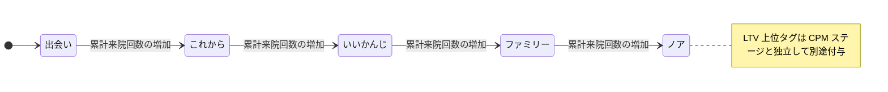

# Lステップ連携 戦略仕様書 (L-Step CRM Integration)

| 管理項目 | 記載 |
|:---|:---|
| 文書ID・種別 | domain.crm.delivery／D15 業務・画面仕様 |
| 決定状態 | 既存記載を継承。明示済み合意と現行実装説明を分け、2026-10-15通知結果不明時の保留方針・初診／健診後の確認付きフォローは承認済み。[DMの目的別配信](#crm-dm-purpose-contract)も共同確認済み。C05保持scopeの判断は別正本。全既存業務の共同確認は継続中 |
| 実装状態 | 既存記載を継承（今回の再監査なし）。既知gapを保持 |
| 実機検証状態 | 今回未実施。テスト名・過去証拠の掲載は再実行を意味しない |
| 文書確認日 | 2026-10-15。今回DM目的別差分の本文・参照・FR/ACを整理し、独立レビュー済み。実装適合は別工程 |

> **目的**: CPM判定・全17種配信トリガーのLステップ戦略を定義する。
> **読者**: マーケ担当・実装者。
> **タイミング**: CPM判定・配信トリガー仕様の確認時。

> **Animal Ekarte**: カルテデータに基づいた自動マーケティングの実現
> **最新更新**: 2026-09-06（repo `7c6592f9f`） | **ステータス**: 実装済みだが既知の安全・性能gapあり。deployment / credential / external scenario / monitoring readiness は [release readiness runbook](../../ops/deploy/runbooks/STG_PRE_DEPLOY_READINESS_CHECK.md) 等のrelease evidenceで別管理

---

> **注記 (2026-07-10 / 更新 2026-07-31)**: Lステップへの Write API（タグ付与・タグ解除・プロパティ更新）は **`LSTEP_WRITE_API_ENABLED`（既定 OFF）+ clinic `is_sync_enabled` の二重 gate** で抑止される。運用手順正本: [`docs/ops/deploy/runbooks/LSTEP_WRITE_API_PAUSE.md`](../../ops/deploy/runbooks/LSTEP_WRITE_API_PAUSE.md)。
>
> 追記（2026-10-07 監査）: 二重 gate の契約本文（`ErrWriteDisabled` とクライアント未構築の意図的スキップ `nil, nil` の区別、gate OFF 後のローカル DB / cache / audit / logging の扱い）は [architecture.md](./architecture.md) 冒頭注記・§4 に一元化した。本書では重複掲載しない。

---

## 納品Phaseと業務仕様・実装説明の区別

**現在の適用範囲・順序**: 2026-10-21本人回答（Sentinel_7c13214d95c881918743e12334d521ca）により、Lステップ連携・DMはPhase1対象。後続回答（Sentinel_bf3be66e21148191a893d5a78ef5ff37）により、マーケティング領域の仕様確定は日常業務の後、最後に進める。Phase1対象外／Phase2への移動ではなく、Phase1内の作業順を示す。実送信・資格情報登録・gate有効化・試験開始の許可ではない。

既存FR/AC・目的別DM条件・現在認可・停止・結果不明保留を維持し、未実装や受入待ちを対象外扱いにしない。LINE予約・本人紐付け・再診問診は各ownerの業務として別に進める。年間ランキング等D16の別個の対象外決定を本回答で変更しない。

### 以前の納品範囲記録（以下2段落は履歴。現在の判断には使わない）

[Backlog](https://docs.google.com/spreadsheets/d/17jaFBv7NmbPzk88lZx94vFxa_G1shGNX2O_lFGt4QdQ/edit) Phase1 G24（No.23）、2026/10/15・曽我の最新回答では、Lステップ連携およびDM機能は今期（Phase1）スコープ外・見送り。G29のマニュアル記載画面仕様への肯定は、この納品範囲を変更する承認とは扱わない。本書の業務FR／ACと現行実装説明を保持すること、外部再開gateを満たすこと、今期の納品対象であることは別の事実である。

除外をLINE予約全体・本人紐付け・今回の再診7項目へ自動拡大せず、それぞれの正本と最新決定を維持する。新しい次期納期・外部送信許可・自動再開を本整理から追加しない。

## 1. 連携のコンセプト

本システムと Lステップの連携は、**「カルテが判断し、Lステップが届ける」**という役割分担に基づき、臨床データに裏打ちされた 1to1 マーケティングを実現します。

### 役割の定義
- **カルテシステム (判定の脳)**: 来院頻度、累計売上、診療内容から「顧客の状態」をリアルタイムに解析。
- **Lステップ (配信の腕)**: カルテが付与した「タグ」をトリガーに、最適なタイミングでメッセージを自動送信。

---

## 2. 顧客分類ロジック (CPM分析)

2026-10-15の来院集計承認により、累計・年間等の来院回数を参照する分析・CPMの指標は[D16の実来院日基準](../domains/analytics/business-rules.md#requirement-fr-analytics-owner-counts)へ揃える。同医院・同日の複数ペットは飼主1回、ペットは各1回。旧カルテ日distinctは現行実装差として区別し、下書き・予約・会計の存在だけでは実来院を確定しない。既存CPMの区分・閾値、V1分析／V2配信の区別は維持する。この指標の承認だけで新しい通知トリガー・送信対象・送信許可を追加しない。

### 2.1 CPM V2 (来院回数ベース)
日常的な運用の中心となる判定基準。累計来院回数（医院ごとに閾値変更可、既定値は以下）で 5 段階を判定する。
- **出会い**: 累計 0〜1 回。
- **これから**: 累計 2〜3 回。
- **いいかんじ**: 累計 4〜7 回。
- **ファミリー**: 累計 8〜12 回。
- **ノア**: 累計 13 回以上。

LTV 上位 20% は CPM ステージとは独立した `LTV_上位20` タグとして別途付与される。

### 2.1a CPM V1（金額＋期間）と残余
タグ同期の既定は医院設定の CPM バージョンに従う。V1 は Encounter / Growing / Core / Spot / Noah / Dormant の 6 区分。該当しない飼主は `cpm_unclassified`（配信対象外。`allCPMStages` に含めない）。顧客集計ダッシュボードの人数チップは 6 区分 + Unclassified の 7 つ（画面正本: [36-aggregation-dashboard.md](../screens/36-aggregation-dashboard.md)）。

### 2.2 休眠予備軍 (VISITタグ)
最終来院日からの経過日数に応じ、以下のタグを自動付与・解除します。
- `VISIT_120日超` / `VISIT_180日超` / `VISIT_220日超` / `VISIT_240日超`

---

## 3. 自動配信トリガーの一覧 (全 17 種)

カルテ上のイベントに基づき、Lステップ側のシナリオが発火します。これらは**「衝突回避優先順位」**（数値が小さいほど優先）に従って制御されます。「全 17 種」はコード定義上の種別数（退役済み `next_visit_reminder` を含む）であり、実稼働中の種別数は未検証である。

次回予定タグの同期は設定・解除・昇格・owner変更後に post-commit で行われる best-effort である（失敗契約は [architecture.md](./architecture.md) §4 — request-local nonfatal）。次回予定リマインダー候補は active tentative の `intended_date` を読取り、送信前に再検証する別経路であり、タグ同期の成否は候補選定を規定しない。

| 優先度 | トリガーコード | 内容 |
|:---:|:---|:---|
| **2** | `dormant_prevention_365d` | 最終来院から 1 年経過。 |
| **3** | `checkup_followup` | 現行は健診作成後に起動し、結果／精密検査要否の predicate がない。承認済み目標では作成だけで送らず、[確認・目的別条件](#crm-followup-confirmation)を満たす。 |
| **4** | `filaria_alert` / `flea_tick_alert` | フィラリア・ノミダニシーズン開始。 |
| **5** | `dormant_prevention_240d` | 休眠防止ステップ（240日経過）。 |
| **6** | `dormant_prevention_210d` | 休眠防止ステップ（210日経過）。 |
| **7** | `dormant_prevention_180d` | 休眠防止ステップ（180日経過）。 |
| **8** | `vaccine_deadline_60d` / `vaccine_deadline_30d` | ワクチン期限の 60日/30日前通知。 |
| **10** | `food_refill_reminder` | 療法食の購入から約 30日後の案内。 |
| **11** | `next_visit_reminder` | EMR-308 で退役: カルテ推奨日カラム撤廃に伴い実行スケジュールから除外。履歴ログ・優先度互換のため登録は維持するが発火しない。 |
| **11** | `next_visit_tentative_reminder_3d` / `next_visit_tentative_reminder_0d` | EMR-308 で `next_visit_reminder` の後継。ペットの active tentative appointment（次回予定・未予約）の `intended_date` 3 日前と当日の 2 ステージ。tentative 昇格・取消で対象は自動追従。 |
| **12** | `birthday_message` | ペットの誕生日の当日祝い。 |
| **13** | `first_visit_followup_3d` / `first_visit_followup_7d` | 現行は初診の 3日後、7日後の調子伺い。承認済み目標は[確認・目的別条件](#crm-followup-confirmation)を追加し、経過日数だけでは送らない。 |
| **14** | `first_visit_welcome` | 現行は初回 medical record 作成後（post-commit）の挨拶で、会計完了起点ではない。目標では[スタッフ確認](#crm-followup-confirmation)前に送らない。 |

---

## 4. 配信安全ガード (Safety Controls)

[共同確認済みのDM目的別条件](#crm-dm-purpose-contract)は以下の現行ゲートへ追加する目標契約で、現行opt-outや配信除外との対応は同一視しない。

現行の最終配信除外確認は owner opt-out、`delivery_excluded`、LINE ID、cached EXCL tag を確認する。同日 claim と優先度抑制により、同日に競合する trigger は高優先度を選ぶ。

EMR-330 で修正済みの範囲: 通知候補 query（初診・最終来院・休眠系およびカーソル系）は死亡ペット由来の来院を除外する（`status <> 'deceased'` かつ `deceased_at IS NULL`。片側 sentinel のみの半死亡行も除外）。さらに非 tentative トリガーは scheduled claim 前と delivery owner lock 内 write/send 直前の 2 回、イベントソースの適格性を owner 単位で fail-closed に再読する。再読内容はファミリーごとに、初診・休眠系は生存ペット由来カルテの初診日 / 最終来院日 boundary、ワクチンは生存ペットの期限イベント、誕生日は生存ペットの誕生日、ウェルカム・健診フォローアップは typed なイベントペットの生存・現飼主・医院整合である。いずれも「同じ飼主に別の生存ペットがいる」だけではイベント由来の死亡行を救済しない。lock 内の再読は delivery owner lock の ambient transaction 上で実行され、単一接続プールでも第 2 接続を要求しない。

**残る safety gap**: `PetStatus` は `alive` / `deceased` であり、`transferred` status はこの契約にない。ペット識別子を持たないタグ系トリガー（シーズンアラート・療法食リマインド等）は scoped living-owner チェックに留まり、owner レベルのタグを特定ペットへ帰属させない。全 pet 死亡時の tag cleanup は引き続き best-effort で、durable exclusion flag を確立しない。またペットの生死遷移は delivery owner lock の直列化範囲外であるため、lock 内再読と外部 write の瞬間的な競合（生死遷移が再読直後に commit されるケース）は構造上排除できない。再読は送信窓を縮小するが、死亡・転院関連配信の絶対遮断は依然保証しない。

---

## 5. 失敗契約（経路別・混同禁止）

LSTEP の失敗時挙動は経路ごとに 1 契約だけを持つ。

> 追記（2026-10-07 監査）: 失敗契約の三分法（scheduled multi-resource best effort / single-owner propagation / request-local nonfatal secondary notification）の契約表・失敗時の振る舞い・耐久計上の正本は [architecture.md](./architecture.md) §4。本書では契約表の重複掲載をやめ、経路ごとの詳細は同節を参照すること。

### 5.1 書き込み停止と運用停止

> 追記（2026-10-07 監査）: Write dual-gate（gate OFF 時は外部 HTTP を送らず `ErrWriteDisabled`。後続のローカル処理は呼び出し元ごとの失敗契約に従う）と clinic 停止（`is_sync_enabled=false` は再有効化後もサービス層で同期対象外）の契約本文の正本は [architecture.md](./architecture.md) 冒頭注記・§4.3。本節では重複掲載しない。運用手順正本: [`LSTEP_WRITE_API_PAUSE.md`](../../ops/deploy/runbooks/LSTEP_WRITE_API_PAUSE.md)

### 5.2 定時 delivery バッチの読み取り要件

> 追記（2026-10-09 再監査）: 読み取り要件の契約本文（bulk-read 通常経路・bulk failure 時の per-owner fallback と bounded fallback への是正・opt-out / suppression / daily-claim 意味論・bounded memory）の正本は [architecture.md](./architecture.md) §4.1。本節は実装側の現況のみを記す。

実装の現況として、production には bulk failure 後の per-owner day-log / owner / tag-cache read fallback が残り、owner 数線形の既知 degraded-mode gap である。bounded fallback への整理または source fallback の除去まで、unconditional な no-N+1 invariant は主張しない。

---

## 6. 運用と効果測定

外部 write 再開の承認・受入は [#259 の再開条件](README.md#3-再開条件259) を参照。全 17 種は実装契約であり、先方 API 有効化や本番配信完了の証拠ではない。scheduler 配線の正本と実環境証跡の区別は [architecture.md §4.2](architecture.md#42-checked-in-scheduler-と運用証跡) に示す。

- **配信監視 (`/lstep/delivery-monitor`)**: **自動配信トリガー**の実行ログ、除外理由、API 失敗を監視（ordinary タグ同期の request-local 経路は対象外）。
- **来院転換分析**: メッセージ配信から 30 日以内の来院率を自動集計。

---

## D15の仕様整理範囲・受入対応（2026-10-15）

### 目的・対象範囲と正本

本領域はCPM/VISIT等のタグ同期、17種の登録トリガー、Webhook、健診対象者同期、配信監視、停止・再開の契約を整理する。タグの変更と飼主へのメッセージ配信は別事象であり、ローカル成功から外部到達を断定しない。17種は退役コードを含む登録数で、17種すべての実送信を要求するものではない。分析の計数はD16、予約可否はD01/D18、健康手帳公開はD20が所有する。

本節の既存継承FRは上の§2〜6、[技術正本](architecture.md)、[管理画面](../screens/31-lstep-integration.md)、[監視画面](../screens/34-lstep-delivery-monitor.md)から追跡を追加したもの。明示された既存合意以外は「既存記載を継承（決定根拠の追加確認なし）」であり、新規業務承認ではない。実装再監査・実送信・停止操作・外部設定は行っていない。

### 担当者・権限・前提

医院設定・タグ／配信監視・対象抽出には異なる権限を使う。FEページ許可だけでAPI操作を許可せず、[管理画面API表](../screens/31-lstep-integration.md)のview/edit/deleteを操作単位で照合する。全医院共通の自動タグ設定のPOST/DELETEはシステム管理者専用。単一医院の設定権限へ拡張しない。Webhookはスタッフ権限ではなくdestination一意解決と当該医院secretの署名検証を先に通す。

### 操作・状態・外部副作用

| 要件ID | 操作・契約 | 根拠と決定状態 |
|:---|:---|:---|
| FR-crm-trigger-catalog-boundary | 17コードの登録・退役・現役を区別する。退役next_visit_reminderは互換履歴として保持し発火させない。tentative後継はactive意図日と送信前再検証に従う | 本文§3の既存継承 |
| FR-crm-source-revalidation | owner opt-out・配信除外・LINE紐付け・停止タグ、同日claim・優先度抑制を区別する。死亡由来候補の除外とイベントsource再検証を保持し、別の生存ペットで死亡イベントを救済しない | 本文§4の既存継承。瞬間競合・タグ帰属の実装gapは残る |
| FR-crm-write-gates | deploy gateと医院gateの両方が外部Lステップwriteを制御する。停止による外部HTTP 0と、ローカルDB/cache/監査が進むかどうかを同義にしない | architecture冒頭・§4、pause runbook |
| FR-crm-failure-classes | scheduled multi-resource、single-owner、request-local secondaryの失敗を分ける。本業務成功を副次同期失敗で反転させない。batchの部分失敗をdurable計上する | architecture§3〜4 |
| FR-crm-webhook-scope | follow/unfollowだけに既存副作用を認め、未知eventはskip。destination未解決・署名不成立はfail-closed。新しいreplyや医院推測を追加しない | architecture§2 |
| FR-crm-preview-and-observation | 健診抽出previewとタグ付与を分離し、監視画面はtrigger logだけを観測する。ordinaryタグ同期を未表示だから成功/未実行と断定しない | 管理画面§2、監視画面概要 |

### 保存・再送・同時処理・停止

現在のsourceと連携先を再評価する次回予定タグのretry、revisionをまたいで新しいretryを消さない条件、飼主削除時のremove-onlyは[技術正本末尾](architecture.md)を参照する。これは現在のタグ状態を収束させる契約で、メッセージ再送を無条件に許可するものではない。

設定削除・配信停止・再開・手動送信はそれぞれ別操作である。Lステップwrite gate OFFだけでMessaging APIの手動送信やD18予約通知も止まったとしない。接続テストのHTTP 200やtoast successは、LIFF・Webhook・外部writeの全面合格ではない。[セットアップの既知gap](setup.md)を保持する。

### 受入条件

各行は独立した文書受入条件で、実行済み証跡ではない。手順は対象医院・対象飼主を固定した読み取り照合または別途承認されたテストで行う。

| 条件ID | Given（前提） | When（操作） | Then（期待結果） | 独立確認・成功条件・確認手順／証跡 |
|:---|:---|:---|:---|:---|
| AC-crm-trigger-retired | 退役コードと後継コードがある | 候補を作る | 退役コードは発火せず、後継はactive tentativeの意図日を使う | §3の各コードと候補契約を照合。実送信未実施 |
| AC-crm-source-deceased | 元イベントのペットが死亡、同飼主に別の生存ペットがいる | 適格性を再検証する | 別ペットを理由に元イベントを適格化しない | §4のtyped source境界を照合。瞬間競合の絶対保証は判定外 |
| AC-crm-optout-suppression | 配信除外または同日高優先度候補がある | 配信判定する | 除外理由と優先度抑制を別項目として識別する | 監視画面のexcluded_reasonとsuppressed_by_priorityを照合 |
| AC-crm-deploy-disabled | deploy gateが無効 | write処理に到達する | 外部HTTP 0、ErrWriteDisabled。firedや成功receiptへ進まない | pause runbookの契約照合。実環境変更なし |
| AC-crm-clinic-disabled | 医院gateが無効 | 同期対象を処理する | client未構築のskip/設定エラーとdeploy gateエラーを区別する | architecture§4.3との照合 |
| AC-crm-secondary-failure | 会計等の本処理が成功済み | 副次タグ同期に失敗する | 本処理は成功のまま、失敗を規定先へ記録しtrigger logへ混入しない | architecture§3と経路別ログ責務を照合 |
| AC-crm-batch-partial | 複数医院/飼主のbatchで1件失敗し、その内部又は単独のsingle-owner同期本体でdesired Add/Remove失敗・stale除去部分失敗を比較 | owner単位処理とbatchの残り処理を確認する | single-owner本体の失敗は呼出元へerrorを返し成功へ握り潰さない。stale除去部分失敗でもdesired addは継続し失敗計上を残す。batchは他resourceを継続し、Processed=Succeeded+Failedと耐久失敗計上を整合させる。本処理成功後のrequest-local副次通知wrapperは別ACの非fatal契約に従う | FR-crm-failure-classesとarchitecture§3〜4の三分法。single-owner/batch/副次wrapperを別々に確認、実行未実施 |
| AC-crm-webhook-invalid | 有効なdestination/署名でfollow・unfollow・その他eventを各受信し、destination欠落/不一致・署名不成立とも比較 | Webhookを受ける | destination/署名の照合をevent種別によるskipより先に行う。有効なfollow/unfollowだけ既存business副作用を扱い、有効な署名等の条件を満たすその他eventは副作用なしでskipする。不正条件では医院推測や複数secret試行をせずbusiness副作用を拒否し、新event処理やreplyを追加しない | FR-crm-webhook-scopeとarchitecture§2の境界を照合。IDは互換保持し正常/未知/不正を個別確認、executable SoTのcode/contract testを置換せず実行未実施 |
| AC-crm-monitor-scope | ordinaryタグ同期とtrigger結果がある | 監視画面を開く | trigger結果だけを示し、ordinary同期成否を代用しない | 監視画面概要・更新ボタン/非pollingを照合 |
| AC-crm-preview-not-send | 健診対象者をpreviewした | 対象を見る | previewだけで外部タグ付与や送信完了としない | 管理画面のGET previewとPOST同期を分けて照合 |
| AC-crm-probe-limit | 接続テストが2xxを返す | 運用可否を判断する | component結果・Webhook/LIFF・gateの別確認を省略しない | setup§5の既知gap。実環境受入は別 |

### 未決・提案と実装残件の分離

- 既存自動trigger契約：`lstep_delivery_claim_retry.go` は外部send callback前の再検証失敗だけclaim再試行可とし、外部API試行後の失敗は結果が不明でもblocking claimを維持する。これは本日新設する提案ではない。承認済み共通方針：手動Messaging送信・予約通知を含め、送信結果が不明の場合は照合まで再送を保留する。通知失敗で予約を作り直さない。送信済みと確認できれば再送しない。照合で未送信と確定した対象だけを通常の送信前再判定を経て扱う。根拠：2026-10-15確認案 Sentinel_75a3a1bf81b481919ba4c34aa633feb4、再確認 Sentinel_8d0032ca45b881919b3d2ceb5339f792 に対するユーザー承認 Sentinel_7a67fd30e47c819192cd36d416f0a2bf「ok」。通常の冪等なタグ状態再同期とは別。
- 実装／運用残件：死亡状態の瞬間競合、ペットIDのないタグ系source帰属、全頭死亡cleanupのbest-effort、bulk失敗時N+1、接続テストの成功誤判定、外部enable・実送信・cron/停止の実測。仕様整理が終わっても解消済みとしない。
- 実送信停止／再開の既存承認境界、保存期間の全体判断は維持する。設定や既存の外部アカウントを本作業で操作しない。

## D15管理操作の詳細契約と現行差（2026-10-15静的照合）

本節は既存serviceの入出力・失敗境界を記録する。新しい外部送信承認やCSV実データ形式の承認ではない。業務方針未決と実装上の不足は別欄に置く。各sourceは `backend/internal/lstep/` 配下。

| 要件ID | 管理対象・操作 | 境界 |
|:---|:---|:---|
| FR-crm-csv-snapshot | CSV importと履歴一覧 | 選択医院の既存LINE連携ownerに分析snapshotを取込む。owner自動登録・LINE link・外部送信を兼ねない |
| FR-crm-manual-send | 同医院ownerへの手動text/pdf/imageと直近log読取 | 配信除外/LINE未連携を送信前に拒否。Messaging API受理と本人受信/既読を区別し、ログ保存失敗で外部成功を巻き戻せたとしない |
| FR-crm-shared-file | upload/list/署名URL取得/delete | ファイル保存・record保存・署名URL・送信は別結果。[原本保持の選定契約](#crm-shared-file-retention)は手動deleteと自動cleanupの双方へ適用。発行済URLのTTL中失効保証を捏造しない |
| FR-crm-settings-catalog | 医院設定、接続test、タグ/コード/条件/purpose設定 | 権限・医院scope・秘密値マスクを保持。設定保存/削除を停止/再開の承認へ変換しない |
| FR-crm-checkup-recheck | preview、選択ownerへのtag同期 | previewは最大100件の候補。実行前にowner存在・opt-out・生存pet・LINE IDを再検査し、全候補条件の再評価済みと誤認させない |

### CSVの入力・結果・再取込

根拠：`lstep_csv_import_handler.go`、`lstep_csv_import_service.go`、`lstep_csv_import_prepare.go`、`lstep_csv_import_processing.go`、`lstep_csv_helpers.go`、`lstep_csv_stream.go`、`lstep_csv_import_concurrency.go`。

| 項目 | 現行契約 |
|:---|:---|
| 入口・権限 | POST multipart `file`、selected clinic＋認証staff、`lstep-csv-import:edit`。一覧GETは同resource:view。D16分析viewだけでは書けない |
| 上限 | データ50MiB、requestはmultipart overhead込み51MiB、100000データ行、64列、セル64KiB、error詳細先頭100件、batch100。プロセス全体2/医院1同時処理、超過429。分散環境全体lockとはしない |
| 前処理 | 一時fileへspool・有界preflightを行い、UTF-8/BOM、非UTF-8はShift_JISとして扱う。RFC4180列数/形式を検査し、処理後temp削除 |
| header | trim＋小文字正規化、同一内部列のaliasが複数なら先頭採用、未知列無視。LINE ID列必須。下表は現行想定aliasで、実LステップCSVによる互換検証は未実施 |
| 行照合 | LINE IDなしはmissing_line_id、同医院既存ownerなしはunknown_line_user_idでその行を除外し継続。owner/LINE関係を自動作成しない |
| 値変換 | tags/scenariosはsemicolonまたはcomma分割・trim・空項目除去。日時はYYYY-MM-DD、YYYY/MM/DD、各HH:mm:ss付き、YYYY-MM-DDTHH:mm:ssをtime.Localでparse。不正/空日時はnilで行を継続し、日付変換失敗を行errorには数えない |
| 保存 | processing import行を先に保存。snapshot行とcompleted/件数/importedAtはrepeatable-read transactionで保存。parse/DB失敗はsnapshot全rollback後、別処理でfailed更新を試行 |
| 補償失敗 | failed更新も失敗するとprocessingが残り得る。processingを完了/再取込可能の証明にしない |
| 件数 | successCountは既存owner照合に通った行の受理数で、OnConflict DoNothing前に加算される。実挿入件数・重複排除数とは同義でない。error総数と詳細最大100件を区別 |
| 再取込 | POSTごと新import ID。既存importの取消/置換や一般的idempotency receiptを提供するものではない。同一CSV再送を安全な1回処理と断定しない |
| 応答・一覧 | POST成功201。Locationはimport ID形式だが登録routeは一覧GETであり、detail GETがあると案内しない。一覧はerror_logを除外して返す |

| 内部列 | 受理alias（大小文字無視） |
|:---|:---|
| line_user_id | LINE ID / line_user_id / userid / user id |
| display_name | 表示名 / display_name / name |
| registered_at | 登録日 / registered_at / registered |
| tags | タグ / tags |
| scenarios | シナリオ / scenarios |
| traffic_source | 流入元 / traffic_source / source |
| block_status | ブロック / block_status / block |
| last_message_at | 最終メッセージ / last_message_at / last_message |

現行helper自身がaliasを想定形式と明記する。実CSVとの互換確認は運用受入であり、本整理が誤列を補って本番取込を許可するものではない。未対応形式は解析契約の追加判断として切り出す。個人情報を含むfile/error詳細の公開先は権限付き管理画面に限定し、ログ/外部メッセージへの転記許可を含まない。

### 手動送信・共有ファイル

根拠：`line_send_service.go`、`line_send_request.go`、`shared_file_service.go`。

| 操作 | 現行結果・副作用 |
|:---|:---|
| manual send | clinic/ownerを照合しLINE ID必須、LstepOptOutなら拒否。textは最大5000文字、file_name/purpose各255文字。pdf/imageはfile IDを必須とし同医院の署名URLを生成する |
| file宛先 | 署名URLはclinic scopeで検査。送信ownerとfileのownerの一致をこのserviceが必ず検査するとは書かない。別owner file流用防止は実装適合の確認対象 |
| 送信結果 | 外部送信後にsent/failed log。timeout/unauthorized/unreachable/line_api_error等の失敗分類、API失敗はgeneric502。ログ/監査はbest-effortで、失敗しても外部作用は取消せない |
| purpose | purpose由来ローカルtagcache更新はbest-effort。これだけで外部Lステップtag付与完了としない |
| log読取 | 直近30件。全期間の完全な配達/既読証明ではない |
| upload | owner指定時は同医院ownerを検査。storage upload後DB作成、DB失敗時はstorage削除を試行する。補償も失敗し得る |
| 署名URL | 一般取得15分、送信用1時間。発行済bearer URLがDB設定変更だけで即時失効するとはしない |
| delete | storage削除が先、DB削除が後。後段DB失敗時にobjectなし/DB行ありの不整合が残り得る。削除済と未完了を混同しない |
| 期限cleanup | 現行serviceは143時間経過を対象とする自動cleanup経路を持つ。原本分類を検査しない現行差があり、選定契約では原本／必要履歴／分類不明を手動・自動の物理削除対象にしない。本仕様整理による実行・有効化は禁止。保持期間の合意をこの実装値から逆算しない |

Messaging手動send inputには共通operation receiptがない。外部結果不明時は承認方針に従い照合まで再送保留。共通receipt不在は実装適合上の差であり、再送許可の根拠にしない。自動trigger側は既存 `lstep_delivery_claim_retry.go` により外部試行後claimをblocking維持し、`pre_send_revalidation_failed`かつfired_atなし・優先度抑制なしの場合だけ再試行対象とする。

### 設定・タグ・健診同期

根拠：`lstep_settings_service.go`、`lstep_settings_update.go`、`lstep_settings_handler.go`、`lstep_tag_service.go`、`lstep_tag_config_service.go`、`checkup_sync_service_preview.go`、`checkup_sync_service_create.go`、`checkup_sync_request.go`。

| 操作 | 現行契約・限界 |
|:---|:---|
| 設定GET | 秘密値をマスク、復号失敗は空設定成功に変換しない。configuredは値の存在であり接続成功ではない |
| 設定PATCH | URL/threshold検証後、credentials・同期flag・医院threshold・reloadを同一tx。監査はcommit後best-effort。文字列空は既存秘密値維持、clearLiffIDは明示削除。sync nilは維持、false→true時enabledAtを設定 |
| 設定DELETE | service=lstepのclinic integration行だけ削除。全cache/履歴/同期flagが消える保証や既発行URL取消を含まない |
| 接続test | LステップAPI/keyとLINE botinfoのcomponent検査。Webhook/LIFF/gatesを検証しない。既知404/429/5xx成功誤判定はsetup.mdの実装gap |
| owner tag追加 | 自動管理tagは拒否、owner/LINE ID/client/opt-outを検査。外部AddTag成功後ローカルcache/監査をbest-effort保存 |
| owner tag削除 | 自動管理tagは拒否。LINE ID/clientなし、外部user not foundは成功no-op扱い。削除はopt-out中も可能。外部成功後のcache失敗で外部状態を戻せたとしない |
| globalタグ設定 | prefix category B/C1/C2/C3、重複prefix/condition codeはConflict。グローバルsystem-admin操作と医院ownerタグ操作を区別。purpose-prefix/condition CRUDは既存API表の権限を保持 |
| preview入力 | checkup type annual/dental/blood/skin/cancer/other、日付YYYY-MM-DD、年齢/金額/回数非負、min age≤max age、慢性病true/false、所定CPM stage enumを検査 |
| preview結果 | 15秒deadline、CPM後filter後最大100件。件数は返却集合に対する数で母集団総数ではない。tagcache一括読取失敗は現行では空tagとして継続するためtagなしを確定事実にしない |
| 同期入力 | owner IDs 1〜100件、手動tagは英数/underscore/hyphenの1〜100文字、自動管理tag不可。service単体の空配列0件結果をHTTP許可へ読み替えない |
| 同期再判定 | bulk owner/生存pet count取得失敗は外部付与前に全体error。不明IDはfailed、opt-out/生存petなし/LINE IDなしはskipped。適格ownerごと外部AddTag、個別失敗はfailedで継続 |
| 同期件数 | 外部成功後のcache upsert失敗はsuccess countのまま。previewの全filterを実行時に再評価する仕組みはなく、選択時点の固定集団や完全再判定を保証しない |

### 追加受入条件

下記は検証可能な文書条件。ソース照合を行ったが、外部API/DBを実行した合格証跡ではない。

| 条件ID | Given（前提）/When（操作） | Then（期待結果） | 独立確認根拠 |
|:---|:---|:---|:---|
| AC-crm-csv-permission | 分析viewだけでCSV POST | import editへ権限昇格させない | handler/routes |
| AC-crm-csv-header | 必須LINE ID列なし | 入力error、snapshotを作らず失敗import記録をbest-effort | helpers/service |
| AC-crm-csv-limits | 50MiB/行/列/セル上限超過 | 有界preflightで拒否、無制限読込しない | stream/service |
| AC-crm-csv-row-partial | 未知LINE ID行と既存owner行が混在 | 不明行をerror計上し既存owner行を処理、owner自動作成なし | processing |
| AC-crm-csv-date-invalid | 日付列がparse不可 | 現行はnil保存、success行数と日時有効件数を同義にしない | helpers |
| AC-crm-csv-db-failure | 途中DB失敗 | snapshot全rollback、failed更新を別試行、processing残存を成功扱いしない | prepare |
| AC-crm-csv-duplicate-count | insert conflictでDoNothing | successCountを新規insert数と表示/説明しない | processing |
| AC-crm-csv-reimport | 同file再POST | 新import操作として扱い自動置換/取消/一度処理を保証しない | service |
| AC-crm-csv-error-cap | 101件以上の行error | 総error数保持、詳細は先頭100件に制限 | processing |
| AC-crm-send-optout | owner配信除外/LINE未連携 | manual send前に拒否 | line_send_service |
| AC-crm-send-log-failure | 外部成功後ローカルlog失敗 | 外部送信取消済み/未送信と表示しない | line_send_service |
| AC-crm-trigger-after-attempt | 自動trigger外部試行後に失敗 | blocking claim維持、blind retryをしない | delivery_claim_retry |
| AC-crm-trigger-before-attempt | pre_send_revalidation_failedでfiredなし/非抑制 | 既存条件に従いclaim再試行可 | delivery_claim_retry |
| AC-crm-file-db-failure | upload成功後DB失敗 | cleanup試行と補償失敗を区別、record成功としない | shared_file_service |
| AC-crm-file-delete-partial | storage削除後DB失敗 | DB残存とobject欠落を部分結果として扱う | shared_file_service |
| AC-crm-settings-secret-empty | 空秘密文字列をPATCH | 現行秘密値を保持、意図せず消去しない | settings_update |
| AC-crm-settings-delete-scope | integration設定DELETE | cache/履歴/flag全消去と誤認しない | settings_service |
| AC-crm-checkup-limit | preview候補が100件超 | 返却最大100、表示件数を母集団総数にしない | preview |
| AC-crm-checkup-stale | preview後opt-out/全頭死亡/LINE解除 | sync時再検査でskip、外部付与なし | create |
| AC-crm-checkup-partial | 対象の1ownerだけAddTag失敗 | 他owner継続、failed/skipped/success区別 | create |
| AC-crm-tag-external-success | AddTag成功後cache失敗 | ローカル不一致と外部失敗を区別し本体保存を戻さない | tag_service/create |

### 詳細確認後も残る判断と適合確認

- ユーザー判断の反映：D20公開範囲と手動Messaging/予約通知の結果不明時保留は承認済み。C05共有ファイル期限cleanupの適用scopeは共通正本へ委ねる。自動triggerの再送抑止は既存契約であり新規承認待ちにしない。
- 仕様に対する適合確認：CSV実export互換、異常日時の現行nil変換を画面が識別できるか、取込件数ラベル、file宛先owner一致、監査best-effort経路、設定の期待版、分散import制限、失敗import補償、既知probe成功誤判定。現行静的照合済みと実機合格を区別する。
- operation coverage：設定GET/PATCH/DELETE/test、global tag設定CRUD、owner tag GET/add/remove、健診preview/sync、手動send/log、shared-file upload/list/URL/delete、CSV POST/list、trigger監視GET/更新、Webhook、batch/secondary同期を本節・既存API表・architectureで分担する。D16集計/来院率はD16、予約作成取消はD18、本人linkはD20。

### 共有fileの生成元・原本所在と手動再送の実装差

`frontend/src/features/owners/components/LineSendPanel.tsx` と `api/upload-line-file.ts`、`backend/internal/lstep/shared_file_handler.go` / `shared_file_request.go`、`backend/internal/model/shared_file.go` を同branchで確認。

- LINE送信パネルは利用者の端末から選択したFileをアップロードし、そのfile IDで送信する。uploadのpurposeはother固定。検査結果/接種証明の内部生成物だけに限定する導線ではない。
- uploadはPDF/JPEG/PNG（GIF不可）、拡張子と内容sniffを検証。HTTP body上限10MiBにはmultipart overheadも含まれる。purposeはinspection_result/vaccine_cert/other、空はother。owner ID任意で、指定時の同医院照合はある。
- SharedFileには元文書ID/別保管key/原本の存在証明がない。143時間cleanupは全対象の原本保管を照合しないため、全てを再生成可能な配送コピーと分類できない。C05の承認済み保持方針を以下の選定契約で適用し、原本／必要履歴／分類不明を手動・自動の物理削除へ渡さない。法的な無期限保管や自動削除の新規例外を本節で承認しない。
- upload権限はowners:edit または medical-records:create/edit、管理list/署名URLはhospital-settings:view、deleteはhospital-settings:delete。送信権限や分析viewから管理delete権限を導かない。
- 現行手動送信画面は送信失敗に「しばらく待ってから再試行」と表示し、再実行時fileを再uploadする。結果不明と明確拒否を分ける承認済み共通方針に対し、この画面文言/操作制御も適合改修対象である。現行を安全案に適合済みとはしない。

| 条件ID | 前提・操作 | 期待結果 | 根拠 |
|:---|:---|:---|:---|
| AC-crm-file-source-unknown | 任意端末Fileをupload | 別原本あり/再生成可能と決め付けず保存scopeを判定 | LineSendPanel/model |
| AC-crm-file-format | GIFまたは拡張子と内容が不一致 | upload拒否、カルテ画像のGIF許可を流用しない | handler/model |
| AC-crm-file-permissions | owners editだけのactor | upload権限をlist/署名URL/delete管理権限へ拡張しない | RegisterSharedFileRoutes |

### 残る管理操作と台帳writerの境界

`backend/internal/lstep/routes.go`、`lstep_lifecycle_service.go`、`lstep_tag_code_mapping_service.go`、`lstep_trigger_priority_service.go`、`lstep_trigger_priority_request.go`、`line_customer_service.go` を静的照合。台帳操作自体のFR/ACはD04に残し、D15から重複writerを作らない。

| 操作 | 契約・副作用・例外 |
|:---|:---|
| 配信停止/再開 | 製品UIはdelivery-exclusion、旧POST lstep-opt-outは停止専用互換、PATCH lstep/opt-outは互換制御。画面の停止状態は永続フラグを正本とし、再開が独立した転院／停止記録や実際のペット死亡に基づく別の安全条件を解除するとはしない。会員区分「退亡者」だけを停止理由にせず、区分変更から配信可否を自動変更しない。画面04の契約を継承 |
| legacy opt-out/in | opt-out記録後の外部全tag解除、opt-in記録後CPM同期はbest-effort。外部失敗でローカル停止状態を元へ戻さない。監査もこのlegacy経路はbest-effortで、死亡一次監査と混同しない |
| 死亡/復活 | D04台帳writerがpet row lock→status/死亡日→一次監査same-tx。既死亡で死亡登録、非死亡で復活はConflict。commit後30秒budgetで別owner tag同期を行い、その失敗で台帳保存成功を失敗へ反転しない |
| 飼主削除前cleanup | 原台帳削除の参照guardはD04。Lステップ解除はbest-effort、LINE未連携ならno-op。外部tag除去失敗を履歴抹消や元台帳を消し直す理由にしない |
| LINE解除/手動ID変更 | D04画面04の専用操作・権限に従う。D19 identity groupのunlinkでもD20単回token linkでもない。LINE連携解除だけで原飼主や患者/過去メッセージ履歴を削除しない |
| code-tag対応GET/PUT | 医院scopeのhospital-settings view/edit。設定可能な4tagのみ、指定tag分を全置換（論理削除＋新規作成same-tx）。空entriesはそのtagの全解除。入力全体上限・code_type/種scope/非負age/空code禁止/64文字上限をwrite前検査。tx依存なしはfail-closed |
| trigger priority GET/PATCH | 未設定はdefault map→fallbackで補完、DB errorを未設定にすり替えない。PATCHは1件以上、priority≥1、既知trigger typeのみ。batch upsertであり送信実行ではない。退役triggerが設定に現れても発火許可にしない |
| LINE customer一覧 | 同医院owner:view。Items/Total/Limit/Truncatedを区別し、打切り配列を全顧客一覧としない |
| customer-owner link | owner:edit、customerと指定ownerを同医院照合。owner nullは解除。customerのowner参照更新とD20のowner LINE ID/token linkは別操作。保存後reload失敗はpreloaded rowのowner IDを更新して成功を返す。既存requestに期待versionがないため並行上書き防止済みとはしない |
| analytics/aggregation read | tag-summary、tag検索owner、friend attributes、月次/来院率はD16。読取認可を設定writeやCSV取込へ広げない。月次集計生成の実行と読取はarchitecture/運用停止契約へ従う |

| 条件ID | 前提・操作 | 期待結果 | 根拠 |
|:---|:---|:---|:---|
| AC-crm-optin-independent-stop | 独立した転院／停止記録や実際のペット死亡由来の安全条件が残る | 配信再開だけで全停止解除としない。会員区分の退亡者を死亡や独立停止理由へ変換しない | 画面04永続フラグ契約・DM共同確認 |
| AC-crm-death-audit | 死亡一次監査失敗 | status/死亡日もrollback、tag同期へ進まない | lifecycle service |
| AC-crm-death-secondary | 死亡commit後tag同期失敗 | 臨床死亡記録成功を反転せず別失敗を記録 | lifecycle service |
| AC-crm-code-replace-failure | 全置換で途中Create失敗 | 旧対応削除もrollback、半分だけの対応を残さない | code mapping service |
| AC-crm-code-empty-replace | 対象tagへ空entries PUT | 他tagは保持し対象tag対応を全解除 | 同service |
| AC-crm-priority-invalid | 不明trigger/priority0をPATCH | 保存前拒否、外部発火なし | priority service/request |
| AC-crm-priority-read-error | DB errorが発生 | default設定成功へ隠さない | priority service |
| AC-crm-customers-truncated | TotalがLimit超 | Truncatedを全件取得済みとしない | customer service |
| AC-crm-customer-link-reload | owner link保存後reload失敗 | 保存済み参照更新を成功として扱い二重実行を誘発しない | customer service |

### FR-crm-line-unlink-future：独立LINE解除後の未来予約と通知再開

質問 Sentinel_78cd352c4c14819196c27eac9109ed6a（2026-10-18 12:44 UTC、分精度）への本人回答 Sentinel_247ecbc4fd888191bc3293478f7f7c4b（同日12:53 UTC、分精度）「1 A／2 A／3 A」の第2項Aを採用する。実際の表示Aは「予約自体と患者への紐付けは残し、LINE通知を停止。再連携後、通知を再開する予約をスタッフが確認する」。以前の比較JSONのBに対応し、番号だけから旧A（予約のLINE宛先参照も解除）を採用しない。

LINE連携だけを解除しても、未来予約そのもの、予約と患者の関連、元の参照・履歴を保持する。予約を取消・複製・再登録したり、原飼主・患者・過去メッセージを削除したりしない。LINE通知は停止し、残ったcustomer／宛先参照を現在の送信許可として使わない。独立LINE解除、主飼主移管、D19 group unlink、D20本人linkは既存どおり別操作。

2026-10-21本人承認（質問 Sentinel_30e2114a28cc8191a10c24d9cb1503a8、回答 Sentinel_9d20fb5539ec8191814c8253231ac0dd「ok」）: 通知再開対象は予約開始時刻がserver現在時刻より厳密に後の予約。等時刻と過去開始は当日でも対象外。GET候補抽出とPOSTのlock下最終検査で両方判定し、client時計や新しい日数horizonを用いない。現在認可・本人/宛先・版・状態・独立停止・結果不明の既存条件も維持する。

再連携しただけでは通知を自動再開しない。スタッフが再開する予約を確認し、その対象を現在の本人対応・宛先・医院／患者・予約状態・既存通知権限／独立停止条件と照合する。確認は既存の配信資格や結果不明保留を解除せず、確認操作そのものから通知を即時送信しない。結果不明attemptを未送信にして自動再送しない。解除前に発信開始したものの回収を保証しない。

| 条件ID | 前提／操作 | 期待結果 | 根拠・検証状態 |
|:---|:---|:---|:---|
| AC-crm-unlink-reservations-preserved | 未来予約のあるownerのLINE連携だけ解除する | 同じ予約ID・患者関連・参照履歴を保持し、予約取消／再create／患者付替えなし。通知は停止 | 12:53 UTC表示第2項A、未実施 |
| AC-crm-relink-no-auto-resume | 解除後にLINEを再連携する | 未来予約の通知を一括自動再開しない。残った旧customer参照だけで送信しない | 同回答、未実施 |
| AC-crm-resume-selected-reservations | 権限あるstaffが再開する予約を確認する | 確認対象だけを現在版・本人対応・宛先・状態・認可と照合。未選択予約は再開せず、確認保存だけで即時送信なし | 同回答・既存送信gate、未実施 |
| AC-crm-resume-future-start | server現在時刻の前・同時・後に始まる予約と、GET後に開始時刻へ到達した予約 | 前・同時は除外し、後のみ既存条件を満たせば候補。POST lock下で開始済みに変わっていれば拒否し、即時送信なし | 2026-10-21本人承認、未実施 |
| AC-crm-resume-safety-holds | 再開確認後に対象版／bindingが変わる、又は独立停止・結果不明が残る | 古い確認を再利用せず再確認。別停止や結果不明を解除せず、重複送信・旧宛先送信を許可しない | 同回答・既存安全条件、未実施 |

FR-crm-notification-unknown: 通知送信結果不明は照合まで再送保留。通知失敗だけで予約本体を作り直さない。外部結果を未取得/ログ不在/HTTP timeoutだけで未送信と推定しない。

| 条件ID | 前提・操作 | 期待結果 | 根拠 |
|:---|:---|:---|:---|
| AC-crm-notification-unknown | 通知外部応答timeout/ログ保存不明 | 照合まで再送を保留し、即再送を促さない | 2026-10-15承認 |
| AC-crm-notification-booking-intact | 予約保存済みで通知失敗 | 予約を再作成せず既存予約ID/状態を保持 | 同承認・D18 |
| AC-crm-notification-reconciled | 照合で送信済み確認 | 再送しない。未送信確認分も現在の停止/本人/対象条件を再判定 | 同承認・既存再検証 |

## 共有ファイルの原本保持・削除操作の選定契約

[共通C05](../shared/retention-audit.md)の2026-10-15承認 Sentinel_7a67fd30e47c819192cd36d416f0a2bf（保存・削除の確認項目6）を手動deleteと自動143時間cleanupの両方へ適用する。現行のstorage先行delete・一律経過時間cleanupは上記の実装事実で、この選定契約へ適合済みとはしない。

- LSTEPのshared-file ownerが医院・file ID・対象版、業務記録／送信参照、分類と根拠、別原本がある場合はその安定参照・保持確認を照合する。分類は業務原本／必要履歴、確認済み一時コピー、未確認を区別。拡張子・purpose=other・upload入口・時間経過だけで一時コピーへ落とさない。旧値に分類／所在がなければ未確認として保護し、推測補完しない。
- 業務原本・必要履歴・原本所在不明へのスタッフ明示の手動削除は非表示／論理削除へ限定し、object・元参照・必要監査を保持する。自動cleanupはこれらを対象から除外し、論理状態・実体の両方を保持する。143時間経過を非表示／論理削除の新しい許可にしない。論理状態、actor／理由／時刻・元先参照、操作結果receiptは同じ保存境界で成功させる。監査・版／現在認可・依存参照検査が失敗したら旧状態を保持し、storageの物理削除を先行させない。
- 未保存で放棄された作業コピーと、別原本保持が確認できる一時配送コピーの既存処理は、業務原本の削除とは分ける。分類／原本保持／現在参照が確認できる既存一時物の処理だけに限定し、新たな物理削除例外を追加しない。業務原本の物理廃棄が必要ならC05の対象・保存義務・承認・復旧方法を確認する別手続へ渡す。
- 手動削除は現在のhospital-settings:deleteと医院scopeを再検査する。表示時の対象版と現在版が違う、送信／記録参照が増えた、原本確認が失われた場合は保存／物理処理を止め、変更内容と再確認を表示する。背景cleanupも同じ保護判定を通し、UIで非表示になったことを物理削除可としない。
- 操作識別・医院／file・内容指紋を保ち、応答不明は元操作結果と現在状態を照合する。同じ操作の成功は既存receiptを返し、内容違いは競合として再確認する。DB行不在・object欠落・timeoutだけで成功／失敗を推測して再deleteしない。既存経路で片側だけ消えた時は部分結果・元参照を保持し、原本の所在確認と復旧を別に扱い、復旧したと偽装しない。
- 新しい読取／署名URL発行は現在の論理状態・認可に従う。すでに発行済みのbearer URLの即時失効は保証せず、15分／1時間の既存TTLとobject保持・物理削除を混同しない。既存の送信結果も書き換えない。

| 条件ID | 前提・操作 | 期待結果 | 根拠・技術trace |
|:---|:---|:---|:---|
| AC-crm-file-manual-original | 原本／必要履歴／分類不明のfileを手動削除またはcleanup | 明示手動削除は非表示／論理状態変更だけで実体・参照・監査保持。自動cleanupは対象から除外し論理状態も実体も保持 | FR-crm-shared-file・本節の分類／保護 |
| AC-crm-file-delete-conflict | 表示後の版／参照／原本確認が変更、または必須監査失敗 | 原状態を保持して停止・再取得確認。storage先行削除なし | 同FR・原子保存と現在検査 |
| AC-crm-file-delete-unknown | 論理削除commit後の応答不明、同一再送または別内容再送 | 同一結果照会・receipt再利用、内容違いは拒否、物理deleteを再試行して結果を推測しない | 同FR・操作識別／結果照会 |

## 初診・健診後の確認付きフォロー（2026-10-15承認）

根拠：2026-10-15の確認案 Sentinel_a408975ce6408191be7a25734aae0aab の7に対するユーザー承認 Sentinel_4f050b1c0ed08191b5ca67deeaeec843「ok」。以下は承認済み業務目標で、現行create起因の外部作用や画面・APIが適合済みという意味ではない。対象は初診のwelcome／follow-upと健診後follow-upであり、他の通知へ新しい送信条件を推定しない。

### FR-crm-followup-confirmation：実施済みと送信対象のスタッフ確認後に送る

- カルテ／健診の記録作成・保存、受付、単なる候補抽出だけでは送信しない。権限を持つスタッフが該当する診療／健診の実施済みと送信対象を確認した後に、既存の送信前条件へ渡す。確認なし・確認結果不明では保留する。該当フォローを起動する外部タグ付与／シナリオ発火も同じ条件に含め、タグ同期経由で確認を迂回しない。ordinaryな状態同期とメッセージ発火を区別する。
- お礼等の一般案内と、再検査・受診を促す医療的案内を区別する。医療的案内は同じ対象の医師による「要フォロー」指定がある場合だけ候補にできる。スタッフ確認はその指定を代行せず、担当医ID・異常値・次回日・テンプレートの存在から指定を推定しない。一般案内の確認を医療的案内へ流用しない。
- 確認は対象clinic・owner・pet・元record／checkupと案内目的に対応付け、確認者・確認時点・参照した保存結果を保持する。医師の指定とスタッフの確認者を区別する。既存の認可・現在scope・必要監査・競合／結果照合契約へ参加し、確認結果と必要履歴を同じ保存結果にする。カルテ編集権限や監視viewだけで送信権限を追加しない。確認UI／API／実grantの対応は実装適合事項であり、本節から新resourceや独立権限名を発明しない。
- 送信前に現在のsource・確認・医師指定（医療的案内の場合）・対象関係を照合し、変更・取消・取得不能時に古い確認のまま送らない。owner opt-out、LINE紐付け、死亡由来除外、停止、同日claim／優先度等の既存制約を重ねて適用する。確認は除外／停止の解除ではなく、別の生存ペットがいることも救済根拠にならない。
- 内部保存・確認成功と外部受理／到達は分離する。内部保存／必須監査失敗やPath Bの保存段階不明を送信許可にしない。外部失敗で記録・確認を再作成せず、二重クリック／同じ確認の再送でも同じ元事象の重複配信を発生させない。外部試行後の結果不明は既存blocking claimと照合方針へ接続し、照合まで再送保留。送信済みは再送せず、未送信と確定した場合だけ現在条件を再判定する。

医療内容、医師の具体的な要フォロー判断・数値閾値、案内の新しい送信時刻／間隔、同意条件は今回決めない。既存の3日／7日等は現行仕様として残し、今回の確認を省略する根拠にしない。過去入力・訂正・転記・復元の保存だけから新しい通知を発火させず、既存の専用入力／副作用境界を維持する。

### 確認付きフォローの受入条件

| 条件ID | Given（前提） | When（操作） | Then（期待結果） | 追跡 |
|:---|:---|:---|:---|:---|
| AC-crm-followup-record-only | 初診／健診記録を作成したが実施済み・送信対象未確認 | create起因または定時候補を処理 | welcomeと配信を起動するタグ／シナリオを含め記録作成だけでは送信しない | FR-crm-followup-confirmation、D03／D09 |
| AC-crm-followup-general | 一般案内として実施済み・対象をスタッフ確認、既存送信条件も充足 | 送信判定 | 一般案内として扱い、医療案内の許可へ流用しない | FR-crm-followup-confirmation |
| AC-crm-followup-medical | 医療的な再検査／受診案内、スタッフ確認済み | 医師の要フォロー指定あり／なしを判定 | 同一対象の指定がある場合だけ候補。異常値・担当医ID・次回日だけでは許可しない | FR-crm-followup-confirmation |
| AC-crm-followup-confirmation-failure | 権限失効・別scope・確認／必須監査の保存失敗・結果不明 | 確認を保存／再送 | 未確認を確認済みにせず、同じ保存結果を照合するまで送信しない | FR-crm-followup-confirmation、D03の認可／監査／receipt |
| AC-crm-followup-source-changed | 確認後に対象・元記録・医師指定・配信除外状態が変更または取得不能 | 送信直前再照合 | 古い確認を流用せず保留／除外し、死亡等の既存保護を維持 | FR-crm-followup-confirmation、FR-crm-source-revalidation |
| AC-crm-followup-duplicate-unknown | 同一確認の反復または外部試行後の応答断 | 再実行 | 記録再作成・重複配信なし。不明は照合まで保留、送信済み再送なし、未送信確定後だけ再判定 | FR-crm-followup-confirmation、既存claim／結果照合 |
| AC-crm-followup-partial-record | 健診Path B途中、または過去入力／訂正／転記／復元だけが成功 | 通知判定 | 部分保存や保存操作だけを新しい実施済み確認・送信許可に変換しない | FR-crm-followup-confirmation、D09 protection／D03専用手順 |

実装差と必要adapterは[技術契約](architecture.md#followup-confirmation-adapter)へ追跡する。外部送信・実DB・実機の受入は未実施。

### 主飼主変更とLINE本人・通知先

主飼主変更では[D04](../domains/owners-pets/lifecycle.md#requirement-fr-owners-pets-primary-transfer)の今後の予約・LINE通知先への影響一覧を確認して切り替える。台帳commitと配信結果は別で、既存の配信除外・本人確認・停止gate・結果不明保留を上書きしない。連絡先の共有・重複候補からLINE本人を自動同定せず、新しい紐付けや通知の自動再送を作らない。過去請求・預り金は元ownerに残す。

## LINEのDM希望と目的別配信（2026-10-15共同確認）

根拠は[D04の共同確認](../domains/owners-pets/lifecycle.md#agreement-owner-membership-dm-20261015)。DMはLINEの希望であり、会員区分・独立停止・アカウント／本人紐付けとは別の値。初回質問の郵送解釈は採用しない。DM未設定の扱いも回答Sentinel_0b29068a42688191be8516f3dd7e704c「yes」で確定しており、未回答として残さない。

### FR-crm-dm-purpose

- 案内・販促LINEはDM必要の飼主を候補とし、未設定／不要は送信対象から除外する。未設定は希望確認後にD04で必要へ明示変更する。未設定を必要へ自動補完しない。
- 予約確認・変更・予約リマインドはDM未設定／不要だけでは除外しない。ただしLINE連携・アカウント・ブロック・本人／宛先・医院scope・独立した停止や配信除外・既存source安全条件を満たす必要があり、DM例外はそれらの解除や到達保証ではない。
- 会員区分を変更してもLINE配信可否を自動変更しない。「退亡者」は無連絡で来院しなくなった区分であり死亡ではなく、他診/準から配信規則を推定しない。独立した転院／停止状態と実際のペット死亡の保護は維持する。
- 目的は実際の通知対象・内容と元事象で判別する。未予約の次回予定や販促の名前に「リマインダー」があっても、予約確認・変更・予約リマインドの例外へ自動分類しない。初診／健診後の一般案内・医療的案内は既存のスタッフ確認／医師指定を維持したうえで目的別条件を適用する。
- 一括健診対象選択、外部シナリオ発火タグ付与、自動trigger、手動送信から案内・販促の抑止を迂回しない。ordinaryな状態同期とメッセージ発火を区別し、DM変更だけで全tagを削除・配信停止を解除したり、過去通知を再送したりしない。

### 目的・現在値・失敗時の技術契約

D04をDM値のwrite ownerとし、D15は送信するclinic／owner、元予約や元事象、通知目的、現在のDM値と既存の送信可否条件を送信前に再照合する。対象または目的が不明な通知を予約通知扱いにして抑止を回避しない。DM読取失敗を必要へ読み替えず、対象／宛先／必要条件が不明なら既存の保留・照合へ渡す。抽出時の旧値や古い希望確認だけで送信せず、目的別条件に不適合なら送信・発火用tag付与へ進まない。

既存operation識別・claim・source再検証・現在認可・競合保護は維持し、内部保存と外部送信結果を別に扱う。DM変更は既存の未確定送信結果を解決せず、送信済みを再送しない。未送信を確認できた再実行も現在のDM・目的・安全条件を判定し直す。LstepOptOut／delivery_excludedとDM希望の自動対応、既存全17triggerの名称だけによる目的分類、新しい配信時刻・間隔・外部設定変更は本合意から推定しない。各caller／adapterの実装適合は未検証であり、既存opt-outの実装観察を目的別契約の適合証拠にしない。

| 条件ID | Given（前提） | When（操作） | Then（期待結果） | 技術trace |
|:---|:---|:---|:---|:---|
| AC-crm-dm-guidance-unwanted | DM不要の飼主、案内・販促 | 自動／手動／一括・発火tagを処理 | 送信対象から除外し、経路変更で迂回しない | FR-crm-dm-purpose・目的／現在値照合 |
| AC-crm-dm-guidance-unset | DM未設定、配信希望未確認 | 案内・販促の候補を評価 | 送らず、必要へ自動補完しない。希望確認後のD04明示変更を待つ | 同FR・D04値保存 |
| AC-crm-dm-booking-exception | DM不要／未設定、予約確認・変更・予約リマインド、他安全条件充足 | 送信可否を判定 | DM値だけでは除外せず既存送信処理へ。送信到達は保証しない | 同FR・予約通知境界 |
| AC-crm-dm-safety-independent | 予約通知だが未連携・ブロック・不正宛先／scope・独立停止等あり | DM例外を評価 | DM例外で安全条件を解除しない | 同FR・現在本人／宛先と既存gate |
| AC-crm-dm-membership-independent | 会員区分のみ変更 | 配信可否を再評価 | 区分だけで可否を変更せず、退亡者を死亡扱いしない。他診/準の挙動を発明しない | 同FR・独立属性 |
| AC-crm-dm-nonbooking-reminder | 日付だけの未予約予定、または目的不明の通知 | 名前にreminderがある処理を評価 | 名前だけで予約通知例外へ分類せず、対象・目的を確認する | 同FR・元事象と目的 |
| AC-crm-dm-current-preference | 抽出後にDM必要から不要へ変わった、または取得失敗 | 案内・販促の送信直前 | 古い必要値を使わず抑止／保留、取得失敗を必要へ変換しない | 同FR・送信前再検証 |
| AC-crm-dm-unknown-no-resend | 送信結果不明の後DM値を変更 | 再処理 | 値変更を未送信の証明にせず照合まで保留。送信済みは再送なし、未送信確定後も現在条件を再検証 | 同FR・既存claim／結果照合 |
