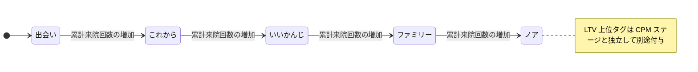

# Lステップ連携 戦略仕様書 (L-Step CRM Integration)

> **目的**: CPM判定・全17種配信トリガーのLステップ戦略を定義する。
> **読者**: マーケ担当・実装者。
> **タイミング**: CPM判定・配信トリガー仕様の確認時。

> **Animal Ekarte**: カルテデータに基づいた自動マーケティングの実現
> **最新更新**: 2026-09-06（repo `7c6592f9f`） | **ステータス**: 実装済みだが既知の安全・性能gapあり。deployment / credential / external scenario / monitoring readiness は [release readiness runbook](../../ops/deploy/runbooks/STG_PRE_DEPLOY_READINESS_CHECK.md) 等のrelease evidenceで別管理

---

> **注記 (2026-07-10 / 更新 2026-07-31)**: Lステップへの Write API（タグ付与・タグ解除・プロパティ更新）は **`LSTEP_WRITE_API_ENABLED`（既定 OFF）+ clinic `is_sync_enabled` の二重 gate** で抑止される。運用手順正本: [`docs/ops/deploy/runbooks/LSTEP_WRITE_API_PAUSE.md`](../../ops/deploy/runbooks/LSTEP_WRITE_API_PAUSE.md)。
>
> 追記（2026-10-07 監査）: 二重 gate の契約本文（`ErrWriteDisabled` とクライアント未構築の意図的スキップ `nil, nil` の区別、gate OFF 後のローカル DB / cache / audit / logging の扱い）は [architecture.md](./architecture.md) 冒頭注記・§4 に一元化した。本書では重複掲載しない。

---

## 1. 連携のコンセプト

本システムと Lステップの連携は、**「カルテが判断し、Lステップが届ける」**という役割分担に基づき、臨床データに裏打ちされた 1to1 マーケティングを実現します。

### 役割の定義
- **カルテシステム (判定の脳)**: 来院頻度、累計売上、診療内容から「顧客の状態」をリアルタイムに解析。
- **Lステップ (配信の腕)**: カルテが付与した「タグ」をトリガーに、最適なタイミングでメッセージを自動送信。

---

## 2. 顧客分類ロジック (CPM分析)

### 2.1 CPM V2 (来院回数ベース)
日常的な運用の中心となる判定基準。累計来院回数（医院ごとに閾値変更可、既定値は以下）で 5 段階を判定する。
- **出会い**: 累計 0〜1 回。
- **これから**: 累計 2〜3 回。
- **いいかんじ**: 累計 4〜7 回。
- **ファミリー**: 累計 8〜12 回。
- **ノア**: 累計 13 回以上。

LTV 上位 20% は CPM ステージとは独立した `LTV_上位20` タグとして別途付与される。

### 2.1a CPM V1（金額＋期間）と残余
タグ同期の既定は医院設定の CPM バージョンに従う。V1 は Encounter / Growing / Core / Spot / Noah / Dormant の 6 区分。該当しない飼主は `cpm_unclassified`（配信対象外。`allCPMStages` に含めない）。顧客集計ダッシュボードの人数チップは 6 区分 + Unclassified の 7 つ（画面正本: [36-aggregation-dashboard.md](../screens/36-aggregation-dashboard.md)）。

### 2.2 休眠予備軍 (VISITタグ)
最終来院日からの経過日数に応じ、以下のタグを自動付与・解除します。
- `VISIT_120日超` / `VISIT_180日超` / `VISIT_220日超` / `VISIT_240日超`

---

## 3. 自動配信トリガーの一覧 (全 17 種)

カルテ上のイベントに基づき、Lステップ側のシナリオが発火します。これらは**「衝突回避優先順位」**（数値が小さいほど優先）に従って制御されます。「全 17 種」はコード定義上の種別数（退役済み `next_visit_reminder` を含む）であり、実稼働中の種別数は未検証である。

次回予定タグの同期は設定・解除・昇格・owner変更後に post-commit で行われる best-effort である（失敗契約は [architecture.md](./architecture.md) §4 — request-local nonfatal）。次回予定リマインダー候補は active tentative の `intended_date` を読取り、送信前に再検証する別経路であり、タグ同期の成否は候補選定を規定しない。

| 優先度 | トリガーコード | 内容 |
|:---:|:---|:---|
| **2** | `dormant_prevention_365d` | 最終来院から 1 年経過。 |
| **3** | `checkup_followup` | 健診作成後に起動する follow-up。現行 call に健診結果や精密検査要否の predicate はない。 |
| **4** | `filaria_alert` / `flea_tick_alert` | フィラリア・ノミダニシーズン開始。 |
| **5** | `dormant_prevention_240d` | 休眠防止ステップ（240日経過）。 |
| **6** | `dormant_prevention_210d` | 休眠防止ステップ（210日経過）。 |
| **7** | `dormant_prevention_180d` | 休眠防止ステップ（180日経過）。 |
| **8** | `vaccine_deadline_60d` / `vaccine_deadline_30d` | ワクチン期限の 60日/30日前通知。 |
| **10** | `food_refill_reminder` | 療法食の購入から約 30日後の案内。 |
| **11** | `next_visit_reminder` | EMR-308 で退役: カルテ推奨日カラム撤廃に伴い実行スケジュールから除外。履歴ログ・優先度互換のため登録は維持するが発火しない。 |
| **11** | `next_visit_tentative_reminder_3d` / `next_visit_tentative_reminder_0d` | EMR-308 で `next_visit_reminder` の後継。ペットの active tentative appointment（次回予定・未予約）の `intended_date` 3 日前と当日の 2 ステージ。tentative 昇格・取消で対象は自動追従。 |
| **12** | `birthday_message` | ペットの誕生日の当日祝い。 |
| **13** | `first_visit_followup_3d` / `first_visit_followup_7d` | 初診の 3日後、7日後の調子伺い。 |
| **14** | `first_visit_welcome` | 初回 medical record 作成後（post-commit）の挨拶。会計完了起点ではない。 |

---

## 4. 配信安全ガード (Safety Controls)

現行の最終配信除外確認は owner opt-out、`delivery_excluded`、LINE ID、cached EXCL tag を確認する。同日 claim と優先度抑制により、同日に競合する trigger は高優先度を選ぶ。

EMR-330 で修正済みの範囲: 通知候補 query（初診・最終来院・休眠系およびカーソル系）は死亡ペット由来の来院を除外する（`status <> 'deceased'` かつ `deceased_at IS NULL`。片側 sentinel のみの半死亡行も除外）。さらに非 tentative トリガーは scheduled claim 前と delivery owner lock 内 write/send 直前の 2 回、イベントソースの適格性を owner 単位で fail-closed に再読する。再読内容はファミリーごとに、初診・休眠系は生存ペット由来カルテの初診日 / 最終来院日 boundary、ワクチンは生存ペットの期限イベント、誕生日は生存ペットの誕生日、ウェルカム・健診フォローアップは typed なイベントペットの生存・現飼主・医院整合である。いずれも「同じ飼主に別の生存ペットがいる」だけではイベント由来の死亡行を救済しない。lock 内の再読は delivery owner lock の ambient transaction 上で実行され、単一接続プールでも第 2 接続を要求しない。

**残る safety gap**: `PetStatus` は `alive` / `deceased` であり、`transferred` status はこの契約にない。ペット識別子を持たないタグ系トリガー（シーズンアラート・療法食リマインド等）は scoped living-owner チェックに留まり、owner レベルのタグを特定ペットへ帰属させない。全 pet 死亡時の tag cleanup は引き続き best-effort で、durable exclusion flag を確立しない。またペットの生死遷移は delivery owner lock の直列化範囲外であるため、lock 内再読と外部 write の瞬間的な競合（生死遷移が再読直後に commit されるケース）は構造上排除できない。再読は送信窓を縮小するが、死亡・転院関連配信の絶対遮断は依然保証しない。

---

## 5. 失敗契約（経路別・混同禁止）

LSTEP の失敗時挙動は経路ごとに 1 契約だけを持つ。

> 追記（2026-10-07 監査）: 失敗契約の三分法（scheduled multi-resource best effort / single-owner propagation / request-local nonfatal secondary notification）の契約表・失敗時の振る舞い・耐久計上の正本は [architecture.md](./architecture.md) §4。本書では契約表の重複掲載をやめ、経路ごとの詳細は同節を参照すること。

### 5.1 書き込み停止と運用停止

> 追記（2026-10-07 監査）: Write dual-gate（gate OFF 時は外部 HTTP を送らず `ErrWriteDisabled`。後続のローカル処理は呼び出し元ごとの失敗契約に従う）と clinic 停止（`is_sync_enabled=false` は再有効化後もサービス層で同期対象外）の契約本文の正本は [architecture.md](./architecture.md) 冒頭注記・§4.3。本節では重複掲載しない。運用手順正本: [`LSTEP_WRITE_API_PAUSE.md`](../../ops/deploy/runbooks/LSTEP_WRITE_API_PAUSE.md)

### 5.2 定時 delivery バッチの読み取り要件

> 追記（2026-10-09 再監査）: 読み取り要件の契約本文（bulk-read 通常経路・bulk failure 時の per-owner fallback と bounded fallback への是正・opt-out / suppression / daily-claim 意味論・bounded memory）の正本は [architecture.md](./architecture.md) §4.1。本節は実装側の現況のみを記す。

実装の現況として、production には bulk failure 後の per-owner day-log / owner / tag-cache read fallback が残り、owner 数線形の既知 degraded-mode gap である。bounded fallback への整理または source fallback の除去まで、unconditional な no-N+1 invariant は主張しない。

---

## 6. 運用と効果測定

外部 write 再開の承認・受入は [#259 の再開条件](README.md#3-再開条件259) を参照。全 17 種は実装契約であり、先方 API 有効化や本番配信完了の証拠ではない。scheduler 配線の正本と実環境証跡の区別は [architecture.md §4.2](architecture.md#42-checked-in-scheduler-と運用証跡) に示す。

- **配信監視 (`/lstep/delivery-monitor`)**: **自動配信トリガー**の実行ログ、除外理由、API 失敗を監視（ordinary タグ同期の request-local 経路は対象外）。
- **来院転換分析**: メッセージ配信から 30 日以内の来院率を自動集計。

---
