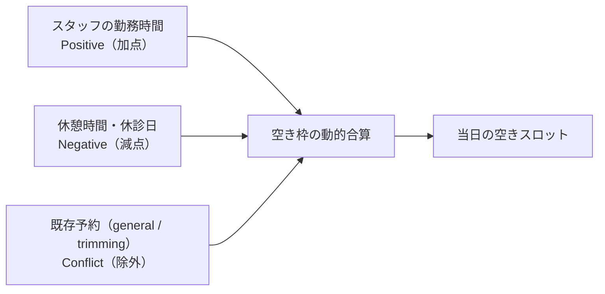

# LINE予約システム 機能仕様書 (LINE Reservation)

> 確定仕様の適用範囲：今回の予約ドメイン合意と本書の接続境界。承認日は各FR要件表・根拠節（2026-10-13〜2026-10-14 17:35）、追加合意は各補足節を参照。[確定FR索引](../domains/reservations/README.md#approved-reservation-scope)に掲載した箇所のみを確定情報として扱う。対象外の継承本文・未承認案・現行実装説明は一括確定しない。実装・実機状態は別管理。

> **目的**: 飼主向けLINE予約システムの機能・計算エンジンを定義する。
> **読者**: 実装者・運用者。
> **タイミング**: LIFF予約機能の仕様確認時。

> **Animal Ekarte**: LIFF アプリによる快適な予約体験
> **現行実装説明の更新**: 2026-09-06（repo `7c6592f9f`） | **当時のステータス**: 実装済み（deployment / clinic 運用状況は repository 外）。17:23新合意全体の実装済みを意味しない

---

| 管理項目 | 記載 |
|:---|:---|
| 文書ID・種別 | workflow.line-reservations／LINE予約業務仕様 |
| 決定状態 | 今回の予約ドメイン合意と[予定枠基準の最新訂正](#line-scheduled-slot-basis)を反映。対象外は既存決定状態を継承。実装・移行・実機検証とは別。完了範囲は予約入口の最終レビュー参照 |
| 実装状態 | 下記の現行説明を継承。main c31c0974の限定静的確認で、新合意への未追従／未確認あり。コード変更なし |
| 実機検証状態 | 未実施。文書検査と実機受入を分ける |
| 文書確認日 | 2026-10-14（合意・参照・語彙の確認。実機受入日ではない） |

## 17:23 JSTのLINE予約6点合意

決定者はユーザー。LINE6点の一括質問（Sentinel_46134f82a4a48191949e35f820b654dc）への2026-10-14 17:23 JST回答「1 ホテルも予約可能です。他はOKです」（Sentinel_609eebc8e6ac8191b13f370c6bd1e9f2）が根拠。ホテルを相談のみとする案は不採用で、入院は医院へ相談する。個別承認編集であり定時報告は読み取りのみ。業務合意と実装・実機検証を分け、ホテル受入基準は17:35合意の医院別同時宿泊頭数・全宿泊期間判定。予約ドメイン全体は未完了。

| 要件ID | 定義の所在 | 決定状態 |
|:---|:---|:---|
| FR-line-reservations-public-business-routing | [公開対象と業務分類による接続](#requirement-fr-line-reservations-public-business-routing) | 合意済み。17:23回答。実装・実機未確認 |
| FR-line-reservations-acceptance-bounds | [受付期間・休診日・時間外・対応可能人数](#requirement-fr-line-reservations-acceptance-bounds) | 合意済み。17:23回答。実装・実機未確認 |
| FR-line-reservations-no-nomination | [指名なしとホテルの担当分離](#requirement-fr-line-reservations-no-nomination) | 合意済み。17:23回答。実装・実機未確認 |
| FR-line-reservations-reselect-after-change | [状況変化時の入力保持と日時再選択](#requirement-fr-line-reservations-reselect-after-change) | 合意済み。17:23回答。実装・実機未確認 |
| FR-line-reservations-owner-cancel | [来院受付前の飼主取消・変更案内](#requirement-fr-line-reservations-owner-cancel) | 合意済み。17:23回答。実装・実機未確認 |
| FR-line-reservations-required-setup | [必要設定不足の新規選択不可と宿泊期間](#requirement-fr-line-reservations-required-setup) | 合意済み。17:23回答。実装・実機未確認 |
| FR-line-reservations-hotel-concurrent-stay-limit | [医院別同時宿泊上限](#requirement-fr-line-reservations-hotel-concurrent-stay-limit) | 17:35合意済み。実装・実機未確認 |

### 公開対象と業務分類による接続

医院が公開した診療・トリミング・ホテルの予約区分をLINEから予約可能にする。ホテルは相談のみとせず予約対象に含め、入院は医院への相談へ案内する。動的に自由登録する予約区分に、固定の業務分類を必須で結び付ける。名称・表示グループから推測せず、分類により診療→通常カルテ、トリミング→専用記録、ホテル→宿泊管理、入院→入院管理へ接続する。記録生成タイミングは各分類の既存業務ルールに従い、LINE予約確定だけで通常カルテや実入院を作るものにしない。公開設定と業務分類は別概念で、院内利用可能でも自動的にLINE公開しない。

### 受付期間・休診日・時間外・対応可能人数

医院設定の受付期間内で受け付ける。休診日・時間外・対応可能人数を超える予約は不可とし、院内の警告確認による例外登録を飼主側に設けない。診療・トリミングの担当可否は登録済みシフトと医院別対応可能区分等の既存適格性で判定する。ホテルの休診日・時間外制限は選択する入室・退室日時に適用し、滞在途中の休診日だけで宿泊不可にしない（18:26合意）。ホテルへ医師人数・医師シフトの計算を代用適用しない。ホテルは17:35合意の医院別同時宿泊頭数上限で宿泊期間全体を判定する。ケージ・世話担当割当とは別で、計算・保存方式は設計へ分ける。

#### LINEの空き判定は予約の予定枠を基準とする（最新訂正）

診療・トリミングのLINE空き表示と確定時再判定は、予約の予定開始・予定終了、既存予約の予定枠による重複、登録済みシフト・休憩・医院別対応可能区分など合意済みの適格性を基準にする。実際に診療中かどうか、診療開始／終了の実状態、予定終了超過、実診療の見込終了を追加の空き判定条件にしない。予定枠が空き、他の受付条件も満たす場合、先行診療が予定終了を過ぎても診療中であることだけで判定不能・受付不可へ変えない。

診療が終了していても、既存予約の予定枠を実終了だけで短縮・除外しない。取消等の既存計数対象の境界は保持する。予定枠に正幅重複がある場合の指名済み占有・対応能力の判定、全予約時間の勤務／休憩条件、全員／一部未登録の区別、依存情報の取得失敗・探索未完了時の扱いは維持する。診療状態を確認しないことを、予約予定の重複判定を廃止する意味にしない。

本訂正は通常時間指定のLINE診療・トリミングに適用する。ホテルの予約済み・実滞在を数える全期間定員管理、予定超過でも未退室なら計数する契約は変更しない。院内の診療中引継ぎ、スタッフ／シフト変更時の未終了指名予約保護、開始・終了の明示操作も別契約として維持する。

決定根拠：ユーザー Sentinel_08ce4d91de608191a05c30220331a832「LINEでは空きが前提です、診療中とかはチェックしなくていいです」。文書編集は Sentinel_2334916604f88191830b7a194c74bf85「許可します」、Sentinel_61b62c3381b88191ad0d5af32bdcffb5「docs/配下のみ許可です」による個別許可。予定終了超過の診療中医師を判定不能としてLINE受付禁止にする案は不採用。実装・実機検証は未実施。

### 指名なしとホテルの担当分離

診療・トリミングで指名なしは医院が許可した場合に選択可能とする。登録済みシフトと対応可能区分で判定し、未登録を勤務可能と推定しない。既合意の全員／一部未登録の区別を保持する。ホテルでは指名医師を選ばず、世話担当は宿泊管理で受入開始までに割り当てる。ホテルの指名医師なしを診療の「指名なし」設定・医師シフト・自動医師割当へ置き換えない。指名なし時の既存自動委譲の方式は現行参照として別に照合し、今回の合意だけで新しい割当アルゴリズムを追加確定しない。

### 状況変化時の入力保持と日時再選択

日時選択後の状況変化によって受付不可となった場合は、入力を保持して別日時を再選択できるようにする。空き表示だけで受付を保証せず、確定時にも合意した受付条件へ従う。別予約の重複作成・条件を迂回した例外登録を行わない。エラー形式・取得／保存・再試行の具体的方式は設計とし、ホテル受入基準は17:35合意へ従い、未承認の別枠方式を追加しない。

### 来院受付前の飼主取消・変更案内

来院受付前は当日でも飼主から取消可能とする。本人・医院スコープと既存の取消履歴／作成済み記録保持を維持し、受付後・診療後・支払い確定後の訂正を飼主取消へ広げない。飼主からの直接の日時等変更・取消復元は設けず、変更希望は医院連絡へ案内する。院内で承認済みの誤取消復元を飼主側へ展開しない。現在の確定ステータス限定UIは実装参照であり、受付前という業務境界の全状態対応を実装済みとしない。

### 必要設定不足の新規選択不可と宿泊期間

所要時間・業務分類など必要設定が不足する予約区分は選択不可とし、必要に応じ医院連絡を案内する。設定不足を他分類の推測や勤務の推測で補わず、飼主へマスタ設定作業を求めない。所要時間と予約時間の既存契約を維持するが、ホテルの宿泊期間へ通常診療・トリミング予約の同日制約を適用しない。宿泊に必要な期間・受付条件の具体的設計は宿泊管理と照合し、通常予約の時刻枠だけで複数日の受入可否を推定しない。

### 医院別同時宿泊頭数と宿泊期間全体の受付判定（17:35合意）

医院ごとに、ホテルで同時宿泊できる頭数の上限を設定する。LINEホテル予約は、宿泊期間全体を通して同時宿泊頭数がその医院の上限内となる場合に確定する。一日の入口時刻だけや平均頭数で、期間途中の超過を見落とさない。既存の同期間のホテル受入と新しい宿泊予約を合わせた同時宿泊頭数を判定し、別医院の上限・人数を流用しない。計数対象・状態・期間端点と入退室の受付条件は下記18:26合意で明示する。照合・計算・保存方式は設計として分ける。入院をホテル頭数へ機械的に分類変換する合意ではない。

上限未設定または期間中の上限超過時はLINE予約を確定せず、医院への相談へ案内する。未設定を無制限・ゼロ・既定値として補完せず、超過を飼主の警告確認で許可しない。状況変化で受付不可になった場合の入力保持・別日時再選択、医院設定の受付期間・休診日・時間外の条件も維持する。相談案内だけで院内の上限超過受入を許可したものにはしない。ホテルの休診日・時間外制限は下記18:26合意の入室・退室日時へ適用し、滞在途中の休診日へ拡張しない。

ホテルの受付は医師指名・医師シフトで判定しない。ホテル予約の指名医師なしと、通常診療・トリミングの同日予約制約を宿泊期間へ適用しないことを維持する。同時宿泊頭数の上限は、[ケージ割当](../screens/09-hospitalization-form.md)・[ホテル世話担当](../screens/settings/master-reservation-type.md#internal-batch-hotel-care)とは別の概念。ケージと世話担当は宿泊管理で割り当て、世話担当は受入開始までに決定する。空きケージ数から上限を自動生成したり、ケージ必須へ変更したり、医師数から宿泊能力を推測したりしない。既存のケージ任意・占有表示／連結保護、宿泊管理の期間・状態・記録契約を保持する。

決定者はユーザー。質問「医院ごとに同時宿泊できる頭数を設定し、宿泊期間全体で上限内ならLINE予約を確定。上限未設定・超過時は医院への相談に案内し、ケージと世話担当は宿泊管理で割り当てる」（Sentinel_8c89bbb29bf08191a21adb823ceef1ea）への2026-10-14 17:35 JST「ok」（Sentinel_2f106003dc5481919e93352985ac3fc5）が根拠。個別承認の文書反映であり定時報告は読み取りのみ。計算・保存・同時確定・日時境界等の技術方式は設計へ分ける。実装・実機受入は未確認。

#### ホテル同時宿泊頭数の計数・状態境界（18:26合意）

同じ宿泊は予約と宿泊管理の双方に現れても1回だけ計上する。予約済み・滞在中を数え、取消・未来院・退室済みは除外する。ホテルの頭数を数え、入院をホテルへ機械的に分類変換しない。頭数上限とケージ・世話担当の割当は引き続き別概念。

| 対象・契機 | 計数／判定結果 |
|:---|:---|
| 予約済み・滞在中のホテル宿泊 | 対象医院・対象期間の同時宿泊頭数へ含める。同じ宿泊の予約と管理レコードを二重計上しない |
| 取消・未来院・退室済み | 同時宿泊頭数から除外する。履歴・記録の削除を意味しない |
| 退室予定時刻と次の入室時刻が同じ | 予定期間の重複はない。期間途中の超過判定は維持する |
| 延泊 | 変更後の期間で同時宿泊頭数上限を再判定する |
| 退室予定を過ぎても未退室 | 滞在中として扱う。予定終了だけで自動退室・計数除外しない |

予定期間の端点判定と実際の未退室を区別する。予約・宿泊管理の対応キー、更新・同時操作・保存方式は技術設計であり、二重計上や予定超過時の自動除外を許可する裁量ではない。延泊超過時の運用は[業務5点合意](#hotel-extension-over-capacity)へ従う。具体的な調整案・実績・確定の保存方式は宿泊管理の設計。

決定者はユーザー。4案と文書不整合3点をまとめた質問（Sentinel_71abdb50fcec8191988196aeb8e25f04）への2026-10-14 18:26 JST「ok」（Sentinel_4e15997c948081918e456378427a7091）が根拠。定時報告とは別の個別承認編集。実装・移行・実機受入は未確認。

#### 延泊定員超過時の運用（業務5点合意）

延泊で同時宿泊頭数上限を超える場合、実滞在は記録し続け、宿泊管理の責任者が他予約・退室見込みを確認して調整した後に延泊を確定する。初期仕様では定員超過の例外承認を設けない。実際に滞在している患者を予定終了だけで退室扱いにせず、既存予約を自動取消しない。LINEの上限超過受入禁止は維持する。

延泊希望・未確定の調整案と、実滞在の記録・確定済み予定を区別する。超過中に実績記録を拒否して状態を偽ることも、希望を記録しただけで延泊受入を確定することもしない。調整後も全期間を再判定してから確定する。責任者の具体的権限・連絡手順・調整案の画面／保存と同時処理は宿泊管理の設計であり、別予約の変更権限・既存安全条件は免除しない。

決定者はユーザー。親の5案一括確認 Sentinel_4c765f9ae6b88191902a7abfed6ac6c1「この5点でよいでしょうか？」への2026-10-14の返信 Sentinel_c713c4fdc74c819182979c4b8d2fef07「ok」が根拠。承認は業務5点に限定し、技術方式の詳細・他ドメイン内部・実装／実機受入を確定しない。

#### LINEホテルの休診日・時間外条件（18:26合意）

LINEホテルの休診日・時間外制限は、選択する入室日時と退室日時に適用する。宿泊途中に休診日があっても宿泊できる。宿泊全期間には同時宿泊頭数上限を適用し、医師指名・医師シフトでホテル受付を判定しない。医院設定の受付期間等、他のLINE条件は維持する。

| 時点 | 休診日・時間外条件 | 同時宿泊頭数上限 |
|:---|:---|:---|
| 選択する入室日時 | 適用する。違反時はLINE確定不可 | 全宿泊期間で判定 |
| 選択する退室日時 | 適用する。違反時はLINE確定不可 | 全宿泊期間で判定 |
| 入室と退室の間の滞在 | 途中の休診日だけで宿泊不可にしない | 期間途中も上限超過を見落とさない |

決定者はユーザー。4案と文書不整合3点をまとめた質問（Sentinel_71abdb50fcec8191988196aeb8e25f04）への2026-10-14 18:26 JST「ok」（Sentinel_4e15997c948081918e456378427a7091）が根拠。定時報告とは別の個別承認編集。実装・移行・実機受入は未確認。

### 合意したLINEの受入条件

| 条件ID | Given（前提） | When（操作） | Then（期待結果） | 独立確認 | 成功条件 | 確認手順／証跡 |
|:---|:---|:---|:---|:---|:---|:---|
| AC-line-reservations-public-business-routing | 公開対象と業務分類による接続の対象予約で、該当業務分類と医院設定がある | 公開対象と業務分類による接続の操作・判定を行う | 医院が公開した診療・トリミング・ホテルの予約区分をLINEから予約可能にする。ホテルは相談のみとせず予約対象に含め、入院は医院への相談へ案内する。動的に自由登録する予約区分に、固定の業務分類を必須で結び付ける。名称・表示グループから推測せず、分類により診療→通常カルテ、トリミング→専用記録、ホテル→宿泊管理、入院→入院管理へ接続する。記録生成タイミングは各分類の既存業務ルールに従い、LINE予約確定だけで通常カルテや実入院を作るものにしない。公開設定と業務分類は別概念で、院内利用可能でも自動的にLINE公開しない。 | 合意した業務結果を確認 | 医院・本人・予約・記録の関連を保持 | [FR](#requirement-fr-line-reservations-public-business-routing)。実機未確認 |
| AC-line-reservations-acceptance-bounds | 受付期間・休診日・時間外・対応可能人数の対象予約で、該当業務分類と医院設定がある | 受付期間・休診日・時間外・対応可能人数の操作・判定を行う | 医院設定の受付期間内で受け付ける。休診日・時間外・対応可能人数を超える予約は不可とし、院内の警告確認による例外登録を飼主側に設けない。診療・トリミングの担当可否は登録済みシフトと医院別対応可能区分等の既存適格性で判定する。ホテルの休診日・時間外制限は選択する入室・退室日時に適用し、滞在途中の休診日だけで宿泊不可にしない（18:26合意）。ホテルへ医師人数・医師シフトの計算を代用適用しない。ホテルは17:35合意の医院別同時宿泊頭数上限で宿泊期間全体を判定する。ケージ・世話担当割当とは別で、計算・保存方式は設計へ分ける。 | 合意した業務結果を確認 | 医院・本人・予約・記録の関連を保持 | [FR](#requirement-fr-line-reservations-acceptance-bounds)。実機未確認 |
| AC-line-scheduled-slot-ignore-consultation-state | 医師Aの先行予約予定は15:00〜15:30。実際には15:30を過ぎても診療中。新予約15:30〜16:00の予定枠・勤務／休憩・対応区分と他のLINE条件は満たす | LINEの空き表示と確定時再判定を行う | 実診療中・予定終了超過・見込終了不明を条件にせず、予定枠基準で受入可能と判定する。同じ予定情報なら実状態によって結果を変えない | 予定枠と実状態を単独比較 | 先行診療超過だけで判定不能・拒否にしない | [FR](#requirement-fr-line-reservations-acceptance-bounds)・[最新訂正](#line-scheduled-slot-basis)。実機未確認 |
| AC-line-scheduled-slot-overlap-retained | 対応可能な医師はAだけで、取消等の除外対象でない既存予約の予定枠15:00〜16:00に新予約15:30〜16:00が重なる。既存診療は実際には終了済み | LINE空き表示と確定時再判定を行う | 予定枠の重複を照合して対応能力不足なら受付不可。実終了だけで予定枠を短縮・除外せず、実状態の不確認を重複無検査へ変換しない | 予定重複と実終了を単独比較 | 予定枠による重複・能力判定を保持 | [FR](#requirement-fr-line-reservations-acceptance-bounds)・[最新訂正](#line-scheduled-slot-basis)。実機未確認 |
| AC-line-scheduled-slot-missing-duty-retained | 予約予定枠は空いているが、必要な勤務情報が取得できないか、候補が全時間勤務／休憩・対応区分条件を満たさない | LINEの確定時再判定を行う | 既存の情報不足・適格性・能力判定に従い受付不可。診療中チェック不要をシフト・休憩・対応区分の免除にしない | 実状態と適格性を分けて確認 | 合意したLINE受付条件を保持 | [FR](#requirement-fr-line-reservations-acceptance-bounds)・[最新訂正](#line-scheduled-slot-basis)。実機未確認 |
| AC-line-reservations-no-nomination | 指名なしとホテルの担当分離の対象予約で、該当業務分類と医院設定がある | 指名なしとホテルの担当分離の操作・判定を行う | 診療・トリミングで指名なしは医院が許可した場合に選択可能とする。登録済みシフトと対応可能区分で判定し、未登録を勤務可能と推定しない。既合意の全員／一部未登録の区別を保持する。ホテルでは指名医師を選ばず、世話担当は宿泊管理で受入開始までに割り当てる。ホテルの指名医師なしを診療の「指名なし」設定・医師シフト・自動医師割当へ置き換えない。指名なし時の既存自動委譲の方式は現行参照として別に照合し、今回の合意だけで新しい割当アルゴリズムを追加確定しない。 | 合意した業務結果を確認 | 医院・本人・予約・記録の関連を保持 | [FR](#requirement-fr-line-reservations-no-nomination)。実機未確認 |
| AC-line-reservations-reselect-after-change | 状況変化時の入力保持と日時再選択の対象予約で、該当業務分類と医院設定がある | 状況変化時の入力保持と日時再選択の操作・判定を行う | 日時選択後の状況変化によって受付不可となった場合は、入力を保持して別日時を再選択できるようにする。空き表示だけで受付を保証せず、確定時にも合意した受付条件へ従う。別予約の重複作成・条件を迂回した例外登録を行わない。エラー形式・取得／保存・再試行の具体的方式は設計とし、ホテル受入基準は17:35合意へ従い、未承認の別枠方式を追加しない。 | 合意した業務結果を確認 | 医院・本人・予約・記録の関連を保持 | [FR](#requirement-fr-line-reservations-reselect-after-change)。実機未確認 |
| AC-line-reservations-owner-cancel | 来院受付前の飼主取消・変更案内の対象予約で、該当業務分類と医院設定がある | 来院受付前の飼主取消・変更案内の操作・判定を行う | 来院受付前は当日でも飼主から取消可能とする。本人・医院スコープと既存の取消履歴／作成済み記録保持を維持し、受付後・診療後・支払い確定後の訂正を飼主取消へ広げない。飼主からの直接の日時等変更・取消復元は設けず、変更希望は医院連絡へ案内する。院内で承認済みの誤取消復元を飼主側へ展開しない。現在の確定ステータス限定UIは実装参照であり、受付前という業務境界の全状態対応を実装済みとしない。 | 合意した業務結果を確認 | 医院・本人・予約・記録の関連を保持 | [FR](#requirement-fr-line-reservations-owner-cancel)。実機未確認 |
| AC-line-reservations-required-setup | 必要設定不足の新規選択不可と宿泊期間の対象予約で、該当業務分類と医院設定がある | 必要設定不足の新規選択不可と宿泊期間の操作・判定を行う | 所要時間・業務分類など必要設定が不足する予約区分は選択不可とし、必要に応じ医院連絡を案内する。設定不足を他分類の推測や勤務の推測で補わず、飼主へマスタ設定作業を求めない。所要時間と予約時間の既存契約を維持するが、ホテルの宿泊期間へ通常診療・トリミング予約の同日制約を適用しない。宿泊に必要な期間・受付条件の具体的設計は宿泊管理と照合し、通常予約の時刻枠だけで複数日の受入可否を推定しない。 | 合意した業務結果を確認 | 医院・本人・予約・記録の関連を保持 | [FR](#requirement-fr-line-reservations-required-setup)。実機未確認 |
| AC-line-reservations-hotel-no-doctor-shift | 医院がホテル区分を公開し、宿泊管理の受入条件を照合する | ホテル予約の担当・期間を確認する | 指名医師選択・医師シフト・通常診療の同日制約をホテルに適用しない。世話担当は宿泊管理で受入開始までに決定。17:35合意の医院別同時宿泊頭数で全期間を判定し、計算・保存方式は設計へ分ける | 分類別境界を確認 | ホテルを相談のみへ戻さず医師条件で代用しない | [FR](#requirement-fr-line-reservations-no-nomination)・[期間](#requirement-fr-line-reservations-required-setup)。実機未確認。計数・入退室日時の境界は18:26合意 |
| AC-line-hotel-limit-whole-stay | 医院Aの上限を設定し、宿泊期間の一部が既存ホテル受入と重なる | 宿泊期間全体で新予約を含む同時宿泊頭数を確認する | 全期間で上限内なら他のLINE条件を満たして確定できる。入口時刻だけで判定せず、別医院の上限や医師人数を流用しない | 合意した業務結果を単独確認 | 宿泊全期間・医院別上限と担当割当を分離 | [FR](#requirement-fr-line-reservations-hotel-concurrent-stay-limit)。実機未確認 |
| AC-line-hotel-limit-unset-consult | 医院の同時宿泊上限が未設定 | LINEホテル予約を確定しようとする | 確定せず医院相談へ案内する。無制限・ゼロ・既定値を推測補完しない | 合意した業務結果を単独確認 | 宿泊全期間・医院別上限と担当割当を分離 | [FR](#requirement-fr-line-reservations-hotel-concurrent-stay-limit)。実機未確認 |
| AC-line-hotel-limit-exceeded-consult | 宿泊期間途中に、新予約を含む同時宿泊頭数が上限を超える | LINEホテル予約を確定しようとする | 確定せず医院相談へ案内する。飼主の警告確認で許可しない。既合意の入力保持・再選択を維持する | 合意した業務結果を単独確認 | 宿泊全期間・医院別上限と担当割当を分離 | [FR](#requirement-fr-line-reservations-hotel-concurrent-stay-limit)。実機未確認 |
| AC-line-hotel-limit-independent-allocation | 全期間上限内のホテル予約でケージや世話担当は管理側で割り当てる | LINE受付と宿泊管理の割当を確認する | 受付上限とケージ／世話担当を別概念とする。ケージ空きから上限を推測せず、ホテルへ医師指名・医師シフト・通常予約同日制約を適用しない。世話担当は受入開始までに決定する | 合意した業務結果を単独確認 | 宿泊全期間・医院別上限と担当割当を分離 | [FR](#requirement-fr-line-reservations-hotel-concurrent-stay-limit)。実機未確認 |

| 条件ID | Given（前提） | When（操作） | Then（期待結果） | 独立確認 | 成功条件 | 確認手順／証跡 |
|:---|:---|:---|:---|:---|:---|:---|
| AC-line-hotel-count-deduplicate | 上限2頭。犬Aの同じ宿泊が予約と宿泊管理に存在 | 同期間へ犬Bの予約を追加する | 犬Aは1頭分だけ数え、犬Bを含む2頭で他条件を満たせば確定可能 | この反例を単独確認 | 同じ予約・記録・業務境界を保持 | [FR](#requirement-fr-line-reservations-hotel-concurrent-stay-limit)・[計数境界](#hotel-counting-boundaries-1826)。実機未確認 |
| AC-line-hotel-count-excluded-states | 取消・未来院・退室済みのホテル宿泊履歴がある | 同期間の頭数を判定する | これらは計数から除外し、履歴・記録は保持する | この反例を単独確認 | 同じ予約・記録・業務境界を保持 | [FR](#requirement-fr-line-reservations-hotel-concurrent-stay-limit)・[計数境界](#hotel-counting-boundaries-1826)。実機未確認 |
| AC-line-hotel-count-touching-periods | 犬Aの退室予定と犬Bの入室時刻が同じで、実際の未退室超過はない | 予定期間の重複を判定する | 同時刻の接触だけでは重複に数えない | この反例を単独確認 | 同じ予約・記録・業務境界を保持 | [FR](#requirement-fr-line-reservations-hotel-concurrent-stay-limit)・[計数境界](#hotel-counting-boundaries-1826)。実機未確認 |
| AC-line-hotel-count-extension | 期間途中に他の予約済み・滞在中のホテル宿泊がある | 延泊で宿泊期間を変更する | 変更後の期間全体で上限を再判定し、旧期間だけで判定しない | この反例を単独確認 | 同じ予約・記録・業務境界を保持 | [FR](#requirement-fr-line-reservations-hotel-concurrent-stay-limit)・[計数境界](#hotel-counting-boundaries-1826)。実機未確認 |
| AC-line-hotel-count-overdue | 退室予定を過ぎたが実際には未退室のホテル宿泊がある | その宿泊を含む同時宿泊頭数を判定する | 滞在中として計数し、予定終了だけで枠を解放しない | この反例を単独確認 | 同じ予約・記録・業務境界を保持 | [FR](#requirement-fr-line-reservations-hotel-concurrent-stay-limit)・[計数境界](#hotel-counting-boundaries-1826)。実機未確認 |
| AC-line-hotel-hours-stay-through-holiday | 火曜の営業時間内に入室、木曜の営業時間内に退室し、水曜が休診。全期間の頭数は上限内 | LINEホテルを予約する | 滞在途中の水曜休診だけでは拒否せず、他のLINE条件を満たせば確定可能 | この反例を単独確認 | 同じ予約・記録・業務境界を保持 | [受付条件FR](#requirement-fr-line-reservations-acceptance-bounds)・[日時境界](#hotel-entry-exit-hours-1826)。実機未確認 |
| AC-line-hotel-hours-endpoints | 入室または退室の選択日時が休診日・時間外 | LINEホテルを確定しようとする | LINE確定不可。院内の警告確認例外を飼主側へ適用しない | この反例を単独確認 | 同じ予約・記録・業務境界を保持 | [受付条件FR](#requirement-fr-line-reservations-acceptance-bounds)・[日時境界](#hotel-entry-exit-hours-1826)。実機未確認 |
| AC-line-hotel-extension-over-capacity-pending | 延泊期間でホテル定員を超え、患者は実際に滞在中 | 延泊希望と実滞在を記録する | 実績を保持し、延泊確定は責任者の調整まで保留。例外承認・自動退室・他予約の自動取消なし | 超過中実績と確定を分けて確認 | 実滞在を偽らず超過確定しない | [FR](#requirement-fr-line-reservations-hotel-concurrent-stay-limit)・[運用](#hotel-extension-over-capacity)。実機未確認 |
| AC-line-hotel-extension-adjusted-confirm | 責任者が他予約・退室見込みを調整し延泊案が全期間上限内 | 延泊を確定する | 全期間を再判定して確定。LINEの超過受入禁止を維持 | 調整後を単独確認 | 上限内の確定 | [FR](#requirement-fr-line-reservations-hotel-concurrent-stay-limit)・[運用](#hotel-extension-over-capacity)。実機未確認 |

## 1. システム概要

本システムは、飼主が LINE アプリから直接病院の空き枠を確認し、診察予約を完結させるためのプラットフォームです。

### 特徴
- **シームレスな体験**: 検証済み LIFF identity に対応する同一 clinic の `line_customers` に保存済みの氏名・電話等がある場合、二回目以降に補完する。LINE profile 自体から電話番号を取得する契約ではない。
- **高精度な空き枠計算**: スタッフの勤務シフト、休憩時間、既存の院内予約をリアルタイムに集計。
- **カルテ統合**: LINE 経由の予約は、院内の受付カンバンボードへ「source=line」として自動反映。

---

## 2. 飼主側の予約フロー (LIFF App)

以下は現行実装の説明であり、新合意と差がある箇所は上記17:23業務契約を優先する。実装正本は別エントリ `frontend/line-reserve` と画面仕様 [37-line-reserve-owner-flow.md](../screens/37-line-reserve-owner-flow.md)。ローカル dev の Vite rewrite と maintenance / mock 上書きも 37 を正本とする。概要のみ:

1.  **お客様情報**: 氏名・電話（必須）、飼主名（任意）、ペット選択/新規入力。
2.  **コース選択**: 診察、ワクチン、トリミング等（マスタで公開設定されたもののみ）。`category=trimming` 時はトリミングコース → オプションへ分岐。
3.  **スタッフ選択**: 担当の指名、または設定が有効な場合の「指名なし」（`staff_id=0`）。
4.  **日付・時間選択**: カレンダー形式の空き日と、当日空きスロット（医院設定の間隔）。
5.  **ご要望 → 確認 → 完了**: 任意テキスト後に確定。成功時は予約完了通知（飼主 LINE + 病院メール、best-effort）。
6.  **マイ予約**: 一覧と **確定（confirmed）** のみキャンセル可。予約の変更 UI は無い。

> **注意**: 予約確定時の **氏名+電話による `line_customers.owner_id` 自動紐付けは行わない**（SEC-CS2-F02）。既に link-token / スタッフ経路で紐付いている顧客のみ、予約へ owner/pet を best-effort 反映する。

---

## 3. 病院側の管理機能 (Integrated Admin)

LINE 予約の管理機能は、電子カルテの各標準メニューに完全に統合されています。

| 管理項目 | 設定場所 | 備考 |
|:---|:---|:---|
| **予約種別の公開** | `/settings/reservation-type` | LINE上での表示名、所要時間、アイコンの設定。 |
| **スタッフの公開** | `/settings/staff` | LINE予約を受け付けるスタッフの選択と紹介文。 |
| **空き枠の基礎** | `/shifts` | 勤務時間と休憩時間。複数の休憩時間登録に対応。 |
| **予約の俯瞰** | `/reservations` | ソースフィルタで「LINE予約のみ」の抽出が可能。 |

---

## 4. 時間枠計算ロジック (Timeslot Engine)

以下は診療・トリミングの現行計算の説明であり、ホテルの受入基準を定義しない。システムは以下の 3 つの要素を動的に合算して空き枠を算出します。

1.  **Positive (加点要素)**: 指定されたスタッフの「勤務時間」。
2.  **Negative (減点要素)**: スタッフの「休憩時間」、医院の「休診日」。
3.  **Conflict (除外要素)**: 既に入っている「診察予約」「トリミング予約」等の既存予約（予約区分は general/trimming の2種）。

---

### 作成時の再検証と限界

空き枠表示後に状態が変わり得るため、LIFF の確定は `liff_service_reservations.go` から `ValidateAndCreate` を呼ぶ。予約種別・appointment conflict を transaction 内で再検証し、明示 staff の医院所属・capability・LINE 公開/active を検査する。追記（2026-10-07 監査）: **選択時刻の勤務 shift 再検証は未実装**という既知 source gap の正本は [reservation-to-record-flow.md §7](../workflows/reservation-to-record-flow.md)（Deferred / known gaps）。空き枠表示を保存時の shift 保証と扱わない点は同節に従う。

## 5. 通知のライフサイクル

- **予約完了時**: 病院への受付通知 ＋ 飼主への完了メッセージ。
- **キャンセル時**: DB のキャンセル状態は同期的に更新する。飼主 LINE / 病院メール通知は設定済みの場合の bounded background best-effort であり、即時到達や成功を保証しない。
- 予約の「変更」機能および「前日リマインド」の自動配信は未実装（LIFF は予約作成・キャンセルのみに対応）。

---
