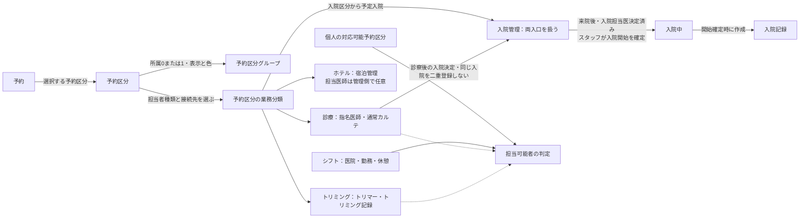

# 予約ドメインのオントロジー

| 管理項目 | 記載 |
|:---|:---|
| 文書ID・種別 | ontology.reservations／用語・概念関係の正本 |
| 決定状態 | 業務5点は Sentinel_c713c4fdc74c819182979c4b8d2fef07 で一括合意。技術方式・関連内部は未確定。今回の予約合意は2026-10-13〜2026-10-14 18:26の各根拠で確定。17:55に本書への移設、18:26に境界4点・不整合3点の是正を承認。継承・未決の関係は元の状態を保持 |
| 適用範囲 | 予約区分・表示グループ・固定業務分類・担当者・勤務・受付・記録接続・入院ホテル・LINE。個別FR・受入条件は各業務正本へ委ねる |
| 実装・実機状態 | 別管理。現行モデルの対応は横断フローの実装参照へ委ね、用語移設を実装済みの根拠にしない |

#### 予約ドメインの用語と概念関係（語彙の正本）

本節は予約ドメインで同じ概念を同じ語で表すための正本。個別の業務ルール・受入条件は参照先のFRを正本とし、本節では意味・相違・関係と制約の所在をまとめる。画面ラベル、会話での別名、現行モデルの識別子は別軸で扱い、業務概念と一対一対応するとは限らない。以下の「確定」は合意または継承仕様の確認範囲を示し、実装・実機受入の完了ではない。

2026-10-14 14:24 JSTのユーザー「オントロジーも充実させるべきです／語彙を統一するべき」（Sentinel_d399619db2548191b27d59202e842cca）が整備根拠。直前は「分類」の用語説明であり、この返信の「ok」を未使用区分変更・未設定分類補完等の業務判断の一括承認と扱わない。

##### 推奨用語・定義・呼称の使い分け

| 推奨用語 | 定義・短い例 | 画面呼称・別名／避ける表現 | 関連概念との相違・ルールの所在 |
|:---|:---|:---|:---|
| 予約 | 患者・日時・予約区分・指名等を持つ来院業務の単位。例：犬Aの15時のワクチン予約 | 「院内予約」「LINE予約」は入口の違い。appointmentは現行モデルの呼称 | [同じ予約を受付へ進める](../workflows/reservation-to-record-flow.md#checkin-contract)。受付やカルテを予約の別名にしない。予約なし来院にも現行契約ではappointmentがある |
| 予約区分 | 予約時に選ぶサービス・対応内容のマスタ項目。例：ワクチン、トリミングの区分 | 画面の「予約区分」。文脈のない「種類」「種別」「コース」を同義語として乱用しない | [標準所要時間・有効状態等](../screens/settings/master-reservation-type.md)を持つ。業務分類の値や表示グループそのものではない |
| 予約区分グループ（表示用） | 区分を見やすくまとめ、名称・色を継承させるグループ | 画面の「区分グループ」「グループ」、会話の「表示グループ」はこの概念 | [所属0または1・階層なし](../screens/settings/master-reservation-type.md#group-membership-cardinality)。担当者・記録接続をグループ名や色から判定しない |
| 予約区分の業務分類 | 自由登録する各予約区分へ必須で結び付ける固定の分類で、担当者の種類と記録・管理への接続を決める区別。診療・トリミング・ホテル・入院の接続が合意済み | 短縮は「業務分類」。単独の「分類」「予約の種類」「予約種別」は、何を区別するか曖昧なので説明なしに使わない | [診療→指名医師・カルテ、トリミング→トリマー・トリミング記録、ホテル→宿泊管理、入院→予定入院と診察後決定から入院管理](../screens/settings/master-reservation-type.md#requirement-fr-reservation-types-business-routing)。初診／再診、職種、表示グループとは別 |
| 予約区分の業務分類の変更 | 設定済み分類を別の値にする操作。例：診療からトリミングへ | 短縮は「業務分類の変更」。未設定補完と混同しない | [未使用区分だけ変更可、過去を含む既存予約がある区分は変更不可](../screens/settings/master-reservation-type.md#requirement-fr-reservation-types-business-classification-initialization) |
| 予約区分の業務分類の補完 | 未設定へ、内容確認後に初めて分類を設定する操作 | 短縮は「業務分類の補完」。自動推定や既存記録の変換という意味ではない | [既存予約・記録がある未設定区分も確認後補完し、担当者・記録の関連を保持](../screens/settings/master-reservation-type.md#requirement-fr-reservation-types-business-classification-initialization)。補完担当と判断不能時停止は[旧マスタ正本](../screens/settings/master-reservation-type.md#requirement-fr-reservation-types-legacy-review)で確定。権限識別子・資料照合は設計 |
| 来院区分 | 初診／再診など、その来院の区分 | 既存画面の「初診／再診」「来院種別」は文脈付きで継承 | 業務分類「診療」とも、予約区分「ワクチン」とも別。既存の初診／再診入力支援とカルテへの引継ぎを維持し、経路の実装整合は検証 |
| 担当者 | その業務を担当するスタッフを指す総称 | 文脈に応じ「指名医師」「担当トリマー」。全画面を「担当者」へ一律置換しない | 業務分類で担当者の種類を区別する。操作する利用者・記録入力者と同じ人とは限らず、ホテル予約は指名医師選択なし。宿泊管理側の担当医師は任意で、別責任担当・非医師担当・一名必須を追加しない。実行actor／記録入力者と任意担当医師は別概念 |
| 指名医師 | 診療予約で選択する医師 | 診療画面の「指名医師」。旧一般呼称「担当者」は説明の総称に限る | [勤務・対応可能予約区分等で候補判定](../domains/reservations/pages/reservation-management.md#requirement-fr-reservations-duty-staff-selection)。[診療中の引継ぎ](../domains/reservations/pages/reservation-management.md#requirement-fr-reservations-doctor-handoff)と実際の記録入力者を同一視しない |
| 担当トリマー | トリミング予約を担当するトリマー | 「トリマー」「担当トリマー」 | [トリミング記録への接続](../screens/settings/master-reservation-type.md#requirement-fr-reservation-types-business-routing)。医師交代の状態制限を独断で適用しない |
| 指名なし・担当未定（LINE） | 飼主が担当者を指名せず、予約の実担当を未定のまま受け付ける状態 | 「指名なし」は選択、「担当未定」は保存された担当の状態。自動お任せ割当の意味にしない | [2026-10-15追加合意2](../line/reservation-spec.md#line-no-nomination-unassigned)。後から院内で明示設定する。受入可否の仮候補は実担当・履歴・通知上の担当ではない |
| LINEの予約可能開始時刻 | 飼主が新規予約の開始として選べる時刻。通常診療は営業時間から生成し、トリミングは医院の登録時刻に限定 | 担当者別に設定・変更する。勤務時間・実担当・同時枠数と同義ではない | [追加合意1](../line/reservation-spec.md#requirement-fr-line-reservations-business-start-times)。既存適格性と全体能力を別途確認。設定変更で保存済み予約を自動変更しない |
| 判定用の仮割当 | 固定指名を保持したうえで、未定予約全体を適格な担当者で対応できるか調べる計算 | 「仮候補」「対応可能性判定」。実担当決定・引継ぎと区別する | [技術契約§4.2](../../design/domains/reservations/technical-spec.md#capacity-assignment-contract)。勤務・休憩・個人能力と全時間・部分重複・共有資源の制約を満たしても実担当として保存しない |
| 職種 | スタッフを医師・トリマー等として区別するスタッフ側の分類 | スタッフ設定の「職種」 | [分類として保持](../screens/settings/master-staff.md#requirement-fr-staff-shared-reservation-eligibility)。[区分側の職種別予約可否設定は廃止](../screens/settings/master-reservation-type.md#requirement-fr-reservation-types-occupation-gate-retirement)。業務分類や個人の対応可否と同義ではない |
| 対応可能予約区分 | スタッフ個人が担当できる予約区分の集合 | 画面の「対応可能な予約区分」「対応可能区分」、仕様の「個人対応区分」。旧「対応不可区分」は旧方式の説明に限定 | [肯定形の個人選択](../screens/settings/master-staff.md#requirement-fr-staff-positive-reservation-capabilities)。職種だけで推定せず、勤務確認も別に必要 |
| シフト | スタッフがどの医院・日時に勤務し、いつ休憩するかという勤務情報 | 「勤務」「休憩」「休み」はシフト内の条件 | [勤務と予約保護](../screens/24-shift-calendar.md#requirement-fr-shifts-protect-assigned-bookings)。医院所属だけで実勤務を推定しない。休診日設定とも別 |
| 診療施設（医院） | 予約先と勤務先を区別して扱う医院 | 「医院」「院」は既存画面の呼称として継承 | [予約先医院の勤務者を候補・人数へ含める](../domains/reservations/pages/reservation-management.md#requirement-fr-reservations-clinic-duty-scope)。スタッフの主所属・全所属とその時刻の勤務先を混同しない |
| 受付 | 来院した予約を受付済へ進める操作と、その業務状態 | 画面の「受付する」「受付済」。受付ページという場所と状態は文脈を明示 | [受付時の通常カルテ作成・同時成功](../workflows/reservation-to-record-flow.md#checkin-contract)。受付済と診療中は別の状態 |
| 診療開始・診療終了 | スタッフが実際の診療開始・終了を明示確定する操作・状態境界 | ボタン「カルテ作成」は診療開始も兼ねる。「診察を終了する」は診療終了操作の画面呼称として保持 | [予定時刻だけで自動遷移しない](../workflows/reservation-to-record-flow.md#requirement-fr-reservations-manual-consultation-state)。予定開始／終了とは別。終了取消も通常の医師変更と別 |
| 通常カルテ（診療カルテ） | 診療の記録。予約とは別の記録概念 | 診療画面の「カルテ」 | [予約時ではなく受付時に作成](../workflows/reservation-to-record-flow.md#checkin-contract)、[作成済みを再利用](../workflows/reservation-to-record-flow.md#requirement-fr-reservations-checkin-record-reuse)。業務分類・予約区分や専用記録の総称にしない |
| トリミング記録・宿泊管理・入院管理 | 各業務分類から接続する専用の記録・管理 | トリミング記録、ホテルの宿泊管理、入院管理。現行の入院管理画面は入院・ホテルを扱う | [16:07の入口契約](../screens/settings/master-reservation-type.md#requirement-fr-reservation-types-hotel-inpatient-entry)。内部作成・保存は[D05正本](../domains/hospitalization/lifecycle.md)・[D06正本](../domains/trimming/lifecycle.md)へ従い、通常カルテの同一ルールを自動適用しない |
| 入院開始 | 来院後にスタッフが実際の入院を明示確定する業務操作 | 推奨語は「入院開始」。現行画面の「チェックイン」は実装参照として区別 | [16:36契約](../screens/settings/master-reservation-type.md#requirement-fr-reservation-types-inpatient-start-confirm)。予約・予定日だけで入院中にせず、開始までに入院担当医を決め、開始確定時に入院記録を作る。失敗時の開始未確定・理由表示・再試行は17:17合意。画面配置・保存方式は設計 |
| 診療前の誤取消からの復元 | 診療前に誤取消した同じ予約を再利用する訂正操作 | 「予約の復元」。誤った診療終了の取消・マスタ復元と区別する | [17:10合意](../domains/reservations/pages/reservation-management.md#requirement-fr-reservations-restore-preconsultation-cancellation)。復元時点の担当適格性再確認、既存カルテ再利用。復元先状態・手動修正は17:17合意 |
| 未終了の指名予約 | 取消・未来院・診療終了が確定していない指名予約。予定時刻を過ぎた診療前も含む | 予定終了済みと診療終了済みを同義にしない | [17:17保護範囲](../workflows/reservation-to-record-flow.md#internal-batch-protection)。シフト・対応区分・有効状態変更の影響予約を手動解消するまで保護 |
| 区分ごとの有効意図 | グループの利用停止とは別に保持する区分個別の有効・無効 | 個別有効と新規利用可を同義にしない | [無効グループ中も個別編集可、利用はグループ有効化後](../screens/settings/master-reservation-type.md#internal-batch-group-intent) |
| 日跨ぎ勤務 | 開始日と終了日が異なる登録可能な勤務 | 日跨ぎの通常予約とは別 | [勤務は登録可](../screens/24-shift-calendar.md#requirement-fr-shifts-overnight-duty)。通常診療・トリミング予約は同日内。内部日時表現は設計 |
| 来院時の患者照合 | 飼主・動物情報を確認し、既存患者なら同じ情報を使う業務 | 同名だけの自動統合・任意情報必須化と区別する | [任意補完と既存情報再利用](../domains/reservations/pages/reservation-management.md#internal-batch-patient-identification)。予約・カルテを推測で自動統合しない |
| カルテの未記入／記入済み | 診療前の予約日訂正で通常変更と内容確認を分ける業務上の境界 | 空のカルテと記入済みカルテ。技術的な判定フィールドは設計 | [未記入は確認して日付整合、記入済みは通常日付変更を停止](../domains/reservations/pages/reservation-management.md#requirement-fr-reservations-preconsultation-date-record-correction)。削除・再作成しない |
| 一医院での勤務終了 | 兼任医師が対象医院だけで勤務を終え、同院の今後の指名を停止する業務 | 「医院別の指名停止」。スタッフ全体の無効化や全体退職と同義にしない | [医院別停止契約](../screens/settings/master-staff.md#requirement-fr-staff-clinic-departure-booking-guard)。同院の保護対象予約を手動解消し、他院勤務・指名予約と完了履歴を保持 |
| 全体退職 | 全医院で勤務を終える業務 | 一医院だけの勤務終了と区別する | [既存の無効化・予約保護](../screens/settings/master-staff.md#requirement-fr-staff-deactivation-booking-guard)へ従う。専用項目やアカウント処理を本整理で追加確定しない |
| 入院担当医 | 入院管理でその入院を担当する医師。入院開始までに決める | 入院管理画面の「担当医」。予約の「指名医師」と区別する | [16:44条件](../screens/settings/master-reservation-type.md#inpatient-doctor-and-record-at-start)。予約時指名未定可と開始時担当医決定済みを区別し、自動転記・確定しない |
| 入院記録 | 入院開始確定時に作る入院の業務記録 | 入院予定レコード・通常カルテ・治療プラン・ケアプラン等と無断で同一視しない | [開始確定時に作成](../screens/settings/master-reservation-type.md#inpatient-doctor-and-record-at-start)。作成失敗時の開始未確定・理由表示・再試行は17:17合意。内部データ対応・内容・保存方式は関連領域の設計 |
| 同時宿泊頭数上限（ホテル） | 医院ごとに設定する、同時にホテル宿泊できる動物の頭数上限 | 診療の対応可能人数・空きケージ数・担当医師人数と同義にしない | [全宿泊期間で上限内ならLINE確定](../line/reservation-spec.md#requirement-fr-line-reservations-hotel-concurrent-stay-limit)。未設定・超過は医院相談、ケージ／任意担当医師は別割当 |
| 宿泊期間（ホテル） | ホテル受入の開始から終了までの対象期間 | 通常診療・トリミング予約の同日時間枠とは別 | [期間全体の同時宿泊頭数判定](../line/reservation-spec.md#requirement-fr-line-reservations-hotel-concurrent-stay-limit)。同時刻の予定入退室は重複なし、予定超過でも未退室は滞在中（18:26合意）。日時表現・保存方式は設計 |
| ホテルの担当医師 | 宿泊管理で任意に設定する担当医師 | 予約の指名医師や実行actorとは別。旧「世話担当者」を必須責任担当として残さない | [最新担当条件](../screens/settings/master-reservation-type.md#internal-batch-hotel-care)。未設定だけで受入を拒否せず、設定時の参照・履歴を保持。臨床入院開始の担当医決定は維持 |
| 予定入院 | 予約区分から予定する入院。入院管理へつなぐ入口の一つ | 「入院予約」「予定入院」はこの文脈で使う | 実際の入院確定とは別。入院管理画面の「予約」状態とのデータ上の対応は追加確定しない |
| 診察後の入院決定 | 診察の結果、入院が必要と決めて入院管理へつなぐもう一つの入口 | 「診察後の入院」。直接の予定入院を禁止する意味ではない | 予定入院と両方を扱う。同じ入院を二重登録せず管理へつなぐ。入院記録は開始確定時に作成。画面配置等は未決 |

| 推奨用語 | 定義・短い例 | 画面呼称・別名／避ける表現 | 関連概念との相違・ルールの所在 |
|:---|:---|:---|:---|
| 業務分類をまたぐ予約区分変更 | 予約が別の業務分類の区分を選ぶ変更。区分マスタ自体の分類変更とは別 | 受付前は担当者・時間等の再確認で可、受付後は通常編集不可・記録確認訂正 | [18:26契約](../domains/reservations/pages/reservation-management.md#requirement-fr-reservations-cross-business-type-change)。既存記録を自動削除・変換しない |
| 未来院からの再受付 | 遅刻来院を同じ予約で受付へ戻す | 取消復元・診療終了取消とは別 | [18:26担当再確認](../workflows/reservation-to-record-flow.md#no-show-recheck-1826)。不適格なら別の適格医師／未定へ手動変更後に受付、既存カルテ再利用 |
| 記録確認訂正 | 受付担当が理由・変更案を入力し記録担当が確認する専用訂正 | 通常編集・自動記録変換・削除／再作成と区別 | [日付・分類訂正の正本](../workflows/reservation-to-record-flow.md#requirement-fr-reservations-record-reviewed-correction)。予約・記録・請求整合、確定記録は追記 |
| 通常Undoの会計確定境界 | 未収・分割・0円でも会計確定後は通常Undo停止 | 残額ゼロ・未保存入力・現在の取消statusと区別 | [会計境界](../workflows/reservation-to-record-flow.md#accounting-finalization-undo-boundary)。返金／取消後も自動再開しない |
| その他逆遷移の訂正 | 合意済み3操作以外を通常状態変更で戻さず記録確認へ渡す | 汎用status変更や逆方向dragと区別 | [正本](../workflows/reservation-to-record-flow.md#requirement-fr-reservations-controlled-reverse-transition) |
| 延泊希望・実滞在・延泊確定 | 希望・実際の滞在・調整後の確定予定は別の事実 | 希望保存を受入確定や退室と同一視しない | [超過時の正本](../line/reservation-spec.md#hotel-extension-over-capacity)。初期仕様は例外承認なし |
| 旧マスタの確認補完 | 医院マスタ管理担当が内容確認して補完する | 名前・勤務の推測補完と区別 | [正本](../screens/settings/master-reservation-type.md#requirement-fr-reservation-types-legacy-review)。判断不能は利用停止・確認待ち、既存履歴保持 |

##### 関係・多重度・確定制約

多重度は業務概念の関係を読むためのもの。DBの列・外部キー・保存方式の追加承認ではない。0または1を必須1へ読み替えず、現行モデルで確認できる最大件数と新合意のルールを分ける。

| 関係 | 多重度・関係の意味 | 確定制約／未決の境界 |
|:---|:---|:---|
| 予約 → 予約区分 | 通常の予約登録では1区分。1区分は複数予約から参照され得る | [予約区分は登録必須](../domains/reservations/pages/reservation-management.md#表示情報入力項目)。[過去を含む既存予約がある区分の業務分類変更不可](../screens/settings/master-reservation-type.md#requirement-fr-reservation-types-business-classification-lock)。次回予定等の別モデルへ必須条件を拡張しない |
| 予約区分 → 予約区分グループ | 0または1。1グループは複数区分を持ち得る | [所属任意・グループ階層なし](../screens/settings/master-reservation-type.md#group-membership-cardinality)。グループ削除でも所属を保持し、[配下の新規利用停止](../screens/settings/master-reservation-type.md#group-deletion-new-use-restart)を所属解除で迂回しない |
| 予約区分 → 業務分類 | 新規利用する自由登録区分は必須の固定業務分類を1つ持つ。1分類を複数区分で使える | 診療・トリミング・ホテル・入院の接続を確定。[未設定は新規選択不可、未使用変更可、内容確認後補完](../screens/settings/master-reservation-type.md#requirement-fr-reservation-types-business-classification-initialization)は15:58合意。未設定の実在・件数は未確認。補完担当と判断不能時停止は[旧マスタ正本](../screens/settings/master-reservation-type.md#requirement-fr-reservation-types-legacy-review)で確定。権限識別子・資料照合は設計。入院は予定入院と診察後決定の両入口を扱い、入院開始は来院後のスタッフ明示確定。担当医・記録時期は16:44合意。失敗時の開始未確定・理由表示・再試行は17:17合意。入院記録内部は[D05正本](../domains/hospitalization/lifecycle.md)の最新条件へ従う。画面配置・保存方式は設計。自動補完値・全分類の網羅を本表で追加確定しない |
| 医院 → ホテル同時宿泊上限、宿泊期間 → 同時宿泊頭数判定 | 医院別の上限を全期間で満たす。頭数上限とケージ／任意担当医師割当を分離 | [17:35契約](../line/reservation-spec.md#requirement-fr-line-reservations-hotel-concurrent-stay-limit)。未設定・超過は相談、医師シフトで判定しない。入退室日時の休診日・時間外条件は[18:26の日時正本](../line/reservation-spec.md#hotel-entry-exit-hours-1826)。予約済み・滞在中を同一宿泊1回だけ計数し、取消・未来院・退室済みは除外。延泊は変更後期間で再判定（18:26合意）。内部データ対応・計算方式は設計 |
| LINE公開設定 → 業務分類別の予約受付 | 公開された診療・トリミング・ホテルを予約可能にし、入院は医院相談へ案内 | [17:23契約](../line/reservation-spec.md#line-agreement-1723)。公開と分類は別。ホテルは医師指名なし・宿泊期間管理、医院別同時宿泊頭数・全宿泊期間判定は17:35合意。計算・保存方式は設計 |
| 診療予約 → 指名医師 | 0または1の指名。1医師は複数予約を担当し得る | 指名なしを認める。適格性・重複警告・[終了前の医師交代／指名なしへの変更](../domains/reservations/pages/reservation-management.md#requirement-fr-reservations-doctor-handoff)は個別正本へ従う。ホテル予約の指名医師選択はなし。宿泊管理の担当医師は任意。別責任担当・非医師担当・一名必須を追加しない |
| 医院・予約区分／業務分類・担当者 → LINE開始時刻設定 | 同じ医院・区分でも担当者別に異なる開始時刻を設定・変更できる | [追加合意1](../line/reservation-spec.md#requirement-fr-line-reservations-business-start-times)。通常診療は営業時間由来、トリミングは担当者別登録限定。担当者別設定の存在は勤務・能力や実担当決定の証明ではない |
| LINE指名なし予約 → 実担当、能力判定 → 仮候補 | 診療・トリミングの指名なし受付時は実担当なし。院内の明示設定後は分類に応じた担当を保持。仮候補は計算上の関係 | [追加合意2](../line/reservation-spec.md#line-no-nomination-unassigned)。仮計算の成功を実担当保存へ変換しない。既存固定指名は保持し、全体対応不能／判定不能ならLINE確定不可。担当種類・個人能力・勤務等は既存正本へ従う |
| スタッフ ↔ 対応可能予約区分 | 多対多。個人が複数区分に対応し、1区分に複数の担当可能者がいる | 個人選択＋勤務等で判定する。グループ一括選択は入力操作であり、職種全員への自動許可ではない。対応可否は予約先医院ごとに判定し、主所属のみで代用せず他医院の対応可否を流用しない。具体的設定・保存方式は未決。 |
| スタッフ → シフト → 医院・勤務時間・休憩 | スタッフに複数の勤務情報。各シフトの対象スタッフ・医院を区別し、複数休憩を扱う | [医院間の勤務重複を拒否](../screens/24-shift-calendar.md#requirement-fr-shifts-cross-clinic-overlap)。同時刻の他院勤務を予約先医院の候補へ含めない。日跨ぎ勤務登録可は17:17合意、具体的保存・表示方式は設計 |
| スタッフ ↔ 医院所属、スタッフ → 職種 | 複数医院への所属は既存モデルで可能。職種の多重度は本整理では追加確定しない | 所属は勤務の証明でも、個人対応可否の証明でもない。医院別対応可否は既合意。一医院の勤務終了は[医院別指名停止](../screens/settings/master-staff.md#requirement-fr-staff-clinic-departure-booking-guard)に従い、他医院勤務を継続する。設定・保存方式は未決 |
| 診療前の取消済み予約 → 同じ予約の復元 → 作成済み通常カルテ | 取消前後で同じ予約と既存カルテの関連を維持。別予約・カルテへ置換しない | [復元時点の指名適格性を再確認](../domains/reservations/pages/reservation-management.md#requirement-fr-reservations-restore-preconsultation-cancellation)。診療後・支払い後訂正へ広げず、復元先状態は17:17合意、内部保存方式は設計 |
| 医師 → 一医院での勤務終了 → 医院別指名停止 | A院のみの指名停止とB院での勤務継続を両立。全体退職と区別する | [A院の保護対象を手動解消後に停止](../screens/settings/master-staff.md#requirement-fr-staff-clinic-departure-booking-guard)。他院・履歴保持、自動解除なし。保存方式は未決 |
| 診療予約の通常進行：受付済 → 診療中 → 診療終了 | 同じ予約の業務状態・操作の関係。状態ごとに別予約を作る関係ではない | 受付と診療開始を区別し、明示操作で進める。[誤終了取消](../workflows/reservation-to-record-flow.md#requirement-fr-reservations-undo-consultation-end)は専用操作。会計待ちと支払い確定を同義にしない |
| 診療の予約／来院 → 通常カルテ | 現行契約ではactiveな通常カルテは最大1件。作成前・失敗は0件を取り得る | 正常な受付確定では受付済への変更と通常カルテ作成の両方成功。[再利用・重複防止](../workflows/reservation-to-record-flow.md#requirement-fr-reservations-checkin-record-reuse)を維持。下記現行モデル表の対象範囲を全分類へ拡張しない |
| 診療前の予約日訂正 → 通常カルテの日付 | 同じ予約・カルテを保持して整合する | [未記入なら確認して整合、記入済みは内容確認訂正](../domains/reservations/pages/reservation-management.md#requirement-fr-reservations-preconsultation-date-record-correction)。診療後／支払い後訂正へ広げない |
| 予約の指名医師 → 入院担当医、入院開始 → 入院記録 | 予約時は指名未定可、開始時までに入院担当医決定済み、入院記録は開始確定時に作成 | [16:44条件](../screens/settings/master-reservation-type.md#inpatient-doctor-and-record-at-start)。指名からの自動転記・担当医自動確定を承認せず、内部データ対応は未決 |
| 予定入院・診察後の入院決定 → 入院管理 | 2種類の業務入口。予約と管理レコードの対応・多重度は未決 | [両入口を扱う](../screens/settings/master-reservation-type.md#requirement-fr-reservation-types-hotel-inpatient-entry)。[来院後の入院開始・同じ入院の二重登録防止](../screens/settings/master-reservation-type.md#requirement-fr-reservation-types-inpatient-start-confirm)は16:36合意。入院担当医は開始までに決定し、入院記録は開始確定時に作成。失敗時の開始未確定・理由表示・再試行は17:17合意。画面配置・技術方式は設計 |
| 業務分類 → 担当者種類・記録／管理接続 | 診療は指名医師＋通常カルテ、トリミングはトリマー＋トリミング記録、ホテルは宿泊管理、入院は予定／診察後決定から入院管理 | ホテル予約の指名医師選択はなしで宿泊管理の担当医師は任意。専用記録・管理内部の多重度、予約時は指名医師未定可、開始までに入院担当医決定。画面表示グループとは独立 |

例：予約区分「ワクチン」は業務分類「診療」を持ち、任意の1表示グループに所属する。グループ色を変えても業務分類は変わらない。個人がその区分に対応可能でも、予約先医院で必要な時間に勤務していなければ指名候補にならない。診療予約を受付済にすることと、実際の診療開始を明示確定することも別である。例のグループ名・色値・マスタ設定を新しい必須値として採用しない。

##### 文書・画面・現行モデルの対応を更新する規約

- 説明・新規仕様では上表の推奨用語を使う。短縮する場合も最初に対象概念を示す。「分類」だけなら業務分類・来院区分・職種・グループのどれかを明示する。
- ボタン名・既存画面ラベル・ユーザー発言の引用・APIやコード識別子を一括置換しない。新しい概念用語は画面ラベル変更・コード改名・DB移行の指示ではない。
- 「指名医師」と「担当トリマー」は画面文脈に合わせて残す。「担当者」は総称に限り、「職種」と「対応可能予約区分」を同義にしない。
- 個別の制約や多重度を変える業務判断は、該当FRと受入条件の正本を更新してから本表へ反映する。未決を用語定義だけで決定済みにしない。

仕様の追加・変更ごとに[文書規約のオントロジー確認手順](../authoring-guide.md#ontology-maintenance)と[記述完了確認](../authoring-guide.md#ontology-review-completion)を適用する。本節は語彙・関係の正本を維持し、手順・チェックリストの本文は文書規約へ一本化する。
