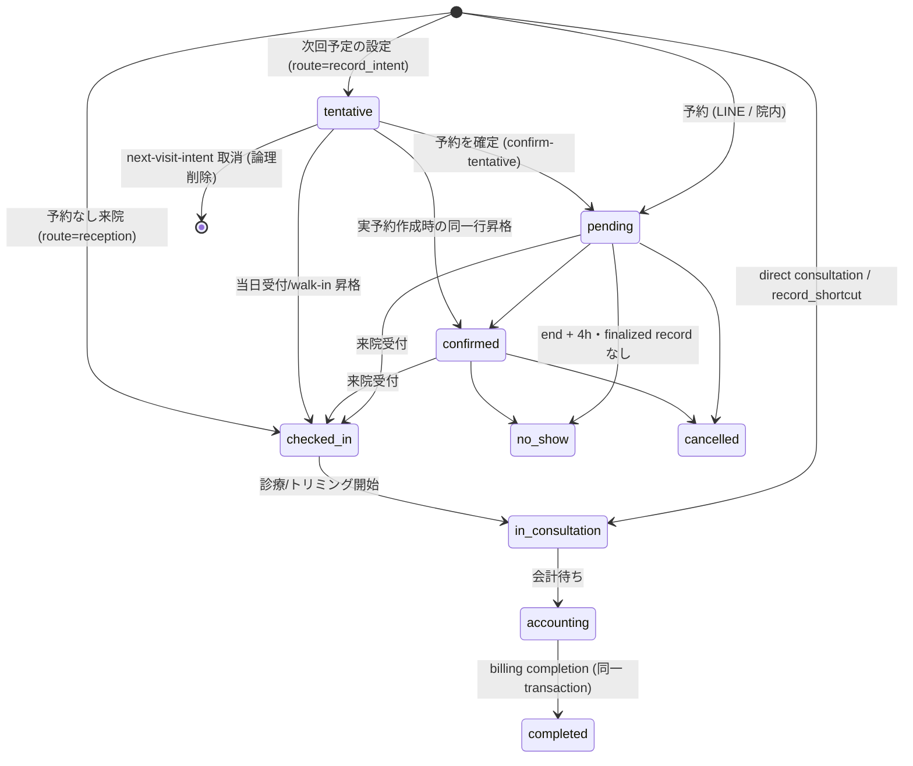

# 予約からカルテ入力までの統合フロー仕様

> **目的**: 予約、受付、通常カルテ、トリミング、会計の現行契約を一箇所に定義する。
> **読者**: 予約・受付・カルテ連携の実装者。
> **最新更新**: 2026-08-31 | **ステータス**: current contract（履歴は §8）

## 1. Source of truth と用語

受付カンバンと予約 lifecycle の source of truth / write owner は `appointments` / `internal/reservation` である。LINE 予約、院内予約、予約なし来院、一覧からの記録入力 shortcut は、受付に載せる業務であれば必ず appointment を持つ。

| 概念 | 現行モデル | 契約 |
|---|---|---|
| 予約・受付 | `appointments` | status、日時、owner/pet/staff、source、route を保持 |
| 通常カルテ | `medical_records.appointment_id` | `general` appointment ごとに active record 最大 1 件 |
| トリミング詳細 | `appointment_trimming_details.appointment_id` | `trimming` appointment ごとに最大 1 件 |
| 予約種別 | `reservation_types.category` | `general` / `trimming` で遷移先を決める |
| スタッフ対応可能種別 | `staff_reservation_capabilities` | staff 可否判定と write 検証の肯定形 SoT |
| 予約経路 | `appointments.reservation_route` | `line`、`reception`、`record_shortcut` 等の業務入口 |
| 次回予定（EMR-308） | `appointments`（`status='tentative'`） | 日付のみ確定の未予約意図。`intended_date` が正本で `reservation_route='record_intent'`・`source_medical_record_id` に由来カルテを保持。枠・容量・時間枠競合・通常予約の完了通知の対象外。別途 Lステップの3日前・当日リマインダー定義がある |

通常診療とトリミングを同日に行う場合は appointment を 2 件作る。会計は appointment 単位に固定せず、同日・同一 owner/pet の未会計項目をまとめられる。

## 2. 入口別の現行フロー

### 2.1 LINE / LIFF 予約

`POST /api/liff/:clinicId/reservations` は active・公開中・非 internal の予約種別、clinic、LINE customer、明示 staff の所属/capability/active/public、trimming course/option を同じ transaction で再検証する。appointment、trimming detail、option junction は全体成功または rollback とする。

- `source = line`。
- LINE customer が既存 owner に紐付く場合、`owner_id` / `pet_id` を best-effort で補完する。氏名+電話だけで自動リンクしない。
- owner/pet が未確定なら、カルテ作成前に同一 clinic の実体へ確定する。
- 当日 appointment は受付カンバンへ表示する。

LINE 予約の owner/pet 事前解決は best-effort だが、予約書込み transaction では `line_customers.owner_id` の取得時状態（未紐付けを含む）との一致、同一医院の owner/pet 関係、死亡状態を row lock 下で再検証する。紐付け変更や譲渡で古くなった入力は挿入・tentative 昇格の前に拒否する。氏名・電話による自動リンクを行う契約ではない。

### 2.2 院内予約管理

`/reservations` の `ReservationFormModal` は `POST /v1/reservations` を使う。

- 予約種別と日付を選ぶと `GET /v1/reservations/available-times` の返却 slot key を時刻候補に使う。
- 15 分刻み候補は fallback / edit behavior として残るが、通常の新規入力で空き枠 API を置き換えるものではない。
- weekly / specific-date の `reservation_type_available_slots` と unavailable time、営業時間、休診日、shift、break、既存予約を空き枠計算へ反映する。
- frontendはstaff候補を選択日のshiftと`staff_reservation_capabilities`で絞る。backendはclinic所属・capability・active/public状態とappointment conflictを再検証するが、**明示staffの選択時刻shift再検証は未実装**。このsource gapをfrontend絞り込みで代替しない。
- frontend の重複表示は補助であり、最終 conflict/capacity 判定は backend transaction 内で行う。

### 2.3 当日受付

予約あり来院は既存 appointment の status を進める。予約なし来院・飛び込みは当日 appointment を `reservation_route = reception`、通常 `checked_in`（direct consultation の明示 flow では `in_consultation`）で作る。

| カンバン列 | `appointments.status` |
|---|---|
| 受付予約 | `pending`, `confirmed` |
| 受付済 | `checked_in` |
| 診療中 | `in_consultation` |
| 会計待ち | `accounting` |
| 会計済 | `completed` |

`cancelled` / `no_show` / `tentative` は通常の進行列には表示しない。

EMR-308: `tentative`（次回予定・未予約）はカルテヘッダーの「次回予定」（`PUT/DELETE /v1/reservations/pets/:petId/next-visit-intent`）で書かれる sentinel 行で、実時刻を持たず（`start_time`/`end_time` は `intended_date` の JST 00:00–00:15 sentinel）カンバン・空き枠・定員計算に参加しない。実予約への遷移は2経路ある。(a) 予約詳細の「予約を確定」（`POST /v1/reservations/:id/confirm-tentative`）で明示時刻・担当を付けて `pending`/`confirmed` へ昇格、(b) 同一ペットへの実予約・当日受付・walk-in 作成経路（内部 Create・CreateBatch・admin/walk-in・LIFF）が `createOrPromoteTentative` で active tentative を同一行昇格し、受付時に sentinel 時刻を実時刻へ置き換える。`DELETE next-visit-intent` は tentative を論理削除する。通常予約の完了通知の対象外であり、別途 Lステップの3日前・当日リマインダー定義がある。

次回予定の権限は操作別である。新規設定の PUT は `reservations:create`、既存 tentative の上書きは `create` と `edit` の両方、取消 DELETE と実予約への確定 POST は `edit` を要する。実予約の表示が優先されていても、既存 tentative があれば上書き権限を省略しない。

拠点横断のカルテ・予約行からの操作は、そのレコードの `clinic_id` を `X-Clinic-ID` に指定し、グローバルの選択医院へ取り違えない。カルテ側の連続した設定・取消は hook インスタンス単位の FIFO で処理し、先行保存の再取得が後続の入力ドラフトを巻き戻さないよう pending と最新要求を管理する。別タブ間や任意のネットワーク障害まで直列化する保証ではない。

### 2.4 受付から通常カルテ / トリミング

受付 card は `appointmentId` と予約文脈を次画面へ渡す。

- `category = general`: 同じ appointment を `medical_records.appointment_id` に保存する。別 appointment を作らない。
- `category = trimming`: 同じ appointment に `appointment_trimming_details` を作成・入力する。
- appointment に既存 pet/owner/staff があれば矛盾する差し替えを拒否する。
- appointment-linked `medical_records.date` は start time の JST 日付へ正規化し、作成後は `date` / `appointment_id` を通常更新で変更しない。

### 2.5 一覧からの記録入力 shortcut

通常カルテ一覧 / trimming 一覧からの新規作成は予約入口ではなく `reservation_route = record_shortcut` の記録入力 shortcut である。

- 対象日の未完了 appointment を解決し、なければ当日 appointment を作る。
- 新規 shortcut appointment は `status = in_consultation`。
- `visit_date` / `date` と `appointment_id` を保持し、pet 選択画面を挟んでも失わない。
- 通常カルテ作成後と trimming 作成後は reception query を invalidate し、当日 card を再取得する。

### 2.6 カルテ ⇔ トリミング相互 shortcut（EMR-168 案A）

診察カルテフォームとトリミングフォームは、同日・同一ペットの相方 record への相互遷移導線を持つ。画面は 2 枚のまま（1画面統合はしない）で、遷移は既存の `record_shortcut` 経路を再利用する。

- 診察カルテ側「トリミング記録を開く/作成」: 同日・同一ペットの未完了 trimming appointment を `GET /v1/reservations` で解決する。あれば `appointmentId` 付きの `/trimming/new` へ（detail 既存ならフォームが hydrate、なければ同 appointment に upsert）。なければ `petId` + `visitDate` のみで遷移し、保存時にフォームが `record_shortcut` で appointment+detail を作成する。
- トリミング側「診察カルテを開く/作成」: 同日・同一ペットの通常カルテを `GET /v1/medical-records` で解決する。あれば `/medical-records/:id` へ。なければ `/medical-records/new?petId&visitDate` へ遷移し、auto-create が同日 general appointment を再利用または `record_shortcut` で新規作成する。
- 遷移先リソースの権限（開く=view、作成=create）がない staff には導線を表示しない。死亡ペットでは非表示。
- feature 境界（medical-records ↔ trimming の直接 import 禁止）を維持するため、解決ロジックは共有 hook（`src/hooks/use-partner-record-link.ts`）、表示は共有 component（`PartnerRecordLink`）に置く。

## 3. 空き枠と staff capability

現行の空き枠は `line_reservation_settings`、`reservation_type_available_slots`、`reservation_type_unavailable_times`、`shift_entries`、`shift_entry_breaks`、既存 appointment を組み合わせる。院内 UI も LIFF と同じ計算を利用する。

staff CRUD の一部 request/response 名は `ExcludedTypeIDs` / `excluded_courses` の exclusion-shaped compatibility surface を残す。この API は入力を `staff_reservation_capabilities` へ変換する。production は `staff_reservation_exclusions` と capability junction の両方へ write しない。候補絞り込みと POST 検証は capability のみを読む。

`GET /v1/reservations/available-staffs` は未実装で、現行設計では不要。導入する場合は別 contract とする。

## 4. データモデル（clinic-owned relations）

clinic-owned relation は tenant boundary を明示する。主要 column は次のとおり。

| テーブル | 主要 column |
|---|---|
| `appointments` | `id`, `clinic_id`, `start_time`, `end_time`, `owner_id`, `pet_id`, `reservation_type_id`, `doctor_id`, `status`, `source`, `reservation_route`, `actual_reservation_at`, `line_customer_id`, `customer_fields`, `intended_date`, `source_medical_record_id` |
| `reservation_types` | `id`, `clinic_id`, `name`, `duration_minutes`, `category`, `reservation_visible`, `reservation_day_option`, `is_internal`, `group_id` |
| `reservation_type_occupations` | `clinic_id`, `reservation_type_id`, `occupation_id` |
| `staffs` | `id`, `clinic_id`, `name`, `is_active`, `staff_type`, `reservation_visible` |
| `staff_reservation_capabilities` | `clinic_id`, `staff_id`, `reservation_type_id` |
| `shift_entries` | `id`, `clinic_id`, `staff_id`, `date`, `shift_type`, `start_time`, `end_time` |
| `shift_entry_breaks` | `id`, `shift_entry_id`, `break_start`, `break_end`。clinic ownershipは`shift_entry_id → shift_entries.clinic_id`で継承・検証 |
| `reservation_type_available_slots` | `id`, `clinic_id`, `reservation_type_id`, `available_type`, `day_of_week`, `specific_date`, `start_time`, `is_active` |
| `reservation_type_unavailable_times` | `id`, `clinic_id`, `reservation_type_id`, `unavailable_type`, `day_of_week`, `specific_date`, `start_time`, `end_time` |
| `appointment_trimming_details` | `id`, `clinic_id`, `appointment_id`, `course_id`, `style_request`, `body_weight`, `body_temperature`, `remarks` |
| `appointment_trimming_options` | `id`, `appointment_id`, `option_id`, `sort_order`, `created_at`。clinic ownershipはappointment経由で継承しwrite時に検証 |

`UNIQUE(clinic_id, staff_id, reservation_type_id)` などの uniqueness だけでなく、参照先 master / staff / pet / owner が appointment と同一 clinic であることを write transaction 内で検証する。

## 5. Lifecycle / transaction safety contract

実装 mechanics の正本は [ADR-006](../architecture/adr/006-backend-domain-package-boundaries.md#appointments-write-ownerの実装決定be9-2e-0) と [`appointment_write_owner_lint_test.go`](../../backend/internal/reservation/appointment_write_owner_lint_test.go)。本書は業務 contract のみを保持する。

- `internal/reservation` 以外の billing、medicalrecord、trimming、lstep は generic appointment update をせず、business intent を表す typed operation を呼ぶ。
- cross-domain write は ambient transaction を必須とし、appointment、record/detail/options、監査、結果再取得の必要部分を commit 前に成功させる。dependency 欠落は fail-closed。
- `general` appointment の通常カルテ作成は appointment を lock し、同じ appointment の active record を最大 1 件にする。`trimming` appointment への通常カルテ作成は拒否する。
- draft record 削除と estimate 作成は同じ parent record lock で直列化する。estimate / finalize が先なら削除を Conflict、削除が先なら後続 estimate を拒否する。
- record finalize と no-show transition は同じ appointment lifecycle lock に参加する。finalize が先なら no-show は no-op、no-show/cancelled が先なら finalize は Conflict。
- no-show 自動検知は `pending` / `confirmed`、end time + 4h、finalized record 不在を write 時に再評価する。実 transition と system audit は同じ transaction で commit する。
- trimming write は同一 clinic の active master と staff を固定し、slot/capacity/conflict を lock 後に再検証する。terminal appointment や medical record linked appointment の不正変更を拒否する。
- billing completion は同一 clinic / JST 日 / owner/pet の対象 appointment を transaction 内で `completed` にし、途中失敗を rollback する。

## 6. 画面契約

| 画面 | 現行契約 |
|---|---|
| 予約フォーム | 空き枠API slotを表示し、frontendがshift + capabilityでstaffを絞る。internal writeはclinic/capability/conflict、LIFFは追加でactive/publicを再検証するが、明示staffの選択時刻shift再検証は未実装 |
| 予約管理（次回予定） | `status='tentative'` の appointment は `GET /v1/reservations` の素の等値フィルタで一覧でき、`ExpiredTentativePanel` が `intended_date` 経過分を actionable 表示する。確定は `POST /v1/reservations/:id/confirm-tentative`、設定・取消は `next-visit-intent`。LINE reminder は別トリガーであり、管理面はこの画面契約が担う |
| 受付カンバン | 当日 `appointments` の status を表示し、category で通常/トリミング遷移を分ける |
| 通常カルテ一覧 | appointment を解決/作成し、JST 日付と予約文脈を保持する |
| トリミング一覧 | appointment + detail を transaction で作成/再利用し、受付 query を再取得する |
| カルテ/トリミングフォーム相互導線 | 同日・同一ペットの相方 record へ「開く/作成」。既存相方は解決して遷移、新規は record_shortcut 経路。遷移先権限なし・死亡ペットは非表示 |

## 7. Deferred / known gaps

- `available-staffs` endpointは未導入。現行client-side shift filteringとserver-side clinic/capability/conflict validationの間に、明示staffの選択時刻shift gapが残る。source修正と必要性を計測する。
- exclusion-shaped staff compatibility field 名は残る。意味を変える source migration は別 task。
- 本書は route / E2E の実行結果を主張しない。docs-only refresh では runtime を再実行していない。

## 8. Historical decisions / resolved issues

**履歴（2026-07-24 までに code-complete。release 状態の主張ではない）**:

- 旧実装では一覧 shortcut が `medical_records` だけを作り、日付/appointment context が欠けて受付へ出ない経路があった。現在は appointment 解決/作成、JST date、query invalidation を含む現行契約へ統一した。
- 院内予約フォームは固定 15 分候補中心だった。現在は `/v1/reservations/available-times` を利用し、15 分候補は fallback/edit に限定した。
- staff 可否の否定形 `staff_reservation_exclusions` を active design としていた。現在の write 検証 SoT は `staff_reservation_capabilities`。
- weekly / specific-date の trimming slot 表現を検討段階としていた。現在は `reservation_type_available_slots.available_type` を含む現行モデルを採用した。
- Phase 1〜4 の実装 checklist と重複する present-tense problem list は削除した。詳細な移行履歴は git history を参照する。
