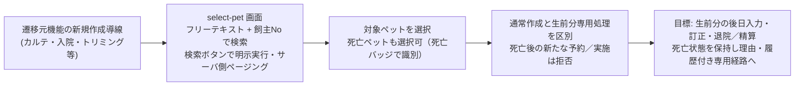

# ペット選択 仕様書

## 概要

2026-10-15の死亡後取扱い確認（Sentinel_2b63d8f5aad88191aa2b4dff79fb5ac2）に対するユーザー「ok」（Sentinel_45be2cab0fe4819188c7c0f9a211358c）。専用経路の正本は[D03過去入力／訂正](../domains/medical-records/lifecycle.md#medical-record-deceased-retrospective)、[D05退院](../domains/hospitalization/lifecycle.md#requirement-fr-hospitalization-delete-and-preserve)、[D10精算](../domains/accounting/lifecycle.md)と各専用記録領域。画面配置・権限対応・APIの実装適合は未確認で、新しいURLは仮設しない。
- **画面の目的**: カルテ、入院、トリミング、会計等の各機能において、新規データ作成の対象となるペットを検索・特定するための中間ページ。
- **URLパターン**: `/:feature/select-pet`
  - 例: `/medical-records/select-pet`, `/hospitalization/select-pet` 等
  - 対象 feature: medical-records / hospitalization / trimming / examinations / checkups / accounting / vaccinations
- **アクセス権限**: 通常は遷移元機能の`<Resource>:create`権限。例外としてcheckupsは`ResourceMedicalRecords:create` **かつ** `ResourceMedicalRecords:edit`を要求する（`RequirePermission`）。

**中間ページとしての役割:**

---

## 画面構成

### 1. 検索契約（目標と旧実装参照を区別）

[共通の患者検索契約](../shared/ui-contracts.md#requirement-fr-common-ui-pet-selection)に従い、単一欄と飼主姓名の空白吸収／ペット名＋飼主名の空白区切りを使う。各一覧の述語完全統一はPhase2であり、本中間画面の統一と混同しない。対応報告を今回の実機合格と扱わない。

- **入力**: ラベル「検索（ペット名・飼主名・よみ・電話）」の単一フリーテキスト `search`、任意の「飼主No」（`owner_id` = owners.id）、種別はマスタ id の select（種別名テキスト部分一致ではない）。住所フィールドは無い（BUG-451）。
- **取得**: サーバ側 page（20 件）を維持し、[10/19承認の検索ボタン実行](../shared/ui-contracts.md#owner-pet-explicit-search-20261019)で検索入力を適用する。旧300ms debounceは実装観察で、新目標は未実装検証（テナント全ペット初期ロードへ変更しない）。死亡ペットも一覧に出す（`includeDeceased: true`）。死亡ペットは生死列の「死亡」バッジと行のグレーアウトで識別する。
- **特記マーク（EMR-173/231、共有 `DangerBadge`）**: ペット特記レベルはペット名列に表示 — `danger_level` 高=赤い八角形アイコン・中=黄い三角形アイコン（文言なし、クリック/Enter/Space で `danger_reason` の補足メモを Popover 開示、空は `内容未登録`）、低・未設定は非表示。飼主 `is_dangerous` は飼主名列の氏名横に文言なしの赤い八角形アイコン（ペット特記レベルとは別概念・Popover なし、代替名「特記」）。いずれもスタッフ向け表示で、分類が伝わる文言は画面・aria-label・title に出さず、LIFF・owner 向け契約にも出さない。
- **死亡ペットの選択（EMR-177と最新合意）**: 死亡ペットも死亡バッジで識別して選択可能。選択だけで新しい予約／実施や通常作成を許可しない。最新合意では、生前分の後日入力・誤記訂正・退院処理・精算を死亡状態を戻さず理由と履歴付きの専用経路で行える目標とする。実施時点不明は確認を要する。現行フォーム／BE（`ValidatePetNotDeceased` 等）の一律作成拒否は実装差として区別し、通常gate全面解除で代用しない。生死が「不明」等の既知外 status の個体は引き続き fail-closed で選択不可。
  - 現行遷移の参照: カルテ登録の selector（`/medical-records/select-pet`）で死亡ペットを選択すると、新規作成画面ではなく `/medical-records?pet_id=<id>`（そのペットのカルテ一覧）へ遷移する。一覧から既存カルテを開けば閲覧でき、確定済みカルテには追記（addendum）で連絡記録を残せる。
- **結果列**: 飼主No／飼主名／ペット番号／ペット名／生死／種／生年月日／体重／環境／前回来院／操作。
- **権限**: 通常は遷移元機能の`<Resource>:create`。checkupsは`ResourceMedicalRecords:create` **かつ** `ResourceMedicalRecords:edit`。

## 明示検索と患者選択の非同一性

検索語/飼主Noの入力変更・消去だけでは適用済み結果や選択患者を変更しない。未適用入力と適用済み条件が異なる間は旧結果からの候補選択確定を抑止し、従来の検索待ち中の取り違え防止を維持する。検索押下後の条件、種別等の既存filter、医院認可/要求世代に一致する候補だけ表示する。既存リセット・詳細復帰は[共通の明示実行契約](../shared/ui-contracts.md#owner-pet-explicit-search-20261019)へ従う。検索実行や0件表示を患者選択成功・カルテ/予約作成成功へ変換しない。4追加ACを7featureへ個別に対応し、死亡表示・選択権限等の既存受入を併用する。実装/実機未確認。

## 10/19後続承認：同種操作・検索ボタン方式

本画面の既存キーワード欄は[適用台帳 S01 / S02 / S03 / S04 / S05 / S06 / S07](../shared/interaction-scope.md)と[共通FR/8AC](../shared/ui-contracts.md#interaction-consistency-20261019)へ従う。入力中/適用済みを分け、入力/待機/消去だけでは検索せず検索ボタンで適用。既存の明示リセット、独立filter、詳細復帰、認可・検索対象・取得上限/ページ内制限を保持し、全件検索や一律の保存方式へ変えない。取得中/0件/失敗と遅延応答を分け、検索で選択/保存/コピー/送信を確定しない。旧defer/debounceの記載は入力即適用の目標に用いず、適用後の描画最適化と区別する。[S14手順](../../ops/testing/scenarios/S14-search-and-multi-word.md#cross-ui-search-20261019)を各対象IDで実施する受入条件とし、実装適合・実機は未確認。
