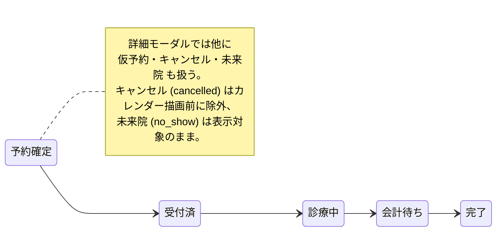

# 予約管理 仕様書 (Reservations)

## 概要
- **画面の目的**: 診療、トリミング、手術等の全予約をカレンダー形式で統合管理する。
- **URLパターン**: `/reservations`
- **アクセス権限**: `reservations:view`（`RequirePermission` によるルートガード。デフォルト action は `view`）。作成/編集/削除は `usePermission` によりさらに `create`/`edit`/`delete` 権限で出し分け。

---

## 画面構成とビュー

### 1. カレンダービュー
用途に応じて2つの表示形式を切り替え可能です。
- **月表示 (`MonthView`)**: 日付ごとの予約件数と概要を把握。セルクリックで該当日の週表示へ遷移。
- **週表示 (`WeekView`)**: 日付ごとの時間軸（15分単位）で空き枠と重複を確認。表示日数は 5日/7日 を切替可能（`DaysRangeToggle`）。URL `?days=`（未指定は 5）。休診日はカレンダー選択不可。

### 2. インテリジェント・ツールバー
- **動的カラー凡例**: マスタ設定（`ReservationTypeGroup.color`）と連動し、診療区分ごとの配色を動的に表示。
- **マルチソース・フィルタ**: 「手動予約」と「LINE予約（source=line）」を切り替えて表示可能。
- **担当医フィルタ**: 特定の医師のスケジュールのみを抽出。
- **キャンセル済みの非表示**: `filterCalendarAppointments` が `cancelled` のみを描画前に除外する（#116）。LINE・院内のどちらからのキャンセルも同じ扱い。`no_show` は表示対象のまま。予約 API の既定取得や保存データは変更せず、履歴用途の取得には影響しない。

---

## 予約登録フロー (`ReservationFormModal`)

デスクトップでは「患者選択」パネルと「予約情報」パネルを左右分割で同時表示します（モバイルのみ、`StepIndicator` による Step1/Step2 タブ切替。両タブは自由に行き来可能で、順序を強制するゲートではありません）。

### 患者の特定（臨床安全ガード）
- **高速検索**: 飼主名、ペット名によるリアルタイム検索。
- **死亡ペットの保護**: ステータスが「死亡」のペットは一覧でグレーアウトされ、選択が物理的に無効化されます（`PatientSelectionTable.tsx`）。
- **結果スクロール**（EMR-318）: 患者結果パネルを高さ制約内のスクロール領域とし、キーボードでフォーカスできる。Windows の実際のスクロールは別途受入で確認する。
- **飼主詳細からの受付追加**（EMR-318）: 予約作成権限がある場合、保存済みの生存ペットの「受付」から当日フォームを開く。保存直前に選択医院の患者状態と当日予約を再取得する。当日 confirmed が1件なら予約の日時・内容を保持して checked_in へ変更し、読取時の updated_at をサーバーで照合する。別操作による版変更は409として再読込を求める。受付済／診療中／会計待ちは再刻印せず既存予約を案内し、複数候補や既存予約を含む複数ペットは受付画面で個別に選ぶ。完了・未来院・キャンセル・次回予定は再利用候補から除外する。当日予約がなければ通常の予約作成経路で受付を追加する。クロスタブ同時新規作成の冪等保証は未達であり、別途サーバーでの対応と受入が必要。

### 予約詳細の入力
- **来院区分の入力支援**（EMR-274）: 通常の新規作成では、新規飼主モードを「初診」、既存ペット選択中を「再診」に固定し、表示値と送信値を一致させる。同一飼主の複数ペット選択・別飼主への切替も再診、新規飼主への切替は初診となる。患者未選択時は選択制限なし。予約編集・次回予定の確定では既存値を維持し、来院区分を変更可能。新規飼主の登録成功後、予約保存のみ失敗した場合も新規飼主モードを維持して初診を送信する。
  - この入力支援は受診履歴の判定やAPI制約を追加しない。未受診でも登録済みペットを選べば再診となる。予約の来院区分は予約連携カルテ作成時の初診ウェルカム通知判定へ伝わる。一方、3日後・7日後フォローは飼主の最初のカルテ日による別判定（EMR-276の通知条件整備は別票）。訂正は予約編集で行う。
  - 予約フォーム内に既存飼主への新規ペット追加機能はない。飼主詳細等で登録後、既存ペットとして選択する場合も再診扱い。
- **予約内容**（EMR-275）: 作成・編集フォームと予約詳細は同じ表示名称を使う。既存値を表示・保存し、DB/APIの項目名は `notes` のまま。受付側（EMR-278）も表示名称は「予約内容」。
- **スマート・スナップ**: 追記（2026-10-07 監査）: 時刻候補の契約は [reservation-to-record-flow.md §2.2](../reservation-to-record-flow.md) が正本で、通常の新規入力では `GET /v1/reservations/available-times` の返却 slot key を時刻候補に使うのが primary。`TIME_OPTIONS`（15分刻み・ゼロ埋め HH:mm）の Select とカレンダー空き枠クリック位置の15分スナップは **fallback / edit behavior** として残る（通常の新規入力で空き枠 API を置き換えるものではない）。
- **終了時刻の自動計算**（EMR-191）: 開始時刻を選択すると終了時刻が自動設定される。LINE 空き枠スロットが存在する時刻ではスロットの終了時刻を採用し、無い場合は選択中の予約区分の `duration_minutes`（未設定・0 は既定15分）を開始時刻へ加算する（`resolveEndTimeOnStartChange`）。自動設定後も終了時刻は手動で変更可能。
- **空き状況の〇△✕表示**（EMR-170）: 予約区分＋日付を選択済みの場合、開始時刻 Select の各候補に空き状況を `〇 空きあり` / `△ 残り1枠` / `✕ 満員` の記号＋テキストで併記する（色だけに依存しない）。✕（満員）枠は選択不可。`GET /v1/reservations/available-times` に `include_unavailable=true` を付けて満員枠も取得する。判定は `remaining = min(空きスタッフ数, 予約区分定員残)` で、remaining>1 が 〇、=1 が △、=0 が ✕。スタッフ制約も定員も無い枠は remaining=null で常に 〇。LINE 空き枠設定未登録・通信エラー・区分未選択時の手動時刻入力パスではバッジは表示しない。
- **重複ブッキング警告**: 同一時間帯に同一担当者の予約が重複した場合、保存前に警告を表示（新規作成・編集保存時、およびドラッグ&ドロップでの時間変更時の双方でチェック）。
- **担当医指名**: 患者の希望に応じた「指名」設定が可能。
- **予約経路** (`ReservationRouteSelect`、編集モードのみ): LINE/電話/受付/診察室/記録入力のいずれかを選択・記録。メインの保存操作とは独立して即時保存される。

---

## ステータス管理と連携

予約詳細（`ReservationDetailModal`）から、来院後のステータスをシームレスに更新できます。

- **ステータス**: 詳細モーダルは 仮予約 / 予約確定 / 受付済 / 診療中 / 会計待ち / 完了 / キャンセル / 未来院 を扱う。来院後の主経路は `予約確定` → `受付済` → `診療中` → `会計待ち` → `完了`。
- **tentative（EMR-308）**: `status='tentative'` の appointment は「次回予定・未予約」— 日付のみ確定（`intended_date`）で時間・枠・担当医は未定。カレンダー（`MonthView`/`WeekViewAppointmentCard`）は色ではなく明示テキスト「次回予定・未予約」（`TENTATIVE_APPOINTMENT_LABEL`）で識別し、空き枠・定員を消費しない。カルテヘッダーの「次回予定」ボタン（`PUT/DELETE /v1/reservations/pets/:petId/next-visit-intent`）で作成・取消され、詳細モーダルではステータス変更でなく「予約を確定」で実予約へ昇格する。当日受付への昇格は [reservation-to-record-flow.md](../reservation-to-record-flow.md) を参照。
- **受付への反映**: プッシュではない。受付側の 30 秒ポーリングとフォーカス再取得。
- **レコード作成**: 予約詳細からワンクリックで「カルテ作成」「入院・ホテル登録」「トリミング記録作成」を開始可能。

**来院後の主経路:**

---

## 技術仕様

### ユーザーインタラクション
- **ドラッグ&ドロップ**: `motion/react` を採用。週表示において、カードの上下ドラッグにより15分単位で時間を直感的に変更可能。
- **レスポンシブ**: デスクトップ環境を優先しつつ、タブレット端末での視認性も確保。

### API連携
| メソッド | エンドポイント | 用途 | 必須権限 | 必須アクション |
|:---|:---|:---|:---|:---|
| GET | `/api/v1/reservations` | カレンダー期間内の予約一括取得 | `reservations` | `view` |
| POST | `/api/v1/reservations` | 新規予約の作成（重複チェック含む） | `reservations` | `create` |
| PATCH | `/api/v1/reservations/:id` | 時間変更・ステータス更新 | `reservations` | `edit` |
| PATCH | `/api/v1/reservations/:id/reservation-route` | 予約経路の更新 | `reservations` | `edit` |
| DELETE | `/api/v1/reservations/:id` | 予約のキャンセル・削除 | `reservations` | `delete` |
| GET | `/api/v1/reservations/available-times` | 予約可能時間枠＋空き状況（`include_unavailable=true` で満員枠も返却、EMR-170） | `reservations` | `view` |

---
