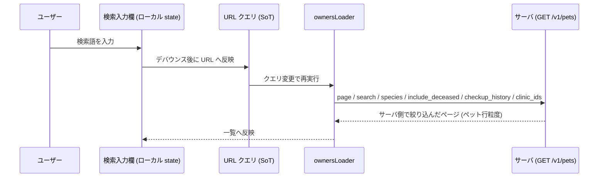

# 飼主・ペット一覧 仕様書 (Owners List)

> 2026-10-15文書整理: 画面をまたぐ業務契約・受入条件は[領域正本](../domains/owners-pets/lifecycle.md)、型・保存／再送と現行差は[技術契約](../../design/domains/owners-pets/technical-spec.md)を参照する。以下の画面詳細は既存記載を継承（決定根拠・実装の全件再監査なし）、実機未実施。飼主削除の参照保護は主飼主ペットだけでなく副飼主リンクも対象。カルテ付きペット削除の拒否を、臨床記録を消して救済する操作指示にしない。

## 概要
- **画面の目的**: 登録されている飼主および患者（ペット）の横断検索、および詳細ページへのアクセス。
- **URLパターン**: `/owners`
- **アクセス権限**: `owners:view`（`RequirePermission` によるルートガード。デフォルト action は `view`）。

---

## 1. 画面構成

### 1.1 高機能検索・フィルタ (`PropertyFilter`)
膨大なカルテベースから、目的の個体を瞬時に特定するための UI。
- **フリーテキスト検索 (`search`)**: 飼主名・ペット名（各カナ含む）・電話番号の部分一致（ひらがな↔カタカナ正規化あり）。飼主フルネームは半角/全角/連続空白を無視した順序保持一致（前後空白も無視）。検索欄は 1 つ。半角/全角/連続空白で分割した**複数語は AND**（各語が既存フィールドのいずれかに一致）。1 語は従来どおりフィールド間 OR（飼主フルネームの空白除去一致を含む）。**飼主No** は `owners.id`（レスポンス `owner_number` のエイリアス）の文字列一致、**ペット番号** は `pets.pet_number` の部分一致。いずれも clinic スコープ内のみ。**種別名は対象外**（種別は下の動的フィルタ / `species` クエリを使う）。空白のみの検索は 0 件（全件返却しない）。医療記録一覧の検索とは独立。
- **動的フィルタ**: 動物種別、生存/死亡ステータス、健診受診履歴による絞り込み（`OWNER_FILTER_PROPERTIES`。来院期間フィルタは未実装）。
    - **健診受診履歴 (`checkup_history`)**: ペット自身の健診受診履歴で絞り込む select フィルタ（条件は「次と一致」のみ）。選択肢は `within_1y` / `within_2y` / `within_3y`（直近 N 年以内に受診あり）、`not_within_1y` / `not_within_2y` / `not_within_3y`（直近 N 年以内に受診なし）、`none`（受診履歴なし）の 7 値。期間窓は JST 当日起点 N 年前の暦日を含む（境界包含）サーバ側絞り込み。未指定はフィルタ無し。
- **並び替え**: 一覧の列ソートは #266 サーバサイドページネーション化に伴い**撤去**（ページ内ソートの誤認を防ぐ）。

### 1.2 統合データテーブル (`DataTable`)
ページネーション（1 ページ 20 件）に対応。

| カラム | 説明 |
|:---|:---|
| **飼主No** | 飼主の管理番号。 |
| **飼主名** | 飼主 `is_dangerous` の場合、氏名横に**赤い八角形アイコンのみ**のマークが表示されます（EMR-173/231、共有 `DangerBadge`、文言は出さず支援技術向け代替名は「特記」）。特記レベル（`danger_level` 高/中）のペットを飼育している場合はさらにアイコンバッジが表示され（高=赤の八角形 / 中=黄の三角形、文言なし）、クリック・Enter・Space で補足メモを Popover 開示します。 |
| **医院**（医院横断表示時のみ） | #86 医院横断フィルタで複数医院を選択した場合に表示。 |
| **ペット番号** | ペット独自の管理番号。 |
| **ペット名** | ペットの名称。リンクをクリックすると飼主詳細 `/owners/:ownerId?pet=:petId` へ遷移し、対象ペットの詳細モーダルが開く（EMR-174・閲覧権限のみでも可）。 |
| **生死** | 生存/死亡の視覚的バッジ。 |
| **種** | 動物種別。 |
| **生年月日** | 基本属性。 |
| **体重** | ペットマスタの `weight` カラム（ペット編集フォームで更新。カルテからの自動引用ではない）。 |
| **環境** | 室内/室外等の飼育環境。 |
| **前回来院** | 最終診療日。 |
| **操作** | 編集/レポート/削除のドロップダウンメニュー。 |

※ 性別カラムは一覧には存在しない（詳細フォームでのみ編集可能）。

### 1.3 医院横断フィルタ (`ClinicScopeFilter`)
複数医院に所属するユーザーにのみ表示（`assignedClinics.length >= 2`）。URL の `?clinics=1,2` で選択医院を保持し、選択変更時にローダーが再実行される（所属検証はサーバ側）。この既存実装の一律抑止は2026-10-17目標と差がある。確認済み共通患者の自院利用を提供し、他院診療記録の操作認可・履歴保護は維持する。

---

## 2. 主要なユーザーアクション

- **登録時の連絡先候補**: [追加合意4](../domains/owners-pets/lifecycle.md#requirement-fr-owners-pets-contact-duplicate-warning)により電話・メール重複は警告・既存飼主候補を表示しつつ別飼主登録可。通常の一覧検索結果から同一人物を自動確定せず、一覧検索の部分一致・カナ正規化を重複判定の新方式として採用しない。登録／編集導線の詳細は[フォーム](04-owners-form.md)へ。

- **台帳からの受付・予約**: 飼主・ペット画面から対象患者の受付・予約作成へ直接進む。受付の主導線と同一予約・受付の重複防止は[D01の飼主詳細からの受付追加](../domains/reservations/pages/reservation-management.md)、[受付の横断契約](../workflows/reservation-to-record-flow.md#checkin-contract)へ接続する。台帳閲覧だけで予約／受付の操作権限を付与せず、同患者の既存予約・受付を照合する。根拠は[Backlog](https://docs.google.com/spreadsheets/d/17jaFBv7NmbPzk88lZx94vFxa_G1shGNX2O_lFGt4QdQ/edit) Phase1 No.85の2026/10/15曽我回答。実装完了の原文報告と、Windows実機・受付登録の今回未検証を分ける。保存済み原セルはPhase1 F86:G86。

| 条件ID | 前提／操作 | 期待結果 | 検証状態 |
|:---|:---|:---|:---|
| AC-owners-list-reception-reservation-entry | 台帳の対象ペットから当日受付／未来の予約作成へ進む | 選択した同じ患者を引継ぎ、各操作の現在権限と既存予約・受付の重複防止を適用。台帳閲覧だけで受付・予約を書き込まない | No.85、D01受付接続。未実施 |

- **詳細へのアクセス**: 飼主名リンク（飼主詳細）、ペット名リンク（飼主詳細＋ペット詳細モーダル、`?pet=` ディープリンク）、または操作メニューの「編集」から詳細へアクセス。ペット詳細の参照は閲覧権限のみで可（EMR-174）。
- **クイック・アクション**（行右端の操作メニューから）:
    - **編集**: 飼主・ペット編集フォームへ遷移。
    - **レポート**: 飼主レポートを別ウィンドウで表示（`medical-records` の閲覧権限が必要）。
    - **削除**: `ConfirmDialog` を経て飼主情報を論理削除。ペットが紐付いている飼主はサーバ側で削除を拒否（409 Conflict、先にペットの削除が必要）。

---

## 3. 技術仕様

### 3.1 一覧取得と URL 同期
- **ロード**: `ownersLoader` が `GET /v1/pets` をペット行粒度で呼び、**サーバ側**で `page` / `limit`（20）/ `search` / `species` / `include_deceased` / `checkup_history`、任意で `clinic_ids` を適用する（クライアント全件取得・クライアント側フィルタではない）。
- **検索入力**: 入力欄はローカル state。URL 反映は **300ms デバウンス**（`SEARCH_DEBOUNCE_MS`）。`useDeferredValue` は owners feature では使わない。
- **SoT**: `page` / `search` / `species` / `include_deceased` / `checkup_history` / `clinics` は URL クエリと同期し、変更時に loader が再実行される。

**検索から一覧描画までのデータ流れ:**

### 3.2 臨床ロジック
- **特記バッジ**: ペットマスタの `danger_level` カラムを参照。院内スタッフの安全を守るための最重要インジケータとして機能します。共有 `DangerBadge` で描画（EMR-173、EMR-231 で文言レス化）: `danger_level` 高=赤の八角形アイコン、中=黄の三角形アイコン（いずれも文言は出さず色と形で識別）、低・未設定は非表示。クリックで Popover を開き「特記レベル: 高/中」の見出しと `danger_reason` の内容を表示、空なら `内容未登録`。
- **飼主特記マーク**: 飼主マスタの `is_dangerous` が true の場合、氏名横に文言なしの赤い八角形アイコンを表示します（支援技術向け代替名は「特記」）。ペット特記レベルとは別概念で、Popover はありません。いずれもスタッフ向け表示で、来院者に分類が伝わる文言は画面・aria-label・title のいずれにも出さず、LIFF・owner 向け契約にも出しません。

### API連携
| メソッド | エンドポイント | 用途 | 必須権限 | 必須アクション |
|:---|:---|:---|:---|:---|
| GET | `/api/v1/pets` | ペット行粒度の一覧（サーバ側 page/limit/search/species/include_deceased/checkup_history、任意 clinic_ids）。画面ルート権限は `owners:view` | `owners` | `view` |
| DELETE | `/api/v1/owners/:id` | 飼主情報の論理削除 | `owners` | `delete` |

---

### 来院回数の意味の追加確認

「前回来院」の既存表示sourceと、[D16の実来院回数](../domains/analytics/business-rules.md#requirement-fr-analytics-owner-counts)は区別して照合する。カルテ日や現在のペット属性だけを新しい来院事実と推定しない。回数を併記する場合は実来院／旧記録日数の基準を明示する。

## 2026-10-17確定仕様との接続

[決定根拠・適用範囲](../domains/SPECIFICATION_PROGRESS.md#confirmed-business-decisions-20261017)：ユーザーの2026-10-16〜17 JSTの直接決定、文書更新承認は10月17日03:20 JST。以下は目標仕様・未実行の受入条件であり、実装・実機合格を示さない。

[業務正本・受入条件](../domains/owners-pets/lifecycle.md#common-owner-pet-20261017)。氏名または動物種＋ペット名の候補をスタッフ確認し、同一飼主は警告して新規停止、別人は可、新ペットは既存飼主へ追加する。他院既存患者の自院利用と共通最新基本情報を採用し、院別診療・金銭記録と認可は維持する。旧他院行／ID一律拒否を自院利用へ機械適用しない。共有ID・既存重複移行・link/unlink方式は未選定で、重複作成を自院利用条件にしない。

## 一覧条件の確定（2026-10-17）

[決定根拠・適用範囲](../domains/SPECIFICATION_PROGRESS.md#confirmed-business-decisions-20261017)：ユーザーの2026-10-16〜17 JSTの直接決定、文書更新承認は10月17日03:20 JST。以下は目標仕様・未実行の受入条件であり、実装・実機合格を示さない。

[一覧の共通正本・4受入条件](../shared/ui-contracts.md#list-filter-contract-20261017)へ従う。台帳・カルテ履歴の初回医院は権限内全医院で次回選択保持。日付付き通常業務6一覧はメニュー当日・詳細復帰で条件保持、行ペットはID指定・日付解除全期間・医院維持。入院ホテル／見積は当日初期化除外、受付は選択日、未納は繰越表示、台帳マスタは当日対象外。表示ページだけを全期間検索結果としない。

## Backlog原条文の補足受入条件

保存済み原Q/Aと既存業務契約の照合による補足。対応済みという旧回答は実装・実機検証の合格証明に用いない。後続の本人合意、医院scope、権限、履歴・会計訂正の既存条件を維持する。

### 2.主要なユーザーアクション

| 条件ID | 受入条件 | 根拠 | 検証状態 |
|:---|:---|:---|:---|
| AC-owners-list-name-detail-navigation | 飼主名リンクは該当飼主詳細、ペット名リンクは同じ飼主内の該当ペット詳細を開く。閲覧権限だけの場合に編集を実行せず、リンク表示だけで予約・受付・台帳を書き込まない。 | Phase1 F40:G40 | 未実施 |

## 電話番号・ペット名検索の補足受入条件

保存済みSlack SLK-074とBacklog No.29 F30:G30の同じ検索要求を、上記の既存検索述語へ結ぶ。電話番号とペット名の各正例を独立に確認し、院内対象・医院フィルタや既存の名前／カナ等の条件を維持する。新たな類似音検索や全一覧の検索統一は追加しない。

| 条件ID | 前提／操作 | 期待結果 | 根拠・検証状態 |
|:---|:---|:---|:---|
| AC-owners-list-search-phone-pet | 対象医院内の登録済み電話番号とペット名に対し、それぞれ単独の検索語を入力する | 電話番号の部分一致の場合とペット名の部分一致の場合を別々に確認でき、既存の医院範囲外の候補は返さない。空白のみ・複数語AND・種別フィルタの既存契約は維持 | SLK-074、No.29、上記search本文。未実施 |

SLK-275の1語検索とペット番号検索は、上記の既存述語へ接続する。電話検索は `AC-owners-list-search-phone-pet` で独立に確認する。

| 条件ID | 前提／操作 | 期待結果 | 根拠・検証状態 |
|:---|:---|:---|:---|
| AC-owners-list-search-single-token-pet-number | 同姓の複数飼主とペット番号の異なる患者があり、姓1語とペット番号をそれぞれ検索する | 姓1語ではその既存部分一致候補を表示し、ペット番号はpets.pet_numberの既存部分一致を使う。飼主Noとの取り違え、全院へのscope拡大、空白のみの全件返却をしない | SLK-275、上記search本文。未実施 |
