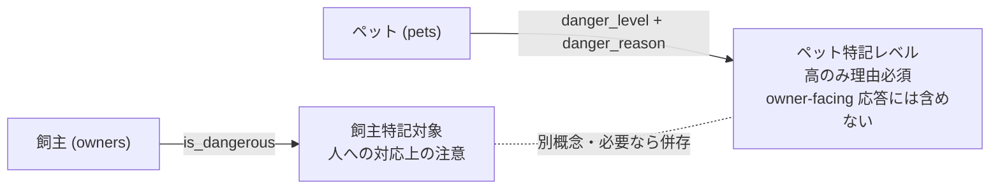

# 飼主・ペット登録/編集 仕様書 (Owner Form)

> 2026-10-15文書整理: 画面をまたぐ業務契約・受入条件は[領域正本](../domains/owners-pets/lifecycle.md)、型・保存／再送と現行差は[技術契約](../../design/domains/owners-pets/technical-spec.md)を参照する。以下は既存記載と[追加合意4・5](../domains/owners-pets/lifecycle.md#agreement-owner-contacts-transfer-20261015)の目標を区別する。実装の全件再監査なし、実機未実施。Owner Reportはスタッフ専用レポートであり飼主公開画面ではない。ペット特記field除外はOwner Report限定DTOとLIFF／line-reserveの飼主向け応答を区別して維持する。主飼主移管は過去請求・預り金の譲渡を意味しない。

## 概要
- **画面の目的**: 飼主基本情報および、紐付く全てのペット（患者）情報の一元管理。
- **URLパターン**: 
  - 新規登録: `/owners/new`
  - 編集: `/owners/:id`
- **アクセス権限**: 新規登録 (`/owners/new`) は `owners:create` を要求する `RequirePermission` ルートガードあり。編集 (`/owners/:id`) は親ルート `/owners` の `owners:view` ガードのみを継承し、保存可否（`fieldset disabled`）は `usePermission` によるコンポーネント内制御。

---

## 1. 画面構成

### 1.1 飼主情報セクション (Owner Information)
Notion スタイルの 4 カラムグリッドを採用し、臨床現場での迅速な入力をサポートします。
- **基本属性**: 飼主No、氏名（漢字・カナ）、電話番号、メールアドレス、会社名、会社電話、備考。新規かつ複数所属時は登録先医院。
- **飼主特記対象 (`owners.is_dangerous`)**: EMR-231 で文言レス化。折りたたみ行「スタッフ向け特記」の中に「特記対象」スイッチと「備考・特記事項」を置き、既定では畳まれています（`StaffNoteDisclosure`）。飼主（人）への対応上の注意を表します。ペットの特記レベル `pets.danger_level` / `danger_reason` とは別概念であり、両者は混用せず、それぞれ必要な場合は併存します（DEC-14 ⑤）。分類が伝わる文言は画面・aria-label・title に出しません。
- **経済・サービス属性**: 
    - **会員区分**: 非会員 / 会員 / 退亡者 / 他診/準 の 4 区分をボタンで選択。
    - **個別値引率**: 特定の事情に基づくデフォルトの値引設定（会計時に自動適用）。
    - **DM**: 未設定／必要／不要。
- **住所管理**: 会社・自宅それぞれの郵便番号と住所1/2。地図連携は未実装。
- **飼主生年月日とサイグラム**: `OwnerAddressFields` で生年月日 DatePicker の下にサイグラムを縦積みする（`flex-col`）。空・不正時は視覚表示なし（読み上げは「サイグラム分類なし」）。横並びで入力欄幅を潰さない。生年月日は `birth_date` として保存し、編集時の消去は JSON null を送信する。サイグラムは生年月日からの派生表示で DB へ保存しない（#262）。
- **保存 form**: `noValidate`。HTML5 email/max が Action 前に黙って止めない。他の必須項目・形式・認可の検証は維持する。
- **電話・メール重複（追加合意4）**: 同医院の重複を警告して権限内の既存飼主候補を示し、家族等の共用連絡先でも別飼主として登録可能にする。候補だけで既存飼主へ自動置換／統合しない。閾値・新たな正規化方式・追加の必須確認は選定していない。従来の「重複はBE409」は[現行実装差](../../design/domains/owners-pets/technical-spec.md#owner-contact-duplicate-target)であり、目標仕様の登録拒否として残さない。受入条件は[領域正本](../domains/owners-pets/lifecycle.md#owners-pets-acceptance)。

### 1.2 ペット管理セクション (Pet Management)
一人の飼主に紐付く複数のペットをテーブル形式の一覧で管理します。

| 項目 | 説明 |
|:---|:---|
| **基本情報** | 飼主配下一覧の列はペット番号・ペット名・生死・種別・性別・生年月日・毛色・体重・環境・備考・操作。モーダルは識別／身体／ケアの独立見出し。動物種は識別列、品種は身体列。永続済みペット名は `/owners/:id?pet=:petId` のリンクで、対象ペットの詳細モーダルを直接開く（EMR-174。`temp-*` の未保存行はリンクなし）。 |
| **臨床ステータス** | **生存 (`alive`) / 死亡 (`deceased`)**。死亡時は日付と理由を記録。追加合意により、生前診療の後日入力・誤記訂正・退院処理・精算は死亡登録を取り消さず理由／履歴付き専用経路で行う。[共通臨床安全](../shared/clinical-safety.md)と各領域正本を参照し、未来の新規予約／施術の許可へ広げない。 |
| **身体的特徴** | 毛色、体重、去勢・避妊手術日、血液型、マイクロチップ番号。 |
| **行動・安全属性** | **特記レベル (`danger_level`)**: 咬癖や攻撃性がある場合、`高 / 中 / 低` で設定。モーダルでは折りたたみ「スタッフ向け特記」の内側にあり、一覧・ヘッダーでは文言なしのアイコンバッジで示されます（EMR-231）。 |
| **医療背景** | 常用フード、飼育環境（自由入力）、加入保険（マスタ選択）。 |

- **名前の由来・出逢いのストーリー (`pets.name_origin` / `pets.meeting_story`)**: EMR-174 の任意項目。識別セクション（`PetIdentitySection`）に入力欄があり、ペット一括登録フォームと `PetEditModal` の双方から記録できる。名前の由来は最大500文字（Input）、出逢いのストーリーは最大2000文字（Textarea・3行）。NULL は未記録を意味し、空文字・空白のみの入力は API 境界で NULL に正規化される。PATCH では省略=変更なし、`null`=NULL クリア、値=更新の3状態を使い分ける。
- **ペット詳細の閲覧**: 飼主配下一覧のペット名リンク・操作メニュー「詳細・編集」のいずれでも `PetEditModal` が開く。`owners:edit` を持たない閲覧ユーザーにも詳細は開くが、`fieldset disabled` で入力は不可・保存ボタンは出ない（EMR-174）。`?pet=` クエリを付けて飼主詳細を開くと、ローダー完了後に対象ペットのモーダルを自動で開き、クエリは `replace` で除去される（同じリンクを再利用可能）。
- **ペット特記 (`pets.danger_level` / `danger_reason`)**: `danger_reason` は動物を安全に取り扱うための補足メモです。理由の入力は特記レベル「高」の場合のみ必須で、「中」では任意です。スタッフ内部情報として扱い、Owner Report・LIFF・line-reserve の owner-facing 応答にはフィールド自体を含めません。フォーム上の項目名は「特記レベル」「理由」に中立化され（EMR-231）、フィールドは「スタッフ向け特記」折りたたみ内に配置されます。
- **飼主変更 (BUG-373、追加合意5)**: 現行入口は`PetEditModal`と`PATCH /api/v1/pets/:id`の`owner_id`。目標仕様では、確定前に今後の予約とLINE通知先への影響一覧を確認してから切り替える。予約・変更前後の飼主・LINE付替え／解除／変更なしが判別でき、0件と取得失敗を区別する。値引率／会員区分が同じでも影響確認を省略せず、異なる場合の会計影響警告は維持する。取消なら変更せず、確認後の対象／版／権限変化は再取得・差分確認へ戻す。過去請求・預り金は元ownerのまま。対象範囲・LINE未連携／manual予約・原子性は[業務正本](../domains/owners-pets/lifecycle.md#requirement-fr-owners-pets-primary-transfer)と[技術目標／現行差](../../design/domains/owners-pets/technical-spec.md#owner-transfer-target)に従い、影響確認UIの実装済みとはしない。
- **副飼主**: 永続済みペットに `PetSubOwnersSection`。続柄は trim 後1〜50文字。取得した version を添えて全置換 PUT し、409 時は再読込を求める。飼主詳細では主飼主としてのペットとは別に「共同飼育ペット」を表示する。会計・LINE・割引判定の主飼主をこの追加リンクで置き換えない（#262）。

### 1.3 LINE/Lステップ連携セクション (編集時のみ、`LineIntegrationCard`)
主飼主変更時は上記の影響一覧を確認する。連絡先重複や変更の確認だけでLINE本人紐付けを生成／上書きせず、未確認・未連携先を送信可能と表示しない。配信除外・停止・結果不明保留の解除や送信済み通知の再送を、この変更へ含めない。
- **紐付け状況**: LINE User ID の取得状態をリアルタイム表示。
- **連携用URLの発行**（未連携時、`LineLinkTokenSection`、SD-14）: 「連携用URLを発行」ボタンで `POST /api/v1/owners/:id/line/link-token` を呼び、返却された LIFF URL（[38-liff-pet-health.md](./38-liff-pet-health.md) の `LiffLinkPage` 紐付けフロー参照）を読み取り専用入力欄に表示しコピーできる。`owners` の edit 権限でゲート。
- **配信除外**: 「配信除外」スイッチによる、リマインドの一時停止機能（`PATCH /clinics/:clinicId/owners/:id/delivery-exclusion`）。
- **配信注意フラグ**: リマインドを止めずに注意喚起のみ行うフラグ＋理由メモ（`PATCH /clinics/:clinicId/owners/:id/delivery-caution`）。配信除外とは独立した別スイッチ。
- **転院ステータス**: 転院済みフラグの切替（`PATCH /clinics/:clinicId/owners/:id/transfer-status`）。
- **個別メッセージ送信**: 
    - **`LineSendPanel`**: サイドパネルから特定の飼主へ直接 LINE メッセージを送信。
    - **ファイル共有**: 血液検査結果などの PDF や画像をアップロードし、LINE 経由で共有可能（**`shared_files`** ストレージ連携）。

### 1.4 会計履歴セクション（編集時のみ）
- 該当飼主の会計履歴を一覧表示。`accounting` の閲覧権限を持つユーザーにのみ表示されます（権限がない場合、見出しごと非表示）。

---

## 2. 主要な臨床安全機能

### 2.1 特記対象の視覚的表示
`danger_level` が設定されたペットは、各一覧・ヘッダーにおいて、即座に目立つアイコンバッジが表示され、スタッフの安全確保を促します（EMR-173、共有 `DangerBadge`。EMR-231 で文言レス化し、来院者に分類が伝わる文言を画面・aria-label・title のいずれにも出しません）。
- **表示ルール**: 「高」= 赤の八角形アイコン、「中」= 黄の三角形アイコン、`低`・未設定 = バッジ非表示。文言を出さず、色だけに依存せず形と色で段階を識別します。
- **メモの開示**: アイコンバッジは、クリック / タップ / Enter / Space のいずれか1操作で開くアクセシブルな Popover とし、「特記レベル: 高/中」の見出しと `danger_reason` を表示します。理由が空の既存データでは `内容未登録` を表示します。トリガーの支援技術向け名前は「〈ペット名〉の詳細を表示」など分類を含まない中立表現です。
- **飼主の特記マーク**: `owners.is_dangerous` が true の飼主は氏名横に文言なしの赤い八角形アイコンを表示します（支援技術向け代替名は「特記」。Popover なし・ペット特記レベルとは別概念）。
- **表示サーフェス**: `PetSelectionResultsTable`（ペット選択一覧）、`OwnersListTable`（飼主一覧）、`AppointmentCard` および `ReceptionDialogBody`（受付カンバン・詳細）、`PatientContextHeader`（カルテ sticky ヘッダー）、`PatientInfoCard`（健診・検査・入院・予防接種・トリミング各フォームの患者ヘッダー）。いずれもスタッフ向け画面で、LIFF・owner 向け契約には出しません。
- **フォームの折りたたみ**: 飼主フォームの「特記対象」スイッチと備考、ペットフォームの「特記レベル」「理由」は、いずれも中立ラベルの折りたたみ行「スタッフ向け特記」（`StaffNoteDisclosure`）の内側にあり既定で畳まれています。理由フィールドのバリデーションエラー時は一度だけ自動展開します。

**特記の二概念（混同禁止）:**

### 2.2 データの真正性保護
- **保存アクション**: React 19 の `useActionState` を活用し、保存中の二重送信防止とエラー箇所への自動フォーカス移動を実現。
- **離脱ブロック**: 編集途中のページ遷移時に、`NavigationBlocker` が変更破棄の確認を求めます。

---

## 3. 技術仕様

### 使用コンポーネント
- **`OwnerForm`**: 統合フォーム。
- **`PetEditModal`**: ペット情報の詳細入力（遅延ロード対応）。
- **`LineIntegrationCard`**: 外部連携管理部品。
- **`LineSendPanel`**: 個別メッセージおよび共有ファイル送信 UI。

### API連携
| メソッド | エンドポイント | 用途 | 必須権限 | 必須アクション |
|:---|:---|:---|:---|:---|
| GET | `/api/v1/owners/:id` | 飼主・ペット情報の取得 | `owners` | `view` |
| POST | `/api/v1/owners` | 新規登録（ペット一括登録含む） | `owners` | `create` |
| PATCH | `/api/v1/owners/:id` | 飼主基本情報の更新 | `owners` | `edit` |
| PATCH | `/api/v1/pets/:id` | ペット単体の属性変更 | `owners` | `edit` |
| GET | `/api/v1/pets/:id/sub-owners` | ペットの副飼主と version の取得 | `owners` | `view` |
| PUT | `/api/v1/pets/:id/sub-owners` | version を伴う副飼主の全置換 | `owners` | `edit` |
| GET | `/api/v1/owners/:id/shared-pets` | 副飼主として共同飼育するペットの取得 | `owners` | `view` |
| POST | `/api/v1/shared-files` | LINE 共有用ファイルのアップロード | `owners` or `medical-records` | `edit` (or `create`/`edit`) |
| POST | `/api/v1/clinics/:clinicId/owners/:id/line/send` | LINE個別メッセージ送信 | `owners` | `edit` |
| GET | `/api/v1/clinics/:clinicId/owners/:id/line/send-logs` | LINEメッセージ送信履歴取得（`pending` 行がある間は5秒間隔でポーリング） | `owners` | `view` |
| PATCH | `/api/v1/clinics/:clinicId/owners/:id/line-user-id` | LINE User ID の手動設定・解除 | `owners` | `edit` |
| PATCH | `/api/v1/clinics/:clinicId/owners/:id/line-id-confirm` | LINE ID 確認の記録 | `owners` | `edit` |
| POST | `/api/v1/owners/:id/line/link-token` | 連携用トークン + LIFF URL の発行（SD-14） | `owners` | `edit` |
| PATCH | `/api/v1/clinics/:clinicId/owners/:id/delivery-exclusion` | 配信除外フラグの切替 | `owners` | `edit` |
| PATCH | `/api/v1/clinics/:clinicId/owners/:id/delivery-caution` | 配信注意フラグ・理由の切替 | `owners` | `edit` |
| PATCH | `/api/v1/clinics/:clinicId/owners/:id/transfer-status` | 転院ステータスの切替 | `owners` | `edit` |

---

