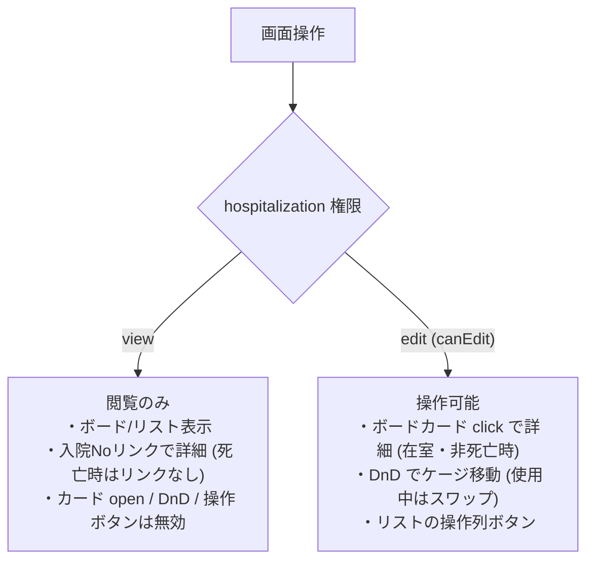

# 入院管理一覧 仕様書 (Hospitalization List)

> 2026-10-15文書整理: 画面をまたぐ業務契約・受入条件は[領域正本](../domains/hospitalization/lifecycle.md)、型・保存／再送と現行差は[技術契約](../../design/domains/hospitalization/technical-spec.md)を参照する。以下の画面詳細は既存記載を継承（決定根拠・実装の全件再監査なし）、実機未実施。2026-10-15のユーザー修正で「担当」は担当医師、指名は必須ではない。責任担当1名必須・医師以外可の提案は不採用。予約の指名と宿泊管理の担当医師、ケア入力actorを分け、新たな指名機能や担当人数を推定しない。予約だけの入院開始・予定終了だけの退室は不可。

ホテル頭数の状態・同一宿泊の重複排除・延泊・未退室と、LINE入退室の休診日／時間外条件は[18:26のLINE正本](../line/reservation-spec.md#hotel-counting-boundaries-1826)・[日時条件](../line/reservation-spec.md#hotel-entry-exit-hours-1826)へ従う。宿泊管理内部の保存方式は設計。

17:35合意の[ホテル受付上限](../line/reservation-spec.md#requirement-fr-line-reservations-hotel-concurrent-stay-limit)は、医院別の同時宿泊頭数を宿泊期間全体で判定し、未設定・超過時はLINE確定せず医院相談へ案内する。ケージと世話担当は宿泊管理側で割り当て、医師指名／医師シフトで代用しない。技術方式は設計、実装・実機受入は未確認。

17:23 JSTの[LINE予約6点合意](../line/reservation-spec.md#line-agreement-1723)へ従う。公開された診療・トリミング・ホテルは予約対象、入院は医院相談。ホテルには医師指名・医師シフト・通常予約の同日制約を適用しない。受付制限・入力保持・受付前取消・必要設定不足の扱いと受入条件はLINE正本を参照する。ホテル受入基準は17:35合意の医院別同時宿泊頭数・全宿泊期間判定で、実装・実機受入は未確認。

17:17 JSTの院内予約8点一括合意は[予約入口の決定一覧](../domains/reservations/README.md#internal-reservation-batch-1717)を参照する。誤取消／誤終了訂正、未終了予約保護、診療前の日付・カルテ整合、マスタ利用・名称履歴、休診日予約／日跨ぎ勤務、患者照合、ホテル担当時点／入院記録失敗の各正本と受入条件へ従う。LINE受付条件は17:23合意（ホテル受入基準は17:35合意、計算・保存方式は設計）、実装・実機受入は未確認。

予約ドメインからの接続は[16:07合意のホテル担当と入院の両入口](settings/master-reservation-type.md#requirement-fr-reservation-types-hotel-inpatient-entry)を参照する。ホテル予約は指名医師を選ばず、世話担当者は宿泊管理側で割り当てる。入院は予約区分からの予定入院と診察後の入院決定をどちらも扱う。本書の既存管理状態・担当医・記録仕様は保持し、今回の接続が実装済みとは扱わない。入院開始は16:36合意の来院後スタッフ明示確定に従う。担当医と記録は16:44合意へ従い、失敗時の開始未確定・理由表示・再試行は17:17合意、具体的画面・保存方式は設計。

16:36合意の[入院開始の明示確定と二重登録防止](settings/master-reservation-type.md#requirement-fr-reservation-types-inpatient-start-confirm)へ従う。予定入院は予約だけで入院中にせず、来院後にスタッフが「入院開始」を確定する。診察後の入院決定も同じ入院管理へつなぎ、同じ入院を二重登録しない。担当医・入院記録は16:44合意の段階条件へ従う。具体的画面配置・重複防止の技術方式・記録作成失敗時の開始未確定・理由表示・再試行は17:17合意。具体的保存方式は設計として分ける。受入条件は区分マスタ正本へ置き、実装・実機受入は未確認。

16:44合意の[入院担当医と開始時の入院記録](settings/master-reservation-type.md#inpatient-doctor-and-record-at-start)へ従う。予定入院予約時は指名医師未定可、入院開始までに入院担当医決定、スタッフによる開始確定時に入院記録を作成する。予定入院・診察後の両入口を維持し、同じ入院を二重登録しない。予約の指名医師から担当医を自動確定せず、記録作成失敗時の開始未確定・理由表示・再試行は17:17合意。具体的UI・保存方式は実装設計とする。実装・実機受入は未確認。

## 死亡登録後の専用処理への接続

[最新の死亡後取扱い](../domains/hospitalization/lifecycle.md#requirement-fr-hospitalization-delete-and-preserve)に従い、生前診療の後日入力・誤記訂正、既存滞在の退院・D10精算は、死亡状態を戻さず理由と履歴付きで行える目標。新たな入院実施・チェックインを許可せず、生前分か不明なら確認する。原記録を保持し、自動返金・在庫戻しは行わない。下記の死亡時リンク抑止／通常更新拒否は現行UIとの差として扱い、専用導線・保存が実装済みとはしない。

## 概要
- **画面の目的**: 入院・ホテル預かり中の患者（ペット）を管理し、ケージの稼働状況を可視化する。
- **URLパターン**: `/hospitalization`
- **アクセス権限**: `hospitalization:view`（`RequirePermission` によるルートガード。デフォルト action は `view`。新規登録・ケージ移動等の操作権限は `usePermission` によりさらに `create`/`edit` で出し分け）

---

## 画面構成とビュー

### 1. 表示モードの切り替え
用途に合わせて2つのビューを即座に切り替え可能です（既定はボードビュー。切り替え状態は永続化されず、再訪問時は既定に戻ります）。
- **ボードビュー (Board)**: ケージマスタの配置に基づいたグリッド表示。空きケージの把握に最適。
- **リストビュー (List)**: 入院期間・主訴（`owner_request`）・担当医を含む表形式。

### 2. ステータス・フィルタタブ
最上部のタブで、患者の状態ごとに表示を切り替えられます。
- **入院中**: `active`（wire 上は admitted。FE 定数に「一時帰宅」があるが BE status は admitted|discharged|reserved のみで、一時帰宅は生成されない）の患者。
- **予約**: 入院予定の予約レコード。
- **退院済**: 過去の入院履歴。
- **すべて**: 全てのレコード。

### 3. 高度なフィルタリング (`PropertyFilter`)
- **入院日**: 入院開始日（`start_date`）が指定範囲に含まれるレコードをサーバーサイドで抽出。
- **全文検索**: 飼主名、ペット名、入院Noによるキーワード検索。
- **動的属性フィルタ**: 動物種別、入院/ホテルの区分による絞り込み。

---

## 主要なユーザーアクション

- **新規登録**: ヘッダーの「新規入院登録」ボタンより、ペット選択を経て登録フォームへ遷移（`hospitalization:create`）。
- **ケージ移動 (DnD)**: ボードビューでカードを別ケージへドラッグし収容ケージを変更（空きケージへの移動は `PATCH`、移動先使用中は `POST /api/v1/hospitalizations/cage-swap` で単一トランザクションのスワップ）。**`hospitalization:edit`（`canEdit`）必須**。死亡ペットはドラッグ不可。view のみでは DnD 無効。
  - 空きケージへの `PATCH` は `cage_id` と併せて表示時点の期待値を送る。移動元カードに表示ケージがあれば `expected_cage_id`（正数）、未割当なら `expected_cage_is_null: true` — どちらか一方のみ必須で、BE は行ロック後に現在の `cage_id` と照合し、不一致なら 409 で書込みなし。`clear_cage_id` でも同じ規則で、両方の期待値を同時に送る・ケージ操作なしに期待値だけ送る・`cage_id` と `clear_cage_id` の同時指定はいずれも 400。
  - スワップは、2件の入院ID（`hospitalization_ids`）と同じ順序の表示時ケージID（`expected_cage_ids`）を送信する（いずれも正数2件・同位置対応）。BE は両入院の行をソート順でロックした後、現在の割当と照合し、どちらかが移動・割当解除済みなら 409 で両方の書込みを拒否する。最新のボードを確認して再操作する。
  - 連結グループの代表・構成ケージを含むスワップは現行仕様では不可。FE は送信前に拒否し、BE の構成ケージ 422・占有グループ 409 の割当ガードも維持する。連結を含まない移動の最終判定も backend が担う。
- **ケージ未割当欄（EMR-316）**: `cage_id` が未設定の入院（登録時に「選択なし」を選んだもの）は、ボードビュー末尾の「ケージ未割当」欄にカードで表示する。ケージカードの「空き」数には影響しない。表示と詳細遷移のみで、ドラッグによるケージ割当は不可（詳細遷移は在室かつ非死亡かつ **`canEdit`** の場合のみ）。未設定の入院が無ければ欄自体を出さない。
- **ボードカードから詳細へ**: 在室かつ非死亡かつ **`canEdit`** のときのみカード click で詳細へ遷移（`HospitalizationBoard` の `canOpenCard`）。view のみではカード open 不可。
- **ケージ連結モード（EMR-306）**: `master-hospitalization:edit` 権限があるとき切替できる merge モード。有効中はペット移動 DnD を止め、ケージ同士のドラッグ&ドロップで「1つの入院スペース」へ連結し、代表ケージ行から解除（unmerge）を要求する。連結ピッカーの占有判定は `GET /api/v1/masters/cages/occupancy`（同じく `master-hospitalization:edit`）。連結メンバー行は代表ケージを指す表示となり、連結ルール（同一 clinic・有効・未連結・非占有。メンバー宛割当は 422、占有グループ宛は 409）の正本は [settings/master-cage.md](./settings/master-cage.md)。
- **リストから詳細へ**: 入院 No の行内リンクは **view** で詳細へ（死亡時はリンクなし）。操作列ボタンは **`canEdit`** 時のみ。全行クリックで遷移する UI ではない。

---

## 技術仕様

### 権限の出し分け
- ルートガード: `hospitalization:view`。
- ボードカード open・DnD・リスト操作ボタン: `edit`。
- リストの入院 No リンク: view 経路。

**権限による操作の出し分け:**

### パフォーマンスと体験
- **非同期計算の最適化**: `useDeferredValue` により、大規模な入院データに対するフィルタリング時もUIの応答性を確保。
- **リスト/ボードの取得粒度**: リストビューはサーバーページングで現在ページのみ表示する。ボードビューは対象医院の同じフィルタ条件を 200 件/ページで全ページ走査する。走査中の `X-Clinic-ID` は開始時の医院に固定し、キャッシュキーも医院ごとに分離する。取得中・失敗時はボードの空き状態を確定表示しない。`start_date`/`id` で同値時の順序を安定させるが、走査中の同時更新まで同一スナップショットになる保証ではない。
- **占有判定と連結の拒否**: 連結ピッカーの占有ケージ集合（`GET /api/v1/masters/cages/occupancy`）が unknown / 読込中 / 取得失敗のときは連結操作を拒否する（占有不明のまま代表選択を許可しない）。占有判定は対象医院の admitted/reserved 全件に基づき、画面上でフィルタ表示されている患者とは独立している。最終判定は backend が担い、FE の除外は補助である。

### API連携
| メソッド | エンドポイント | 用途 | 必須権限 | 必須アクション |
|:---|:---|:---|:---|:---|
| GET | `/api/v1/hospitalizations` | 期間・条件に応じた入院データの一括取得 | `hospitalization` | `view` |
| PATCH | `/api/v1/hospitalizations/:id` | 空きケージへの移動（DnD）による収容ケージの更新。FE も board open/DnD を edit でゲート | `hospitalization` | `edit` |
| POST | `/api/v1/hospitalizations/cage-swap` | 使用中ケージとの原子的な入れ替え。`hospitalization_ids` と `expected_cage_ids` は正数2件・同位置対応。割当不一致は 409 で書込みなし（構成ケージ宛は 422、占有グループ宛は 409、EMR-306） | `hospitalization` | `edit` |
| GET | `/api/v1/masters/cages/occupancy` | 連結ピッカーの占有ケージ判定（EMR-306） | `master-hospitalization` | `edit` |
| POST | `/api/v1/masters/cages/:id/merge` | ケージの一時連結（EMR-306） | `master-hospitalization` | `edit` |
| POST | `/api/v1/masters/cages/:id/unmerge` | ケージ連結の解除（EMR-306） | `master-hospitalization` | `edit` |

---

