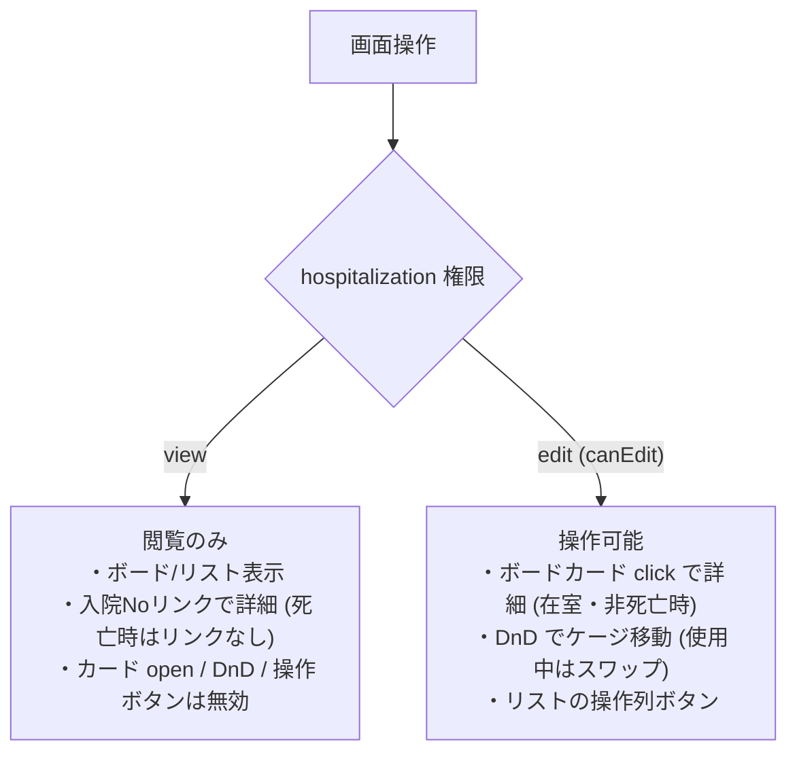

# 入院管理一覧 仕様書 (Hospitalization List)

## 概要
- **画面の目的**: 入院・ホテル預かり中の患者（ペット）を管理し、ケージの稼働状況を可視化する。
- **URLパターン**: `/hospitalization`
- **アクセス権限**: `hospitalization:view`（`RequirePermission` によるルートガード。デフォルト action は `view`。新規登録・ケージ移動等の操作権限は `usePermission` によりさらに `create`/`edit` で出し分け）

---

## 画面構成とビュー

### 1. 表示モードの切り替え
用途に合わせて2つのビューを即座に切り替え可能です（既定はボードビュー。切り替え状態は永続化されず、再訪問時は既定に戻ります）。
- **ボードビュー (Board)**: ケージマスタの配置に基づいたグリッド表示。空きケージの把握に最適。
- **リストビュー (List)**: 入院期間・主訴（`owner_request`）・担当医を含む表形式。

### 2. ステータス・フィルタタブ
最上部のタブで、患者の状態ごとに表示を切り替えられます。
- **入院中**: `active`（wire 上は admitted。FE 定数に「一時帰宅」があるが BE status は admitted|discharged|reserved のみで、一時帰宅は生成されない）の患者。
- **予約**: 入院予定の予約レコード。
- **退院済**: 過去の入院履歴。
- **すべて**: 全てのレコード。

### 3. 高度なフィルタリング (`PropertyFilter`)
- **入院日**: 入院開始日（`start_date`）が指定範囲に含まれるレコードをサーバーサイドで抽出。
- **全文検索**: 飼主名、ペット名、入院Noによるキーワード検索。
- **動的属性フィルタ**: 動物種別、入院/ホテルの区分による絞り込み。

---

## 主要なユーザーアクション

- **新規登録**: ヘッダーの「新規入院登録」ボタンより、ペット選択を経て登録フォームへ遷移（`hospitalization:create`）。
- **ケージ移動 (DnD)**: ボードビューでカードを別ケージへドラッグし収容ケージを変更（空きケージへの移動は `PATCH`、移動先使用中は `POST /api/v1/hospitalizations/cage-swap` で単一トランザクションのスワップ）。**`hospitalization:edit`（`canEdit`）必須**。死亡ペットはドラッグ不可。view のみでは DnD 無効。
  - 空きケージへの `PATCH` は `cage_id` と併せて表示時点の期待値を送る。移動元カードに表示ケージがあれば `expected_cage_id`（正数）、未割当なら `expected_cage_is_null: true` — どちらか一方のみ必須で、BE は行ロック後に現在の `cage_id` と照合し、不一致なら 409 で書込みなし。`clear_cage_id` でも同じ規則で、両方の期待値を同時に送る・ケージ操作なしに期待値だけ送る・`cage_id` と `clear_cage_id` の同時指定はいずれも 400。
  - スワップは、2件の入院ID（`hospitalization_ids`）と同じ順序の表示時ケージID（`expected_cage_ids`）を送信する（いずれも正数2件・同位置対応）。BE は両入院の行をソート順でロックした後、現在の割当と照合し、どちらかが移動・割当解除済みなら 409 で両方の書込みを拒否する。最新のボードを確認して再操作する。
  - 連結グループの代表・構成ケージを含むスワップは現行仕様では不可。FE は送信前に拒否し、BE の構成ケージ 422・占有グループ 409 の割当ガードも維持する。連結を含まない移動の最終判定も backend が担う。
- **ケージ未割当欄（EMR-316）**: `cage_id` が未設定の入院（登録時に「選択なし」を選んだもの）は、ボードビュー末尾の「ケージ未割当」欄にカードで表示する。ケージカードの「空き」数には影響しない。表示と詳細遷移のみで、ドラッグによるケージ割当は不可（詳細遷移は在室かつ非死亡かつ **`canEdit`** の場合のみ）。未設定の入院が無ければ欄自体を出さない。
- **ボードカードから詳細へ**: 在室かつ非死亡かつ **`canEdit`** のときのみカード click で詳細へ遷移（`HospitalizationBoard` の `canOpenCard`）。view のみではカード open 不可。
- **ケージ連結モード（EMR-306）**: `master-hospitalization:edit` 権限があるとき切替できる merge モード。有効中はペット移動 DnD を止め、ケージ同士のドラッグ&ドロップで「1つの入院スペース」へ連結し、代表ケージ行から解除（unmerge）を要求する。連結ピッカーの占有判定は `GET /api/v1/masters/cages/occupancy`（同じく `master-hospitalization:edit`）。連結メンバー行は代表ケージを指す表示となり、連結ルール（同一 clinic・有効・未連結・非占有。メンバー宛割当は 422、占有グループ宛は 409）の正本は [settings/master-cage.md](./settings/master-cage.md)。
- **リストから詳細へ**: 入院 No の行内リンクは **view** で詳細へ（死亡時はリンクなし）。操作列ボタンは **`canEdit`** 時のみ。全行クリックで遷移する UI ではない。

---

## 技術仕様

### 権限の出し分け
- ルートガード: `hospitalization:view`。
- ボードカード open・DnD・リスト操作ボタン: `edit`。
- リストの入院 No リンク: view 経路。

**権限による操作の出し分け:**

### パフォーマンスと体験
- **非同期計算の最適化**: `useDeferredValue` により、大規模な入院データに対するフィルタリング時もUIの応答性を確保。
- **リスト/ボードの取得粒度**: リストビューはサーバーページングで現在ページのみ表示する。ボードビューは対象医院の同じフィルタ条件を 200 件/ページで全ページ走査する。走査中の `X-Clinic-ID` は開始時の医院に固定し、キャッシュキーも医院ごとに分離する。取得中・失敗時はボードの空き状態を確定表示しない。`start_date`/`id` で同値時の順序を安定させるが、走査中の同時更新まで同一スナップショットになる保証ではない。
- **占有判定と連結の拒否**: 連結ピッカーの占有ケージ集合（`GET /api/v1/masters/cages/occupancy`）が unknown / 読込中 / 取得失敗のときは連結操作を拒否する（占有不明のまま代表選択を許可しない）。占有判定は対象医院の admitted/reserved 全件に基づき、画面上でフィルタ表示されている患者とは独立している。最終判定は backend が担い、FE の除外は補助である。

### API連携
| メソッド | エンドポイント | 用途 | 必須権限 | 必須アクション |
|:---|:---|:---|:---|:---|
| GET | `/api/v1/hospitalizations` | 期間・条件に応じた入院データの一括取得 | `hospitalization` | `view` |
| PATCH | `/api/v1/hospitalizations/:id` | 空きケージへの移動（DnD）による収容ケージの更新。FE も board open/DnD を edit でゲート | `hospitalization` | `edit` |
| POST | `/api/v1/hospitalizations/cage-swap` | 使用中ケージとの原子的な入れ替え。`hospitalization_ids` と `expected_cage_ids` は正数2件・同位置対応。割当不一致は 409 で書込みなし（構成ケージ宛は 422、占有グループ宛は 409、EMR-306） | `hospitalization` | `edit` |
| GET | `/api/v1/masters/cages/occupancy` | 連結ピッカーの占有ケージ判定（EMR-306） | `master-hospitalization` | `edit` |
| POST | `/api/v1/masters/cages/:id/merge` | ケージの一時連結（EMR-306） | `master-hospitalization` | `edit` |
| POST | `/api/v1/masters/cages/:id/unmerge` | ケージ連結の解除（EMR-306） | `master-hospitalization` | `edit` |

---
