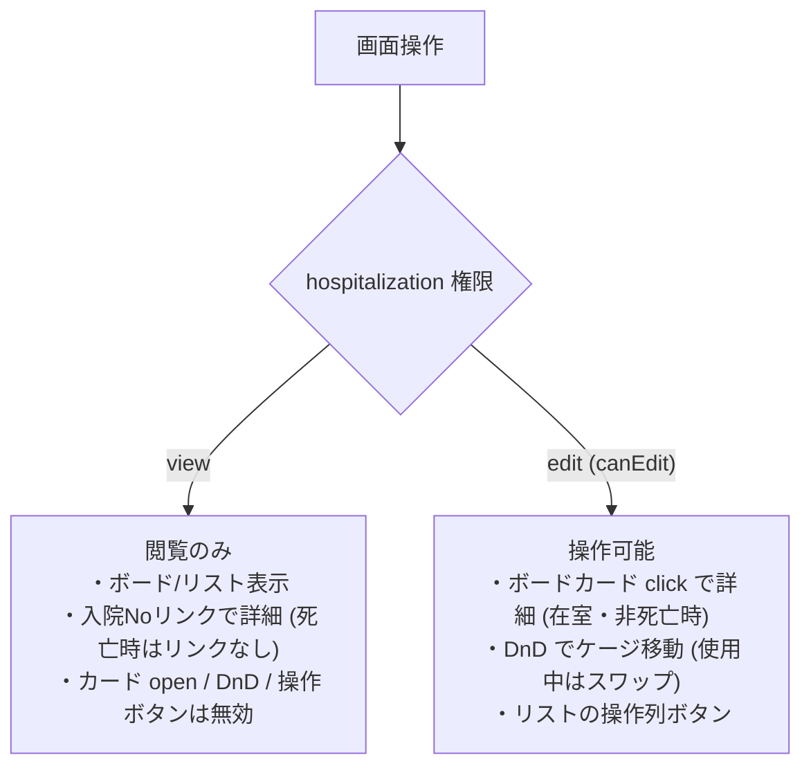

# 入院管理一覧 仕様書 (Hospitalization List)

## 概要
- **画面の目的**: 入院・ホテル預かり中の患者（ペット）を管理し、ケージの稼働状況を可視化する。
- **URLパターン**: `/hospitalization`
- **アクセス権限**: `hospitalization:view`（`RequirePermission` によるルートガード。デフォルト action は `view`。新規登録・ケージ移動等の操作権限は `usePermission` によりさらに `create`/`edit` で出し分け）

---

## 画面構成とビュー

### 1. 表示モードの切り替え
用途に合わせて2つのビューを即座に切り替え可能です（既定はボードビュー。切り替え状態は永続化されず、再訪問時は既定に戻ります）。
- **ボードビュー (Board)**: ケージマスタの配置に基づいたグリッド表示。空きケージの把握に最適。
- **リストビュー (List)**: 入院期間・主訴（`owner_request`）・担当医を含む表形式。

### 2. ステータス・フィルタタブ
最上部のタブで、患者の状態ごとに表示を切り替えられます。
- **入院中**: `active`（wire 上は admitted。FE 定数に「一時帰宅」があるが BE status は admitted|discharged|reserved のみで、一時帰宅は生成されない）の患者。
- **予約**: 入院予定の予約レコード。
- **退院済**: 過去の入院履歴。
- **すべて**: 全てのレコード。

### 3. 高度なフィルタリング (`PropertyFilter`)
- **入院日**: 入院開始日（`start_date`）が指定範囲に含まれるレコードをサーバーサイドで抽出。
- **全文検索**: 飼主名、ペット名、入院Noによるキーワード検索。
- **動的属性フィルタ**: 動物種別、入院/ホテルの区分による絞り込み。

---

## 主要なユーザーアクション

- **新規登録**: ヘッダーの「新規入院登録」ボタンより、ペット選択を経て登録フォームへ遷移（`hospitalization:create`）。
- **ケージ移動 (DnD)**: ボードビューでカードを別ケージへドラッグし収容ケージを変更（移動先使用中はスワップ）。**`hospitalization:edit`（`canEdit`）必須**。死亡ペットはドラッグ不可。view のみでは DnD 無効。
  - スワップは、2件の入院IDと同じ順序の表示時ケージID（`expected_cage_ids`）を送信する。BEは両入院の行ロック後に現在の割当と照合し、どちらかが移動・割当解除済みなら409で両方の書込みを拒否する。最新のボードを確認して再操作する。
  - 連結グループの代表・構成ケージを含むスワップは現行仕様では不可。FEは送信前に拒否し、BEの構成ケージ422・占有グループ409の割当ガードも維持する。
- **ケージ未割当欄（EMR-316）**: `cage_id` が未設定の入院（登録時に「選択なし」を選んだもの）は、ボードビュー末尾の「ケージ未割当」欄にカードで表示する。ケージカードの「空き」数には影響しない。表示と詳細遷移のみで、ドラッグによるケージ割当は不可（詳細遷移は在室かつ非死亡かつ **`canEdit`** の場合のみ）。未設定の入院が無ければ欄自体を出さない。
- **ボードカードから詳細へ**: 在室かつ非死亡かつ **`canEdit`** のときのみカード click で詳細へ遷移（`HospitalizationBoard` の `canOpenCard`）。view のみではカード open 不可。
- **リストから詳細へ**: 入院 No の行内リンクは **view** で詳細へ（死亡時はリンクなし）。操作列ボタンは **`canEdit`** 時のみ。全行クリックで遷移する UI ではない。

---

## 技術仕様

### 権限の出し分け
- ルートガード: `hospitalization:view`。
- ボードカード open・DnD・リスト操作ボタン: `edit`。
- リストの入院 No リンク: view 経路。

**権限による操作の出し分け:**

### パフォーマンスと体験
- **非同期計算の最適化**: `useDeferredValue` により、大規模な入院データに対するフィルタリング時もUIの応答性を確保。

### API連携
| メソッド | エンドポイント | 用途 | 必須権限 | 必須アクション |
|:---|:---|:---|:---|:---|
| GET | `/api/v1/hospitalizations` | 期間・条件に応じた入院データの一括取得 | `hospitalization` | `view` |
| PATCH | `/api/v1/hospitalizations/:id` | 空きケージへの移動（DnD）による収容ケージの更新。FE も board open/DnD を edit でゲート | `hospitalization` | `edit` |
| POST | `/api/v1/hospitalizations/cage-swap` | 使用中ケージとの原子的な入れ替え。`hospitalization_ids`と`expected_cage_ids`は正数2件・同位置対応。不一致409で書込みなし | `hospitalization` | `edit` |

---
