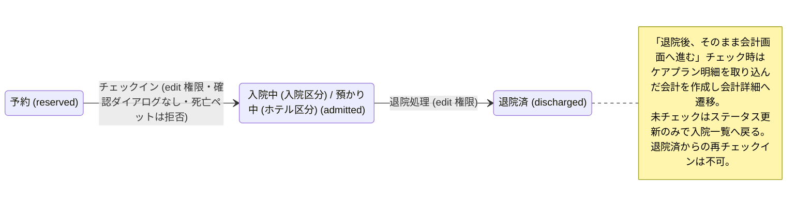

# 入院詳細・デイリーカルテ 仕様書 (Hospitalization Detail)

> 2026-10-15文書整理: 画面をまたぐ業務契約・受入条件は[領域正本](../domains/hospitalization/lifecycle.md)、型・保存／再送と現行差は[技術契約](../../design/domains/hospitalization/technical-spec.md)を参照する。以下の画面詳細は既存記載を継承（決定根拠・実装の全件再監査なし）、実機未実施。以下の単純status PATCHによるチェックインは現行参照。新しい入院開始は担当医決定と必要入院記録の同時成功に従う。退院会計の現行固定税率／取消会計soft-deleteは最新D10の計算・元取消請求保持へ未追従の可能性があり、合意仕様扱いしない。担当は担当医師、指名は非必須。完了後の原記録保持・理由付き専用訂正とスタッフ確認によるホテル料金・必要前金・取消料入力は追加承認済み。自動返金・在庫巻戻し・日数自動課金・取消時自動請求／返金は設けない。

ホテルの計数・退室／延泊とLINEの入退室日時条件は[18:26の計数正本](../line/reservation-spec.md#hotel-counting-boundaries-1826)・[日時正本](../line/reservation-spec.md#hotel-entry-exit-hours-1826)へ従う。予定超過だけで実際の退室を自動確定しない。

17:35合意の[ホテル受付上限](../line/reservation-spec.md#requirement-fr-line-reservations-hotel-concurrent-stay-limit)は、医院別の同時宿泊頭数を宿泊期間全体で判定し、未設定・超過時はLINE確定せず医院相談へ案内する。ケージ割当と[任意の担当医師設定](settings/master-reservation-type.md#internal-batch-hotel-care)は宿泊管理で扱い、担当医師未設定だけで受入開始を拒否せず、別責任担当・非医師担当・一名必須を追加しない。ホテルの受付を医師指名／医師シフトで代用しない。技術方式は設計、実装・実機受入は未確認。

17:23 JSTの[LINE予約6点合意](../line/reservation-spec.md#line-agreement-1723)へ従う。公開された診療・トリミング・ホテルは予約対象、入院は医院相談。ホテルには医師指名・医師シフト・通常予約の同日制約を適用しない。受付制限・入力保持・受付前取消・必要設定不足の扱いと受入条件はLINE正本を参照する。ホテル受入基準は17:35合意の医院別同時宿泊頭数・全宿泊期間判定で、実装・実機受入は未確認。

17:17 JSTの院内予約8点一括合意は[予約入口の決定一覧](../domains/reservations/README.md#internal-reservation-batch-1717)を参照する。誤取消／誤終了訂正、未終了予約保護、診療前の日付・カルテ整合、マスタ利用・名称履歴、休診日予約／日跨ぎ勤務、患者照合、ホテル担当時点／入院記録失敗の各正本と受入条件へ従う。LINE受付条件は17:23合意（ホテル受入基準は17:35合意、計算・保存方式は設計）、実装・実機受入は未確認。

予約ドメインからの接続は[16:07合意のホテル担当と入院の両入口](settings/master-reservation-type.md#requirement-fr-reservation-types-hotel-inpatient-entry)を参照する。ホテル予約は指名医師を選ばず、宿泊管理側の担当医師は[最新条件](settings/master-reservation-type.md#internal-batch-hotel-care)に従い任意で設定する。未設定だけで受入開始を拒否せず、別の必須担当者を追加しない。入院は予約区分からの予定入院と診察後の入院決定をどちらも扱う。本書の既存管理状態・担当医・記録仕様は保持し、今回の接続が実装済みとは扱わない。入院開始は16:33合意の来院後スタッフ明示確定に従う。担当医と記録は16:44合意へ従い、失敗時の開始未確定・理由表示・再試行は17:17合意、具体的画面・保存方式は設計。

16:33合意の[入院開始の明示確定と二重登録防止](settings/master-reservation-type.md#requirement-fr-reservation-types-inpatient-start-confirm)へ従う。予定入院は予約だけで入院中にせず、来院後にスタッフが「入院開始」を確定する。診察後の入院決定も同じ入院管理へつなぎ、同じ入院を二重登録しない。担当医・入院記録は16:44合意の段階条件へ従う。具体的画面配置・重複防止の技術方式・記録作成失敗時の開始未確定・理由表示・再試行は17:17合意。具体的保存方式は設計として分ける。受入条件は区分マスタ正本へ置き、実装・実機受入は未確認。

16:44合意の[入院担当医と開始時の入院記録](settings/master-reservation-type.md#inpatient-doctor-and-record-at-start)へ従う。予定入院予約時は指名医師未定可、入院開始までに入院担当医決定、スタッフによる開始確定時に入院記録を作成する。予定入院・診察後の両入口を維持し、同じ入院を二重登録しない。予約の指名医師から担当医を自動確定せず、記録作成失敗時の開始未確定・理由表示・再試行は17:17合意。具体的UI・保存方式は実装設計とする。実装・実機受入は未確認。

## 入院中の治療プランと記録の区別

[最新の治療プラン合意](../domains/hospitalization/lifecycle.md#requirement-fr-hospitalization-distinct-plans-and-records)は、入院中の元内容・金額明細を履歴に残す追加・変更・中止。詳細画面のケア項目・日次ログとは別の計画であり、プラン保存を実施済み・請求／返金・在庫の使用／巻戻しとしない。完了後の原記録保持と理由付き専用訂正は維持する。現行フォーム／APIとの差は技術契約へ残し、今回画面配置や新API実装を確定しない。

## 死亡登録後の専用処理への接続

[最新の死亡後取扱い](../domains/hospitalization/lifecycle.md#requirement-fr-hospitalization-delete-and-preserve)に従い、生前診療の後日入力・誤記訂正、既存滞在の退院・D10精算は、死亡状態を戻さず理由と履歴付きで行える目標。新たな入院実施・チェックインを許可せず、生前分か不明なら確認する。原記録を保持し、自動返金・在庫戻しは行わない。下記の死亡時リンク抑止／通常更新拒否は現行UIとの差として扱い、専用導線・保存が実装済みとはしない。

## 概要
- **画面の目的**: 入院患者のケアプラン（治療・給餌計画）の管理、および日々のバイタルや処置実施状況の時系列記録。
- **URLパターン**: `/hospitalization/:id`
- **アクセス権限**: `hospitalization` リソースの `view` 権限（`/hospitalization` 配下は `RequirePermission` でガード。操作権限は `usePermission` で制御）
- **画面タイトル**: 保存済みレコードは区分固有の「入院詳細・カルテ」（入院区分）／「ホテル詳細・カルテ」（ホテル区分）。読込中・該当なし（URL に `id` がない場合を含む）・取得失敗の未解決状態は区分を断定しない中立の「入院・ホテル詳細・カルテ」を `PageLayout` が表示する（PR679）。

---

## 画面構成

### 1. プランとログの二画面構成
- **デスクトップ (`lg` 以上、`HospitalizationExpandedView`)**: 上段ケアプラン、下段デイリーログ。
- **モバイル (`lg:hidden`、`HospitalizationTabbedView`)**: 「デイリーカルテ」と「プラン管理・詳細」の 2 タブ。一覧画面の status タブ（予約/入院・預かり中/退院済）とは別物。

### 2. デイリーログのセクション構成
日次の記録は、日付ナビゲーションで対象日を切り替えつつ、「バイタル」「ケアログ」「スタッフメモ」の3セクションに分類して表示・入力されます。

---

## 主要機能

### 1. ケアプランの管理
- **タスク設定**: 獣医師が指示した投薬内容や給餌量を登録。
- **実施登録**: 看護スタッフが `DailyVitalsSection` / `DailyCareLogsSection` / `DailyStaffNotesSection` それぞれの追加ダイアログから、時刻・測定値（バイタル）または内容・メモ（ケアログ／スタッフメモ）を独立して記録します（ケアプランのタスクとの自動紐付けや実施者の記録項目はありません）。
- **持ち物（`item`）の手入力「その他」明細**: `AddForm` で種別「持ち物」を選ぶと「手入力（その他）」チェックボックスが現れ、ON で入院プラン（マスタ）参照の代わりに名称・単価・理由を直接入力できます。理由は trim 後 1〜500 文字が必須（会計の手入力「その他」明細と同じ契約）。手入力明細は `ItemRow` に `ManualBadge`（「手入力」）と理由を表示します。`EditRow` でも手入力⇔マスタ参照を切り替えられ、手入力へ切り替える時は参照をクリア、マスタ参照へ戻る時は理由をクリアします（送信は `manual` フラグと `hospitalization_plan_id`/`other_reason` で表現）。投薬・処置は従来どおりマスタ参照必須で、手入力は「持ち物」のみです。
- **退院会計との連携**: 手入力明細もマスタ参照明細と同じ規則で退院会計の請求明細へ変換されます（名称・単価を転記、`source=hospitalization`）。理由は請求明細へ持ち越しません（請求側の理由必須は会計画面の手入力明細のみ）。

### 2. チェックイン（予約→入院中）
以下は現行画面・実装の継承記載。業務上の来院後「入院開始」は上記16:33正本へ従うが、具体的なボタン配置・表示条件・確認画面等の対応を今回承認したものにしない。
- **表示条件**: `HospitalizationDetailActions` は status が予約（API: `reserved`）かつ `hospitalization` の `edit` 権限があるときのみ「チェックイン」を表示する。入院中／預かり中・退院済では非表示。退院済からの再チェックインは不可。
- **操作**: 確認ダイアログなし。押下で既存 `PATCH /api/v1/hospitalizations/:id`（`useUpdateHospitalization`）へ `status: admitted` を送信し、表示ステータスを入院中（ホテル区分は預かり中）へ遷移させる。監査ログは当該 PATCH 経路の既存挙動に従う。
- **死亡ペット**: チェックイン mutation を拒否する。チェックインボタンは `colorVariant="primary"`。

ホテル延泊時の定員超過は[実滞在を保持し責任者調整後に確定・例外承認なしの正本](../line/reservation-spec.md#hotel-extension-over-capacity)へ従う。予定終了のみの退室や既存予約の自動取消を行わない。調整案・実績・予定の保存と具体的連絡手順は宿泊管理の設計。

### 3. 退院プロセスと会計連携
- **表示条件**: 「退院処理」は status が入院中／預かり中（API: `admitted`。区分により表示ラベルが変わる）かつ `edit` 権限があるときのみ表示する。予約（`reserved`）では表示しない（旧障害モードの是正）。退院は record を消さない状態遷移であるため `delete` ではなく `edit` を要求する（BUG-457・2026-07-28 の製品判断。従来は表示条件だけ `delete` を要求しており、下表の退院 route が要求する `edit` と食い違っていた）。
- **ステータス移行**: 「退院処理」を実行すると、患者のステータスが `discharged` に更新されます。
- **会計連携誘導**: 確認ダイアログの「退院後、そのまま会計画面へ進む」にチェックして実行すると、ケアプランの明細を取り込んだ会計が作成され、会計詳細画面（会計が作成されなかった場合は新規会計作成フォーム）へ遷移し、精算漏れを防止します（以上は旧画面の観察記述）。目標: 会計付き退院の成功時だけ結果の会計IDへ遷移する。失敗・結果不明は新規会計作成で救済せず、元操作（退院と会計の原子保存）を照合する（根拠: [退院と会計の原子保存](../domains/hospitalization/lifecycle.md)のAC-hospitalization-discharge-atomic）。「会計を作らず退院」の選択肢は維持する。チェックしない場合はステータス更新のみ行い、入院一覧へ戻ります。

**入院ステータスの遷移:**

---

## 技術仕様

### 構成コンポーネント
- **`HospitalizationDetailActions`**: 詳細ヘッダーのアクション（チェックイン / 退院処理 / 入院情報の編集）。
- **`HospitalizationExpandedView`**: デスクトップ用レイアウトコンテナ。
- **`DailyRecordsTab`**: 時系列ログの表示・管理モジュール。
- **`DischargeAlertDialog`**: 安全な退院手続きのための最終確認ダイアログ。
- **`HospitalizationTabbedView`**: モバイル用 2 タブ。
- **`PrimaryButton`**: チェックイン用（`colorVariant="primary"`）。

### API連携
| メソッド | エンドポイント | 用途 | 必須権限 | 必須アクション |
|:---|:---|:---|:---|:---|
| GET | `/api/v1/hospitalizations/:id` | 入院詳細情報の取得 | `hospitalization` | `view` |
| GET | `/api/v1/hospitalizations/:id/daily-records/:date` | 対象日の日次記録の取得 | `hospitalization` | `view` |
| POST | `/api/v1/hospitalizations/:id/daily-records` | 対象日の日次記録（空のデイリーカルテ）の作成 | `hospitalization` | `create` |
| POST | `/api/v1/hospitalizations/:id/daily-records/:date/vitals` | バイタル記録の追加 | `hospitalization` | `create` |
| POST | `/api/v1/hospitalizations/:id/daily-records/:date/care-logs` | ケアログの追加 | `hospitalization` | `create` |
| POST | `/api/v1/hospitalizations/:id/daily-records/:date/staff-notes` | スタッフメモの追加 | `hospitalization` | `create` |
| GET | `/api/v1/hospitalizations/:id/care-plan-items` | ケアプランアイテムの取得 | `hospitalization` | `view` |
| POST | `/api/v1/hospitalizations/:id/care-plan-items` | ケアプランアイテムの追加 | `hospitalization` | `create` |
| PATCH | `/api/v1/hospitalizations/:id/care-plan-items/:itemId` | ケアプランアイテムの更新 | `hospitalization` | `edit` |
| DELETE | `/api/v1/hospitalizations/:id/care-plan-items/:itemId` | ケアプランアイテムの削除 | `hospitalization` | `delete` |
| PATCH | `/api/v1/hospitalizations/:id` | 入院情報（ケージ等）の更新。チェックイン（`status: admitted`）および会計連携なしの退院（ステータス・退院日更新）にも使用。連結中ケージ（EMR-306）への割当は代表ケージ宛のみで、構成メンバー宛は 422。ケージ間の入れ替えは `POST /api/v1/hospitalizations/cage-swap` 専用経路 | `hospitalization` | `edit` |
| POST | `/api/v1/hospitalizations/:id/discharge-with-billing` | 退院処理（会計連携含む） | `hospitalization` | `edit` |

---

