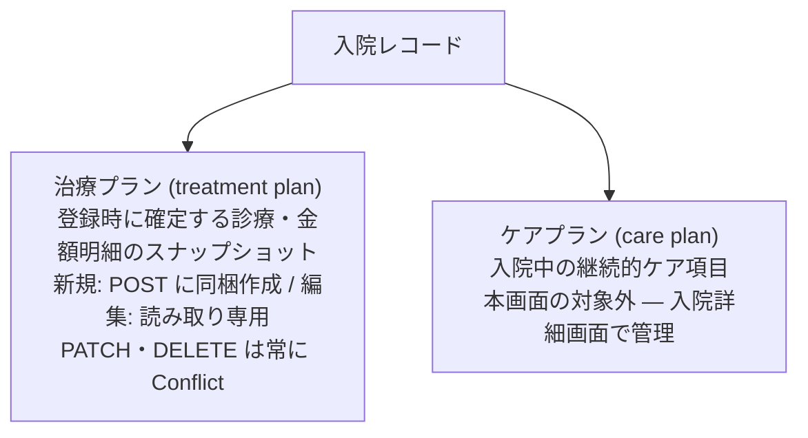

# 入院登録/編集 仕様書 (Hospitalization Form)

> 2026-10-15文書整理: 画面をまたぐ業務契約・受入条件は[領域正本](../domains/hospitalization/lifecycle.md)、型・保存／再送と現行差は[技術契約](../../design/domains/hospitalization/technical-spec.md)を参照する。以下の画面詳細は既存記載を継承（決定根拠・実装の全件再監査なし）、実機未実施。担当は担当医師、指名は非必須。臨床入院の開始時担当医決定は別の既合意である。現行createのstart_date由来admitted既定、チェックインの単純PATCH、編集の日付未送信は目標との現行差。予定／実績の更新を保存済みと誤認させない。料金の日数自動積算は既存仕様ではなく、ホテル料金・必要前金・取消料はスタッフの個別確認入力とする追加合意。取消時の自動請求／返金は設けない。

ホテルの計数・退室／延泊とLINEの入退室日時条件は[18:26の計数正本](../line/reservation-spec.md#hotel-counting-boundaries-1826)・[日時正本](../line/reservation-spec.md#hotel-entry-exit-hours-1826)へ従う。

17:35合意の[ホテル受付上限](../line/reservation-spec.md#requirement-fr-line-reservations-hotel-concurrent-stay-limit)は、医院別の同時宿泊頭数を宿泊期間全体で判定し、未設定・超過時はLINE確定せず医院相談へ案内する。ケージと世話担当は宿泊管理側で割り当て、医師指名／医師シフトで代用しない。技術方式は設計、実装・実機受入は未確認。

17:23 JSTの[LINE予約6点合意](../line/reservation-spec.md#line-agreement-1723)へ従う。公開された診療・トリミング・ホテルは予約対象、入院は医院相談。ホテルには医師指名・医師シフト・通常予約の同日制約を適用しない。受付制限・入力保持・受付前取消・必要設定不足の扱いと受入条件はLINE正本を参照する。ホテル受入基準は17:35合意の医院別同時宿泊頭数・全宿泊期間判定で、実装・実機受入は未確認。

17:17 JSTの院内予約8点一括合意は[予約入口の決定一覧](../domains/reservations/README.md#internal-reservation-batch-1717)を参照する。誤取消／誤終了訂正、未終了予約保護、診療前の日付・カルテ整合、マスタ利用・名称履歴、休診日予約／日跨ぎ勤務、患者照合、ホテル担当時点／入院記録失敗の各正本と受入条件へ従う。LINE受付条件は17:23合意（ホテル受入基準は17:35合意、計算・保存方式は設計）、実装・実機受入は未確認。

予約ドメインからの接続は[16:07合意のホテル担当と入院の両入口](settings/master-reservation-type.md#requirement-fr-reservation-types-hotel-inpatient-entry)を参照する。ホテル予約は指名医師を選ばず、世話担当者は宿泊管理側で割り当てる。入院は予約区分からの予定入院と診察後の入院決定をどちらも扱う。本書の既存管理状態・担当医・記録仕様は保持し、今回の接続が実装済みとは扱わない。入院開始は16:36合意の来院後スタッフ明示確定に従う。担当医と記録は16:44合意へ従い、失敗時の開始未確定・理由表示・再試行は17:17合意、具体的画面・保存方式は設計。

16:36合意の[入院開始の明示確定と二重登録防止](settings/master-reservation-type.md#requirement-fr-reservation-types-inpatient-start-confirm)へ従う。予定入院は予約だけで入院中にせず、来院後にスタッフが「入院開始」を確定する。診察後の入院決定も同じ入院管理へつなぎ、同じ入院を二重登録しない。担当医・入院記録は16:44合意の段階条件へ従う。具体的画面配置・重複防止の技術方式・記録作成失敗時の開始未確定・理由表示・再試行は17:17合意。具体的保存方式は設計として分ける。受入条件は区分マスタ正本へ置き、実装・実機受入は未確認。

16:44合意の[入院担当医と開始時の入院記録](settings/master-reservation-type.md#inpatient-doctor-and-record-at-start)へ従う。予定入院予約時は指名医師未定可、入院開始までに入院担当医決定、スタッフによる開始確定時に入院記録を作成する。予定入院・診察後の両入口を維持し、同じ入院を二重登録しない。予約の指名医師から担当医を自動確定せず、記録作成失敗時の開始未確定・理由表示・再試行は17:17合意。具体的UI・保存方式は実装設計とする。実装・実機受入は未確認。

## 概要
- **画面の目的**: 入院またはペットホテルの新規受付、および登録時の治療プラン（診療内容・金額明細のスナップショット）の定義。
- **URLパターン**:
  - 新規作成: `/hospitalization/new?petId=xxx`
  - 編集: `/hospitalization/:id/edit`
  - ペット選択: `/hospitalization/select-pet`（create ガード）
- **アクセス権限**（`RequirePermission` + 画面内 `usePermission`）:
  - 親 `/hospitalization`: `ResourceHospitalization` **`view`**
  - 新規・ペット選択: **`create`**
  - 編集: **`edit`**
  - 保存は `canSubmit`（新規=create / 編集=edit）。削除は `delete`。**認証済ユーザー全員ではない**。
  - **親削除 UI ガード**: 紐付く治療プランが 1 件以上ある場合、削除ボタンを出さない（BE も Conflict で拒否）。API 失敗だけに頼らない。

---

## 用語（必須）

| 用語 | 意味 | 管理画面 |
|------|------|----------|
| **治療プラン** (treatment plan) | 入院**登録時**に確定する診療内容・金額明細の**スナップショット**。登録後は変更・削除不可。 | 本画面（新規入力 / 編集は参照のみ） |
| **ケアプラン** (care plan) | 入院中の投薬・給餌・処置など**継続的なケア項目**。 | 入院詳細画面 |

治療プランとケアプランを同一視しない。UI 文言でも「ケア／治療」と混同しない。

---

## 画面構成

### 1. 入院基本情報
- **患者ヘッダー**: `PatientInfoCard` + `formatPatientPetDetails` に `species` を渡す。動物種は実データを表示する（固定の「不明」にしない）。特記マーク（EMR-173/231、共有 `DangerBadge`）: ペット名横に `danger_level` 高=赤い八角形アイコン・中=黄い三角形アイコン（文言なし、Popover で補足メモ）、低・未設定は非表示。飼主 `is_dangerous` は飼主名横に文言なしの赤い八角形アイコン（代替名「特記」）。入院・ホテル施術前の安全確認に必須の常時表示。

Notionスタイルのプロパティ編集UIで、入院の根幹となる条件を設定します。
- **入院タイプ**: 「入院」または「ホテル」を選択。
- **予定期間**: 入院予定日と退院予定日の期間指定。新規では `start_date` / `end_date` を送信するが、現行の `buildUpdateHospitalizationRequest` は両フィールドを送らないため、編集フォームでの日付変更は永続化されない。
- **ケージ割り当て**: マスタに登録済みのケージ・個室から検索選択（空き状況によるフィルタリングはなし）。ペットの選択は必須。ケージ・個室は**任意**で、「選択なし」のまま登録・更新できる（EMR-316。BUG-037 の必須化を撤回）。更新の送信は3分岐: ケージ欄に触れていなければ PATCH から除外（現状維持）、空でない値へ変更すれば `cage_id` を送信、明示的に「選択なし」へ戻せば `clear_cage_id: true` で `cage_id` を NULL にする。ケージ未設定の入院はボードの「ケージ未割当」欄に表示される（[07-hospitalization-list.md](07-hospitalization-list.md)）。連結中（EMR-306）の構成メンバーケージは選択肢から除外され、代表ケージは「代表名 + メンバー名…」のラベルで表示する。登録後に連結された場合は保存値の表示を維持する（メンバー宛の新規割当は backend が 422 で拒否。ルール正本は [settings/master-cage.md](./settings/master-cage.md)）。
- **担当医**: ヘッダー「担当医」ボタンで `staffType=doctor` かつ active のスタッフを選ぶ（`doctor_id`）。未選択可は現行登録フォームの継承記載。16:44合意では予定入院の予約時は指名医師未定可だが、入院開始までに入院担当医を決める。予約の指名医師との自動連動は未承認。一覧の担当医列と同じフィールド。
- **保険適用**: チェックONで保険会社名・保険番号の入力欄が表示される。
- **メモ**: 自由記述メモ。

### 2. 治療プランと連絡事項
- **治療プラン**（登録時スナップショット）: 治療内容・メモを行単位で入力する明細テーブル（保険・単価・数量・割引(%)・値引(円)・小計を表示）。
  - **新規作成時**: 治療内容が空でない行だけを、親 `POST /v1/hospitalizations` の `treatment_plans` に同梱して作成する。空行はスキップ。
  - **編集時**: `GET /v1/hospitalizations/:id/treatment-plans` で hydrate し **読み取り専用**。本画面の更新では治療プランを変更しない（親フィールドのみ）。
  - **BE**: 入院ネストの `PATCH` / `DELETE .../treatment-plans/:planId` はサービス層で **Conflict**（登録時スナップショットのため変更・削除不可）。ルートは fail-closed のまま残す。
- **主訴**: `owner_request` を入力するメモカード。一覧の主訴列と同じフィールド（新規列は無い）。
- **スタッフへの連絡事項**: `staff_notes`。
- **継続ケア**: 投薬・給餌などの**ケアプラン**は入院詳細画面で管理する（本画面の対象外）。ケアプランの持ち物（`item`）明細は入院プラン（マスタ）参照に加えて手入力「その他」（理由必須）も登録できる。詳細は `08-hospitalization-detail.md` 参照。治療プラン（本画面の登録時スナップショット）は従来どおり自由記述であり、手入力モードの概念は持たない。

### 3. 金額概算
- **概算計**: 治療プラン明細に基づいた入院費の画面上自動計算（小計・消費税・請求額の読み取り専用表示）。
- **一括割引（% / 円）**: **UI に入力欄を置かない**。BE 永続化フィールドも無く、create/update でも送信しない。

---

## 主要な機能

- **保存アクション (`useActionState`)**: React 19 の最新パターンを採用。保存中のローディング表示や、バリデーションエラー時の対象フィールドへの自動フォーカスに対応。
- **意図しない離脱の防止**: 編集中のデータがある場合、ブラウザの「戻る」やページ遷移時に確認ダイアログを表示（`NavigationBlocker`）。
- **臨床安全ガード**: 画面は死亡済みペットの新規登録・既存情報の更新を拒否します（`hospitalizationSubmitFieldErrors`）。
- **親削除ガード**: 治療プランが紐付いている入院は削除ボタン非表示 + 正直メッセージ。BE も `CountTreatmentPlansByHospitalizationID` で Conflict。

---

## 技術仕様

### 使用コンポーネント
- **`HospitalizationForm`**: メインフォームコンテナ。
- **`SearchableSelect`**（`HospitalizationBasicInfo` 内）: マスタ登録済みケージの検索選択。
- **`HospitalizationCostSummary`**: 金額概算の読み取り専用表示（一括割引入力なし）。

### API連携
| メソッド | エンドポイント | 用途 | 必須権限 | 必須アクション |
|:---|:---|:---|:---|:---|
| GET | `/api/v1/hospitalizations/:id` | 編集時の既存レコード取得 | `hospitalization` | `view` |
| POST | `/api/v1/hospitalizations` | 入院レコードの新規保存（`treatment_plans` 同梱可。任意で `doctor_id` / `owner_request`） | `hospitalization` | `create` |
| PATCH | `/api/v1/hospitalizations/:id` | 登録情報の更新（治療プランは含まない。任意で `doctor_id` / `owner_request`） | `hospitalization` | `edit` |
| DELETE | `/api/v1/hospitalizations/:id` | 入院レコードの削除（子治療プランありは 409） | `hospitalization` | `delete` |
| GET | `/api/v1/hospitalizations/:id/treatment-plans` | 編集時の治療プラン hydrate | `hospitalization` | `view` |
| PATCH | `/api/v1/hospitalizations/:id/treatment-plans/:planId` | **常に Conflict**（スナップショット） | `hospitalization` | `edit` |
| DELETE | `/api/v1/hospitalizations/:id/treatment-plans/:planId` | **常に Conflict**（スナップショット） | `hospitalization` | `delete` |
| GET | `/api/v1/masters/cages` | 利用可能なケージ一覧の取得 | `master-hospitalization` | `view` |

---

