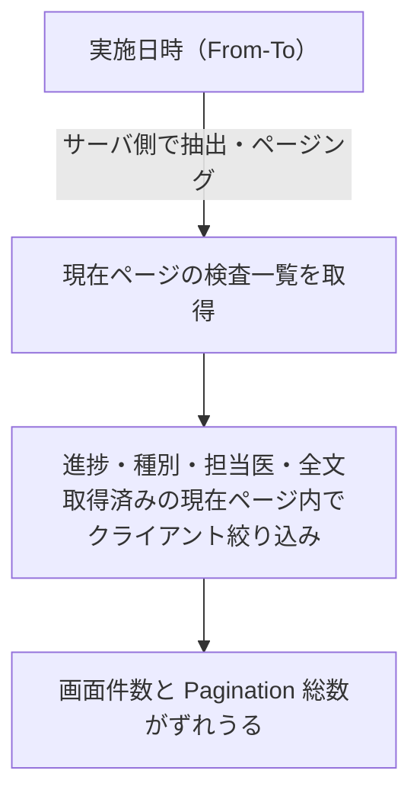

# 検査一覧 仕様書 (Examinations List)

## 2026-10-15 D07仕様整理の優先順位

業務・GWTの正本は[検査ライフサイクル](../domains/examinations/lifecycle.md)、型／全writer／未追従差分は[技術契約](../../design/domains/examinations/technical-spec.md)。以下の画面説明は現行UI参照として保持する。ページ内フィルタと先頭20件の履歴を全件検索と解釈しない。検査・カルテは同じ結果ID／固定版を参照する目標であり、現カルテadapterのrevision欠落を実装済みと扱わない。

## 概要
- **画面の目的**: 院内および院外（外部委託）で実施される全検査のオーダー状況および、測定結果ステータスの一元管理。
- **URLパターン**: `/examinations`
- **アクセス権限**: `examinations` リソースの `view` 権限が必要（`RequirePermission` + `ResourceExaminations`）。作成・編集導線は `usePermission` で出し分け。

---

## 1. 画面構成

### 1.1 高度な検索・フィルタ (`PropertyFilter`)
- **実施日時指定**: 検査が実施された期間（From-To）はサーバ抽出。ページは `?page=`、`limit=20`。
- **進捗・種別・担当医・全文**: 取得済みの現在ページ内のみ（`uniqueSortedOptions` / クライアント絞り込み）。このとき画面件数と Pagination 総数がずれうる。

検索条件の処理経路（サーバ抽出とページ内絞り込みの分担）：

### 1.2 進捗管理テーブル (`DataTable`)
臨床のワークフローを止めることなく、状況を把握するための情報が集約されています。

| カラム | 説明 |
|:---|:---|
| **日時** | 検査が開始・または予定された日付。 |
| **飼主名** | 飼主氏名。 |
| **ペット名** | 患者（ペット）名。 |
| **検査種別** | 血液検査、生化学、尿検査、画像診断等のカテゴリ。 |
| **結果概要** | 入力済みの主要な数値や判定コメントの抜粋（lg 以上の画面幅でのみ表示）。 |
| **担当医** | 任意に設定した検査担当医。未選択を認め、入力者ログから担当を推定しない。担当表示だけを実施者の証拠にしない。 |
| **ステータス** | 進捗状況を示すカラーバッジ。 |
| **操作** | 詳細画面への編集導線（`RowActionButton`、`edit` 権限保有時のみ表示）。 |

---

## 2. 主要なユーザーアクション

- **新規オーダー**: ヘッダーの「新規検査登録」（`create` 権限保有時のみ表示）からペットを選び、`/examinations/new?petId=:id` を開く。既存のカルテ紐付き検査の参照・編集はカルテ検査タブへ着地する。
- **結果入力**: ペット名リンクまたは操作ボタンで、紐付きカルテの検査タブ (`/medical-records/:id?tab=検査&examId=:id`) を開く。対象検査は先頭に出して着地する。カルテ未紐付けの行だけ従来の詳細画面 (`/examinations/:id`) へ行く。

---

## 3. 技術仕様

### 3.1 非同期描画
- **遅延描画**: `useDeferredValue` により、多数の検査履歴を検索する際もタイピングの応答性を損ないません。
- **透過アニメーション**: フィルタ処理中は `FilteringIndicator` によりテーブル領域の透過度を調整し、ユーザーに状況を通知します。

### API連携
| メソッド | エンドポイント | 用途 | 必須権限 | 必須アクション |
|:---|:---|:---|:---|:---|
| GET | `/api/v1/examinations` | 条件に応じた検査一覧の取得 | `examinations` | `view` |

---

## カルテへの後日結果・訂正履歴の接続

2026-10-14の[カルテ追加合意](../domains/medical-records/pages/medical-record-form.md#requirement-fr-medical-records-late-result-shared-history)により、検査画面とカルテは同じ検査結果・変更履歴を参照する。カルテ作成中は後日結果を追加、確定済みなら原記載／確定時参照版を保持して結果を追記する。患者／医院／検査／カルテ対応を照合し、結果訂正の前後・理由・操作主体／時刻を履歴へ残す。

検査ownerの確定／訂正・専用unconfirm権限は[検査入力／結果登録の既存契約](13-examinations-form.md#21-真正性の担保確定ロック)へ従う。検査のunconfirmをカルテ確定解除やfinalizedへの通常関連PATCHの許可にしない。[参照版と追記の技術契約](../../design/domains/medical-records/technical-spec.md#medical-record-integration-contracts)へ接続し、revisionなし旧結果・機器受信／adapter全経路はD07の文書照合に残す。今回検査内部の新しい解除手順・実装・実機受入を確定しない。

### 最終照合の受け手契約

[型・互換](../../design/domains/medical-records/technical-spec.md#medical-record-reconciled-contract)と[専用結果追記](../../design/domains/medical-records/technical-spec.md#medical-record-legacy-and-special-contract)を参照する。医院＋検査IDを結果全体の同一性、revision／versionを固定版、item IDを版内参照として返す。現カルテExamGroupはrevisionを保持しないため、同じ版の参照へ追従済みとしない。revisionなし旧結果・跨版item対応不明は元記載／元参照を保持して照合し、名前や行位置で補完しない。機器取込／attach／revertもwriter参加の対象で、現receiptを患者転記／カルテ復元のreceiptへ流用しない。検査内部の訂正／解除は検査正本へ残す。

