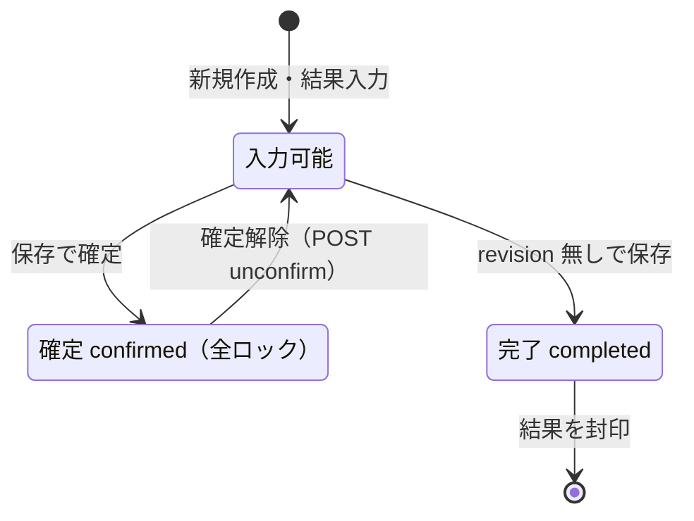

# 検査入力/結果登録 仕様書 (Examination Form)

## 2026-10-15 D07仕様整理の優先順位

業務・例外・GWTは[検査ライフサイクル](../domains/examinations/lifecycle.md)、現wireとの差は[技術契約](../../design/domains/examinations/technical-spec.md)を優先する。以下のUI／図は現行参照であり、保存するだけで一律に確定する意味ではない。

- confirmedは全ロック。revisionなしcompletedは結果封印、revisionありcompletedは解除後の作業版となり得る。
- 専用unconfirmは権限・理由・official版・親draftが必要。検査の解除はカルテfinalizedを解除しない。
- 旧PUT /itemsは未送信／nullも全消去へ変換する現状差がある。D03継承目標は明示[]だけを意図的全消去とし、旧経路適合済みとしない。
- 日常機器受信はEMR-402のブラウザWeb Serial（NX600/AU10V、ページ表示中）。ADRの歴史的LaunchAgent説明を現在の通常経路にしない。
- HIGH/LOWは表示補助。取得不能／評価不能を正常確認済みとせず、基準値具体値の医師確認とソフト仕様整理を分ける。

## 概要
- **画面の目的**: 検査オーダーの作成、および臨床検査値（数値・判定）の精緻な記録。
- **URLパターン**: 
  - 検査管理からの新規: `/examinations/new?petId=xxx`
  - 未紐付け・検歴: `/examinations/:id`
- **アクセス権限**: `examinations` リソースの `view` 権限（ルートを `RequirePermission` でガード。新規作成ルート `/examinations/new` は `create` アクション必須）。操作ボタンの出し分けは `usePermission` で制御。

---

## 1. 画面構成

### 1.1 検査基本情報
- **検査種別**: 血液、尿、エコー等のマスタ（`exam_types`）から選択。
- **担当医**: `staffType=doctor` かつ active のスタッフ。検査種別とともに保存時の必須項目。
- **患者ヘッダー**: `PatientInfoCard` で種を `petName` / `petDetails` に実データで出す。特記マーク（EMR-173/231、共有 `DangerBadge`）: ペット名横に `danger_level` 高=赤い八角形アイコン・中=黄い三角形アイコン（文言なし、Popover で補足メモ）、低・未設定は非表示。飼主 `is_dangerous` は飼主名横に文言なしの赤い八角形アイコン（代替名「特記」）。採血・保定など検査実施前の安全確認用。

### 1.2 動的検査項目テーブル (`ExamItemsTable`)
選択した検査種別に基づき、測定項目が動的に生成されます。

| 項目 | 説明 |
|:---|:---|
| **項目名 / 単位** | 例：ALT (U/L), CRE (mg/dL)。マスタより自動展開。 |
| **測定値** | 実測値を数値入力。 |
| **判定 (HIGH/LOW)** | **自動判定**: マスタで定義された基準値（Min〜Max）に基づき、高値は **HIGH**（赤）、低値は **LOW**（status-blue）でハイライトされます。判定はバックエンドが導出するため、保存・再読込後に反映されます。 |
| **基準値参照** | 検査種別マスタで定義された正常範囲（`normal_value`）を横に表示し、臨床判断を助けます。 |

### 1.3 未紐付け受信バナー
選択中ペットの検査画面に、医院の未紐付け機器受信があれば表示する。1クリックで `POST /lab-imports/:job_id/attach`。値は編集しない。確認ダイアログは出さない。待機の遠隔起動はしない。

### 1.4 検査履歴パネル (`ExaminationHistoryPanel`)
画面は 2 カラム構成（左 3/5 = フォーム・右 2/5 = 履歴）で、右カラムに**同一ペットの過去の検査履歴**を常時表示します。過去の数値と見比べながら入力できるため、別画面への往復が不要です。
- **絞り込み**: 期間（開始日・終了日）、キーワード（検査種別・結果サマリーをかな正規化で部分一致）、日付の昇順/降順切替、一括クリア。
- **編集中レコードの除外**: 編集モードでは、開いている検査自身は履歴から除外されます。
- **データ源**: `useExaminationHistoryFilters` が `useGetExaminations` へ `petId` / `startDate` / `endDate` を渡し、サーバ側でペットと期間を絞る（wire は `pet_id` / `start_date` / `end_date`）。page/limit は未指定のため BE 既定の先頭20件。取得後に同一ペットの再確認、キーワード検索、編集中レコード除外、ソートを行う。`?historyView=pivot` でピボット表示。

---

## 2. 主要な臨床・安全機能

### 2.1 真正性の担保（確定ロック）
- **ステータス**: サーバ保存後の `確定 (confirmed)` は全ロック。revision 無しの `completed` は結果を封印する。
- **確定解除**: `POST /examinations/:id/unconfirm`（権限 `examination-unconfirm:edit`）。
- **印刷**: 保存済み print-snapshot。

検査レコードの確定ロック状態：

### 2.2 保存時ハイライト
数値の判定（HIGH/LOW）はバックエンドが基準値（Min〜Max）から導出し、保存・再読込のタイミングで UI の色に反映されます。これにより、多忙な診察室でも重要値の見落としを防止します。

### 2.3 未保存データ保護（`NavigationBlocker`）
フォームに未保存の編集がある状態（`useUnsavedChanges` の dirty フラグが立ち、かつ保存処理中でない）で他画面へ遷移しようとすると、`NavigationBlocker` が遷移をブロックし確認を求めます。入力途中の検査値が黙って失われることを防ぎます。保存成功・削除確定時は dirty フラグを解除してから遷移するため、正常フローでは警告は出ません。

### 2.4 削除の保護と権限制御
- **削除**: `ConfirmDialog`（destructive）を経由し、取り消せない旨を明示してから実行します。
- **権限**: 編集権限（新規は `create`・編集は `edit`）が無い場合はフォーム全体が入力不可になります。
- **バリデーションエラー時のフォーカス移動**: 保存失敗時は最初のエラーフィールドへ自動フォーカス・スクロールします（アクセシビリティ対応）。

---

## 3. 技術仕様

### 3.1 構成コンポーネント
- **`ExaminationForm`**: 統合フォーム。
- **`ExaminationFormFields`**: 検査種別・担当医等の基本情報フィールド。
- **`ExamItemsTable`**: 選択された検査種別の項目テンプレ（`exam_type_fields`、`useGetExamTypeFields` で取得）を描画する動的テーブル。確定済み検査では入力不可。
- **`ExaminationHistoryPanel`**: 右カラムの同一ペット検査履歴（§1.4）。
- **`NavigationBlocker`** + **`useUnsavedChanges`**: 未保存データ保護（§2.3）。

### API連携
| メソッド | エンドポイント | 用途 | 必須権限 | 必須アクション |
|:---|:---|:---|:---|:---|
| GET | `/api/v1/examinations/:id` | 検査基本情報の取得（項目リストは `/:id/items` で別途取得） | `examinations` | `view` |
| POST | `/api/v1/examinations` | 新規保存 | `examinations` | `create` |
| PATCH | `/api/v1/examinations/:id` | 数値・判定・ステータスの更新 | `examinations` | `edit` |
| DELETE | `/api/v1/examinations/:id` | 検査記録の削除（編集時のみ削除ボタンを表示） | `examinations` | `delete` |
| GET | `/api/v1/examinations/:id/items` | 検査項目（結果）のリスト取得 | `examinations` | `view` |
| PUT | `/api/v1/examinations/:id/items` | 検査項目（結果）の一括更新 | `examinations` | `edit` |
| POST | `/api/v1/examinations/:id/unconfirm` | 確定解除 | `examination-unconfirm` | `edit` |
| GET | `/api/v1/examinations/:id/print-snapshot` | 印刷用スナップショット | `examinations` | `view` |
| GET | `/api/v1/masters/examination-types` | 利用可能な検査種別リストの取得 | `master-medical` | `view` |
| GET | `/api/v1/masters/examination-types/:id` | 検査種別詳細（項目テンプレ `exam_type_fields`）の取得 | `master-medical` | `view` |

---

## カルテへの後日結果・訂正履歴の接続

2026-10-14の[カルテ追加合意](../domains/medical-records/pages/medical-record-form.md#requirement-fr-medical-records-late-result-shared-history)により、検査画面とカルテは同じ検査結果・変更履歴を参照する。カルテ作成中は後日結果を追加、確定済みなら原記載／確定時参照版を保持して結果を追記する。患者／医院／検査／カルテ対応を照合し、結果訂正の前後・理由・操作主体／時刻を履歴へ残す。

検査ownerの確定／訂正・専用unconfirm権限は本書の既存契約へ従う。検査のunconfirmをカルテ確定解除やfinalizedへの通常関連PATCHの許可にしない。[参照版と追記の技術契約](../../design/domains/medical-records/technical-spec.md#medical-record-integration-contracts)へ接続し、revisionなし旧結果・機器受信／adapter全経路はD07の文書照合に残す。今回検査内部の新しい解除手順・実装・実機受入を確定しない。

### カルテへの返却・利用開始の最終照合

[最終型／writer契約](../../design/domains/medical-records/technical-spec.md#medical-record-writer-matrix)へ接続し、院内scope・検査ID・患者／record対応・固定revision／版内item ref・変更理由／actor／時刻・取得結果を返す。原記載の確定時参照版と後日版を分離。現在のrevision／print-snapshotの存在だけでカルテadapter実装済みとしない。確定済みカルテへの普通FK PATCH／unfinalizeなし。旧結果／項目の明示対応を確認できなければ停止し、既存の検査内部確定／訂正手順を保持する。

