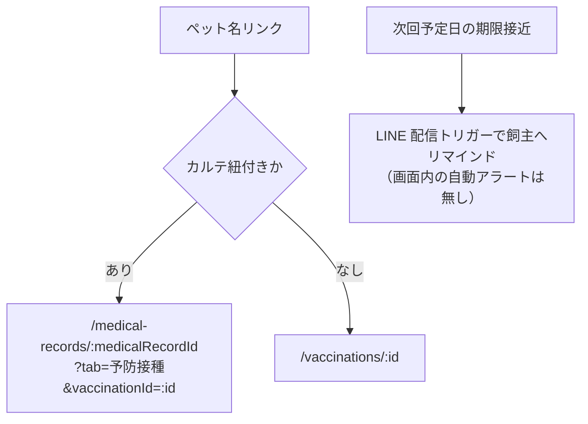

# 予防接種一覧 仕様書 (Vaccinations List)

## 2026-10-15 D08仕様整理の優先順位

次回日は[最新合意](../domains/vaccinations/lifecycle.md#fr-vaccinations-schedule)のワクチン種類別設定または手入力に統一し、独立／カルテ内の入口差を設けない。一覧は保存済み次回日を表示し、旧入口の固定既定や現在マスタから勝手に再計算しない。[最新第4項合意](../domains/vaccinations/lifecycle.md#vaccination-retrospective-next-date)の過去接種後日入力で保存した、既に過ぎた当時の次回日も履歴として保持・表示する。実装適合は未確認。

業務・例外・GWTは[予防接種ライフサイクル](../domains/vaccinations/lifecycle.md)、現wire／監査等の差は[技術契約](../../design/domains/vaccinations/technical-spec.md)。独立／カルテ内は同じvaccinations資源。単体finalizedを新設しない。最新の[通常編集契約](../domains/vaccinations/lifecycle.md#vaccination-normal-edit-autosave)により親の診療終了／旧finalizedだけで入力・編集を一律拒否せず、現在権限・版・変更履歴と別の削除／患者訂正保護を維持する。

同日複数の単件順次登録は[EMR-105の後続検証記録](../../work/emr/emr-105-vaccine-multi-20261002.md)を参照し、S29の古い「調査中」を現在状態としない。当時の限定検証を今回の実機PASSにしない。以下の担当医フィルタは最大100件内であり、全件検索ではない。接種保存・タグ同期・配信／公開の成功は別に判定する。

## 概要
- **画面の目的**: 院内で行われた全予防接種（混合ワクチン、狂犬病ワクチン、フィラリア・ノミダニ予防等）の実績管理。
- **URLパターン**: `/vaccinations`
- **アクセス権限**: `ResourceVaccinations` の **`view`**（`RequirePermission`。create/edit/delete は `usePermission`）

---

## 1. 画面構成

### 1.1 高機能検索・フィルタ (`PropertyFilter`)
- **実施日・全文検索**: `start_date` / `end_date` と遅延した `search` を API に送信する。終了日未指定時は JST 当日を `end_date` とし、未来の記録が最大 `HISTORY_FETCH_LIMIT`（100）件の取得枠を消費しないようにする。
- **担当医**: 取得済み最大 100 件内でクライアント絞り込み。現行通常画面は死亡ペットの編集・削除を拒否する。最新合意の生前接種の後日入力／誤記訂正は、死亡状態を維持した理由・履歴付き専用経路へ。新たな接種を許可しない。
- **既定順**: 次回予定日（`next_date`）が近い順。未設定は末尾。ユーザーが列ソートを選んだ場合はその指定を優先する。

### 1.2 接種実績テーブル (`DataTable`)
| カラム | 説明 |
|:---|:---|
| **実施日** | 予防接種が完了した日付。 |
| **飼主名** | オーナー氏名。 |
| **ペット名** | 対象個体名。 |
| **予防接種名** | マスタ連動した正式名称。 |
| **次回予定** | 次回の接種推奨時期。 |
| **操作** | 行末ドロップダウン (`RowActionDropdown`)。編集・削除を各権限保持時のみ表示し、削除は確認ダイアログ (`ConfirmDialog`) を経由。 |

---

## 2. 主要な臨床連携

- **次回予定の視覚化**: 「次回予定」列で各個体の次回接種推奨日を一覧表示します（受付画面での自動アラート表示はありません。期限接近の通知は LINE 配信設定の `vaccine_deadline_60d` / `vaccine_deadline_30d` トリガーによる飼主宛リマインドで行われます）。
- **編集画面への遷移**: ペット名リンクで詳細へ移動します。カルテ紐付きは `/medical-records/:medicalRecordId?tab=予防接種&vaccinationId=:id`、未紐付きは `/vaccinations/:id` へ着地します。リンクは編集権限と独立して表示し、編集・削除操作は各権限でゲートします。

一覧からの遷移先と期限リマインドの経路：

---

## 3. 技術仕様

### 3.1 描画の最適化
- **遅延検索**: `useDeferredValue` で全文検索の API 送信を遅延し、担当医は取得済みデータをクライアントで絞り込みます。

### API連携
| メソッド | エンドポイント | 用途 | 必須権限 | 必須アクション |
|:---|:---|:---|:---|:---|
| GET | `/api/v1/vaccinations` | 条件に応じた接種記録の一括取得 | `vaccinations` | `view` |
| DELETE | `/api/v1/vaccinations/:id` | 誤登録データの論理削除 | `vaccinations` | `delete` |

---

