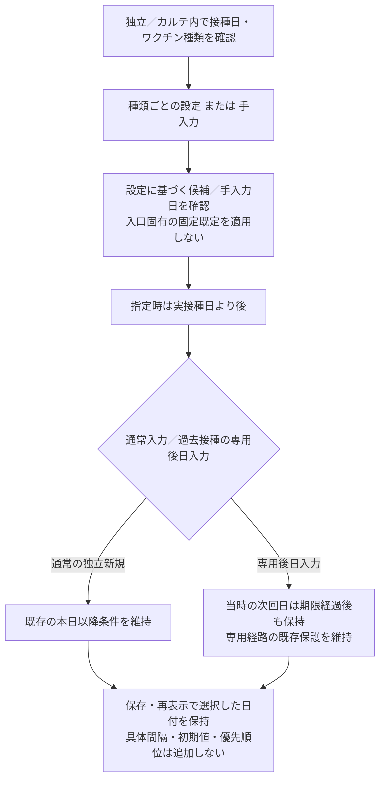

# 予防接種入力/編集 仕様書 (Vaccination Form)

## 2026-10-15 D08仕様整理の優先順位

[死亡後の生前接種記録](../domains/vaccinations/lifecycle.md#fr-vaccinations-correction)は死亡状態を戻さず理由・履歴付きで後日入力／誤記訂正できる目標。通常フォームの死亡拒否とは分けて専用経路を設計し、新たな接種・未来予約を許可しない。実装適合は未確認。

業務・例外・GWTは[予防接種ライフサイクル](../domains/vaccinations/lifecycle.md)、[技術契約](../../design/domains/vaccinations/technical-spec.md)を参照する。以下は最新合意の目標と現行実装の観察を区別する。具体数値の臨床承認や実装適合を意味しない。

- 最新の第2項合意は、独立／カルテ内とも次回日をワクチン種類ごとの設定または手入力へ統一する。旧独立既定1year／カルテ内既定4weeksは解消対象の実装差。具体間隔・設定なしの初期値・新たな優先順位は追加確定しない。
- 種フィルタ／種不一致拒否は現状未実装。異種接種の適否を承認済みとしない。
- 通常の独立新規では次回日の本日以降条件を維持する。[最新第4項合意](../domains/vaccinations/lifecycle.md#vaccination-retrospective-next-date)では、過去接種の専用後日入力に限り、実接種日より後の当時の次回日が既に過ぎていても履歴保存できる。APIの「接種日より後」条件だけで専用経路まで実装済みとしない。
- 同日複数は各行独立・一送信一記録。通信断後の無条件再createを同日複数許可から導かない。
- 親の診療終了／旧finalizedだけで通常入力・編集を拒否しない。[最新D03接続](../domains/vaccinations/lifecycle.md#vaccination-normal-edit-autosave)へ従い、患者取り違え、死亡後／過去専用入力、復元の対象版・履歴は既決の境界を保持し、通常FK PATCHで代用しない。

## 概要
- **画面の目的**: ワクチン接種等の詳細記録（ロット番号）の編集、および次回予定日の管理。
- **URLパターン**: 
  - 新規作成: `/vaccinations/new?petId=xxx`（`petId` 未指定時はペット選択へ誘導）。カルテ「予防接種」タブにも別の入力実装がある
  - 編集: `/vaccinations/:id`
- **アクセス権限**: 親 `/vaccinations` は `ResourceVaccinations` **`view`**。`:id` は親 view 継承、保存/削除は `usePermission`

---

## 1. 画面構成

### 1.0 患者ヘッダー
- **`PatientInfoCard`**: `formatPatientPetDetails` に `species` / 生年月日 / 性別 / 去勢避妊を渡す。動物種は先頭に実データを出す。欠損の年齢・性別・去勢避妊だけ「不明」（固定ダミーの「犬」は使わない）。特記マーク（EMR-173/231、共有 `DangerBadge`）: ペット名横に `danger_level` 高=赤い八角形アイコン・中=黄い三角形アイコン（文言なし、Popover で補足メモ）、低・未設定は非表示。飼主 `is_dangerous` は飼主名横に文言なしの赤い八角形アイコン（代替名「特記」）。接種・保定前の安全確認用。
- カルテ「予防接種」タブ（[medical-record-form.md](../domains/medical-records/pages/medical-record-form.md)）は本画面とは別実装。タブ左ペインの一覧も同じ `GET /vaccinations?pet_id=` を使う。

### 1.1 接種基本情報
- **接種日**: 必須入力（未入力はエラー）。未来日は選択不可。
- **ワクチン**: 有効なワクチンマスタ（`useGetAllVaccinesMaster` の isActive）から選択（必須）。固定2択ハードコードではない。`MasterLink` でマスタへ遷移可。
- **補助説明**: 自由入力の補足テキスト。
- **備考**: 自由入力の備考テキスト。

### 1.2 製品トレーサビリティ管理 (LOT)
- **ロット番号**: 最大 4 つまでの LOT 番号を並行して登録可能（セット接種等に対応）。

### 1.3 期間管理（次回予定）
- **次回予定日**: 
    - **種類別設定**: ワクチン種類ごとの設定から候補を扱い、独立／カルテ内で同じ業務契約を適用する。入口ごとの固定既定は設けない。設定がないときの初期値や具体間隔は本合意で追加しない。
    - **手入力**: 臨床的な判断に基づき、カレンダーから直接指定可能。保存・再表示時に手入力値を黙って上書きしない。設定値との新たな優先順位は推定しない。
    - **バリデーション**: 指定する次回予定日は実接種日より後であること。通常の独立新規登録時は本日以降とする。過去接種の専用後日入力では当時の次回日が入力時点より前でも保持でき、今日以降へ補正しない。未来接種日の拒否・専用経路の権限／理由／履歴・患者／親記録対応と現在版の保護は維持する。

次回予定日の決定フロー：

### 1.4 過去の接種履歴
- 選択中ペットの過去の接種記録を右カラムに一覧表示。期間・ワクチン名検索・ソート（昇順/降順）で絞り込み可能。

### 1.5 削除
- 編集時のみ、削除権限（`vaccinations` の `delete`）がある場合に削除ボタンを表示。`ConfirmDialog` による確認後に削除。

---

## 2. 主要な臨床・安全機能

### 2.1 未保存変更の保護
- **`NavigationBlocker`**: フォーム入力中の誤ったページ遷移を防ぎ、データの確実な保存を促します。

### 2.2 権限によるロック
- 編集権限 (`vaccinations` の `edit`/`create`) がない場合、フォーム全体が読み取り専用となります。

---

## 3. 技術仕様

### 3.1 構成コンポーネント
- **`VaccinationForm`**: 統合フォーム（React 19 Action 対応）。
- **`calculateNextDate`**: `use-vaccination-form` フック内の、接種周期に基づいた自動計算ロジック。

現行UIの3weeks／4weeks／1year／otherと入口別初期値は旧実装の参照。種類設定または手入力への統一、手入力保持、両入口一致の適合確認は未実施であり、上記コンポーネントの存在だけで完了としない。

### API連携
| メソッド | エンドポイント | 用途 | 必須権限 | 必須アクション |
|:---|:---|:---|:---|:---|
| GET | `/api/v1/vaccinations` | 接種履歴一覧の取得（履歴パネル用） | `vaccinations` | `view` |
| GET | `/api/v1/vaccinations/:id` | 接種詳細情報の取得 | `vaccinations` | `view` |
| POST | `/api/v1/vaccinations` | 新規保存 | `vaccinations` | `create` |
| PATCH | `/api/v1/vaccinations/:id` | 登録内容（LOT、予定日等）の更新 | `vaccinations` | `edit` |
| DELETE | `/api/v1/vaccinations/:id` | 接種記録の削除 | `vaccinations` | `delete` |

---

