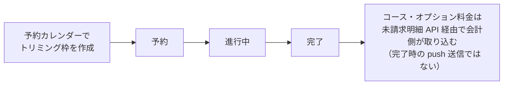

# トリミング一覧 仕様書 (Trimming List)

> 2026-10-15文書整理: 画面をまたぐ業務契約・受入条件は[領域正本](../domains/trimming/lifecycle.md)、型・保存／再送と現行差は[技術契約](../../design/domains/trimming/technical-spec.md)を参照する。以下の画面詳細は既存記載を継承（決定根拠・実装の全件再監査なし）、実機未実施。予約一覧対象としての存在と施術detailの作成済みを区別する。会計連携は未請求明細のpullで、施術完了時の会計push生成ではない。施術の完了と会計確定・入金は別結果。

[最新第5項合意](../domains/trimming/lifecycle.md#trimming-partial-save-undecided)では、担当・コース未定の途中保存が可能。保存済みの未定を架空の担当／コースで補完せず、同じ記録を再開する。以下の「進行中」表示や状態図だけで終了済みとせず、[終了条件の追加承認](../domains/trimming/lifecycle.md#trimming-end-recorded-performance)に従って実担当と記録済み施術内容を確認する。コースなしの既存オプション明細による終了も認める。実装適合は未確認。

## 概要
- **画面の目的**: 院内で実施されるトリミング施術の予約・実績・進捗管理。
- **URLパターン**: `/trimming`
- **アクセス権限**: `trimming` リソースの `view` 権限（`RequirePermission` + `ResourceTrimming` によるルートガード）。新規登録・編集・削除導線は `usePermission` で出し分け。

---

## 1. 画面構成

### 1.1 高機能検索・フィルタ (`PropertyFilter`)
- **施術日指定**: 施術が行われた、または予定されている期間での絞り込み。
- **ステータスフィルタ**: 「予約」「進行中」「完了」による進捗状況の抽出。
- **種指定**: 動物種による絞り込み。
- **全文検索**: 飼主名、ペット名、犬種キーワードによる検索。
- **トリマー指定**: 担当スタッフによる絞り込み。

### 1.2 施術管理テーブル (`DataTable`)
トリミング室の業務フローに最適化された情報表示。

| カラム | 説明 |
|:---|:---|
| **診療日** | 施術実施（予定）日。 |
| **飼主名** | オーナー名。 |
| **ペット名** | ペット名とペット番号。 |
| **種** | 動物種。 |
| **犬種** | 犬種。未登録時は「-」を表示。 |
| **体重** | 個体の体重。 |
| **スタイル希望** | 今回の主要な要望の抜粋。 |
| **担当** | 施術を担当するスタッフ名。 |
| **ステータス** | 進捗状況を示すカラーバッジ。 |
| **操作** | 行末ドロップダウン (`RowActionDropdown`)。編集・削除を各権限保持時のみ表示し、削除は確認ダイアログ (`ConfirmDialog`) を経由。 |

---

## 2. 主要な運営連携

- **予約管理との統合**: 予約カレンダー (`/reservations`) で作成されたトリミング枠は、自動的にこの一覧の「予約」ステータスとして出現します。
- **会計への連携**: [会議追加3](../domains/trimming/lifecycle.md#trimming-meeting-pricing-category)の保存済み料金手修正／値引きを含むコース・オプション料金は、会計作成時に「未請求明細」API（`billing_item_repository` がトリミング明細を UNION で統合取得）経由で会計側に取り込まれます。施術完了を契機に会計ドラフトを push 送信する仕組みではありません。

[会議追加2](../domains/trimming/lifecycle.md#trimming-meeting-start-end)では、施術開始後は受付の診療中列、専用画面の終了後は同じ予約の会計待ちへ進む。会計待ちカードから同じ既存記録を再表示でき、終了だけで記録・請求・入金を確定しない。

施術ステータスの流れと会計連携（下図は進捗の概略であり、記録確定／入金を表さない）：

---

## 3. 技術仕様

### 3.1 描画の最適化
- **遅延フィルタリング**: `useDeferredValue` により、多数の過去実績を検索する際も軽快な操作感を維持。
- **透過インジケータ**: フィルタ処理中は `FilteringIndicator` により状態を通知。

### API連携
| メソッド | エンドポイント | 用途 | 必須権限 | 必須アクション |
|:---|:---|:---|:---|:---|
| GET | `/api/v1/trimmings` | 条件に応じた施術記録の一括取得 | `trimming` | `view` |
| DELETE | `/api/v1/trimmings/:id` | 施術記録の論理削除 | `trimming` | `delete` |

---

## 開始後・実施なし中止の表示

[追加合意](../domains/trimming/lifecycle.md#requirement-fr-trimming-zero-performance-abort)により、実施なしの中止は通常の施術完了と区別して同じ記録から確認できるようにする。上記の予約→進行中→完了の図は通常終了の概略で、中止を完了へ読み替えない。請求ありは会計待ち、請求なしは当該中止の新規請求を作らず中止で閉じる。中止理由・実施なし・選択結果を保持し、既存請求や他診療の会計導線を消さない。表示・フィルタの現行適合は未確認であり、新しい物理status値をこの文書から推定しない。
