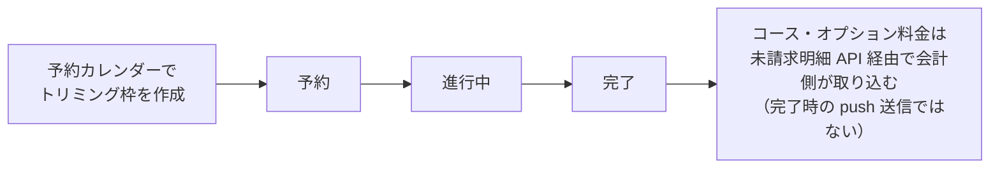

# トリミング一覧 仕様書 (Trimming List)

> 2026-10-15文書整理: 画面をまたぐ業務契約・受入条件は[領域正本](../domains/trimming/lifecycle.md)、型・保存／再送と現行差は[技術契約](../../design/domains/trimming/technical-spec.md)を参照する。以下の画面詳細は既存記載を継承（決定根拠・実装の全件再監査なし）、実機未実施。予約一覧対象としての存在と施術detailの作成済みを区別する。会計連携は未請求明細のpullで、施術完了時の会計push生成ではない。施術の完了と会計確定・入金は別結果。

[最新第5項合意](../domains/trimming/lifecycle.md#trimming-partial-save-undecided)では、担当・コース未定の途中保存が可能。保存済みの未定を架空の担当／コースで補完せず、同じ記録を再開する。以下の「進行中」表示や状態図だけで終了済みとせず、[終了条件の追加承認](../domains/trimming/lifecycle.md#trimming-end-recorded-performance)に従って実担当と記録済み施術内容を確認する。コースなしの既存オプション明細による終了も認める。実装適合は未確認。

## 概要
- **画面の目的**: 院内で実施されるトリミング施術の予約・実績・進捗管理。
- **URLパターン**: `/trimming`
- **アクセス権限**: `trimming` リソースの `view` 権限（`RequirePermission` + `ResourceTrimming` によるルートガード）。新規登録・編集・削除導線は `usePermission` で出し分け。

---

## 1. 画面構成

### 1.1 高機能検索・フィルタ (`PropertyFilter`)
- **施術日指定**: 施術が行われた、または予定されている期間での絞り込み。
- **ステータスフィルタ**: 「予約」「進行中」「完了」による進捗状況の抽出。
- **種指定**: 動物種による絞り込み。
- **全文検索**: 飼主名、ペット名、犬種キーワードによる検索。
- **トリマー指定**: 担当スタッフによる絞り込み。

### 1.2 施術管理テーブル (`DataTable`)
トリミング室の業務フローに最適化された情報表示。

| カラム | 説明 |
|:---|:---|
| **診療日** | 施術実施（予定）日。 |
| **飼主名** | オーナー名。 |
| **ペット名** | ペット名とペット番号。 |
| **種** | 動物種。 |
| **犬種** | 犬種。未登録時は「-」を表示。 |
| **体重** | 個体の体重。 |
| **スタイル希望** | 今回の主要な要望の抜粋。 |
| **担当** | 施術を担当するスタッフ名。 |
| **ステータス** | 進捗状況を示すカラーバッジ。 |
| **操作** | 行末ドロップダウン (`RowActionDropdown`)。編集・削除を各権限保持時のみ表示し、削除は確認ダイアログ (`ConfirmDialog`) を経由。 |

---

## 2. 主要な運営連携

- **予約管理との統合**: 予約カレンダー (`/reservations`) で作成されたトリミング枠は、自動的にこの一覧の「予約」ステータスとして出現します。
- **会計への連携**: [会議追加3](../domains/trimming/lifecycle.md#trimming-meeting-pricing-category)の保存済み料金手修正／値引きを含むコース・オプション料金は、会計作成時に「未請求明細」API（`billing_item_repository` がトリミング明細を UNION で統合取得）経由で会計側に取り込まれます。施術完了を契機に会計ドラフトを push 送信する仕組みではありません。

[会議追加2](../domains/trimming/lifecycle.md#trimming-meeting-start-end)では、施術開始後は受付の診療中列、専用画面の終了後は同じ予約の会計待ちへ進む。会計待ちカードから同じ既存記録を再表示でき、終了だけで記録・請求・入金を確定しない。

施術ステータスの流れと会計連携（下図は進捗の概略であり、記録確定／入金を表さない）：

---

## 3. 技術仕様

### 3.1 描画の最適化
- **遅延フィルタリング**: `useDeferredValue` により、多数の過去実績を検索する際も軽快な操作感を維持。 10/19後続承認の目標は検索ボタン適用後の結果を描画する方式。入力だけで検索を適用する旧挙動を継承しない。
- **透過インジケータ**: フィルタ処理中は `FilteringIndicator` により状態を通知。

### API連携
| メソッド | エンドポイント | 用途 | 必須権限 | 必須アクション |
|:---|:---|:---|:---|:---|
| GET | `/api/v1/trimmings` | 条件に応じた施術記録の一括取得 | `trimming` | `view` |
| DELETE | `/api/v1/trimmings/:id` | 施術記録の論理削除 | `trimming` | `delete` |

---

## 開始後・実施なし中止の表示

[追加合意](../domains/trimming/lifecycle.md#requirement-fr-trimming-zero-performance-abort)により、実施なしの中止は通常の施術完了と区別して同じ記録から確認できるようにする。上記の予約→進行中→完了の図は通常終了の概略で、中止を完了へ読み替えない。請求ありは会計待ち、請求なしは当該中止の新規請求を作らず中止で閉じる。中止理由・実施なし・選択結果を保持し、既存請求や他診療の会計導線を消さない。表示・フィルタの現行適合は未確認であり、新しい物理status値をこの文書から推定しない。

## 一覧条件の確定（2026-10-17）

[決定根拠・適用範囲](../domains/SPECIFICATION_PROGRESS.md#confirmed-business-decisions-20261017)：ユーザーの2026-10-16〜17 JSTの直接決定、文書更新承認は10月17日03:20 JST。以下は目標仕様・未実行の受入条件であり、実装・実機合格を示さない。

[一覧の共通正本・4受入条件](../shared/ui-contracts.md#list-filter-contract-20261017)へ従う。台帳・カルテ履歴の初回医院は権限内全医院で次回選択保持。日付付き通常業務6一覧はメニュー当日・詳細復帰で条件保持、行ペットはID指定・日付解除全期間・医院維持。入院ホテル／見積は当日初期化除外、受付は選択日、未納は繰越表示、台帳マスタは当日対象外。表示ページだけを全期間検索結果としない。

## Backlog原条文の補足受入条件

保存済み原Q/Aと既存業務契約の照合による補足。対応済みという旧回答は実装・実機検証の合格証明に用いない。後続の本人合意、医院scope、権限、履歴・会計訂正の既存条件を維持する。

### 一覧表示／検索

| 条件ID | 受入条件 | 根拠 | 検証状態 |
|:---|:---|:---|:---|
| AC-trimming-list-breed-display-search | 登録済み犬種の異なるペットの施術記録がある／一覧で犬種を参照し犬種で検索する／犬種列を確認でき、既存検索方式に従って該当記録を絞り込める。 | Phase1 F34:G34 | 未実施 |

## 指定日のトリミング予約表の印刷（2026-10-17承認）

指定した1日分のトリミング予約を、担当者別に確認できる形で印刷できるようにする。掲載する項目は「開始・終了時刻、担当者、飼主名、ペット名、コース、追加オプション」に、[13:18:27 UTC承認の状態表示](#trimming-daily-print-states-20261017)を加える。予約表の開始・終了は予約予定時刻として扱い、施術の実開始／実終了や会計日時へ読み替えない。画面の複数日期間検索と、今回の指定1日分の印刷範囲は区別する。

根拠は質問Sentinel_8bc8010c2968819198ae4dab99817e09への本人Sentinel_4696427f469c8191b4a1af5680bc5fdfの2026-10-17 12:40:29 UTC「おけ」。[旧公式マニュアルp.17](https://j-jp.jp/~yoyaku/admin/documents/manual.pdf#page=17)の印刷対応は機能存在の参照であり、掲載項目やレイアウトを旧資料が規定していたとはしない。指定1日・担当者別確認・今回の掲載項目は今回本人の新システム採用として管理する。旧資料の参照は親側の確認結果に基づき、MacでのPDF全文独立照合済みとはしない。

医院scopeと既存の予約／トリミング情報の参照権限を維持し、印刷を認可外の医院・飼主・ペット情報を取得する経路にしない。担当・コース未定等の既存保存状態を、印刷のために架空の担当・コース・オプションで補完しない。印刷によって予約、施術記録、開始／終了状態、料金、会計、時間snapshotを変更しない。

用紙サイズ・向き、具体的な配置・改ページ・担当未定の配置、印刷入口・生成／保存方式は別途具体化する。月次／複数日印刷や診療・ホテルへの拡張を今回確定せず、旧マニュアルだけでこれらを採用しない。

| 条件ID | 前提／操作 | 期待結果 | 検証状態 |
|:---|:---|:---|:---|
| AC-trimming-one-day-reservation-print | 権限内の医院に複数日・複数担当のトリミング予約があり、1日を指定して印刷する | 指定1日分を対象とし、担当者別に予約を確認できる。複数日検索結果をそのまま月次印刷へ拡張しない | 未実施 |
| AC-trimming-reservation-print-approved-fields | 異なる飼主・ペット・コース・追加オプションのある予約表を確認する | 開始・終了予定時刻、担当者、飼主名、ペット名、コース、追加オプションと後続承認の状態を確認できる。未定値を架空情報で補完せず、実施時刻や請求項目で代用しない | 未実施 |
| AC-trimming-reservation-print-read-boundary | 指定日印刷の対象医院・参照権限と、印刷前後の保存済み状態を確認する | 認可範囲の情報だけを扱い、印刷で予約・施術・会計・時間snapshot等を更新しない。診療／ホテル印刷や用紙仕様をこの条件で追加承認したとはしない | 未実施 |

### 日次トリミング予約表の対象状態と担当者未定

質問Sentinel_4532889093e881918890010a3d9d2424に対する本人Sentinel_9e274b9c467481919d8d06212935f792の2026-10-17 13:18:27 UTC「ok」を根拠に、指定日の日次トリミング予約表だけへ次を適用する。

| 保存済み状態・条件 | 日次予約表での扱い |
|:---|:---|
| キャンセル済み | 印刷対象から除外する |
| 無断キャンセル扱い・未来院（既存のno_show） | 印刷対象から除外する。単にまだ受付していないことを未来院扱いにしない |
| 予約確定などの有効な未受付予約 | 印刷対象に残し、既存の状態を表示する |
| 受付済み | 印刷対象に残し、状態を表示する |
| 施術中（予約主経路の診療中に対応） | 印刷対象に残し、状態を表示する |
| 施術完了・会計待ち・完了の既存有効予約 | 印刷対象に残し、状態を表示する。施術完了と会計／入金完了は同一状態に変換しない |
| 担当者未定 | 上記の対象状態なら除外せず、「担当者未定」として掲載する。仮候補や別スタッフ名で埋めない |

[既存の予約状態](../domains/reservations/pages/reservation-management.md)の主経路と、[手動未来院・再受付](../workflows/reservation-to-record-flow.md#requirement-fr-reservations-manual-no-show)に照合する。予約確定→受付済→診療中→会計待ち→完了という既存の区別を維持し、施術中／施術完了はトリミング専用記録の事実と予約の状態を照合して表示する。未来院の自動判定を新設せず、時間経過・未受付・未会計という理由で印刷対象から落とさない。「次回予定・未予約」を印刷のために確定済み予約へ変換しない。

未来院が通常予約カレンダーで表示される既存契約と、今回の日次トリミング印刷で除外する契約は適用先を区別する。印刷対象外にする操作は予約取消・未来院化・記録削除ではなく、保存済み状態を変更しない。診療・ホテルの一覧／印刷や月次印刷へ一律に適用しない。

| 条件ID | 前提／操作 | 期待結果 | 検証状態 |
|:---|:---|:---|:---|
| AC-trimming-print-exclude-cancel-no-show | 指定日にキャンセル済み・既に未来院/no_showとして保存された予約と、有効未受付予約がある | 前2者は印刷対象外、有効未受付予約は掲載する。未受付や時間経過を新たなno_show判定にせず、保存状態や通常予約カレンダーを変更しない | 未実施 |
| AC-trimming-print-include-active-completed-states | 指定日に有効な未受付・受付済み・施術中・施術完了後の会計待ち・完了の予約がある | 各対象を掲載して状態を表示する。施術完了と会計／入金完了を混同せず、未会計という理由で完了施術を落とさない | 未実施 |
| AC-trimming-print-unassigned-staff | 印刷対象状態の担当未定予約と、対象外状態の担当未定予約がある | 対象予約は「担当者未定」として掲載し仮担当を補わない。担当未定だけで除外せず、取消等の対象外条件を逆に解除もしない | 未実施 |

## 10/19後続承認：同種操作・検索ボタン方式

本画面の既存キーワード欄は[適用台帳 L06](../shared/interaction-scope.md)と[共通FR/8AC](../shared/ui-contracts.md#interaction-consistency-20261019)へ従う。入力中/適用済みを分け、入力/待機/消去だけでは検索せず検索ボタンで適用。既存の明示リセット、独立filter、詳細復帰、認可・検索対象・取得上限/ページ内制限を保持し、全件検索や一律の保存方式へ変えない。取得中/0件/失敗と遅延応答を分け、検索で選択/保存/コピー/送信を確定しない。旧defer/debounceの記載は入力即適用の目標に用いず、適用後の描画最適化と区別する。[S14手順](../../ops/testing/scenarios/S14-search-and-multi-word.md#cross-ui-search-20261019)を各対象IDで実施する受入条件とし、実装適合・実機は未確認。
