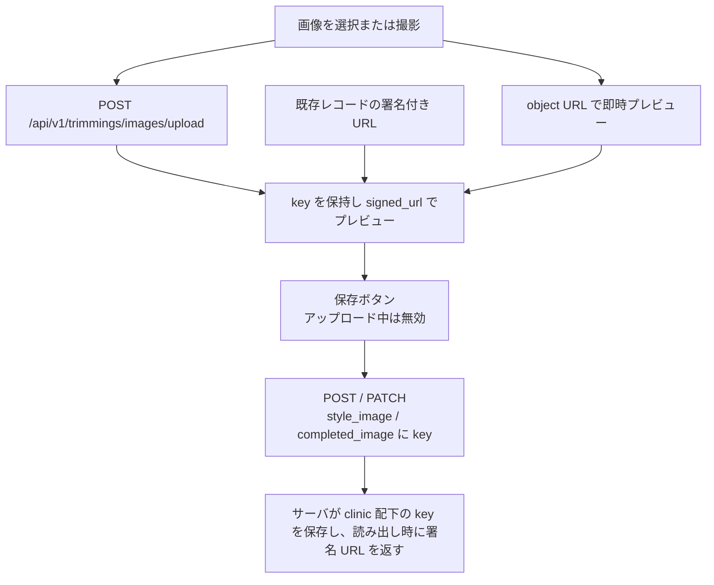

# トリミング登録/編集 仕様書 (Trimming Form)

> 最新保持方針: 保存済み原画像・添付、参照済みkey、業務原本／必要履歴か分類不明の画像はC05の原本保持対象とし、通常削除・clear・置換・取消でblobを物理削除しない。通常操作は論理削除／非表示とし元参照・必要監査を保持する。未保存かつ未送信の放棄作業copyと区別し、分類不明は保護する。物理削除は承認された別手続へ委ね、本整理から新しい例外や保存年限を推定しない。
> 2026-10-15文書整理: 画面をまたぐ業務契約・受入条件は[領域正本](../domains/trimming/lifecycle.md)、型・保存／再送と現行差は[技術契約](../../design/domains/trimming/technical-spec.md)を参照する。以下の画面詳細は既存記載を継承（決定根拠・実装の全件再監査なし）、実機未実施。担当医という現行ラベル／doctor_id列名は業務上のトリマーと区別する。施術保存と画像upload、record削除とstorage cleanupは別結果。完了後の原記録保持・理由付き専用訂正は追加承認済み。自動返金・在庫巻戻しは行わず、通常PATCH／DELETEを専用訂正の実装済み証拠としない。

## 概要
- **画面の目的**: トリミング施術の詳細（コース、オプション、カットスタイル、身体状態）の記録。画像欄は選択・撮影直後に `POST /api/v1/trimmings/images/upload` へアップロードされ、返却 object key が `style_image` / `completed_image` として保存 request で永続化される（§1.2）。
- **URLパターン**: 
  - 新規作成: `/trimming/new?petId=xxx`
  - 編集: `/trimming/:id`
- **アクセス権限**: `trimming` リソースの `view` 権限保有者（ルート単位で `RequirePermission` によりブロック。新規作成ルートは `create` 権限が必要）

診察カルテとの入力1画面化は未実装。[#242](https://github.com/MinoruSoga/AnimalEkarte/issues/242) は PO の「着手しない」判断で Closed。診察・トリミングの入力画面は分離したまま、同一ペットの未請求明細を会計側で集約する。

---

## 1. 画面構成

### 1.0 患者ヘッダー
- **`PatientInfoCard`**: 飼主名・ペット名・ペット番号・体重・担当（`staffLabel=担当医`）・予約区分（トリミング）・`formatPatientPetDetails` のペット詳細・保険情報を表示。特記マーク（EMR-173/231、共有 `DangerBadge`）: ペット名横に `danger_level` 高=赤い八角形アイコン・中=黄い三角形アイコン（文言なし、Popover で補足メモ）、低・未設定は非表示。飼主 `is_dangerous` は飼主名横に文言なしの赤い八角形アイコン（代替名「特記」）。施術・保定前の安全確認用。

### 1.1 施術・スタイル設定 (Main Info)
- **未定の途中保存**: [最新第5項合意](../domains/trimming/lifecycle.md#trimming-partial-save-undecided)により、担当のみ・コースのみ・両方未定でも途中保存して再表示できる。未定を架空の担当・コースで補完せず、同じ記録の入力を続ける。終了時は別の[追加承認](../domains/trimming/lifecycle.md#trimming-end-recorded-performance)に従い、実担当と記録済み施術内容を確認する。コース未選択でも既存オプション等の施術明細があれば終了できる。実装適合は未確認。
- **登録時ステータス**: 新規作成時のみ表示（既存予約に紐付く登録では非表示）。「進行中」（デフォルト）/「予約」を選択（#233）。
- **record_shortcut 既定時刻**: 予約に紐づかない新規登録は `defaultRecordShortcutTimes` が JST の現在時刻（秒・ミリ秒込み）を使う。固定 10:00 は使わない（`uk_appointment_staff_time` で同スタッフ同日が 409 になるため）。同一スタッフが同日に複数ペットを登録できる。
- **コース選択**: シャンプー、カット等の基本メニュー（マスタ連動、参照価格と今回の料金調整を区別して表示。§2.1）。
- **オプション**: 薬用、歯磨き等の追加メニューの複数選択（参照価格と今回の料金調整を区別。§2.1）。
- 無効化されたコース・オプションは選択肢から除外。ただし編集中の記録に既に紐づく無効項目のみ「（無効）」表記で選択肢に維持する（#228）。
- **スタイル要望**: 飼主からの具体的な指示内容。
- **身体状態**: 体重 (BW / Kg・g切替) と体温 (BT)。
- **使用シャンプー・使用リボン**: 施術で使用した製品名の記録。
- **備考**: 自由入力メモ。

### 1.2 画像管理
- **希望スタイル画像・完成画像**: ファイルを選択するか、`TrimmingImageUploadField` の「撮影」で背面カメラを起動する（隠し input の `capture="environment"`）。選択直後にローカルの object URL で即時プレビューし、並行して `useTrimmingFormImages` が `uploadTrimmingImage` で `POST /api/v1/trimmings/images/upload` を呼ぶ。返った object key をフォームへ入れ、プレビューは返った `signed_url`（空ならローカル URL のまま）へ切り替える。既存レコードの署名付き URL があれば再表示する。
- **アップロード中の保存ブロック**: いずれかの画像アップロードが in-flight の間は保存ボタンを無効化し「画像アップロード中...」と表示する。保存リクエスト送信中も画像操作を含むフォーム操作を無効化する（送信済みペイロードとフォーム状態の乖離を防ぐ）。画像の選択・削除は未保存変更として dirty に記録され、離脱ガード（§2.3）の対象になる。
- **保存**: `buildCreateTrimmingRequest` / `buildUpdateTrimmingRequest` は、画像を変更したときだけ `style_image` / `completed_image` に object key を載せる。未変更の再保存ではそのフィールドを省く。明示的な削除は空文字を送る。署名 URL は保存しない。アップロード失敗は toast を出し、直前の key とプレビューは残す。
- **未保存アップロードの掃除**: 選択の置き換え・削除・遅延解決・フォーム放棄でレコードに永続化されなくなったアップロード済みオブジェクトは `DELETE /api/v1/trimmings/images` で best-effort 削除する（失敗時は孤立オブジェクトが残るのみで通知しない）。レコード参照が残るキーは 409 で拒否される。保存リクエストに含めたキーは送信時点でサーバー側の所有物とみなし、クライアントは以後削除しない（commit 済みレコードの参照を壊さないため）。永続化済みフィールドの削除は PATCH/DELETE の superseded 処理が担う。
- **画像キーと旧値の境界**: 新しい保存・削除は対象医院の正規キー `trimming-images/<clinic_id>/<name>` を要求し、`./`・重複 `/`・末尾 `/`・バックスラッシュ・`..` 等の別名や他医院のキーを拒否する。ローカルの `/uploads/` 包装は正規キーへ解決する。既存の HTTP(S) 値は未変更なら表示互換のため保持するが、ホストを検証できないので内部オブジェクトとみなさず署名・掃除の対象にしない。旧パス別名が参照保護に使われる場合も、ストレージ削除先を正規化して別オブジェクトへ置き換えない。表示用の署名 URL は DB に保存しない。
- **保存と削除の競合保護**: 保存 transaction は booking/appointment lock の後に、最終画像 key の advisory lock を昇順で取得し、削除台帳にないことを確認して commit まで保持する。掃除は画像 key lock のみを使い、最新の全参照を確認して `trimming_image_deletions` に永久 tombstone を commit した後、DB transaction の外で storage を削除する。PATCH の掃除では自レコードも参照対象とし、DELETE は削除 transaction 内で取得した最新画像を対象にする。共有 key は参照が残る間保持する。削除が先行した key の保存は 409 とし、再アップロードが必要。
- **削除失敗と記録**: storage 削除に失敗しても tombstone は保持し、新規参照を拒否する。同じ key の画像 DELETE で storage 削除を再試行できる。既存レコードの clinical 変更は `audit_logs`、画像の削除予約は専用 sink `trimming_image_deletions`（clinic/key/最初の staff/時刻）が正本で、tombstone に削除期限・soft-delete は設けない。`035_trimming_image_storage_retry` は同表へ最終試行（`last_attempt_at`）と storage 削除完了（`storage_deleted_at`）を追加し、`TRIMMING_IMAGE_CLEANUP_ENABLED=true` の環境でのみ起動する retry worker が pending 行を画像 key lock 直下で冪等に再削除する（5分間隔で起動・1 run 120秒上限・key あたり 10秒上限・run ごと最大100医院・選択 key 合計100件まで）。worker の provider 呼び出しは key lock 内の独立 transaction で実行し、直接 postcommit の storage 削除は DB transaction の外で行う。worker は既定で停止しており、手動 `DELETE /api/v1/trimmings/images` が fallback として残る。完了記録は worker run に遅延する（delayed acknowledgement）ため、完了前の二重削除呼び出しは冪等に吸収され、完了済み tombstone も引き続き参照を拒否する。storage 失敗は構造化 warning として記録する。診療画像の削除台帳は別契約のため流用しない。

画像選択から保存までの扱い：

### 1.3 過去履歴の参照と引用 (History Sync)
- **履歴パネル**: 画面右側に同ペットの過去の施術記録を表示。
- **コピー機能**: 履歴カードをクリックすると、コース・オプション・スタイル要望・使用シャンプー/リボン・備考・前回の担当者名（表示のみ）を現在のフォームへ一括反映。担当者 ID・体重・体温・画像・日付・ステータスはコピーしない。担当未定の途中保存が可能で、前回担当名を今回担当の確定選択に置き換えない。常連顧客の再オーダーの手間を削減します。

---

## 2. 主要な運営機能

### 2.1 料金表示・手修正・値引き
[会議追加3](../domains/trimming/lifecycle.md#trimming-meeting-pricing-category)により、コース・オプションのマスタ料金を参照表示し、今回の施術料金の手修正・値引きを入力して保存できるようにする。元値と調整値・値引き条件／対象scopeを区別し、同じ施術の未請求明細へ会計引継ぎする。個別調整でマスタ価格を変えず、会計追加後のsnapshot／手修正を後追い自動上書きしない。確定済み請求はD10の訂正／取消・再請求へ渡す。

D10の税抜計算・税込表示、明細→全体、同scope割合合算→金額、丸め・超過警告・0円下限を維持し、調整後単価と同じ値引きの二重適用を防ぐ。コース／オプションの対象行を明示して値引きを入力し、D10の明細scopeへ渡す。会計全体値引きはD10の会計側で確認して扱い、同じ行値引きを全体へ複製しない。追加後の変更は差分表示・対象を確認した明示再適用・現在版／状態の再検査を通し、自動同期にしない。新しいscope・初期値・計算順を設けない。表示上の税込額から保存根拠を推測せず、未定のコースへ架空料金を付けない。現行のマスタ価格表示だけではこの合意への適合を確認できず、UI／API・保存形式・実機受入は未確認。

### 2.1.1 施術開始・終了と既存記録への戻り
[会議追加2](../domains/trimming/lifecycle.md#trimming-meeting-start-end)に従い、開始成功後は同じ予約を受付の診療中列へ表示する。専用トリミング画面に明示終了操作を設け、成功後に会計待ちへ進める。終了だけで本文の保存／記録確定・請求確定・入金を行わず、保存と終了の結果を分ける。未保存入力を保持し、終了失敗・競合・結果不明から記録再作成・自動Undoを行わない。

会計待ちカードからは同じ予約に明示linkedされた既存の本画面を開く。new経路や施術開始を発火せず、参照なし／取得失敗／権限不足は確認・再取得へ渡す。既存grantと版・会計境界は維持し、終了時には実担当と今回行った施術内容の記録を確認する。実担当未定・内容未記録・取得不明は該当欄を示して止め、保存済み版を確認後に終了する。入力者・前回担当名・予約仮候補の転記で実担当を埋めず、未保存／保存結果不明を記録済みとしない。コースなしの既存オプション明細は認め、自由入力明細や料金必須を追加しない。予約リンクなし／不明はownerの対象確認へ止め、架空予約を作らない。通常カルテの自動保存と治療プラン未実施警告はD03の最新合意であり、本画面へ新しい完了条件として流用しない。

### 2.2 気づきの記録
トリミング中に発見した皮膚の異常等は「備考」欄に記録できます。

### 2.3 保存条件と離脱時の保護

- 終了validationは実担当と記録済み施術内容を確認するが、途中保存・開始へ新しい担当gateを遡って適用しない。コース未選択自体を終了エラーにしない。版競合では入力を保持し、終了状態だけを先に変更しない。
- 途中保存ではペットとトリミング予約区分を確認し、区分を解決できなければ送信せず該当欄にエラーを表示する。担当者・コース未定だけを保存拒否にしない。旧新規フォームの両項目必須は解消対象の実装差。既存更新に新規用validationをそのまま再実行せず、医院／患者・状態・認可の既存保護は維持する。後から指定する担当・コースは既存の適格性・有効マスタ条件へ従う。
- 現行通常画面は死亡ペットの保存・削除を拒否する。[最新合意](../domains/trimming/lifecycle.md#requirement-fr-trimming-safety-and-status)では生前分の後日入力・誤記訂正を死亡状態を戻さず理由・履歴付き専用経路で可能にする。新たな予約／施術は許可せず、専用経路の実装適合は未確認。編集時はペット情報の取得が完了するまで保存・削除を無効化し、各操作の権限も確認する。
- 未保存変更がある状態で画面を離れる際は確認を表示する（保存中を除く）。画像の選択・削除のみの変更も未保存変更に含む。

---

## 3. 技術仕様

### 3.1 構成コンポーネント
- **`TrimmingForm`**: 統合フォーム。
- **`TrimmingLeftColumn`/`TrimmingMiddleColumn`**: コース・オプション・スタイル要望・身体状態等の入力欄。
- **`TrimmingRightColumn`**: 過去履歴パネル。クリックで過去データを現在のフォームへマージ。
- **`TrimmingImageUploadField`**: 希望スタイル画像・完成画像のファイル選択、`capture="environment"` の撮影ボタン、プレビューと削除。永続化は §1.2。

### API連携
| メソッド | エンドポイント | 用途 | 必須権限 | 必須アクション |
|:---|:---|:---|:---|:---|
| GET | `/api/v1/trimmings/:id` | 施術詳細および画像 URL の取得 | `trimming` | `view` |
| POST | `/api/v1/trimmings/images/upload` | 画像を先にアップロードし object key と署名 URL を返す | `trimming` | `create` または `edit` |
| DELETE | `/api/v1/trimmings/images` | 未保存のまま残ったアップロード済みオブジェクトの掃除 | `trimming` | `create` または `edit` |
| POST | `/api/v1/trimmings` | 新規保存。変更した画像は `style_image` / `completed_image` に key を載せる | `trimming` | `create` |
| PATCH | `/api/v1/trimmings/:id` | 内容の更新 | `trimming` | `edit` |
| GET | `/api/v1/trimmings` | 過去のカット履歴の取得（クエリパラメータ: `pet_id=xxx`） | `trimming` | `view` |
| DELETE | `/api/v1/trimmings/:id` | 記録の削除（編集画面のみ、`delete` 権限保有者にヘッダーの削除ボタンを表示） | `trimming` | `delete` |

---

