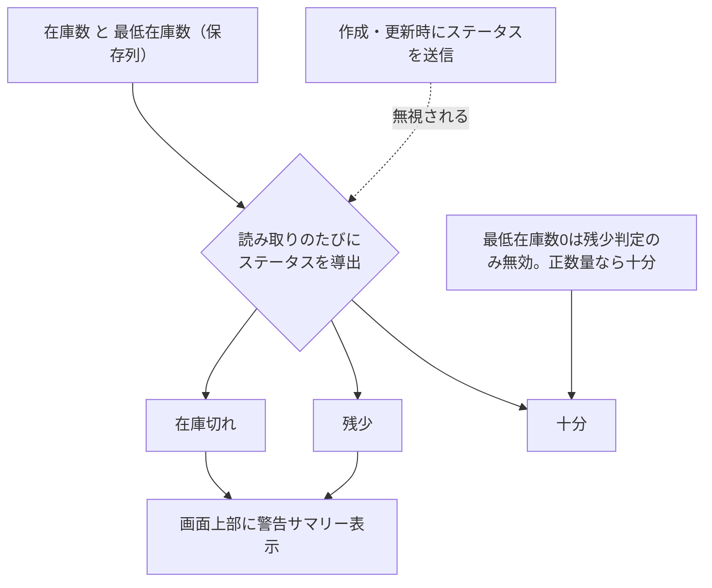

# 在庫管理一覧 仕様書 (Inventory List)

| 管理項目 | 記載 |
|:---|:---|
| 文書ID・種別 | page.inventory.list／画面仕様 |
| 決定状態 | 既存記載を継承（決定根拠未確認の部分を含む）。I1の目標は依頼者2026-10-15承認（Sentinel_7a67fd30e47c819192cd36d416f0a2bf）。既存詳細全体の再承認ではない。 |
| 実装状態 | 現行差を分離。今回実装変更・網羅監査なし |
| 実機検証状態 | 未実施。受入条件は検査定義 |
| 文書確認日 | 2026-10-20 |
## 業務正本と現在の説明範囲

[業務契約・FR／受入条件・例外・未決](../domains/inventory/business-rules.md)。数量由来の状態とページ内検索を保持。臨床／会計訂正から自動巻戻しせず、在庫側の確認結果を区別する。

## 概要
- **画面の目的**: 院内で使用・販売する医薬品、フード、備品等の在庫状況の監視と、適切な発注タイミングの把握。
- **URLパターン**: `/inventory`
- **アクセス権限**: `ResourceInventory` の **`view`**（`RequirePermission`）

---

## 1. 画面構成

### 1.1 在庫アラートパネル
ステータスが「在庫切れ」または「残少」の品目がある場合、画面上部に警告サマリーが表示されます。
- **視覚的強調**: `AlertTriangle` アイコンと共に、緊急対応が必要な件数を一目で確認可能。

### 1.2 高度な検索・フィルタ (`PropertyFilter`)
- **状態・カテゴリ**: `is` 一致はサーバ。`is_not` は取得済みページ内。
- **全文検索・ソート**: 品名・保管場所・仕入先は現在ページ内。一覧はサーバ page（既定 20）。複数ページ時は「検索・並び替えは現在表示中のページ内のみ」バナーを出す。

### 1.3 在庫状況テーブル (`DataTable`)
| カラム | 説明 |
|:---|:---|
| **品名** | 商品名または薬品名。 |
| **カテゴリ** | 医薬品・消耗品・フード・その他の固定分類。 |
| **在庫数 / 単位** | 現在の理論在庫数と単位。 |
| **最低在庫数** | 発注の目安となる閾値。0は残少閾値未設定。数量が正なら十分だが、数量0は在庫切れ。 |
| **保管場所** | 院内のどの棚・冷蔵庫にあるかの記録。 |
| **有効期限** | 医薬品等の使用期限管理（期限間近の把握に利用）。 |
| **ステータス** | 十分・残少・在庫切れを示すカラーバッジ。**保存値ではなく読み取りのたびに在庫数と最低在庫数から導出される**（旧決裁 SD-4。実装は `backend/internal/inventory/`）。作成・更新時にステータスを明示送信しても無視される。状態フィルタも保存列でなく在庫数/最低在庫数の導出条件で絞り込む。 |
| **操作** | 品名リンクで詳細へ遷移。`inventory` の `edit` 権限がある場合は操作列にも編集ボタンを表示。 |

ステータスの導出とアラート表示：

---

## 2. 技術仕様

### 2.1 描画の最適化
- **遅延フィルタリング**: `useDeferredValue` は現在ページ内の検索に使う。全件クライアント絞り込みではない。 10/19後続承認の目標は検索ボタン適用後の結果を描画する方式。入力だけで検索を適用する旧挙動を継承しない。

### API連携
| メソッド | エンドポイント | 用途 | 必須権限 | 必須アクション |
|:---|:---|:---|:---|:---|
| GET | `/api/v1/inventory` | 条件に応じた在庫一覧の取得 | `inventory` | `view` |
| DELETE | `/api/v1/inventory/:id` | 在庫品目の論理削除（バックエンドには実装済みだが、`InventoryList`/`InventoryForm` に削除UIは未実装のため現状フロントエンドから未呼出） | `inventory` | `delete` |

---

## カルテ訂正からの影響確認

[カルテ追加合意](../domains/medical-records/pages/medical-record-form.md#requirement-fr-medical-records-correction-owner-impact)では、訂正だけで在庫を自動増減せず、影響を表示して在庫側の訂正操作へ案内する。元記録／項目・訂正履歴・関連在庫ID／現在版を照合し、案内や臨床訂正成功を在庫変更成功とみなさない。増減・実績取消・返却等は[在庫業務正本](../domains/inventory/business-rules.md#requirement-fr-inventory-adjustment)の決定状態に従い、カルテ文書だけで新しい増減や権限を認めない。対応不明は影響なしへ置換せずowner確認へ残す。

### 通常治療createの副作用との分離

[全writer参加表](../../design/domains/medical-records/technical-spec.md#medical-record-writer-matrix)で、旧通常治療createはinventory ID指定時に在庫減算することを静的確認した。これは[最新の担当スタッフによる実施／引渡し時出庫確定](../domains/inventory/business-rules.md#inventory-outflow-confirmation-20261020)に対する実装差で、カルテ保存だけの減算を目標や適合済みとしない。患者転記／過去入力／カルテ訂正の保存をこの入口へ無条件流用しない。[専用intent](../../design/domains/medical-records/technical-spec.md#medical-record-legacy-and-special-contract)は歴史的記録と新しい在庫実績を分離し、影響表示・関連inventory ID／現在版・元訂正ref・理由を在庫ownerへ渡す。実増減・返却・取消の内部ルールとreceiptはD13で確認し、今回新しい増減を確定しない。

## 10/19後続承認：同種操作・検索ボタン方式

本画面の既存キーワード欄は[適用台帳 L08](../shared/interaction-scope.md)と[共通FR/8AC](../shared/ui-contracts.md#interaction-consistency-20261019)へ従う。入力中/適用済みを分け、入力/待機/消去だけでは検索せず検索ボタンで適用。既存の明示リセット、独立filter、詳細復帰、認可・検索対象・取得上限/ページ内制限を保持し、全件検索や一律の保存方式へ変えない。取得中/0件/失敗と遅延応答を分け、検索で選択/保存/コピー/送信を確定しない。旧defer/debounceの記載は入力即適用の目標に用いず、適用後の描画最適化と区別する。[S14手順](../../ops/testing/scenarios/S14-search-and-multi-word.md#cross-ui-search-20261019)を各対象IDで実施する受入条件とし、実装適合・実機は未確認。
