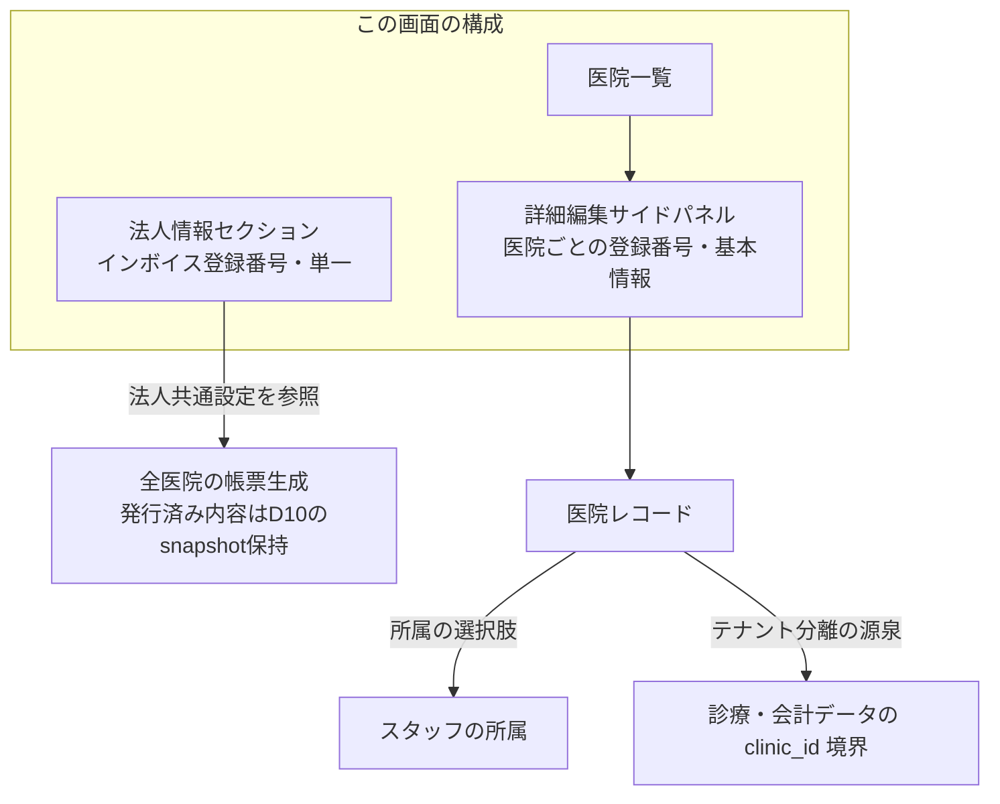

# 医院マスタ設定 仕様書 (Clinic Master Settings)

## 概要
- **画面の目的**: システムを利用する各医院（本院・分院）の基本情報、連絡先、およびインボイス制度に対応した各種パラメータの一元管理。
- **URLパターン**: `/settings/clinic`
- **アクセス権限**: 医院管理者権限が必要（`ResourceHospitalSettings`）

---

## 1. 画面構成

### 1.1 医院一覧テーブル
登録されている全医院のリスト。
- **表示項目**: 院名、電話番号、メール、ステータス。

### 1.2 詳細編集サイドパネル (`ClinicMasterSidePanel`)
- **基本情報**: 院名、ステータス（有効/無効）、郵便番号、住所、電話/FAX番号、登録番号、院長名、メール、Webサイト。
- **消費税率**: 通常課税・軽減税率の定義。
- **明細兼領収書設定**: ロゴ表示・登録番号警告・項目カテゴリ・各セクション（医院情報ヘッダー／飼主・ペット情報／明細テーブル／お会計サマリー）の表示可否をトグルで切替。セクション表示順の並べ替えとフッター文言の編集も可能（ロゴ画像自体のアップロード機能はこの画面には無い）。

### 1.3 法人情報セクション (`CompanyInvoiceSection`)
- 医院一覧の上部に表示される、法人（シングルトン、`companies` テーブル）のインボイス登録番号のみを編集する小セクション。
- 医院（`Clinic`）ごとの「登録番号」（1.2）とは別エンティティ。法人単位でインボイス発行事業者登録番号を1つだけ保持する。
- 法人共通設定として全医院から参照する。発行済み会計伝票・領収書の保存内容を設定保存だけで書き換えず、過去帳票・再印刷は[D10の会計時点snapshot](../domains/accounting/lifecycle.md#requirement-fr-accounting-calculation-snapshot)と既決の訂正手順へ従う。新しい設定の参照と発行済み原本の保持を区別する。

---

## 2. 主要な運営機能

### 2.1 マルチテナントの核
ここで定義された各医院が、スタッフの「所属」の選択肢となり、全ての診療・会計データの論理的なテナント分離境界（`clinic_id`）の源泉となります。

### 2.2 帳票の適格性保証
帳票生成で使う所在地、代表者名、インボイス番号は、医院固有情報と法人共通情報を区別して参照します。採用値と発行済み内容の再現・訂正は[D10正本](../domains/accounting/lifecycle.md#requirement-fr-accounting-calculation-snapshot)へ従い、基本情報や法人設定の変更で過去帳票を自動再解釈しません。

---

## 3. 技術仕様

### 使用コンポーネント
- **`ClinicMasterSettings`**: メインページ。
- **`ClinicMasterList`**: 医院一覧テーブル（`topSection` に `CompanyInvoiceSection` を差し込む）。
- **`ClinicMasterSidePanel`**: コンテキストを維持した詳細編集パネル。
- **`CompanyInvoiceSection`**: 法人（`Company` シングルトン）のインボイス登録番号編集セクション。`useGetCompany` / `useUpdateCompany`（`frontend/src/features/master`）を使用。

### API連携
| メソッド | エンドポイント | 用途 | 必須権限 | 必須アクション |
|:---|:---|:---|:---|:---|
| GET | `/api/v1/clinics` | 医院一覧取得（`scope=all` 指定でも非システム管理者は所属医院のみ。システム管理者は全院一覧。認可正本 `docs/architecture/auth.md` §4.10に従い、詳細パネルも一覧データから参照） | `hospital-settings` | `view` |
| POST | `/api/v1/clinics` | 新規医院の開設 | `hospital-settings` | `create` |
| PATCH | `/api/v1/clinics/:clinic_id` | 医院情報の更新 | `hospital-settings` | `edit` |
| DELETE | `/api/v1/clinics/:clinic_id` | 医院情報の削除（物理削除。参照中のデータが残る場合は 409 で拒否） | `hospital-settings` | `delete` |
| GET | `/api/v1/company` | 法人情報取得（インボイス登録番号を含む） | `hospital-settings` | `view` |
| PATCH | `/api/v1/company` | 法人情報の部分更新（本画面ではインボイス登録番号のみ編集可能） | `hospital-settings` | `edit` |

---

## 2026-10-17確定仕様との接続

[決定根拠・適用範囲](../domains/SPECIFICATION_PROGRESS.md#confirmed-business-decisions-20261017)：ユーザーの2026-10-16〜17 JSTの直接決定、文書更新承認は10月17日03:20 JST。以下は目標仕様・未実行の受入条件であり、実装・実機合格を示さない。

[業務正本・受入条件](../domains/owners-pets/lifecycle.md#common-owner-pet-20261017)。氏名または動物種＋ペット名の候補をスタッフ確認し、同一飼主は警告して新規停止、別人は可、新ペットは既存飼主へ追加する。他院既存患者の自院利用と共通最新基本情報を採用し、院別診療・金銭記録と認可は維持する。旧他院行／ID一律拒否を自院利用へ機械適用しない。共有ID・既存重複移行・link/unlink方式は未選定で、重複作成を自院利用条件にしない。
