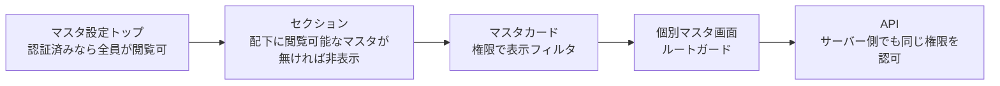

# マスタ設定トップ 仕様書 (Master Settings Index)

| 管理項目 | 記載 |
|:---|:---|
| 文書ID・種別 | page.settings.master-index／画面仕様 |
| 決定状態 | 既存本文は継承（決定根拠未確認）。第六群の合意と未決は下記正本へ |
| 実装状態 | 既存記載を継承。今回の目標機能／認可適合は未確認 |
| 実機検証状態 | 未実施 |
| 文書確認日 | 2026-10-15 |

### 会計第六群との対応

[第六群の業務正本](../domains/accounting/lifecycle.md#accounting-agreement-sixth)と[マスタ変更権限](../domains/accounting/lifecycle.md#requirement-fr-accounting-master-authorized-maintenance)へ従う。価格・割引・保険・支払方法の変更者は管理者と対象変更権限付きスタッフ。ポータル閲覧可能と編集可能を同一視しない。 全スタッフに変更を開放せず、対象grant・医院scopeを検査する。今回、実権限・設定・API／DBは変更していない。詳細な[現行mapping](../../design/domains/accounting/technical-spec.md#accounting-master-permission-map)は技術仕様へ。

## 概要
- **画面の目的**: 診療、トリミング、入院、スタッフ、権限、および外部連携など、システム全体で共通利用される定義データ（マスタ）を一元的に管理するポータル。
- **URLパターン**: `/settings` (トップ)
- **アクセス権限**: `/settings` トップに `RequirePermission` 無し（認証 Layout）。各カードは resource で表示フィルタ、遷移先は個別ガード

---

## 画面構成

### セクション別マスタ一覧
管理対象を 8 つの論理的なセクションに分類し、直感的なアクセスを実現しています。

> 追記（2026-10-07 監査）: 各マスタの詳細仕様インデックス（doc-index）の正本は [settings/README.md](./settings/README.md)。本節は `/settings` ポータル画面のセクション構成（画面カードの UI composition）の記録に限定し、マスタ単位の文書リンクの二重管理をやめた（screens/CLAUDE.md 二重管理禁止）。下表のリンクはマスタ名の平文表記に置き換え、固有の画面経路・権限の記載のみ保持する。

| セクション名 | 管理対象（画面カード構成） |
|:---|:---|
| **基本設定** | 医院情報（詳細: [19-clinic-settings.md](./19-clinic-settings.md)）、動物種類マスタ |
| **カルテ** | 診療項目、検査マスタ（診療項目の検査タブ。サイドバー「マスタ設定」→「カルテ関連」→「検査マスタ」。`/settings/treatment-items?tab=examination`）、診断マスタ、問診テンプレート、主訴種別、薬剤マスタ、検査機器マスタ（サイドバー「マスタ設定」→「カルテ関連」→「検査機器マスタ」。`/settings/lab-device-item-masters`。機器名と検査種別は `lab_devices`。登録は `lab-import:create`、編集は `lab-import:edit`。日常の送信画面には出さない） |
| **予約管理マスタ** | 予約区分マスタ |
| **入院・ケージ管理** | 入院プラン、ケージマスタ |
| **トリミング関連** | トリミングマスタ、トリミングコース種別 |
| **会計・商品** | 商品マスタ、保険マスタ、支払方法、割引キャンペーン、締め時間設定 |
| **スタッフ・権限** | スタッフ管理、職種マスタ、権限グループ設定 |
| **シフト管理** | シフトパターン |

> 補足: [LINE予約設定](./28-line-reservation.md)（`/line-reservation`）と [Lステップ連携設定](./31-lstep-integration.md) はサイドバーの別セクションから遷移する。

### 検査機器マスタ

- **画面の目的**: 検査機器の項目コードと検査フィールドの対応を定義する。日常の受信操作はここでは行わない。
- **URL**: `/settings/lab-device-item-masters`

### path を持たないサイドバーグループ

ポータルのセクションを開く項目である。臨床の同名画面の目的は使わない。

- **カルテ関連**
  - **画面の目的**: カルテで使う診療項目、診断、問診、主訴、薬剤、検査、検査機器の定義をまとめて開く。
- **入院・ケージ**
  - **画面の目的**: 入院プランと院内ケージの定義をまとめて開く。
- **トリミング**（マスタ設定。施術一覧 `/trimming` とは別）
  - **画面の目的**: トリミングの基本コース、追加オプション、コース種別の定義をまとめて開く。

---

## 共通の操作性

### 1. カード型リスト (`CardRow`)
各マスタの項目は Notion ライクなカード形式で表示され、以下の情報を提供します。
- **アイコン**: 視覚的な識別のための lucide アイコン。
- **名称と説明**: そのマスタが何に使用されるかの要約。
- **遷移シェブロン**: 右端の `ChevronRight` アイコン。

### 2. サイドパネル編集 (`SidePeekPanel`)
大部分のマスタ画面では、一覧を離れずに詳細を編集できるサイドパネル方式を採用しています。これにより、作業のコンテキストを維持したまま複数の項目を連続して編集することが可能です。

---

## 技術仕様

### 権限制御 (RBAC)
ポータルは認証 `Layout` 内で全ユーザーが閲覧可能です。カードは `usePermission` / `hasPermission` で表示を絞り、個別フロントエンドルートは `RequirePermission` でガードします。各 API は同じ resource/action をサーバー側でも認可します。

### 使用コンポーネント
- **`MasterSettingsIndex`**: メインコンテナ。
- **`PermissionFilteredSection`**: セクション別のグループ表示部品。セクション内の全マスタに閲覧権限がない場合はセクションごと非表示になる。
- **`PermissionFilteredCard`** / **`CardRow`**: 個別マスタへのリンク・サマリ表示部品。

---
