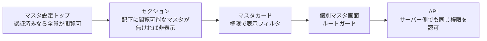

# マスタ設定トップ 仕様書 (Master Settings Index)

## 概要
- **画面の目的**: 診療、トリミング、入院、スタッフ、権限、および外部連携など、システム全体で共通利用される定義データ（マスタ）を一元的に管理するポータル。
- **URLパターン**: `/settings` (トップ)
- **アクセス権限**: `/settings` トップに `RequirePermission` 無し（認証 Layout）。各カードは resource で表示フィルタ、遷移先は個別ガード

---

## 画面構成

### セクション別マスタ一覧
管理対象を 8 つの論理的なセクションに分類し、直感的なアクセスを実現しています。

> 追記（2026-10-07 監査）: 各マスタの詳細仕様インデックス（doc-index）の正本は [settings/README.md](./settings/README.md)。本節は `/settings` ポータル画面のセクション構成（画面カードの UI composition）の記録に限定し、マスタ単位の文書リンクの二重管理をやめた（screens/CLAUDE.md 二重管理禁止）。下表のリンクはマスタ名の平文表記に置き換え、固有の画面経路・権限の記載のみ保持する。

| セクション名 | 管理対象（画面カード構成） |
|:---|:---|
| **基本設定** | 医院情報（詳細: [19-clinic-settings.md](./19-clinic-settings.md)）、動物種類マスタ |
| **カルテ** | 診療項目、検査マスタ（診療項目の検査タブ。サイドバー「マスタ設定」→「カルテ関連」→「検査マスタ」。`/settings/treatment-items?tab=examination`）、診断マスタ、問診テンプレート、主訴種別、薬剤マスタ、検査機器マスタ（サイドバー「マスタ設定」→「カルテ関連」→「検査機器マスタ」。`/settings/lab-device-item-masters`。機器名と検査種別は `lab_devices`。登録は `lab-import:create`、編集は `lab-import:edit`。日常の送信画面には出さない） |
| **予約管理マスタ** | 予約区分マスタ |
| **入院・ケージ管理** | 入院プラン、ケージマスタ |
| **トリミング関連** | トリミングマスタ、トリミングコース種別 |
| **会計・商品** | 商品マスタ、保険マスタ、支払方法、割引キャンペーン、締め時間設定 |
| **スタッフ・権限** | スタッフ管理、職種マスタ、権限グループ設定 |
| **シフト管理** | シフトパターン |

> 補足: [LINE予約設定](./28-line-reservation.md)（`/line-reservation`）と [Lステップ連携設定](./31-lstep-integration.md) はサイドバーの別セクションから遷移する。

### 検査機器マスタ

- **画面の目的**: 検査機器の項目コードと検査フィールドの対応を定義する。日常の受信操作はここでは行わない。
- **URL**: `/settings/lab-device-item-masters`

### path を持たないサイドバーグループ

ポータルのセクションを開く項目である。臨床の同名画面の目的は使わない。

- **カルテ関連**
  - **画面の目的**: カルテで使う診療項目、診断、問診、主訴、薬剤、検査、検査機器の定義をまとめて開く。
- **入院・ケージ**
  - **画面の目的**: 入院プランと院内ケージの定義をまとめて開く。
- **トリミング**（マスタ設定。施術一覧 `/trimming` とは別）
  - **画面の目的**: トリミングの基本コース、追加オプション、コース種別の定義をまとめて開く。

---

## 共通の操作性

### フォーム部品の棚卸し（EMR-411 後続）

対象は本画面のマスタカードから到達する編集フォーム（診療項目の各タブを含む）。
医院マスタ、締め時間設定、シフトテンプレートも含む。サポート欄のバグ報告・
チャット履歴、通常のシフト登録ダイアログ、共有部品内部のネイティブ要素は
含めない。重複する画面へのリンクは同一フォームとして数える。

移行前の直接記述された操作可能な入力要素は JSX の記述位置で **34 箇所**。
これは描画時の入力欄数（リスト・種別・選択した動物種で増減）ではない。

| 種類（互いに排他的） | 箇所 | 対象と移行先 |
|:---|---:|:---|
| テキスト・メール・パスワード・電話など | 18 | 各マスタ、医院、休診日、シフトテンプレート。共有 `Input` |
| 時刻 | 6 | 締め時間 5、シフトテンプレート内専用入力 1。共有 `Input` の `type="time"` |
| 数値／定性切替の範囲入力 | 1 | 検査項目。数値時は共有 `NumberInput`（小数許可）、定性時は共有 `Input`（候補リスト維持） |
| 色 | 2 | 予約区分グループ、権限グループ。共有 `Input` の `type="color"` |
| チェック | 1 | 締め時間の休診曜日。共有 `NativeCheckbox`、送信値・フォーカス・タッチ領域を維持 |
| 複数行 | 4 | 主訴、問診、権限グループ、医院。共有 `Textarea` |
| 選択 | 2 | 検査・健診の項目種別。ネイティブ選択の操作・値を保つ共有入力 |

配置別では `master/components` に21箇所、`clinic-settings/components` に4箇所、
`closing-settings/components` に7箇所、`shifts/components` のシフトテンプレートに
2箇所（計34）。日付欄は既に共有 `DatePicker` を使用しており、この分類の
「直接記述」には該当しない。締め時間の送信用 hidden input 1箇所は
操作可能な入力ではないため34箇所から除外し、値の送信を維持する。
真偽値の独自トグルは別分類で、医院の `ClinicBooleanProperty`、診療項目の
保険対象外、薬剤の保険対象外の3実装を共有のトグルに寄せる。
`StatusToggleButton`、`PropertyInput` など既存の共有部品そのものは
利用済みとして扱い、その内部実装を重複として数えない。

### 1. カード型リスト (`CardRow`)
各マスタの項目は Notion ライクなカード形式で表示され、以下の情報を提供します。
- **アイコン**: 視覚的な識別のための lucide アイコン。
- **名称と説明**: そのマスタが何に使用されるかの要約。
- **遷移シェブロン**: 右端の `ChevronRight` アイコン。

### 2. サイドパネル編集 (`SidePeekPanel`)
大部分のマスタ画面では、一覧を離れずに詳細を編集できるサイドパネル方式を採用しています。これにより、作業のコンテキストを維持したまま複数の項目を連続して編集することが可能です。

---

## 技術仕様

### 権限制御 (RBAC)
ポータルは認証 `Layout` 内で全ユーザーが閲覧可能です。カードは `usePermission` / `hasPermission` で表示を絞り、個別フロントエンドルートは `RequirePermission` でガードします。各 API は同じ resource/action をサーバー側でも認可します。

### 使用コンポーネント
- **`MasterSettingsIndex`**: メインコンテナ。
- **`PermissionFilteredSection`**: セクション別のグループ表示部品。セクション内の全マスタに閲覧権限がない場合はセクションごと非表示になる。
- **`PermissionFilteredCard`** / **`CardRow`**: 個別マスタへのリンク・サマリ表示部品。

---
