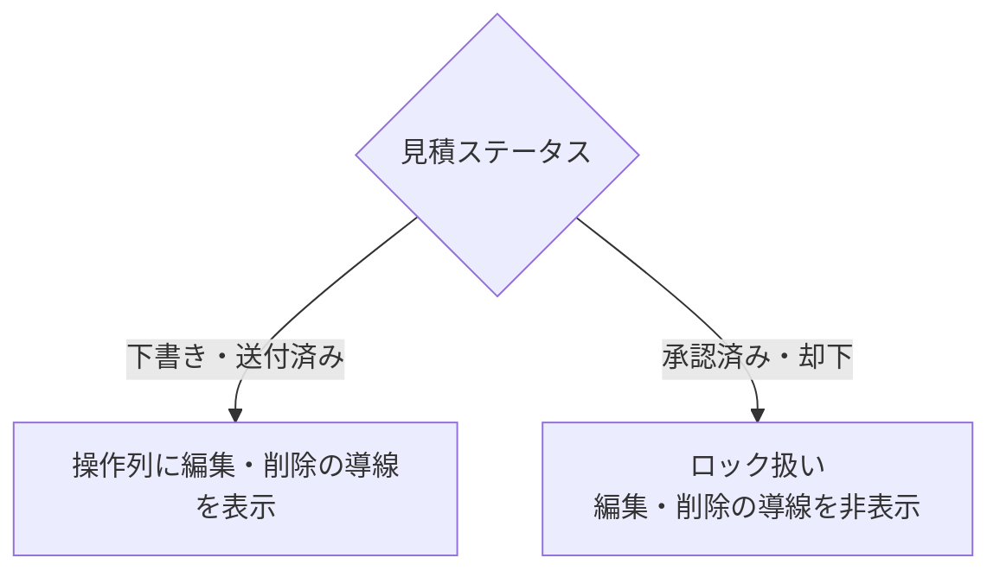

# 見積書一覧 仕様書 (Estimates List)

| 管理項目 | 記載 |
|:---|:---|
| 文書ID・種別 | page.estimates.list／画面仕様 |
| 決定状態 | 2026-10-17追加決定は末尾と進捗入口を参照。従来：既存記載を継承。E1の目標は2026-10-15依頼者承認（業務正本参照）。既存詳細すべての再承認ではない。 |
| 実装状態 | 現行差を分離。今回実装変更・網羅監査なし |
| 実機検証状態 | 未実施。受入条件は検査定義 |
| 文書確認日 | 2026-10-17追加差分（従来確認2026-10-15） |
## 業務正本と現在の説明範囲

[業務契約・FR／受入条件・例外・未決](../domains/estimates/business-rules.md)。一覧・状態・ページ内検索の現行説明。見積承認を請求確定としない。

## 追加承認の目標と現行との差

2026-10-15追加承認：承認済み・期限内で内容と数量が同じなら提示単価を使う。追加処置や内容・数量変更は再説明し、提示済み見積は返答待ちでも原本を残して後継改訂・再提示する。税・保険・割引は既存適用条件を維持し、総額の無条件固定や自動請求確定に拡張しない。 [追加合意の正本](../domains/estimates/business-rules.md#estimate-price-presentation-agreement-20261015)を参照。下記の送付済み編集可・承認／却下だけのロック判定・既存図は現行実装の説明であり、新しい提示原本保護が実装済みという意味ではない。目標では提示済みの金額・明細変更は「改訂版を作成」へ誘導し、元版と変更点を確認して再提示する。提示版への返答記録は金額・明細の上書きと分ける。カルテ見積タブにも同じ条件を適用する。

## 概要
- **画面の目的**: 作成済みの見積記録を時系列で一覧管理し、承認状況や有効期限を監視する。
- **URLパターン**: `/estimates`
- **アクセス権限**: `ResourceEstimates` の **`view`**（`RequirePermission`）

---

## 1. 画面構成

### 1.1 高機能検索・フィルタ (`PropertyFilter`)
- **データ取得**: `useGetEstimates()` はパラメータ無しで API 既定先頭ページ（limit 20）のみ。
- **全文/状態/期限フィルタ**: いずれも **クライアント側**（全件サーバ検索ではない）。

### 1.2 見積管理テーブル (`DataTable`)
| カラム | 説明 |
|:---|:---|
| **見積番号** | システムが自動採番する一意識別子。 |
| **タイトル** | 診察、手術、予防接種等の具体的な目的（例：混合ワクチン 5 種）。 |
| **飼主名** | 見積の宛先となる飼主名。 |
| **有効期限** | 承認済みかつ内容・数量が同じ場合に提示単価を使う期限。 |
| **合計金額** | 税込の見積総額（等幅フォント）。 |
| **ステータス** | 進捗状況を示すカラーバッジ。 |
| **操作** | `RowActionDropdown` による「詳細」「編集」「削除」メニュー（編集・削除は権限保持者のみ）。 |

---

## 2. 主要な業務アクション

- **新規見積作成**: ヘッダーの「新規見積書登録」より、作成フォーム (`/estimates/new`) へ直接遷移（ペット選択画面は経由しない）。
- **詳細参照**: テーブルの見積番号リンク、または操作メニューの「詳細」から詳細画面 (`/estimates/:id`) でヘッダ金額と飼主向けメッセージを確認。明細行があるのはカルテ見積タブ／後継ドラフト由来の見積だけ。
- **編集**: 操作列より編集フォーム (`/estimates/:id/edit`) へ遷移。
- **削除**: 不要になった、または誤作成した見積の論理削除。
- **確定済み見積の保護**: 「承認済み」「却下」の見積は `isEstimateLockedStatus` によりロック扱いとなり、操作列の編集・削除導線を非表示にする（「下書き」「送付済み」のみ編集・削除可能）。

---

## 3. 技術仕様

### 3.1 描画の最適化
- **遅延フィルタリング**: `useDeferredValue` により、多数の見積履歴を検索する際も軽快な入力を維持。 10/19後続承認の目標は検索ボタン適用後の結果を描画する方式。入力だけで検索を適用する旧挙動を継承しない。
- **削除の非同期処理**: 削除確定は `useTransition` でラップし、`ConfirmDialog` の `isPending` によりボタンの二重クリックを防止（`FilteringIndicator` は本画面では未使用）。

### API連携
| メソッド | エンドポイント | 用途 | 必須権限 | 必須アクション |
|:---|:---|:---|:---|:---|
| GET | `/api/v1/estimates` | 条件に応じた見積一覧の取得 | `estimates` | `view` |
| DELETE | `/api/v1/estimates/:id` | 特定の見積レコードの論理削除 | `estimates` | `delete` |

---

## 一覧条件の確定（2026-10-17）

[決定根拠・適用範囲](../domains/SPECIFICATION_PROGRESS.md#confirmed-business-decisions-20261017)：ユーザーの2026-10-16〜17 JSTの直接決定、文書更新承認は10月17日03:20 JST。以下は目標仕様・未実行の受入条件であり、実装・実機合格を示さない。

[一覧の共通正本・4受入条件](../shared/ui-contracts.md#list-filter-contract-20261017)へ従う。台帳・カルテ履歴の初回医院は権限内全医院で次回選択保持。日付付き通常業務6一覧はメニュー当日・詳細復帰で条件保持、行ペットはID指定・日付解除全期間・医院維持。入院ホテル／見積は当日初期化除外、受付は選択日、未納は繰越表示、台帳マスタは当日対象外。表示ページだけを全期間検索結果としない。

## 10/19後続承認：同種操作・検索ボタン方式

本画面の既存キーワード欄は[適用台帳 L09](../shared/interaction-scope.md)と[共通FR/8AC](../shared/ui-contracts.md#interaction-consistency-20261019)へ従う。入力中/適用済みを分け、入力/待機/消去だけでは検索せず検索ボタンで適用。既存の明示リセット、独立filter、詳細復帰、認可・検索対象・取得上限/ページ内制限を保持し、全件検索や一律の保存方式へ変えない。取得中/0件/失敗と遅延応答を分け、検索で選択/保存/コピー/送信を確定しない。旧defer/debounceの記載は入力即適用の目標に用いず、適用後の描画最適化と区別する。[S14手順](../../ops/testing/scenarios/S14-search-and-multi-word.md#cross-ui-search-20261019)を各対象IDで実施する受入条件とし、実装適合・実機は未確認。
