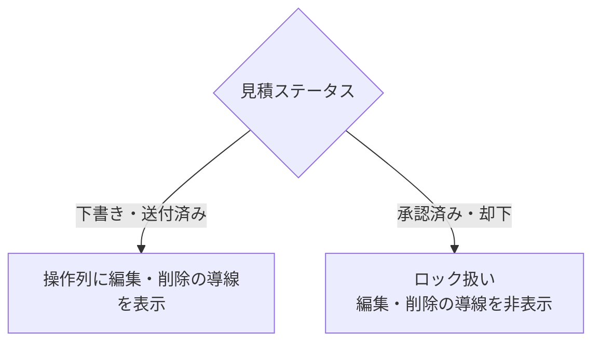

# 見積書一覧 仕様書 (Estimates List)

| 管理項目 | 記載 |
|:---|:---|
| 文書ID・種別 | page.estimates.list／画面仕様 |
| 決定状態 | 既存記載を継承。E1の目標は2026-10-15依頼者承認（業務正本参照）。既存詳細すべての再承認ではない。 |
| 実装状態 | 現行差を分離。今回実装変更・網羅監査なし |
| 実機検証状態 | 未実施。受入条件は検査定義 |
| 文書確認日 | 2026-10-15 |
## 業務正本と現在の説明範囲

[業務契約・FR／受入条件・例外・未決](../domains/estimates/business-rules.md)。一覧・状態・ページ内検索の現行説明。見積承認を請求確定としない。

## 概要
- **画面の目的**: 作成済みの見積記録を時系列で一覧管理し、承認状況や有効期限を監視する。
- **URLパターン**: `/estimates`
- **アクセス権限**: `ResourceEstimates` の **`view`**（`RequirePermission`）

---

## 1. 画面構成

### 1.1 高機能検索・フィルタ (`PropertyFilter`)
- **データ取得**: `useGetEstimates()` はパラメータ無しで API 既定先頭ページ（limit 20）のみ。
- **全文/状態/期限フィルタ**: いずれも **クライアント側**（全件サーバ検索ではない）。

### 1.2 見積管理テーブル (`DataTable`)
| カラム | 説明 |
|:---|:---|
| **見積番号** | システムが自動採番する一意識別子。 |
| **タイトル** | 診察、手術、予防接種等の具体的な目的（例：混合ワクチン 5 種）。 |
| **飼主名** | 見積の宛先となる飼主名。 |
| **有効期限** | 見積内容（単価）を保証する最終日。 |
| **合計金額** | 税込の見積総額（等幅フォント）。 |
| **ステータス** | 進捗状況を示すカラーバッジ。 |
| **操作** | `RowActionDropdown` による「詳細」「編集」「削除」メニュー（編集・削除は権限保持者のみ）。 |

---

## 2. 主要な業務アクション

- **新規見積作成**: ヘッダーの「新規見積書登録」より、作成フォーム (`/estimates/new`) へ直接遷移（ペット選択画面は経由しない）。
- **詳細参照**: テーブルの見積番号リンク、または操作メニューの「詳細」から詳細画面 (`/estimates/:id`) でヘッダ金額と飼主向けメッセージを確認。明細行があるのはカルテ見積タブ／後継ドラフト由来の見積だけ。
- **編集**: 操作列より編集フォーム (`/estimates/:id/edit`) へ遷移。
- **削除**: 不要になった、または誤作成した見積の論理削除。
- **確定済み見積の保護**: 「承認済み」「却下」の見積は `isEstimateLockedStatus` によりロック扱いとなり、操作列の編集・削除導線を非表示にする（「下書き」「送付済み」のみ編集・削除可能）。

---

## 3. 技術仕様

### 3.1 描画の最適化
- **遅延フィルタリング**: `useDeferredValue` により、多数の見積履歴を検索する際も軽快な入力を維持。
- **削除の非同期処理**: 削除確定は `useTransition` でラップし、`ConfirmDialog` の `isPending` によりボタンの二重クリックを防止（`FilteringIndicator` は本画面では未使用）。

### API連携
| メソッド | エンドポイント | 用途 | 必須権限 | 必須アクション |
|:---|:---|:---|:---|:---|
| GET | `/api/v1/estimates` | 条件に応じた見積一覧の取得 | `estimates` | `view` |
| DELETE | `/api/v1/estimates/:id` | 特定の見積レコードの論理削除 | `estimates` | `delete` |

---
