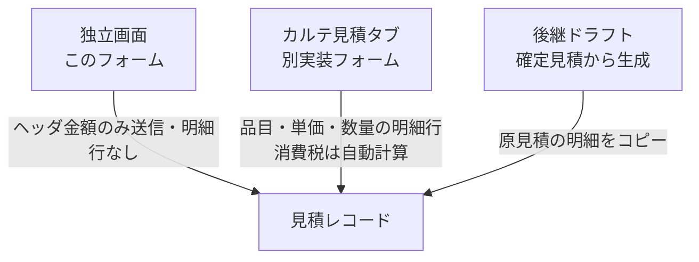

# 見積書作成・編集 仕様書 (Estimate Form)

| 管理項目 | 記載 |
|:---|:---|
| 文書ID・種別 | page.estimates.form／画面仕様 |
| 決定状態 | 2026-10-17追加決定は末尾と進捗入口を参照。従来：既存記載を継承。E1の目標は2026-10-15依頼者承認（業務正本参照）。既存詳細すべての再承認ではない。 |
| 実装状態 | 現行差を分離。今回実装変更・網羅監査なし |
| 実機検証状態 | 未実施。受入条件は検査定義 |
| 文書確認日 | 2026-10-17追加差分（従来確認2026-10-15） |
## 業務正本と現在の説明範囲

[業務契約・FR／受入条件・例外・未決](../domains/estimates/business-rules.md)。下記は既存フォームの実装説明。承認済みの目標は入口を問わない明細方式・D10共通計算・概算保険表示・確認付き会計draft転記。旧ヘッダ入力／一律10%を新要件としない。

## 追加承認の目標と現行との差

2026-10-15追加承認：承認済み・期限内で内容と数量が同じなら提示単価を使う。追加処置や内容・数量変更は再説明し、提示済み見積は返答待ちでも原本を残して後継改訂・再提示する。税・保険・割引は既存適用条件を維持し、総額の無条件固定や自動請求確定に拡張しない。 [追加合意の正本](../domains/estimates/business-rules.md#estimate-price-presentation-agreement-20261015)を参照。下記の送付済み編集可・承認／却下だけのロック判定・既存図は現行実装の説明であり、新しい提示原本保護が実装済みという意味ではない。目標では提示済みの金額・明細変更は「改訂版を作成」へ誘導し、元版と変更点を確認して再提示する。提示版への返答記録は金額・明細の上書きと分ける。カルテ見積タブにも同じ条件を適用する。

## 概要
- **画面の目的**: 診療や処置に先立ち、飼主へ提示する概算費用（小計・税・保険適用額・割引額・合計）の登録・編集。
- **URLパターン**: 
  - 新規作成: `/estimates/new`（ペット・飼主の紐付け入力欄はこの画面には存在しません）
  - 編集: `/estimates/:id/edit`
- **アクセス権限**: 新規作成は `estimates:create`、編集は `estimates:edit` を要求する `RequirePermission` ルートガードあり（親ルート `/estimates` の `estimates:view` ガードに加算）。保存ボタンの表示可否や割引額入力はさらに `usePermission` で制御。

---

## 1. 画面構成

### 1.1 基本情報セクション
- **タイトル**: 見積の目的（例：右膝蓋骨脱臼 整復手術）。
- **ステータス**: 下書き、送付済み、承認済み、却下の管理。新規作成時の選択肢は下書き・送付済みのみに制限されます（`CREATE_STATUS_OPTIONS`。それ以外を送信するとステータス欄にエラーを表示）。編集時は4値すべてを選択できますが、承認済み・却下の見積は編集画面を開けず詳細画面へリダイレクトされます（`isEstimateLockedStatus`）。
- **有効期限**: 承認済みかつ内容・数量が同じ場合に提示単価を使う期限。

### 1.2 金額セクション
明細の内訳ではなく、小計・消費税・保険適用額・割引額・合計金額を数値として直接入力します（マスタからの項目選択・自由入力による明細行の追加機能はこの画面には存在しません）。
- **割引額**: `discount` 権限を持たないユーザーには入力欄が無効化されます。

### 1.3 テキスト・メッセージ設定
- **コメント**: 飼主向けコメント。
- **備考（社内メモ）**: スタッフ間での算出根拠等の共有。

---

## 2. 主要な運営機能

### 2.1 金額入力
自動計算エンジンは無く、小計・消費税・保険適用額・割引額・合計金額はすべてスタッフが直接数値入力します。

### 2.2 臨床連携
診察室（カルテ）の見積タブ (`MedicalRecordEstimate`) は、本画面（`/estimates/new` `/estimates/:id/edit`）とは別実装のフォームです。品目名・単価・数量を自由入力する明細テーブルを持ち、消費税は一律 10% で自動計算されますが、診療項目マスタからの選択機能はありません。保存時は `items` を create/update 同一 tx で置換永続化する。独立画面（本フォーム）は引き続きヘッダ金額のみ送信し、明細行は送らない。

後継ドラフト（`POST /estimates/:id/successors`）は原見積の明細をコピーする。

---

## 3. 技術仕様

### 3.1 ハイパフォーマンス・フォーム
- **再描画の抑制**: 基本情報／金額／テキストの各セクションを `memo()` 化し、一部フィールドの変更が他セクションの再描画を引き起こさないようにしています。
- **保存アクション**: React 19 の `useActionState` を活用し、保存中の二重送信を防止。

### API連携
| メソッド | エンドポイント | 用途 | 必須権限 | 必須アクション |
|:---|:---|:---|:---|:---|
| GET | `/api/v1/estimates/:id` | 見積情報の取得 | `estimates` | `view` |
| POST | `/api/v1/estimates` | 新規保存 | `estimates` | `create` |
| PATCH | `/api/v1/estimates/:id` | 内容およびステータスの更新 | `estimates` | `edit` |

---

## 2026-10-17確定仕様との接続

[決定根拠・適用範囲](../domains/SPECIFICATION_PROGRESS.md#confirmed-business-decisions-20261017)：ユーザーの2026-10-16〜17 JSTの直接決定、文書更新承認は10月17日03:20 JST。以下は目標仕様・未実行の受入条件であり、実装・実機合格を示さない。

[業務正本・受入条件](../domains/medical-records/lifecycle.md#requirement-fr-medical-records-dose-display-unit-price)。通常プラン4種明細の単価編集・通常理由任意を、提示済み見積の原本保護や後継訂正理由必須へ拡張しない。共通患者の自院利用はD04に従い、同一医院の見積記録・参照整合を検証する。他院由来の共通患者であることだけを一律拒否理由にせず、未認可の他院見積ID付替えは拒否する。
