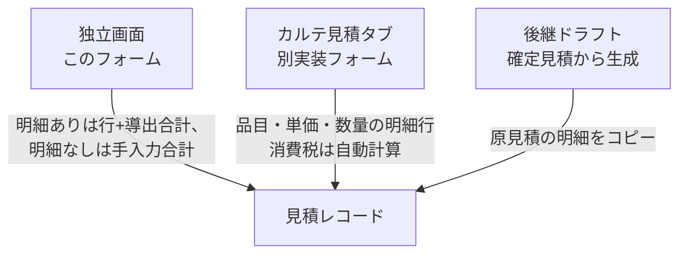

# 見積書作成・編集 仕様書 (Estimate Form)

## 概要
- **画面の目的**: 診療や処置に先立ち、飼主へ提示する概算費用（小計・税・保険適用額・割引額・合計）の登録・編集。
- **URLパターン**: 
  - 新規作成: `/estimates/new`（ペット・飼主の紐付け入力欄はこの画面には存在しません）
  - 編集: `/estimates/:id/edit`
- **アクセス権限**: 新規作成は `estimates:create`、編集は `estimates:edit` を要求する `RequirePermission` ルートガードあり（親ルート `/estimates` の `estimates:view` ガードに加算）。保存ボタンの表示可否や割引額入力はさらに `usePermission` で制御。

---

## 1. 画面構成

### 1.1 基本情報セクション
- **タイトル**: 見積の目的（例：右膝蓋骨脱臼 整復手術）。
- **ステータス**: 下書き、送付済み、承認済み、却下の管理。新規作成時の選択肢は下書き・送付済みのみに制限されます（`CREATE_STATUS_OPTIONS`。それ以外を送信するとステータス欄にエラーを表示）。編集時は4値すべてを選択できますが、承認済み・却下の見積は編集画面を開けず詳細画面へリダイレクトされます（`isEstimateLockedStatus`）。
- **有効期限**: 単価を保証する期限。

### 1.2 金額セクション
本画面は明細行エディタ（`EstimateItemsEditor`）を持ち、品目名・単価・数量・課税区分・税率・行割引を入力できます。
- **明細あり（itemized）**: 小計・消費税・合計金額は明細から導出される読み取り専用値です。合計金額は明細総額から実効の保険適用額とヘッダー割引額を控除した額です（小計・税額は控除前の総額のまま）。外税明細は税額が合計へ加算され、内税明細は税込総額の内訳として税額だけが表示されます。
- **明細なし（もともと明細のない見積、および新規作成で明細未入力）**: 小計・消費税・合計金額を手入力します（`estimate-subtotal` / `estimate-tax-total` / `estimate-total-amount`）。保険・割引の変更で手入力合計は自動再計算されません。
- **全行クリア**: 明細ありの見積で全行を削除して保存する（`items: []` の明示置換）と、サーバーは合計を 0 にします（保険・割引はメタデータとして保持）。クリア直後の画面は導出 0 の読み取り専用で、再読込後に手入力へ切り替わります。
- **メタデータのみの更新（明細あり見積）**: 明細・控除（保険・割引）を変更しない PATCH は保存済みの合計をそのまま保持します。旧データの保存済み超過控除は据え置き更新で再検証・再計算されず、明細あり見積ではクライアントが送った合計値で保存済み金額が書き換わることもありません。控除を実変更するか明細を置換する場合のみ、サーバー・クライアント双方が控除の上限（割引≦明細総額、保険≦明細総額−割引）を検証します。
- **割引額**: `discount` 権限を持たないユーザーには入力欄が無効化されます。

### 1.3 テキスト・メッセージ設定
- **コメント**: 飼主向けコメント。
- **備考（社内メモ）**: スタッフ間での算出根拠等の共有。

---

## 2. 主要な運営機能

### 2.1 金額入力
明細がある見積は小計・税・合計が明細から自動導出され、合計には保険適用額とヘッダー割引の控除が適用されます。明細のない見積では小計・消費税・合計金額をスタッフが直接数値入力します。権限不足またはロック済みの見積では入力は変わりません（無効化・非表示の既存挙動を維持）。

### 2.2 臨床連携
診察室（カルテ）の見積タブ (`MedicalRecordEstimate`) は、本画面（`/estimates/new` `/estimates/:id/edit`）とは別実装のフォームです。品目名・単価・数量を自由入力する明細テーブルを持ち、消費税は行の `tax_type`/`tax_rate`（未指定時は病院マスタの標準税率）で自動計算されますが、診療項目マスタからの選択機能はありません。保存時は `items` を create/update 同一 tx で置換永続化する。独立画面（本フォーム）も明細行エディタを持ち、明細ありでは行+導出合計、明細なしでは手入力合計を送信する。

- **保険適用額**: 既存見積の `insurance_amount` を hydrate して `保険適用額` 入力欄へ表示し、`medical-records` 編集権限で編集できます（`discount` 権限とは独立）。表示される請求額・保存 payload の `total_amount` は明細総額から値引額と保険適用額を控除した実効額で一致します。保険適用額が負・非整数・値引後残額超過の場合は保存を拒否します。明細なし保存は合計 0 で値引・保険メタデータのみ保持します。

後継ドラフト（`POST /estimates/:id/successors`）は原見積の明細をコピーする。

---

## 3. 技術仕様

### 3.1 ハイパフォーマンス・フォーム
- **再描画の抑制**: 基本情報／金額／テキストの各セクションを `memo()` 化し、一部フィールドの変更が他セクションの再描画を引き起こさないようにしています。
- **保存アクション**: React 19 の `useActionState` を活用し、保存中の二重送信を防止。

### API連携
| メソッド | エンドポイント | 用途 | 必須権限 | 必須アクション |
|:---|:---|:---|:---|:---|
| GET | `/api/v1/estimates/:id` | 見積情報の取得 | `estimates` | `view` |
| POST | `/api/v1/estimates` | 新規保存 | `estimates` | `create` |
| PATCH | `/api/v1/estimates/:id` | 内容およびステータスの更新 | `estimates` | `edit` |

---
