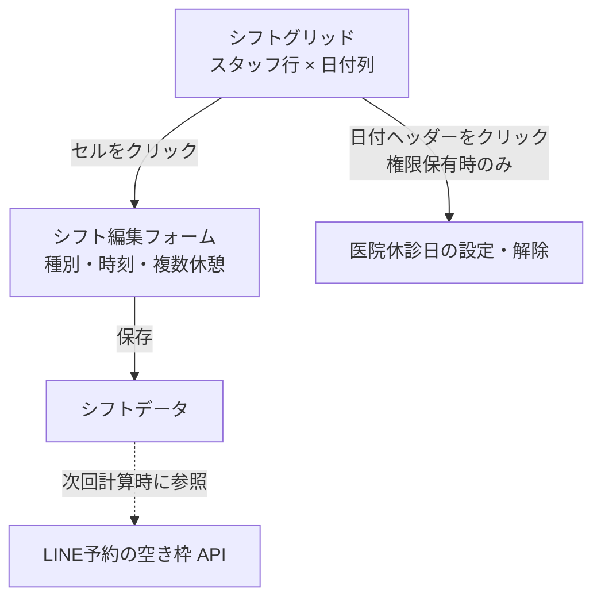

# シフト管理カレンダー 仕様書 (Shift Calendar)

未来院からの再受付は[18:26の担当再確認](../workflows/reservation-to-record-flow.md#no-show-recheck-1826)に従い、保護対象外の間に変更した勤務を無検査で復活させない。

> 確定仕様の適用範囲：今回の予約ドメイン合意と本書の接続境界。承認日は各FR要件表・根拠節（2026-10-13〜2026-10-14 17:35）、追加合意は各補足節を参照。[確定FR索引](../domains/reservations/README.md#approved-reservation-scope)に掲載した箇所のみを確定情報として扱う。対象外の継承本文・未承認案・現行実装説明は一括確定しない。実装・実機状態は別管理。

17:23 JSTの[LINE予約6点合意](../line/reservation-spec.md#line-agreement-1723)へ従う。公開された診療・トリミング・ホテルは予約対象、入院は医院相談。ホテルには医師指名・医師シフト・通常予約の同日制約を適用しない。受付制限・入力保持・受付前取消・必要設定不足の扱いと受入条件はLINE正本を参照する。ホテル受入基準は17:35合意の医院別同時宿泊頭数・全宿泊期間判定で、実装・実機受入は未確認。

17:17 JSTの院内予約8点一括合意は[予約入口の決定一覧](../domains/reservations/README.md#internal-reservation-batch-1717)を参照する。誤取消／誤終了訂正、未終了予約保護、診療前の日付・カルテ整合、マスタ利用・名称履歴、休診日予約／日跨ぎ勤務、患者照合、ホテル担当時点／入院記録失敗の各正本と受入条件へ従う。LINE受付条件は17:23合意（ホテル受入基準は17:35合意、計算・保存方式は設計）、実装・実機受入は未確認。

17:04 JSTに文書反映を個別許可された[一医院での勤務終了と指名停止](settings/master-staff.md#requirement-fr-staff-clinic-departure-booking-guard)へ従う。A院の今後の指名予約を別の適格医師または未定へ手動変更してからA院での指名を停止し、B院の勤務・指名予約は継続する。現在診療中の既存保護、自動解除しない方針、完了済み履歴保持を維持し、全体退職と区別する。医院別の予約区分対応可否は既合意、具体的設定・保存方式は未決。受入条件は担当者マスタ正本へ置き、実装・実機受入は未確認。

| 管理項目 | 記載 |
|:---|:---|
| 文書ID・種別 | page.shifts／既存画面・共通マスタ仕様 |
| 決定状態 | 既存の予約ドメイン合意とレビュー履歴を継承し、2026-10-15のシフト複製・CSV取込合意を追加。新操作の業務結果、合意を具体化する選定設計、物理設計残件を下記で分離する。実装・移行・実機検証とは別 |
| 実装状態 | main ec4f7146aの必要箇所を静的照合。新合意へ未追従／未確認の残差を下記に記載。コード変更なし |
| 実機検証状態 | 未実施。文書検査と実機受入を分ける |
| 文書確認日 | 2026-10-15（複製・CSV取込の追加合意を接続。実機受入日ではない） |

12:22合意の[医師交代時の判定時間と診療延長警告](../domains/reservations/pages/reservation-management.md#handoff-time-and-extension)に従う。診療延長による自然な時間経過は警告し、自動終了・自動交代しない。保護対象の既指名予約を不適格にするシフト編集の保存禁止とは別であり、警告を編集保存の許可にしない。実装対応・実機受入は未確認。

用語・概念関係は[予約オントロジーの語彙正本](../ontology/reservations.md#reservation-ontology)へ統一する。予約区分、予約区分グループ（表示用）、予約区分の業務分類を区別し、担当者の総称と画面の指名医師／担当トリマー、職種と個人の対応可能予約区分を同義にしない。画面ラベル・引用・コード識別子は継承し、用語整理から未決業務を確定しない。

## 概要
- **画面の目的**: 勤務・休憩を管理し、院内予約の指名候補・対応能力警告とLINE計算へ基礎情報を提供する。院内は空き枠・残数表示を採用しない。LINEは[正本の予定枠基準](../line/reservation-spec.md#line-scheduled-slot-basis)・個人対応／勤務／休憩の合意へ従う。実診療状態や予定超過を空き判定条件にしない。実装／検証は別。
- **URLパターン**: `/shifts`
- **アクセス権限**: `ResourceShifts` の `view` 権限保有ユーザー（編集操作は `create`/`edit`/`delete` の各アクション権限が必要）

---

## 画面構成

### 1. シフト・グリッド
スタッフ（行）× 日付（列）のマトリックス形式で勤務状況を表示します。縦にスクロールしても日付ヘッダーを上部に固定表示し、どの日の勤務を操作しているか識別できるようにする。根拠は[Backlog Phase1 No.91](https://docs.google.com/spreadsheets/d/17jaFBv7NmbPzk88lZx94vFxa_G1shGNX2O_lFGt4QdQ/edit)の大沼の要望と2026-10-15曽我の回答。回答の「対応完了」は当時の報告であり、今回の実機合格を示さない。
- **視覚的識別**: シフト区分（全日/午前/午後/休日/有休）に応じて、セルの色が自動的に変化。
- **スタッフ抽出**: 画面上部のフィルタより、特定のスタッフのシフトのみを表示可能。
- **職種抽出**: 同じく上部の職種フィルタ（occupations マスタ）で行を絞り込める。「すべての職種」・各職種・「未設定」。職種フィルタ後もスタッフ名フィルタを併用可能。表示のみで、未表示スタッフのシフトデータは削除しない。

### 2. 医院休診日管理
カレンダーの日付ヘッダーをクリックすることで、医院全体の休診設定を行えます（`create` 権限保有時のみクリック可能）。初期表示月は JST 当月。
- **休診日表示**: 休診設定された日は、日付ヘッダーが赤色表示と赤いドットで強調され、一目で把握可能です。
- **同一日**: POST は INSERT のみ。既存日の再追加は unique 違反（409）。理由変更は解除してから再設定。理由は任意。

---

### 3. 期間・スタッフを選ぶ複製／CSV取込の入口（目標仕様）

シフト管理から[期間・スタッフを選ぶ複製](#requirement-fr-shifts-copy-selected-range)と[Excelで作成したCSVの取込](#requirement-fr-shifts-excel-csv-import)を開始できる。いずれも入力案を作り、[差分・エラー・予約影響の確認](#requirement-fr-shifts-bulk-preview-confirm)を経て明示的に反映する。入口を押す、ファイルを選ぶ、解析が完了するだけでは保存しない。複製元期間と複製先開始日を明示選択し、相対日付を保つ結果を全件プレビューする。具体的なボタン配置・ダイアログは後続設計であり、現行コンポーネントが対応済みという記載ではない。

## 主要な機能

### 1. シフト・休憩時間の編集 (`ShiftFormDialog`)
カレンダーのセルをクリックして詳細を編集します。
- **複数休憩時間**: 1日のシフトの中に、複数の休憩時間（例：午前休憩、午後休憩）を登録可能です。
- **休日・有休の入力制御**: `off` と `paid_leave` はどちらも終日非勤務として扱い、時刻・休憩入力を無効化して保存時にも時刻を送信しません。
- **テンプレート入力**: 有効なシフトテンプレートを選択すると、シフト種別・開始/終了時刻・休憩時間がフォームに一括反映されます（テンプレート自体の管理は設定画面）。
- **LINE予約連携**: 保存された勤務・休憩情報を、LINE予約 LIFF アプリの空き枠 API が次回計算時に参照します。既に開いている別端末へのプッシュ通知ではありません。

### 2. インテリジェント・ナビゲーション
- **月次切替**: 前月・翌月ボタンでのスムーズな期間移動。
- **保存後の再取得**: シフト保存成功時に `queryKeys.shifts.all()` を無効化して自画面のシフトを再取得します。受付や予約カレンダーを直接更新する処理はなく、それぞれの取得契約に従います（受付は30秒ポーリング）。

---

## 予約との依存・途中合意

決定者はユーザー、合意日は2026-10-13。根拠は予約マスタ・担当適格性・シフト連携の対話合意を親タスクから引き継いだ記録。予約ドメインには関連マスタ・シフト・LINEも含み、途中合意で未完了。LINE6点は17:23合意、ホテル受入基準は17:35合意、計算・保存方式は設計として保持。実装・実機受入の完了を意味しない。

| 要件ID | 定義の所在 | 決定根拠 |
|:---|:---|:---|
| FR-shifts-protect-assigned-bookings | [シフト変更と指名予約保護](#requirement-fr-shifts-protect-assigned-bookings) | 合意済み。2026-10-13、ユーザー対話。根拠は下記 |
| FR-shifts-overnight-duty | [日をまたぐ勤務](#requirement-fr-shifts-overnight-duty) | 合意済み。2026-10-14 17:17 JST「ok」。具体的保存・表示は設計 |
| FR-shifts-holiday-warning-confirm | [休診日への変更と既存予約警告](#requirement-fr-shifts-holiday-warning-confirm) | 合意済み。2026-10-14 12:43 JST、ユーザー「ok」。院内休診日登録は17:17合意、LINE条件は17:23・17:35・18:26合意 |
| FR-shifts-cross-clinic-overlap | [同一スタッフの医院間勤務重複を拒否](#requirement-fr-shifts-cross-clinic-overlap) | 合意済み。2026-10-13 22:44 JST、ユーザー「はい」 |
| FR-shifts-manual-travel-gap | [登録者が医院間移動時間を確保](#requirement-fr-shifts-manual-travel-gap) | 合意済み。2026-10-13 22:57 JST、ユーザー「ok」。23:04の「ok」は進行への回答 |

2026-10-13 20:43 JSTのユーザー「ok」により、シフトと[スタッフ個人の対応可能区分](settings/master-staff.md#requirement-fr-staff-shared-reservation-eligibility)を院内／LINEの担当可能者判定の共通基準にする。予約区分側の職種による別の予約可否設定は廃止方針。職種分類・表示フィルタは保持し、LINE固有の公開範囲・受付条件は17:23・17:35・18:26合意のLINE正本へ従う。

予約の指名候補は[予約時間全体の勤務・休憩判定](../domains/reservations/pages/reservation-management.md#requirement-fr-reservations-duty-staff-selection)に従う。非勤務者を指名できず、休憩中は対応可能人数から除く。全未登録日は候補を出さず、指名なし予約と判定不可表示を認める。一部未登録は[登録済み情報ベースの合意](../domains/reservations/pages/reservation-management.md#requirement-fr-reservations-partial-shift-evaluation)で区別する。[未登録・勤務なし](../domains/reservations/pages/reservation-management.md#requirement-fr-reservations-unassigned-without-duty)の詳細は予約正本へ委ねる。診療中の別医師への引継ぎは[23:43の契約](../domains/reservations/pages/reservation-management.md#requirement-fr-reservations-doctor-handoff)へ従い、11:15合意により交代先は引継ぎ後の担当時間の勤務・休憩・対応区分で判定し、過去全体の勤務は要求しない。診療終了まで指名なしへの変更も可、終了後の通常変更は不可。[12:22合意の判定時間・延長警告](../domains/reservations/pages/reservation-management.md#handoff-time-and-extension)へ従う。通常の全時間条件と区別する。

### シフト変更と指名予約保護

休みへの変更・勤務短縮・休憩追加・シフト削除で、検査対象の既指名予約を担当できなくなる場合、その予約を他の適格者または指名なしに変更して解消するまでシフト保存不可とする。「警告だけで変更して指名を保持する」方式は採用しない。指名解除・予約取消を自動実行しない。

保存できない理由、対象予約の日時／患者／区分の一覧、予約編集への導線を表示する。入力したシフト案を保持し、予約を修正後に再保存できる。対象範囲・履歴保全は[未来・現在診療中予約の共通契約](../workflows/reservation-to-record-flow.md#requirement-fr-reservations-future-assignment-protection)が正本。通常予約の勤務開始／終了の端点、日跨ぎ勤務は17:17合意で登録可、保存・表示方式は設計。シフト削除と休診日変更は下記12:43合意で区別する。

「休みなのに予約がある人のカレンダー列を警告付きで残す」案はユーザーが不採用とした。非勤務指名を防ぐ契約であり、既存データ不整合の救済や未登録時の列構成は未決。

21:52 JSTに合意した[休憩端点の指名判定](../domains/reservations/pages/reservation-management.md#break-boundary)を勤務・休憩の予約影響検査にも使う。休憩開始ちょうどの予約終了と休憩終了ちょうどの予約開始は非重複、正の時間幅で重なる指名は不可。勤務全時間・他の適格性と既存予約重複の警告契約を維持する。例と受入条件の正本は予約画面へ置き、本書で複製しない。

22:00 JST合意の[予定終了超過でも現在診療中の予約保護](../workflows/reservation-to-record-flow.md#consultation-overtime)に従う。シフト変更でも影響チェック対象に残し、影響する予約は解消まで保存不可。影響しない変更を一律拒否せず、診療終了や予約時間延長を自動実行しない。診療開始・終了は[2026-10-14 00:18 JSTのスタッフによる明示確定](../workflows/reservation-to-record-flow.md#requirement-fr-reservations-manual-consultation-state)を参照し、予定時刻で自動遷移しない。開始は[10:07合意の当日カードモーダル「カルテ作成」](../workflows/reservation-to-record-flow.md#consultation-start-card-modal)が兼ねる。終了は[10:12合意の同じカードモーダル「診察を終了する」](../workflows/reservation-to-record-flow.md#consultation-end-card-modal)で確定する。[10:43の確認付きドラッグ終了](../workflows/reservation-to-record-flow.md#requirement-fr-reservations-confirmed-drag-consultation-end)も同じ診療終了として扱い、キャンセルなら診療中を維持する。誤終了取消は[11:56の専用操作](../workflows/reservation-to-record-flow.md#requirement-fr-reservations-undo-consultation-end)へ従う。その他の逆方向・遷移は[記録確認訂正](../workflows/reservation-to-record-flow.md#requirement-fr-reservations-controlled-reverse-transition)へ渡す。誤終了取消の会計確定境界と[既存grant対応](../../design/domains/reservations/technical-spec.md#reservation-api-closed-contract)は選定済み、訂正内部は関連ownerへ残す。具体例・3操作の共通受入条件は横断正本を参照。 [12:22合意の判定時間・延長警告](../domains/reservations/pages/reservation-management.md#handoff-time-and-extension)へ従う。

22:21 JST合意の[一部未登録時の候補と不足警告](../domains/reservations/pages/reservation-management.md#requirement-fr-reservations-partial-shift-evaluation)を参照。登録済みの適格者だけ候補とし、未登録者の勤務・休日を推測しない。全未登録の判定不可と区別し、検出方式と未登録検出の対象母集団・他院勤務情報の取得方法は調査事項。

22:31 JST合意の[予約先医院に基づく勤務先範囲](../domains/reservations/pages/reservation-management.md#requirement-fr-reservations-clinic-duty-scope)を参照。同時間に他院へ出勤する人を指名候補・人数へ含めず、所属から出勤を推測しない。医院間で勤務時間が重なるシフトの保存可否は[22:44 JSTの追加合意](#requirement-fr-shifts-cross-clinic-overlap)に従う。移動時間は[22:57 JSTの手動確保契約](#requirement-fr-shifts-manual-travel-gap)に従う。他院勤務情報取得の詳細は未決。

#### シフト削除と保護対象（12:43合意）

シフト削除は休みへの変更と同じく、削除により担当できなくなる未来の既指名予約・現在診療中の既指名予約を、別の適格な担当者（診察では別医師）または指名なしへ変更して解消するまで確定不可とする。現在診療中は予定終了を過ぎていても保護対象に残す。過去完了の予約は削除を止める対象へ広げず、過去対応済み・取消済み・未来院の履歴を保持する既存契約を維持する。

削除できない理由、対象予約の日時／患者／区分の一覧と[予約管理の編集入口](../domains/reservations/pages/reservation-management.md#requirement-fr-reservations-edit-entry)への導線を表示する。解消前にシフトを削除せず、削除操作の対象を保持して予約変更後に再度確定できる。予約の自動取消・自動指名解除は行わない。変更先は既存の[医師適格性・勤務・休憩・対応区分・診療施設条件](../domains/reservations/pages/reservation-management.md#requirement-fr-reservations-doctor-handoff)を満たす必要があり、診療段階による通常操作制限も免除しない。影響しない削除を一律に止めず、17:17合意の未終了予約保護へ従い、対象外の状態を独断で追加しない。

### 休診日への変更と既存予約警告（12:43合意）

医院を休診日へ変更する場合、その日・医院の既存予約を一覧で警告し、利用者が確認すれば休診日への変更を確定できる。警告の確認を取りやめた場合は変更を確定しない。既存予約を自動キャンセルせず、予約の指名・カルテ等をこの変更で自動削除しない。休診日変更後の既存予約をどのように対応するかは、保持した予約を基に判断する。

この警告確認による確定は、医院の休診日設定に対する契約。スタッフのシフトを自動削除・変更する意味ではなく、シフト削除・休み変更で既指名予約を不適格にする場合の解消まで確定不可という保護や、既存の医師適格性を迂回しない。院内休診日の警告確認・指名未定登録は17:17合意済み。LINEの公開・新規受付・飼主側変更／取消条件は17:23・17:35合意へ従う。過去日の休診日設定等、今回改訂しない既存運用は継承する。既存の休診日設定・解除権限を継承し、新しい権限やロールは追加確定しない。警告一覧の表示設計・確認キャンセル時の復帰等は合意した結果を満たす実装設計へ分ける。

決定者はユーザー。2026-10-14 12:28:19 JSTの質問「シフト削除も休みへの変更と同じく、対象の指名予約を別医師か指名なしへ変更するまで確定不可。休診日への変更は、既存予約を一覧で警告し、確認すれば変更可能として、予約は自動キャンセルしない形でよいですか？」（Sentinel_62a3d03ee58881919c49307db2167c72）への明示返信「ok」（Sentinel_53ff7f47f1d8819186d97aa6c410b501）が、上記のシフト削除と休診日変更の根拠。予約ドメイン全体の完了、実装対応・実機受入の完了を意味しない。

### 同一スタッフの医院間勤務重複（合意済み）

同じスタッフの異なる医院での勤務時間が重なる場合は、シフトの新規登録・更新を保存できない。重複する相手医院の名前と重複時間帯を表示し、保存できない理由を説明する。予約同士の重複を警告確認後に保存できる[予約の重複契約](../domains/reservations/pages/reservation-management.md#requirement-fr-reservations-staff-overlap-warning)とは別であり、このシフト重複を警告確認だけで許可しない。

合意例: 同じスタッフにA院9:00〜12:00の勤務があり、B院11:00〜15:00を登録・更新しようとする場合は保存不可。相手医院「A院」と重複時間「11:00〜12:00」を表示する。

決定者はユーザー。2026-10-13 22:44 JSTに「同じスタッフのA院9:00〜12:00、B院11:00〜15:00のような医院間の重なりは、重複時間と医院名を表示して保存不可」という提案へ「はい」と回答。この時点で未決だった移動時間の扱いは、下記の22:57 JSTの手動確保契約で決定した。

### 登録者が医院間移動時間を確保（合意済み）

医院間の移動に必要な時間はシステムで自動計算せず、シフト登録者が各医院の勤務時間の間を空けて確保する。例としてA院12:00終了、B院13:00開始のように登録する。この1時間は例示であり、固定の1時間や別の一律最小移動時間を必須値にしない。登録者が必要な時間を確保する運用で、システムが移動可能性を算定済みと扱わない。

[医院間の勤務時間重複禁止](#requirement-fr-shifts-cross-clinic-overlap)は維持する。システムが移動時間や固定バッファを自動追加して勤務時間を決める契約にはしない。

決定者はユーザー。2026-10-13 22:57 JSTに「移動に必要な時間はシステムで自動計算せず、シフト登録者が勤務時間の間を空けて確保する（A院12:00終了、B院13:00開始など）」へ「ok」と回答。23:04 JSTの「ok」は進行への回答であり、追加の固定時間や制約の承認ではない。実装対応・実機受入は未確認。

### 日をまたぐ勤務の登録（17:17一括合意）

日をまたぐ勤務は登録できる。通常診療・トリミング予約は引き続き日をまたがず、予約時間全体の勤務内・休憩外、医院別対応可否を確認する。勤務が日をまたぐことを、通常予約の同日制約を免除する理由にしない。医院間勤務重複禁止、移動間隔の手動確保、未終了の指名予約保護を維持する。日跨ぎ勤務の日時表現・日別表示・分割保存の要否・判定方式は実装設計へ分け、勤務情報を自動補完しない。

要件は [FR](#requirement-fr-shifts-overnight-duty)。決定者はユーザー。院内予約8点を明示した一括確認「この8点を仕様に反映してよいですか？変更したい番号だけでも大丈夫です。その後、LINE予約をまとめて確認します。」（Sentinel_99085f0f5aa4819187183153215846b9）への2026-10-14 17:17 JST「ok」（Sentinel_5010e24570b88191a4d6bd204ab00163）が根拠。個別承認編集であり、定時報告は読み取りのみ。この17:17時点でLINE案は未承認だった。現在は17:23合意に従う。実装・実機受入は未確認、予約ドメイン全体は未完了。

## シフト複製・CSV取込の追加合意（2026-10-15）

決定者はユーザー。確認文 Sentinel_9a29cd61be04819188b76ade8dddfafd の第4項「期間・スタッフを選んで複製でき、Excelで作成したCSVも取り込める形」「反映前に差分・エラー・予約への影響を確認し、既存シフトを無断で上書きしない案」への回答 Sentinel_e99d06bd6f0c8191b7bd18fd34d562f9「4 ok」が根拠。第1項のタブ編集・保存・入力内容クリアの回答を、シフトのタブ構成や全件クリアの新規承認へ拡張しない。

この節と新しいFR／ACは上記合意の追加範囲。冒頭の旧確定索引に未掲載であることを未承認への逆戻しとせず、過去のレビュー完了を新機能の実装・検証完了へ拡張もしない。今回の基準文書headは `5a4c292e3d8545b4e7516692ee3c00695569d9b2`。旧実装観察は時点を保持し、新操作のAPI・DB・画面の実装適合は未確認。

| 要件ID | 定義の所在 | 決定根拠 |
|:---|:---|:---|
| FR-shifts-copy-selected-range | [期間・スタッフによる複製](#requirement-fr-shifts-copy-selected-range) | 上記第4項への明示回答。日付対応と衝突時選択を下記の選定設計で具体化 |
| FR-shifts-excel-csv-import | [Excel作成CSV取込](#requirement-fr-shifts-excel-csv-import) | 同回答。具体的ファイル形式・列・上限は未決 |
| FR-shifts-bulk-preview-confirm | [差分・エラー・予約影響の確認](#requirement-fr-shifts-bulk-preview-confirm) | 同回答。既存予約保護・医院scope・保存整合性を新操作へ接続 |

### 期間・スタッフを選んだシフト複製

利用者が期間とスタッフを選択して、登録済みシフトから複製先の勤務案を作れる。選定設計として複製元期間・複製先開始日とスタッフを明示選択し、元期間内の相対日付を保った複製先を算出する。反映前に複製元・複製先の期間、対象医院、対象スタッフと各勤務の対応を全件プレビューで確認できるようにする。未選択の期間・スタッフへ広げず、同姓同名だけで別人へ対応付けない。表示フィルタと反映対象を同一と推測しない。複製を元勤務の移動・削除にせず、勤務種別・勤務時間・複数休憩等の反映内容を差分として確認する。元先が重なるセルへの変更は複製先側の明示置換として扱い、確認範囲の外へ波及させない。

未登録の複製元・空欄を自動的な休日、有休、複製先の削除指示にしない。休日／有休は既存契約どおり終日非勤務であり、勤務時刻・休憩を勤務として残さない。日跨ぎ勤務・医院間勤務重複禁止・手動移動間隔の既決を維持する。スタッフの所属・権限・対応可能予約区分・テンプレート定義や医院休診日は勤務複製で変更しない。他医院への展開や別スタッフへの対応付けを今回の一括承認から自動的に許可しない。

元期間と先期間が重なる場合も、確認した元勤務を基にした案を維持し、途中で作成した複製先をさらに複製元として連鎖利用しない。既存勤務があれば差分を示し、利用者が明示選択した置換だけを反映対象にできる。置換が既指名予約を不適格にする場合は解消まで不可。未解決の衝突が確定範囲に残る場合はその範囲全体を反映せず、自動上書き・自動除外・自動マージをしない。具体的項目wireは設計へ分けても、元先と変更内容の確認を省略しない。

### Excelで作成したCSVからのシフト取込

Excelで作成したCSVを読み込み、シフト入力案として確認してから反映できる。CSV選択・解析・プレビューは保存成功ではない。元ファイルの行と解釈した医院・スタッフ・日付・勤務内容を対応付け、取込先が曖昧な行、重複する行、値や勤務条件が不正な行、未対応の形式を利用者が識別できるようにする。解決できない行を勝手に補完したり、氏名だけで別人へ割り当てたり、新しい職員・医院・対応区分を自動作成したりしない。

CSVに含まれない既存勤務や空欄は削除指示として扱わない。既存勤務と衝突する行は差分として明示し、無断上書き・無断マージ・黙った行除外で取込完了にしない。対応するCSV形式が未確定の段階で「Excelの任意のCSVをそのまま取り込める」と保証せず、`.xlsx` 直接取込・Excelへの書戻し・外部サービスへのファイル送信もこの合意へ追加しない。

文字コード、区切り・引用、ヘッダ／列名・列順、職員識別、日時・日跨ぎ・複数休憩・休日／有休、空欄、サイズ／行数上限、配布template/合成例とpreview/apply/retry・結果照会・lockは、[EMR-448/493選定技術契約](../../work/emr/emr-448-493-shift-csv-selected-contract-20261021.md)へ具体選定済み。実装は同lifecycle契約へ準拠する。スタッフの実CSVとの対応確認・API登録・migration・runtime・試験/受入は未完で、技術選定を本人による列名/方式の直接承認や実装済みという意味にしない。

### 差分・エラー・予約影響を確認して反映

複製・CSV取込は同じ既存勤務保存の安全境界を通る。利用者が確認した対象と内容だけを、現在の医院・権限・版・予約状態を再確認して反映する。最低限の業務結果を次のとおりとし、具体的wire・画面部品は[D14技術契約](../../design/domains/staff-workforce/technical-spec.md#shift-bulk-operation-contract)で分離する。

- 反映前に、対象医院・スタッフ・期間、既存値と予定値の差分、追加／変更・変更なし、入力エラー、既存勤務との衝突、予約への影響と反映可能／不可の理由を示す。入力エラーを予約影響の警告と混同せず、解析できない場合に影響なしと表示しない。
- 既存勤務を変更する場合はその差分と対象を明示して利用者の確認を得る。「無断上書きしない」を具体化し、差分・対象を利用者が明示選択した置換だけを許可する。自動上書き、エラー行の自動除外、正常行だけの自動部分保存はしない。現在のプレビューで確定する範囲に未解決の衝突・エラーが一つでもあれば、その範囲全体を反映しない。利用者が別の範囲を選び直すことはできるが、最新状態で全件再プレビューして再確認し、元の承認を使い回さない。
- 休みへの変更、勤務短縮、休憩追加、勤務を失わせる変更等は[既指名予約保護](#requirement-fr-shifts-protect-assigned-bookings)へ接続する。未来・現在診療中の該当予約には予定終了超過を含め、別の適格者または指名なしへ変更して解消するまで反映不可。理由・日時／患者／区分の一覧・予約編集への導線と入力案を保持する。自動指名解除・自動取消・自動診療終了はしない。対応可能区分の変更による同じ保護も迂回せず、複製／取込から能力設定を変更しない。
- [休診日変更の警告確認](#requirement-fr-shifts-holiday-warning-confirm)とは別操作。休診日の警告を確認したことを、複製・CSV取込による不適格なシフト変更の許可へ読み替えない。医院休診日と個人の休日／有休を区別する。
- 確認取消なら保存しない。予約影響・入力エラー・競合等で反映できない場合は入力案と対象を保持し、理由を確認して修正／再評価できる。医院を切り替えても旧医院の案を新医院へ自動送信しない。権限を失ったデータの再表示は現在の閲覧権限に従う。
- 確認後に対象シフト・複製元・所属／対応区分・予約状態等が変化した場合は古い差分を承認済みとして上書きしない。最新情報で再評価し、差分・影響が変われば再確認する。医院間勤務重複も反映時に再検査し、警告だけで許可しない。
- 保存の成功、拒否、結果不明、部分結果を区別する。選定設計として、一回のプレビューで利用者が確認して確定する範囲全体を一つの保存単位とし、勤務・休憩・必要履歴／監査を原子的に保存する。保存失敗が確認できた場合は範囲全体を未反映とし、保存していない対象を成功扱いしない。別範囲の再プレビュー／確認は別の保存操作であり、元の確認から自動的に分割保存しない。結果不明は同じ操作の保存結果を照会してから続け、無条件の全件再送で重複・上書きを起こさない。

### 選定設計と残る完成条件

2026-10-21の[EMR-448/493 CSV選定技術契約](../../work/emr/emr-448-493-shift-csv-selected-contract-20261021.md)で、以下のCSV物理形式・上限・識別・保管/preview/apply/retryの技術残件を具体化した。上記の本人合意FR/ACは変更せず、列名や方式は設計担当の技術選定である。実入力との対応確認、API登録、実装、試験は未完で、任意Excel CSV対応を保証しない。

合意済みは期間・スタッフ選択による複製、Excel作成CSV取込、反映前確認、無断上書き禁止。これを満たす選定設計は、元期間と先開始日の明示選択・相対日付保持・全件プレビュー、差分を明示選択した置換のみ、確定範囲にエラー／未解決衝突があれば全体未反映、別範囲の選び直し時は再プレビュー／再確認、確定範囲の原子保存である。これらを新たな業務許可やコード実装済みという意味にしない。追加の業務質問はこの整理では不要。CSVの具体仕様・上限、API、識別子の物理名、版・lock・receipt方式、UI配置は技術設計へ分けるが、対象・差分・認可・予約保護・失敗時の不変条件を後回しにしない。詳細確定・実装・並行性／実機受入前に新操作を完成済みとしない。

## 追加合意の受入条件

| 条件ID | Given（前提） | When（操作） | Then（期待結果） | 独立確認 | 成功条件 | 確認手順／証跡 |
|:---|:---|:---|:---|:---|:---|:---|
| AC-shifts-date-header-visible | 対象月に縦スクロールが必要な職員行がある | シフトグリッドを縦スクロールして勤務セルを確認する | 日付ヘッダーが上部に固定され、対象日と勤務セルの対応を確認できる。表示操作で勤務・予約を変更しない | 上部と下部を別々に確認 | 対象日を失わず勤務を識別できる | 本書「シフト・グリッド」、Backlog Phase1 No.91。実機未実施 |
| AC-shifts-protect-assigned-bookings | 対象の未来指名予約または現在診療中の指名予約がある | 休み変更・勤務短縮・休憩追加を保存し、一覧から予約を修正して再保存する | 解消前は保存不可、理由・日時／患者／区分・編集導線とシフト案を保持。自動指名解除／取消せず、解消後に再保存できる | この条件を単独確認 | Thenの業務結果 | [FR](#requirement-fr-shifts-protect-assigned-bookings)。実機未確認 |
| AC-shifts-cross-clinic-overlap-create | 同じスタッフにA院9:00〜12:00の勤務が登録済み | B院11:00〜15:00の勤務を新規登録して保存を試す | 保存不可。相手医院A院と重複時間11:00〜12:00を説明に表示し、重複した勤務を登録しない | 新規登録の重複拒否を単独確認 | 医院間の重複勤務を警告確認だけで保存できない | [FR](#requirement-fr-shifts-cross-clinic-overlap)。実機未確認 |
| AC-shifts-cross-clinic-overlap-update | 同じスタッフにA院9:00〜12:00とB院13:00〜15:00の勤務が登録済み | B院の開始を11:00へ変更して保存を試す | 保存不可。相手医院A院と重複時間11:00〜12:00を表示し、登録済みシフトを重複する変更で置き換えない | 更新の重複拒否を単独確認 | 新規と更新の双方で医院間勤務重複を拒否する | [FR](#requirement-fr-shifts-cross-clinic-overlap)。実機未確認 |
| AC-shifts-manual-travel-gap | 同じスタッフがA院からB院へ移動し、登録者が必要な移動時間を確保する | A院12:00終了・B院13:00開始として登録する | 指定した勤務時間の間を移動用に確保し、システムは移動時間を自動計算・自動追加しない。医院間勤務重複禁止は維持する | 手動での時間確保を単独確認 | 移動時間を登録者がシフトで確保する | [FR](#requirement-fr-shifts-manual-travel-gap)。実機未確認 |
| AC-shifts-manual-travel-gap-no-fixed-hour | 登録者が必要な移動時間を1時間以外の間隔で確保し、勤務は重複せず他の保存条件も満たす | その勤務時間で保存を試す | 1時間の例を一律必須値とせず、その理由だけで拒否したり1時間へ変更したりしない。システムが移動可能性を計算したとは扱わない | 例示と必須値の区別を単独確認 | 固定1時間の制約を新設しない | [FR](#requirement-fr-shifts-manual-travel-gap)。実機未確認 |
| AC-shifts-delete-protected-bookings | 削除対象のシフトに未来の既指名予約または現在診療中の既指名予約があり、削除すると担当できなくなる。現在診療中には予定終了超過も含む | シフト削除を確定しようとし、対象一覧から予約管理で別の適格者または指名なしへ変更後に再確定する | 解消前は削除不可。理由・日時／患者／区分・予約編集導線を表示し、シフトを残す。予約を自動取消・指名解除せず、解消後に削除できる | 保護・解消・再確定を確認 | 休み変更と同じ保護を削除へ適用する | [FR](#requirement-fr-shifts-protect-assigned-bookings)・[12:43条件](#shift-deletion-protection)。実機未確認 |
| AC-shifts-delete-past-history | 削除対象のシフトに過去完了の予約履歴だけがあり、他の既存削除条件を満たす | シフト削除を確定する | 過去完了履歴だけで未来・現在診療中の保護を適用して削除を拒否しない。予約・カルテ等の履歴は保持する | 過去完了の非保護と履歴保持を確認 | 保護対象を過去完了へ広げない | [FR](#requirement-fr-shifts-protect-assigned-bookings)・[12:43条件](#shift-deletion-protection)。実機未確認 |
| AC-shifts-holiday-warning-confirm | 休診日へ変更する医院・日に既存予約とスタッフシフトがあり、既存設定権限を持つ | 既存予約一覧の警告を確認して休診日への変更を確定する | 警告確認で休診日設定を確定できる。既存予約を自動キャンセルせず、シフトを自動削除しない。別のシフト変更・指名操作の適格性を免除しない | 休診日確定とデータ保持を確認 | 警告確認をシフト削除禁止と区別する | [FR](#requirement-fr-shifts-holiday-warning-confirm)。実機未確認・院内休診日予約は17:17合意、LINE条件は17:23・17:35・18:26合意 |
| AC-shifts-holiday-warning-cancel | 休診日へ変更する医院・日に既存予約がある | 既存予約一覧の警告の確認を取りやめる | 休診日への変更を確定せず、既存予約・指名・シフトを保持する | 確認取消時の非確定を確認 | 確認なしに休診日変更を確定しない | [FR](#requirement-fr-shifts-holiday-warning-confirm)。実機未確認 |
| AC-shifts-overnight-duty | 日をまたぐ勤務の登録の対象で既存の適用条件を満たす | [日をまたぐ勤務の登録](#requirement-fr-shifts-overnight-duty)の操作を実行する | 日をまたぐ勤務は登録できる。通常診療・トリミング予約は引き続き日をまたがず、予約時間全体の勤務内・休憩外、医院別対応可否を確認する。勤務が日をまたぐことを、通常予約の同日制約を免除する理由にしない。医院間勤務重複禁止、移動間隔の手動確保、未終了の指名予約保護を維持する。日跨ぎ勤務の日時表現・日別表示・分割保存の要否・判定方式は実装設計へ分け、勤務情報を自動補完しない。 | 合意した業務結果を単独確認 | 同じ予約・記録・履歴を保持する | [FR](#requirement-fr-shifts-overnight-duty)・[17:17条件](#requirement-fr-shifts-overnight-duty)。実機未確認 |

### 複製・CSV取込の受入条件（2026-10-15）

| 条件ID | Given（前提） | When（操作） | Then（期待結果） | 独立確認 | 成功条件 | 確認手順／証跡 |
|:---|:---|:---|:---|:---|:---|:---|
| AC-shifts-copy-selected-scope | 複製元に複数期間・スタッフの勤務がある | 期間とスタッフを指定して複製案を作る | 元先・医院・スタッフ・日付の対応と差分を確認でき、未選択範囲を変更しない。元勤務を移動／削除せず、元先が重なるセルの変更は先側として明示確認する。相対日付を保った全件の対応を確認し、重なる元先でも連鎖複製しない。 | 選択範囲と保存前後を比較 | 指定した複製案だけが確認対象 | [FR](#requirement-fr-shifts-copy-selected-range)。実機未確認 |
| AC-shifts-bulk-preview-no-write | 複製またはCSV取込の案を作れる | 入口／解析／プレビューだけを行う、または確認を取りやめる | シフトを保存しない。差分・エラー・予約影響を確認でき、解析成功を保存成功にしない | 反映前後と取消を別々に確認 | 明示反映前の既存勤務を保持 | [FR](#requirement-fr-shifts-bulk-preview-confirm)。実機未確認 |
| AC-shifts-csv-identity-errors | CSVに曖昧な職員・重複行・不正時刻・未対応形式がある | 読み込んで反映しようとする | 元行と理由を識別でき、推測対応・職員自動作成・黙った除外・正常行の自動部分保存をしない。入力案を修正後に再評価できる | 各異常行を独立確認 | 解釈不能を無害／成功と扱わない | [FR](#requirement-fr-shifts-excel-csv-import)・[反映](#requirement-fr-shifts-bulk-preview-confirm)。実機未確認 |
| AC-shifts-bulk-existing-conflict | 複製先／CSV取込先に既存勤務がある | 同じ対象への案を確認する | 既存値と予定値・衝突を明示し、利用者が差分と対象を明示選択した置換だけが反映対象になる。未解決なら確定範囲全体を反映せず、自動上書き・マージ・除外しない。空欄／CSV未掲載を削除指示にしない。 | 複製・CSVの双方で独立確認 | 利用者未確認の既存勤務変更なし | [FR](#requirement-fr-shifts-bulk-preview-confirm)。実機未確認 |
| AC-shifts-bulk-protected-bookings | 未来または現在診療中の既指名予約があり、予定終了超過を含む | 複製／CSVで休み・短縮・休憩追加等へ変える | 不適格になる予約は解消まで反映不可。理由・一覧・予約編集導線・入力案を保持し、自動取消／指名解除しない。能力変更や休診日警告確認も迂回口にしない | 複製／CSV×未来／診療中超過を確認 | 既存保護を新操作でも維持 | [FR](#requirement-fr-shifts-bulk-preview-confirm)・[既存保護](#requirement-fr-shifts-protect-assigned-bookings)。実機未確認 |
| AC-shifts-bulk-unaffected-history | 過去完了履歴のみ、または保護予約へ影響しない勤務案がある | 複製／CSVの反映を評価する | 過去完了だけで永久拒否せず、影響しない変更を一律拒否しない。履歴・他医院勤務・休診日・能力設定を自動変更しない | 対象外と履歴を比較 | 保護対象の独断拡張なし | [FR](#requirement-fr-shifts-bulk-preview-confirm)・[複製](#requirement-fr-shifts-copy-selected-range)。実機未確認 |
| AC-shifts-bulk-cross-clinic | 同一スタッフの他院勤務と複製／CSVの勤務が重なる | 反映を試す | 既存契約どおり相手医院と重複時間を示して拒否し、警告だけで保存しない。日跨ぎ・複数休憩・休日／有休・移動間隔にも既存契約を適用 | 両操作を通常編集と比較 | 新入力経路でも勤務制約が同じ | [FR](#requirement-fr-shifts-bulk-preview-confirm)・[医院間重複](#requirement-fr-shifts-cross-clinic-overlap)。実機未確認 |
| AC-shifts-bulk-scope-permission-version | 確認後に医院切替・権限失効・勤務／所属／能力／予約の変更がある | 古い案を反映しようとする | 現在のscope・権限・版と予約影響を再確認し、不一致は停止・再評価。変わった差分は再確認し、別医院へ自動保存しない | 各変更を独立確認 | 古いプレビューによる上書き／保護漏れなし | [FR](#requirement-fr-shifts-bulk-preview-confirm)・[技術契約](../../design/domains/staff-workforce/technical-spec.md#shift-bulk-operation-contract)。実機未確認 |
| AC-shifts-bulk-save-failure | 一回のプレビューで確認した範囲の一部の勤務／休憩／必要監査が保存できない | 反映を実行する | 確認範囲全体を反映せず原子性を維持。未反映の案・理由を保持する。正常行だけ保存しない。範囲を選び直すなら全件再プレビュー／再確認する。 | commit前の失敗を注入して確認 | 保存単位内の不整合なし | [FR](#requirement-fr-shifts-bulk-preview-confirm)・[保存](../../design/domains/staff-workforce/technical-spec.md#shift-bulk-save-recovery)。実機未確認 |
| AC-shifts-bulk-result-unknown | 反映送信後に応答が失われる | 再操作しようとする | 元操作・対象・保存結果を照会し、照合不能中は再送を止める。成功済み効果を重複作成／再上書きせず、失敗と推測して全件再送しない | commit後応答喪失で確認 | 結果不明を成功／失敗へ決め付けない | [FR](#requirement-fr-shifts-bulk-preview-confirm)・[回復](../../design/domains/staff-workforce/technical-spec.md#shift-bulk-save-recovery)。実機未確認 |
| AC-shifts-bulk-partial-result | 別々に確認した複数操作、または障害／旧経路による保存単位内の不整合な部分結果を検知する | 一部だけ結果が確認できる | 保存済み／未反映／結果不明を対象別に示し、全件成功や全件失敗に丸めない。既存成功を保護し、未反映分だけを最新状態で再確認する。保存単位内の部分commitは整合性違反とし、自動部分採用を新規承認したとは扱わない。 | 結果集合と再操作対象を照合 | 部分失敗の隠蔽と全件盲目再送なし | [FR](#requirement-fr-shifts-bulk-preview-confirm)・[回復](../../design/domains/staff-workforce/technical-spec.md#shift-bulk-save-recovery)。実機未確認 |
| AC-shifts-template-copy-boundary | 有効テンプレートと複製／CSV入力案がある | テンプレートを変更する、または複製／CSVを反映する | テンプレート定義と登録済み勤務を無断で相互更新しない。入力値コピー・勤務反映・マスタ改訂を区別する | 3操作の保存対象を比較 | template非遡及と勤務ownerを保持 | [FR](#requirement-fr-shifts-copy-selected-range)・[マスタ境界](settings/master-shift-template.md#shift-template-bulk-boundary)。実機未確認 |

## 未決事項・現実装との差分

詳細設計・移行・調査と未承認事項は[設計／未承認事項](../../work/design/reservations/pending-and-design.md#shift-details)へ移設。以下のコード照合は現行実装の参照で、確定仕様の承認や実機PASSではない。

[現シフト更新](../../../backend/internal/staff/shift_entry_service.go)は勤務時刻・休憩の保存を持つが、今回の予約影響検査と対象予約一覧は確認した更新経路では未確認。[現フォーム](../../../frontend/src/features/shifts/components/ShiftFormDialog/ShiftFormDialog.tsx)はAPIエラー通知を持つが、予約修正導線を伴う入力案保持・再保存の受入は未実施。今回コードは変更しない。

22:44 JSTの医院間勤務重複拒否・相手医院名と重複時間の表示は合意済みだが、実装対応と実機受入は未確認。本更新では文書整合性だけを確認し、実装調査・コード変更は行わない。既存の重複勤務データの有無・解消方法も未確認／未決。

22:57 JSTの移動時間手動確保は合意済み。移動時間の自動計算や固定バッファは採用せず、登録者が勤務間隔で必要時間を確保する。実装対応・実機受入は未確認。残る業務判断の確認順は[予約ドメインの一覧](../domains/reservations/README.md#remaining-business-decisions)を参照する。

## 技術仕様

### 使用コンポーネント
- **`ShiftCalendarPage`**: メインページコンテナ。
- **`ShiftCell`**: 個別の日次シフト表示・操作部品。
- **`ShiftFormDialog`**: 動的リスト形式の休憩時間入力を含む編集フォーム。
- **`ClinicHolidayModal`**: 医院レベルの休診日管理モジュール。

### API連携

以下は継承した単日勤務・テンプレート・休診日のAPI記録。複製／CSVのプレビュー・反映・結果照会APIが既にあるとは示さず、単日APIのループだけで新操作の保存契約を満たしたとも扱わない。新操作の意味契約は[D14技術設計](../../design/domains/staff-workforce/technical-spec.md#shift-bulk-operation-contract)、具体的endpoint・DTO・エラー識別子・版は後続設計と実装確認へ分ける。

| メソッド | エンドポイント | 用途 | 必須権限 | 必須アクション |
|:---|:---|:---|:---|:---|
| GET | `/api/v1/shifts` | 指定月のスタッフ全員のシフトの取得 | `shifts` | `view` |
| POST | `/api/v1/shifts` | 新規シフト（単日）の登録 | `shifts` | `create` |
| PATCH | `/api/v1/shifts/:id` | 既存シフトおよび休憩時間の更新 | `shifts` | `edit` |
| DELETE | `/api/v1/shifts/:id` | シフトの削除 | `shifts` | `delete` |
| GET | `/api/v1/shift-templates` | シフトテンプレート一覧の取得（テンプレート入力用） | `shifts` | `view` |
| GET | `/api/v1/masters/staffs` | スタッフ一覧の取得（グリッド行・フィルタ用） | `master-staff` | `view` |
| GET | `/api/v1/clinic-holidays` | 医院単位の休診日リストの取得 | `shifts` | `view` |
| POST | `/api/v1/clinic-holidays` | 医院単位の休診日設定 | `shifts` | `create` |
| DELETE | `/api/v1/clinic-holidays/:date` | 医院単位の休診日解除 | `shifts` | `delete` |

---
