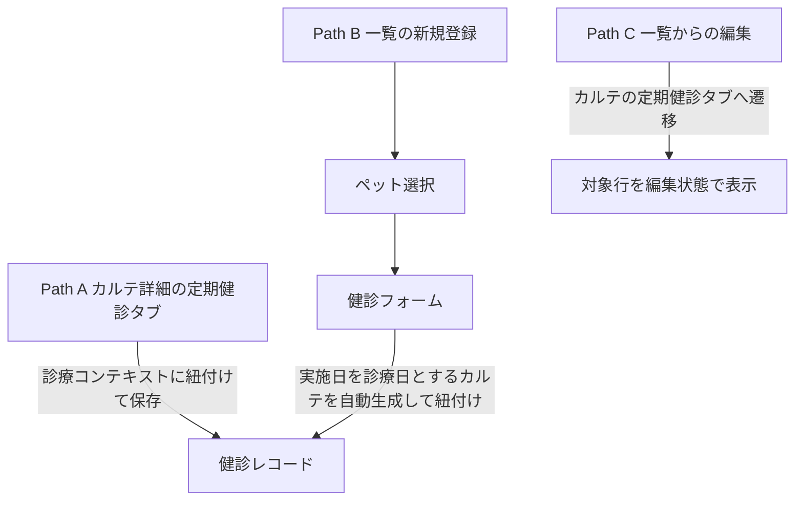

# 定期健診一覧・登録 仕様書 (Checkups)

## 2026-10-15 D09仕様整理の優先順位

業務・例外・GWTは[健診ライフサイクル](../domains/checkups/lifecycle.md)、現wire／部分成功は[技術契約](../../design/domains/checkups/technical-spec.md)を正本とする。以下は現行UI参照として保持する。

- ADR004によりCheckup系が唯一の健診正系統。検査系へ二重記録しない。
- [2026-10-15の確認付きフォロー](../line/lstep-integration.md#crm-followup-confirmation)は、作成だけで送信せずスタッフが実施済み・送信対象を確認後に扱う。一般のお礼と医療的再検査／受診案内を分け、後者は医師の要フォロー指定が必要。現画面の登録成功や次回日表示を確認・送信成功に読み替えない。確認UI／APIの実装は未確認。受入はD09のfollowup-confirmation／followup-purpose／followup-recoveryを参照する。
- Path Bは親カルテ作成→健診作成→値がある場合field-results PUTの最大3要求である。以下の2要求の説明は本体作成部分であり、全体atomic保存を意味しない。後段失敗時は前段IDを照会し、無条件再create／自動削除をしない。
- field-resultsのGETは現screen記載どおり入力UIへの復元未配線という制約を残す。一方、独立登録のPUTは配線されているため「field API全て未使用」としない。
- 独立フォームは種別・実施日が必須、担当医等を新たに必須化しない。[最新第3項合意](../domains/checkups/lifecycle.md#checkup-next-date-approved)により、次回日は健診パッケージ設定から候補を出し手入力も可能。設定・保存済み日付・手入力日がなければ空欄とし、一律1年後を補完しない。旧1year初期値は解消対象の実装差。手入力・保存済み日付を現在設定で黙って上書き／消去しない。設定の取得失敗／未知値を設定なしの空欄既定として成功扱いしない。受入はD09のnext-manual／next-package-candidate／next-no-setting-blank／next-history-preserved／next-setting-unknown。
- 独立フォーム離脱保護なし、versionなし、必要監査／再送receipt等の未追従を明示し、カルテ本体の保護だけで全経路完成としない。

## 概要
- **画面の目的**: ペットの身体測定や一般健診の履歴を管理し、次回予定日に基づく受診漏れを防止する。
- **URLパターン**: 
  - 一覧表示: `/checkups`
  - ペット選択: `/checkups/select-pet`
  - 新規登録: `/checkups/new`
- **アクセス権限**: 一覧は `ResourceCheckups` **`view`**。select-pet/new は `ResourceMedicalRecords` の **create かつ edit**

---

## 1. 登録エントリーポイント

臨床現場の状況に合わせ、2 つの登録経路を提供しています。

### Path A: カルテ経由（メイン）
診察中のカルテ詳細画面 (`/medical-records/:id`) の「定期健診」タブから登録。
- **特徴**: 既存の診療コンテキストに紐付けて記録を保存します。
- **自動連携**: 保存した内容は、即座に当該カルテのサブリソースとして管理されます。

### Path B: 独立登録（クイック）
定期健診一覧画面の「新規登録」ボタンから実行。
- **フロー**: ペット選択 → 健診フォーム。
- **自動処理**: 健診を登録すると、フロントエンドの `useCheckupForm` が内部的に**実施日を診療日とするカルテを自動生成**した後に、健診記録を紐付けます。
- **患者ヘッダー**: `PatientInfoCard` + `formatPatientPetDetails` に `species` を渡す。動物種は実データを表示する。

### Path C: 一覧からの編集
行の編集は独立編集ルートを持たない。`/medical-records/:id?tab=定期健診&checkupId=` へ遷移し、カルテの定期健診タブで対象行を編集状態にする。問診タブへ落ちない。

---

## 2. 画面構成

### 2.1 健診・期限管理テーブル (`DataTable`)
| カラム | 説明 |
|:---|:---|
| **実施日** | 健診が行われた日付。 |
| **飼主名** | 飼主氏名。 |
| **ペット名** | 対象ペット名。 |
| **健診種別** | 混合ワクチン、狂犬病、フィラリア、健康診断等のマスタ区分。 |
| **次回予定 / アラート** | 保存済み次回日を表示し、**期限切れ（赤）**、**期限間近（黄）** のバッジで区別。未設定は空欄で、マスタ現在値や一律1年後から再計算しない。 |
| **結果・所見** | 診察内容の要約。 |
| **担当医** | 健診を実施した医師。 |

### 2.2 高度なフィルタリング (`PropertyFilter`)
- **期限状態**: 「期限切れ」または「期限間近（30日以内）」の個体のみを抽出。Lステップでの一括配信リスト作成に活用します。
- **全文検索**: 名前や所見内容でのキーワード検索（取得済みの現在ページ内でのクライアントサイド絞り込み）。

---

## 3. 臨床安全ガード

### 死亡登録後の生前健診記録
[最新合意](../domains/checkups/lifecycle.md#checkup-deceased-retrospective)に従い、生前健診の後日入力・誤記訂正は死亡状態を戻さず理由・履歴付き専用経路へ。通常Path Bや死亡状態取消で代用せず、生前の実施時点不明なら確認する。新たな健診・未来予約を許可せず、自動返金・在庫戻しは行わない。専用UI／保存の実装適合は未確認。

### ステータス・ロック
- **確定済カルテの保護**: 紐付くカルテが「確定済 (finalized)」ステータスの場合、健診記録の追加・編集・削除ボタンは非表示になり、「確定済みカルテのため健診情報は編集できません」の注記を表示して臨床記録の整合性を守ります。

### 離脱ブロック
- `CheckupForm`（独立登録フォーム）には離脱時の変更破棄確認は実装されていません。カルテ本体（`MedicalRecordForm`）側の `NavigationBlocker` は、Path A でカルテ全体を編集中の離脱のみを保護します。

---

## 技術仕様

### コンポーネント構成
- **`CheckupsList`**: メイン一覧ページ。
- **`CheckupForm`**: 登録・編集用統合フォーム。
- **`CheckupAlertBadge`**: 残り日数に応じた動的警告表示部品。
- **`useCheckupForm`**: 保存時に `POST /v1/medical-records` と `POST /v1/medical-records/:id/checkups` を連続実行するオーケストレーター。

### API連携
| メソッド | エンドポイント | 用途 | 必須権限 | 必須アクション |
|:---|:---|:---|:---|:---|
| GET | `/api/v1/checkups` | 条件に応じた健診履歴のサーバページング取得（1ページ20件。画面上のアラート表示は `CheckupAlertBadge` が行単位で算出） | `checkups` | `view` |
| GET | `/api/v1/checkups/field-results` | ペット単位の健診結果（レポート用）取得 | `checkups` | `view` |
| POST | `/api/v1/medical-records` | Path B におけるベースカルテの自動生成 | `medical-records` | `create` |
| GET | `/api/v1/medical-records/:id/checkups` | カルテに紐付く健診レコード一覧の取得 | `medical-records` | `view` |
| POST | `/api/v1/medical-records/:id/checkups` | カルテに紐付く新規健診レコードの保存 | `medical-records` | `create` |
| PATCH | `/api/v1/medical-records/:id/checkups/:checkupId` | 健診レコードの更新 | `medical-records` | `edit` |
| DELETE | `/api/v1/medical-records/:id/checkups/:checkupId` | 健診レコードの削除 | `medical-records` | `delete` |
| GET | `/api/v1/medical-records/:id/checkups/:checkupId/field-results` | 健診パッケージの結果値の取得（バックエンドに実装済みだがフロントエンドからは未呼出） | `medical-records` | `view` |
| PUT | `/api/v1/medical-records/:id/checkups/:checkupId/field-results` | 健診パッケージの結果値の一括更新 | `medical-records` | `edit` |

---

