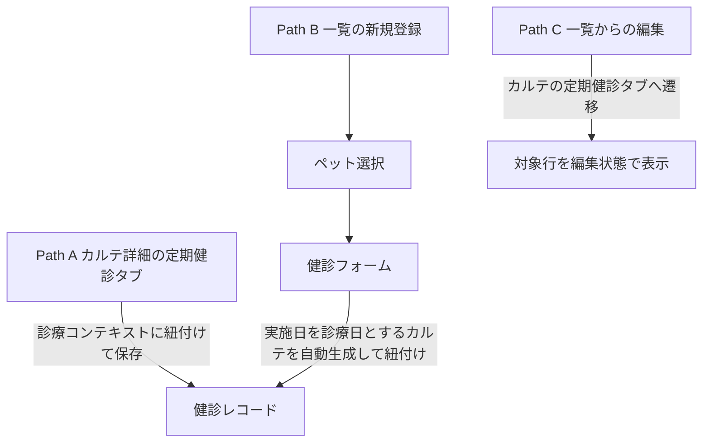

# 定期健診一覧・登録 仕様書 (Checkups)

> 2026-10-20追加目標：カルテ内の定期健診タブは[治療プランの同一予定追跡FR／10AC](../domains/medical-records/pages/medical-record-form.md#requirement-fr-medical-records-plan-domain-tabs)へ接続し、追加した予定を未実施として示す。保存済み実績／結果と区別し、予定追加だけで実施・結果確定・証明書発行・健診完了・機器送信・請求確定を行わない。実績の既決入力・訂正・認可は[領域正本](../domains/checkups/lifecycle.md#checkups-plan-tab-link)を維持し、別本文の二重入力を作らない。[設計差分](../../design/domains/checkups/technical-spec.md#plan-tab-link-design)は未実装／実機未確認。独立一覧・過去履歴の全件を未実施予定へ置換する意味ではない。

## 2026-10-15 D09仕様整理の優先順位

業務・例外・GWTは[健診ライフサイクル](../domains/checkups/lifecycle.md)、現wire／部分成功は[技術契約](../../design/domains/checkups/technical-spec.md)を正本とする。以下は現行UI参照として保持する。

- ADR004によりCheckup系が唯一の健診正系統。検査系へ二重記録しない。
- [2026-10-15の確認付きフォロー](../line/lstep-integration.md#crm-followup-confirmation)は、作成だけで送信せずスタッフが実施済み・送信対象を確認後に扱う。一般のお礼と医療的再検査／受診案内を分け、後者は医師の要フォロー指定が必要。現画面の登録成功や次回日表示を確認・送信成功に読み替えない。確認UI／APIの実装は未確認。受入はD09のfollowup-confirmation／followup-purpose／followup-recoveryを参照する。
- Path Bは親カルテ作成→健診作成→値がある場合field-results PUTの最大3要求である。以下の2要求の説明は本体作成部分であり、全体atomic保存を意味しない。後段失敗時は前段IDを照会し、無条件再create／自動削除をしない。
- field-resultsのGETは現screen記載どおり入力UIへの復元未配線という制約を残す。一方、独立登録のPUTは配線されているため「field API全て未使用」としない。
- 独立フォームは種別・実施日が必須、担当医等を新たに必須化しない。[最新第3項合意](../domains/checkups/lifecycle.md#checkup-next-date-approved)により、次回日は健診パッケージ設定から候補を出し手入力も可能。設定・保存済み日付・手入力日がなければ空欄とし、一律1年後を補完しない。旧1year初期値は解消対象の実装差。手入力・保存済み日付を現在設定で黙って上書き／消去しない。設定の取得失敗／未知値を設定なしの空欄既定として成功扱いしない。受入はD09のnext-manual／next-package-candidate／next-no-setting-blank／next-history-preserved／next-setting-unknown。
- 独立フォーム離脱保護なし、versionなし、必要監査／再送receipt等の未追従を明示し、カルテ本体の保護だけで全経路完成としない。

## 概要
- **画面の目的**: ペットの身体測定や一般健診の履歴を管理し、次回予定日に基づく受診漏れを防止する。
- **URLパターン**: 
  - 一覧表示: `/checkups`
  - ペット選択: `/checkups/select-pet`
  - 新規登録: `/checkups/new`
- **アクセス権限**: 一覧は `ResourceCheckups` **`view`**。select-pet/new は `ResourceMedicalRecords` の **create かつ edit**

---

## 1. 登録エントリーポイント

臨床現場の状況に合わせ、2 つの登録経路を提供しています。

### Path A: カルテ経由（メイン）
診察中のカルテ詳細画面 (`/medical-records/:id`) の「定期健診」タブから登録。
- **特徴**: 既存の診療コンテキストに紐付けて記録を保存します。
- **自動連携**: 保存した内容は、即座に当該カルテのサブリソースとして管理されます。

### Path B: 独立登録（クイック）
定期健診一覧画面の「新規登録」ボタンから実行。
- **フロー**: ペット選択 → 健診フォーム。
- **自動処理**: 健診を登録すると、フロントエンドの `useCheckupForm` が内部的に**実施日を診療日とするカルテを自動生成**した後に、健診記録を紐付けます。
- **患者ヘッダー**: `PatientInfoCard` + `formatPatientPetDetails` に `species` を渡す。動物種は実データを表示する。

### Path C: 一覧からの編集
行の編集は独立編集ルートを持たない。`/medical-records/:id?tab=定期健診&checkupId=` へ遷移し、カルテの定期健診タブで対象行を編集状態にする。問診タブへ落ちない。

---

## 2. 画面構成

### 2.1 健診・期限管理テーブル (`DataTable`)
| カラム | 説明 |
|:---|:---|
| **実施日** | 健診が行われた日付。 |
| **飼主名** | 飼主氏名。 |
| **ペット名** | 対象ペット名。 |
| **健診種別** | 健診パッケージマスタ（`checkup_types`）の対象パッケージ名。接種種類はD08の予防接種と区別する。 |
| **次回予定 / アラート** | 保存済み次回日を表示し、**期限切れ（赤）**、**期限間近（黄）** のバッジで区別。未設定は空欄で、マスタ現在値や一律1年後から再計算しない。 |
| **結果・所見** | 診察内容の要約。 |
| **担当医** | 健診を実施した医師。 |

### 2.2 高度なフィルタリング (`PropertyFilter`)
- **期限状態**: 「期限切れ」または「期限間近（30日以内）」の個体のみを抽出。Lステップでの一括配信リスト作成に活用します。
- **動物種と期間**: 動物種の絞込みと日付の開始／終了による期間指定を併用でき、「2年以内に健診を受けた犬」等を抽出する。動物種は取得済みの表示ページ内に適用される既存制限を示し、全期間全件への検索完了と誤表示しない。現行の動物種マスタと日付取得範囲を維持し、新しい固定種enumを作らない。根拠はBacklog Phase1 No.55 F56:G56、2026-10-01回答。
- **テキスト検索**: ペット名・飼主名・健診種別を扱う。既存の所見検索も維持し、取得済みの現在ページ内でのクライアント絞込みと全件検索を区別する。No.55回答が示す対象を、所見一般の記載だけで代替しない。

---

### No.55の受入条件（未実施）

| 条件ID | 前提／操作 | 期待結果 | 根拠 |
|:---|:---|:---|:---|
| AC-checkups-species-period-search | 動物種と2年の期間を指定し、ペット名／飼主名／健診種別でも検索する | 期間と動物種を併用し、各テキスト対象で該当行を探せる。種とテキストの現在ページ内制限を明示し、範囲外を含めた0件を断定しない。期限切れ／期限間近の既存条件も維持 | No.55、本節 |

## 3. 臨床安全ガード

### 死亡登録後の生前健診記録
[最新合意](../domains/checkups/lifecycle.md#checkup-deceased-retrospective)に従い、生前健診の後日入力・誤記訂正は死亡状態を戻さず理由・履歴付き専用経路へ。通常Path Bや死亡状態取消で代用せず、生前の実施時点不明なら確認する。新たな健診・未来予約を許可せず、自動返金・在庫戻しは行わない。専用UI／保存の実装適合は未確認。

### ステータス・ロック
- **通常編集と履歴保護**: 最新の[D03接続](../domains/checkups/lifecycle.md#checkup-normal-edit-autosave)により、診療終了／旧finalizedだけで入力・編集ボタンを一律非表示にしません。現在権限・患者／親参照・版・変更履歴を確認し、記録自体の削除や患者取り違え・死亡後処理の別保護は維持します。旧finalizedによる一律編集拒否表示は目標との差分です。

### 離脱ブロック
- `CheckupForm`（独立登録フォーム）には離脱時の変更破棄確認は実装されていません。カルテ本体（`MedicalRecordForm`）側の `NavigationBlocker` は、Path A でカルテ全体を編集中の離脱のみを保護します。

---

## 技術仕様

### コンポーネント構成
- **`CheckupsList`**: メイン一覧ページ。
- **`CheckupForm`**: 登録・編集用統合フォーム。
- **`CheckupAlertBadge`**: 残り日数に応じた動的警告表示部品。
- **`useCheckupForm`**: 保存時に `POST /v1/medical-records` と `POST /v1/medical-records/:id/checkups` を連続実行するオーケストレーター。

### API連携
| メソッド | エンドポイント | 用途 | 必須権限 | 必須アクション |
|:---|:---|:---|:---|:---|
| GET | `/api/v1/checkups` | 条件に応じた健診履歴のサーバページング取得（1ページ20件。画面上のアラート表示は `CheckupAlertBadge` が行単位で算出） | `checkups` | `view` |
| GET | `/api/v1/checkups/field-results` | ペット単位の健診結果（レポート用）取得 | `checkups` | `view` |
| POST | `/api/v1/medical-records` | Path B におけるベースカルテの自動生成 | `medical-records` | `create` |
| GET | `/api/v1/medical-records/:id/checkups` | カルテに紐付く健診レコード一覧の取得 | `medical-records` | `view` |
| POST | `/api/v1/medical-records/:id/checkups` | カルテに紐付く新規健診レコードの保存 | `medical-records` | `create` |
| PATCH | `/api/v1/medical-records/:id/checkups/:checkupId` | 健診レコードの更新 | `medical-records` | `edit` |
| DELETE | `/api/v1/medical-records/:id/checkups/:checkupId` | 健診レコードの削除 | `medical-records` | `delete` |
| GET | `/api/v1/medical-records/:id/checkups/:checkupId/field-results` | 健診パッケージの結果値の取得（バックエンドに実装済みだがフロントエンドからは未呼出） | `medical-records` | `view` |
| PUT | `/api/v1/medical-records/:id/checkups/:checkupId/field-results` | 健診パッケージの結果値の一括更新 | `medical-records` | `edit` |

---

## 一覧条件の確定（2026-10-17）

[決定根拠・適用範囲](../domains/SPECIFICATION_PROGRESS.md#confirmed-business-decisions-20261017)：ユーザーの2026-10-16〜17 JSTの直接決定、文書更新承認は10月17日03:20 JST。以下は目標仕様・未実行の受入条件であり、実装・実機合格を示さない。

[一覧の共通正本・4受入条件](../shared/ui-contracts.md#list-filter-contract-20261017)へ従う。台帳・カルテ履歴の初回医院は権限内全医院で次回選択保持。日付付き通常業務6一覧はメニュー当日・詳細復帰で条件保持、行ペットはID指定・日付解除全期間・医院維持。入院ホテル／見積は当日初期化除外、受付は選択日、未納は繰越表示、台帳マスタは当日対象外。表示ページだけを全期間検索結果としない。

## 10/19後続承認：同種操作・検索ボタン方式

本画面の既存キーワード欄は[適用台帳 L07 / H05](../shared/interaction-scope.md)と[共通FR/8AC](../shared/ui-contracts.md#interaction-consistency-20261019)へ従う。入力中/適用済みを分け、入力/待機/消去だけでは検索せず検索ボタンで適用。既存の明示リセット、独立filter、詳細復帰、認可・検索対象・取得上限/ページ内制限を保持し、全件検索や一律の保存方式へ変えない。取得中/0件/失敗と遅延応答を分け、検索で選択/保存/コピー/送信を確定しない。旧defer/debounceの記載は入力即適用の目標に用いず、適用後の描画最適化と区別する。[S14手順](../../ops/testing/scenarios/S14-search-and-multi-word.md#cross-ui-search-20261019)を各対象IDで実施する受入条件とし、実装適合・実機は未確認。
