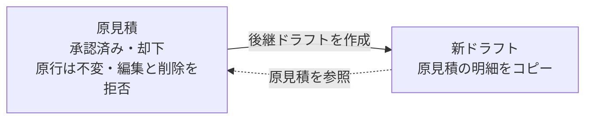

# 見積書詳細 仕様書 (Estimate Detail)

| 管理項目 | 記載 |
|:---|:---|
| 文書ID・種別 | page.estimates.detail／画面仕様 |
| 決定状態 | 既存記載を継承。E1の目標は2026-10-15依頼者承認（業務正本参照）。既存詳細すべての再承認ではない。 |
| 実装状態 | 現行差を分離。今回実装変更・網羅監査なし |
| 実機検証状態 | 未実施。受入条件は検査定義 |
| 文書確認日 | 2026-10-15 |
## 業務正本と現在の説明範囲

[業務契約・FR／受入条件・例外・未決](../domains/estimates/business-rules.md)。原見積ロック・理由付き後継を保持。変更・期限切れ再提示は後継へ。会計転記は対象確認後の未確定会計で、承認だけでは請求・入金・在庫を動かさない。

## 追加承認の目標と現行との差

2026-10-15追加承認：承認済み・期限内で内容と数量が同じなら提示単価を使う。追加処置や内容・数量変更は再説明し、提示済み見積は返答待ちでも原本を残して後継改訂・再提示する。税・保険・割引は既存適用条件を維持し、総額の無条件固定や自動請求確定に拡張しない。 [追加合意の正本](../domains/estimates/business-rules.md#estimate-price-presentation-agreement-20261015)を参照。下記の送付済み編集可・承認／却下だけのロック判定・既存図は現行実装の説明であり、新しい提示原本保護が実装済みという意味ではない。目標では提示済みの金額・明細変更は「改訂版を作成」へ誘導し、元版と変更点を確認して再提示する。提示版への返答記録は金額・明細の上書きと分ける。カルテ見積タブにも同じ条件を適用する。

## 概要
- **画面の目的**: 作成済みの見積内容の最終確認、および承認ステータスの遷移。
- **URLパターン**: `/estimates/:id`
- **アクセス権限**: 親 `/estimates` の `ResourceEstimates` **`view`** を継承。編集/削除は `usePermission`

---

## 1. 画面構成

### 1.1 見積基本情報
- **ステータスバッジ**: 下書き（グレー）、送付済み（青）、承認済み（緑）、却下（赤）の色分け。
- **宛先情報**: 飼主名。ペット名がある見積ではペット名も表示。

### 1.2 明細・金額サマリ
`EstimateLineItems` により、保存済みの明細とヘッダ金額を表示します（明細行の合計のみ `calcLineItemAmount` で算出）。
- **明細リスト**: 品目名、カテゴリ、単価、数量、税率、割引、金額。カルテ見積タブまたは後継ドラフトから作った見積は明細がある。独立画面 `/estimates` はヘッダ金額のみ保存するため、明細は空になり得る（[23-estimate-form.md](./23-estimate-form.md)）。
- **総合計**: 小計、消費税、保険適用額、割引、合計金額（ヘッダ値）。

### 1.3 付属情報
- **コメント**: 飼主向けコメント。
- **備考**: スタッフ間での情報共有メモ。

---

## 2. 主要な運営機能

### 2.1 編集・削除制御
- **保護**: `ResourceEstimates` の編集・削除権限がないユーザーには、ボタンが非表示となります。
- **確定ロック**: 承認済み・却下の見積は `isEstimateLockedStatus` 判定で編集・削除ボタン自体が非表示となり、バックエンドも `UpdateIfNotLocked` / `DeleteIfNotLocked` で更新・削除を原子的に拒否します（下書きへ戻す / unlock 手段はありません。不可逆）。
- **訂正経路**: 確定見積の修正は後継ドラフトのみ（`POST /api/v1/estimates/:id/successors`）。原行は不変で、新 draft が `supersedes_estimate_id` で原見積を参照する（S07・TASK-012 FINAL B）。
- **削除制約**: 明細が残っている見積は削除できません（バックエンドが競合エラーで拒否）。

---

## 3. 技術仕様

### 3.1 構成コンポーネント
- **`EstimateDetail`**: 統合コンテナ。
- **`EstimateLineItems`**: 明細リストと合計金額の表示部品。

### API連携
| メソッド | エンドポイント | 用途 | 必須権限 | 必須アクション |
|:---|:---|:---|:---|:---|
| GET | `/api/v1/estimates/:id` | 明細を含む見積詳細情報の取得 | `estimates` | `view` |
| DELETE | `/api/v1/estimates/:id` | 特定の見積レコードの論理削除 | `estimates` | `delete` |
| POST | `/api/v1/estimates/:id/successors` | 確定見積の後継ドラフト作成（原行不変） | `estimates` | `create` |

---
