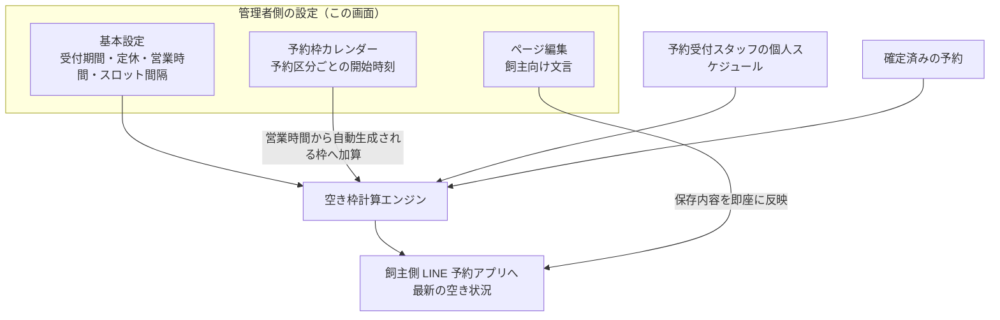

# LINE予約設定 仕様書 (LINE Reservation Settings)

> **注記**: 本画面仕様は文面定義のみで、現時点で画像差分は未収録。

## 概要
- **画面の目的**: 飼主向け LINE 予約システムの稼働状態、受付ルール、および表示内容を一元管理する。
- **URLパターン**: 
  - 基本設定: `/line-reservation/settings`
  - ページ編集: `/line-reservation/page-editor`
  - 予約枠: `/line-reservation/slots`
- **アクセス権限**:
  - 基本設定・ページ編集: `ResourceReservations`（画面遷移）／`ResourceHospitalSettings`（API: GET/PUT `/api/v1/clinics/:clinic_id/line-reservation-settings`）
  - 予約枠: `ResourceMasterReservationType`（API が予約区分マスタ配下のため BE と同一リソースでガード）

---

## 画面構成

### 1. 稼働・受付ルール設定 (`/settings`)
- **LINE予約受付**: 「受付中」または「停止中」の切り替え。
- **受付期間**: 最短・最長の予約受付日数（何日前から何日先までの予約を許可するか）を個別に設定。
- **定休・営業**: 定休曜日、祝日休診、特定定休日、通常/曜日別営業時間、休憩、表示月数、スロット間隔、電話、通知メール。日次/月次上限はこの UI では編集できず、保存時は取得済みの値を維持して送信する。
- **タイムスロットモード**: 
    - **空き時間を最小化**: 予約枠の隙間ができるだけ生まれないよう詰めて割り当てる設定。
    - **空き時間を許容**: 隙間の発生を許容して割り当てる設定。
- **数値入力**: `min` 付き number は HTML5 が先に拒否し、範囲外は API 未到達（V05-8）。本画面の休診は売上集計の締め休診とは別モデル。

### 2. 表示ページ編集 (`/page-editor`)
LINE アプリ内で飼主が見る画面の文言を編集します。`LineReservationPageEditor` はフェーズ別タブ切替ではなく、5 つのテキストエリアを縦に並べた単一フォームです（セクション選択 UI は存在しない）。
- **ヘッダーテキスト (`header_text`)**: LINE 予約ページのヘッダーに表示するテキスト。
- **予約時の注意事項 (`reservation_notice`)**: 予約時に顧客へ表示する注意事項。
- **キャンセル時の注意事項 (`cancel_notice`)**: キャンセル時に表示する注意事項。
- **プライバシーポリシー (`privacy_policy`)**: 個人情報の取り扱いに関する説明。
- **リクエスト例 (`request_example`)**: 予約リクエストの記入例。

`body_text` / `footer_text` という単一フィールドは存在しません（`line_reservation_settings` 実装基準）。保存内容は即座に LIFF アプリへ反映されるため、季節キャンペーンや緊急休診の告知をスタッフ自身で行えます。保存 API は基本設定と同一の PUT `line-reservation-settings`（概要のアクセス権限欄の FE/BE 権限乖離に注意）。

### 3. 連携クレデンシャル
- **LINE連携**: チャネルID（Channel ID）および LIFF ID の登録（`LineReservationSettingsForm`）。
- チャネルシークレット・アクセストークンはこの画面では**扱わない**（旧 SD-3 決裁A。削除済み q&a.html を現在の設定手順として参照しない）。対応する input・送信コードは設けていない。予約通知用 access token は `line_reservation_settings` に暗号化して保持する。Webhook 検証に使う正本の channel secret は `clinic_integrations` の `line_channel_secret` として暗号化して保持する。設定経路は該当する運用 runbook／seed 契約に従い、legacy の `line_reservation_settings.line_channel_secret` を設定先として使わない。

### 4. 予約枠カレンダー (`/slots`)
予約区分ごとの「予約可能な開始時刻（予約可能枠）」を週カレンダー形式で日別に管理します。
- **予約区分ツリー**: 編集対象の予約区分を左のツリーパネル（`ReservationTypeTree`）で切り替え。`?typeId=` クエリで事前選択可能（予約区分マスタのサイドパネル「カレンダーで編集」からの遷移で使用）。無効区分は「（無効）」表記で選択可能。
- **週グリッド**: 予約管理ページと同一スタイル。日付セルをクリックすると下部の編集パネルが開く。
- **特定日枠**: 編集パネルから日別の開始時刻を追加・削除（15分刻み）。
- **毎週枠**: カレンダーでは読み取り専用表示（リピートアイコン付き）。登録・削除は予約区分マスタのサイドパネルで行う。

> ℹ️ **加算モード仕様**: 予約可能枠に登録した開始時刻は、営業時間設定から自動生成される予約可能枠に追加される（ホワイトリストではない）。営業時間内に既に含まれる時刻は重複追加されない。枠を登録しても他の時刻が予約不可になることはなく、枠が未登録の日も通常どおり営業時間から自動生成される。この案内は画面上部に常時表示される（2026-06-11 コミット 2ad756b3 でホワイトリスト方式から加算方式へ変更）。

---

## 主要な機能

### 1. リアルタイムな空き枠計算
ここでの設定と、予約受付スタッフの個人スケジュール（`reservation_schedule_service.go`）、および既に確定している予約 (`/reservations`) を掛け合わせ、飼主側には常に「最新の空き状況」が表示されます。

### 2. 自動通知連携
予約の完了およびキャンセルの通知が、Messaging API を通じて飼主の LINE へ自動送信されます（あわせて病院の通知メール宛にメール通知）。

---

## 技術仕様

### 使用コンポーネント
- **`LineReservationSettings`**: 管理者向け設定ページ。
- **`LineReservationPageEditor`**: 表示ページ編集（§2）。`Textarea`（shadcn/ui）5 個の単一フォーム。
- **`LineReservationSlotsSettings`**: 予約枠カレンダーページ（`features/master`）。
- **`ReservationTypeAvailableSlotsCalendar`**: 週カレンダー + 日別編集パネル。
- **飼主側予約アプリ (`frontend/line-reserve`・別エントリ)**: 飼主が操作する LINE 内予約フロー。画面仕様は [37-line-reserve-owner-flow.md](./37-line-reserve-owner-flow.md) を参照。
- **枠計算エンジン (`timeslot_engine.go`)**: 空き時間を算出するバックエンドロジック。

### API連携
| メソッド | エンドポイント | 用途 | 必須権限 | 必須アクション |
|:---|:---|:---|:---|:---|
| GET | `/api/v1/clinics/:clinic_id/line-reservation-settings` | 稼働状態やルールの取得 | `hospital-settings` | `view` |
| PUT | `/api/v1/clinics/:clinic_id/line-reservation-settings` | 設定の更新 | `hospital-settings` | `edit` |
| GET | `/api/v1/clinics/:clinic_id/reservation-types` | LINE管理用予約区分の一覧取得 | `master-reservation-type` | `view` |
| POST | `/api/v1/clinics/:clinic_id/reservation-types` | LINE管理用予約区分の追加 | `master-reservation-type` | `create` |
| PUT | `/api/v1/clinics/:clinic_id/reservation-types/:id` | LINE管理用予約区分の更新 | `master-reservation-type` | `edit` |
| DELETE | `/api/v1/clinics/:clinic_id/reservation-types/:id` | LINE管理用予約区分の削除 | `master-reservation-type` | `delete` |
| PATCH | `/api/v1/clinics/:clinic_id/reservation-types/:id/status` | LINE管理用予約区分ステータスの更新 | `master-reservation-type` | `edit` |
| PATCH | `/api/v1/clinics/:clinic_id/reservation-types/:id/sort-order` | LINE管理用予約区分表示順の更新 | `master-reservation-type` | `edit` |
| POST | `/api/v1/clinics/:clinic_id/reservation-types/:id/image` | LINE管理用予約区分画像のアップロード | `master-reservation-type` | `create` |
| GET | `/api/v1/masters/reservation-types/:id/available-slots` | 予約可能枠の一覧取得 | `master-reservation-type` | `view` |
| POST | `/api/v1/masters/reservation-types/:id/available-slots` | 予約可能枠の追加 | `master-reservation-type` | `edit` |
| DELETE | `/api/v1/masters/reservation-types/:id/available-slots/:available_slot_id` | 予約可能枠の削除 | `master-reservation-type` | `delete` |

---

## チャネル全域との接続（2026-10-15）

設定・公開・飼主入力／再選択・取消・通知のFR/ACと残件は[飼主側フローのD18整理](37-line-reserve-owner-flow.md#line-channel-document-contract)を参照する。保存済み文言の即時公開、FE/BE権限差、加算枠という現行記載を維持する。D01の予定枠基準・保存時再検証と、実装の既知gapを混同しない。本追記は外部設定変更・公開・通知送信の実行を伴わない。

## D18設定保存の現行技術契約（2026-10-15）

`backend/internal/reservation/line_reservation_setting_service.go` と `line_reservation_setting_handler.go` を静的照合。業務予約条件はD01／LINE予約正本が優先し、本節は設定PUTが実際に保存する境界を分ける。

| 操作 | 現行契約 |
|:---|:---|
| GET | path clinicのhospital-settings:viewを検査。設定なしは204であり通信失敗とは別 |
| PUT | 同医院hospital-settings:edit。部分PATCHではなく入力全体を設定へmapして保存する。初回201、更新200 |
| JSON入力 | 対象JSONの構文を検証。空/null配列は[]、businessHoursはstart0900/end1900の既定。曜日別営業時間は任意。breakHoursはstart/end HHMMの型/形式を保存前検証 |
| 秘密値 | LineAccessTokenが空なら既存値を復号して再暗号化し保持。画面に秘密値がないことは削除指示ではない。ChannelSecret legacy列は本writerの読書き対象外、canonical secretへ無断転記しない |
| 保存失敗 | JSON/休憩形式/秘密値処理等の保存前失敗は成功にしない。repo.Save後は保存modelを返し、成功後のreload失敗を作る経路ではない |
| 同時編集 | 現行入力に期待versionがない。直列保存できることと、古い画面値の全PUT上書き検出は別。全PUTを安全な部分更新と説明しない |
| 予約結果不明 | 設定保存と予約確定は別writer。設定再PUTで予約の不明結果を解決したことにはならない。予約操作ID/照会はD01契約へ接続 |

FR-line-channel-settings-write: 設定の保存対象/省略値/秘密保持/権限を明示し、成功・明確拒否・結果不明を区別する。失敗時に利用者入力を無条件消去せず、古い全PUTによる変更消失を防ぐ方式は技術設計として選定する。期待versionとUI入力保持の実装適合を本静的照合だけで保証しない。

| 条件ID | Given/When | Then | 根拠・確認 |
|:---|:---|:---|:---|
| AC-line-channel-setting-missing | GETが204 | 未設定と通信errorを分け、予約公開可能とは推定しない | handler |
| AC-line-channel-setting-scope | path医院へのeditなしでPUT | 別医院設定を書込まない | handler認可 |
| AC-line-channel-setting-secret | token空で設定更新 | 既存token保持、ChannelSecretをこのwriterで変更しない | service |
| AC-line-channel-setting-json | 不正JSON/休憩HHMMで保存 | 保存前拒否、成功通知しない | service検証 |
| AC-line-channel-setting-stale | 他者変更後に古い全PUT | 現行は期待versionなしというgapを示し、部分更新/競合保護済みと扱わない | input型/Save |
| AC-line-channel-setting-failure-input | 保存error/通信不明 | 入力保持と保存結果確認を分け、別医院に再送しない | 業務受入条件。UI実機確認別途 |
