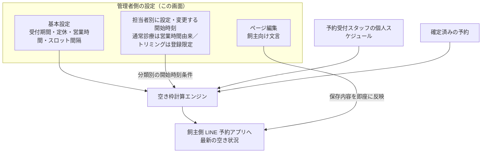

# LINE予約設定 仕様書 (LINE Reservation Settings)

> **注記**: 本画面仕様は文面定義のみで、現時点で画像差分は未収録。

## 概要
- **画面の目的**: 飼主向け LINE 予約システムの稼働状態、受付ルール、および表示内容を一元管理する。
- **URLパターン**: 
  - 基本設定: `/line-reservation/settings`
  - ページ編集: `/line-reservation/page-editor`
  - 予約枠: `/line-reservation/slots`
- **アクセス権限**:
  - 基本設定・ページ編集: `ResourceReservations`（画面遷移）／`ResourceHospitalSettings`（API: GET/PUT `/api/v1/clinics/:clinic_id/line-reservation-settings`）
  - 予約枠: `ResourceMasterReservationType`（API が予約区分マスタ配下のため BE と同一リソースでガード）

---

## 画面構成

### 1. 稼働・受付ルール設定 (`/settings`)
- **LINE予約受付**: 「受付中」または「停止中」の切り替え。
- **受付期間**: 最短・最長の予約受付日数（何日前から何日先までの予約を許可するか）を個別に設定。
- **定休・営業**: 定休曜日、祝日休診、特定定休日、通常/曜日別営業時間、休憩、表示月数、スロット間隔、電話、通知メール。営業時間・休診日の共通基準は[医院設定の2026-10-20回答](../domains/clinic-settings/README.md#clinic-hours-common-basis-20261020)へ従い、本画面のLINE受付時間はその範囲内の制限として別設定する。LINE設定で医院の営業時間外を開放したり共通の休診を営業へ戻したりしない。[2026-10-17の撤回決定](#line-no-user-daily-monthly-limits-20261017)により、利用者ごとの日次／月次予約件数制限とその設定機能は設けない。旧画面の編集不可・取得値保持という説明は既存状態の観察に限り、上限判定や設定機能を目標仕様へ残す根拠にはしない。
- **タイムスロットモード**: 
    - **空き時間を最小化**: 予約枠の隙間ができるだけ生まれないよう詰めて割り当てる設定。
    - **空き時間を許容**: 隙間の発生を許容して割り当てる設定。
- **数値入力**: `min` 付き number は HTML5 が先に拒否し、範囲外は API 未到達（V05-8）。本画面の休診は売上集計の締め休診とは別モデル。

### 2. 表示ページ編集 (`/page-editor`)
LINE アプリ内で飼主が見る画面の文言を編集します。`LineReservationPageEditor` はフェーズ別タブ切替ではなく、5 つのテキストエリアを縦に並べた単一フォームです（セクション選択 UI は存在しない）。
- **ヘッダーテキスト (`header_text`)**: LINE 予約ページのヘッダーに表示するテキスト。
- **予約時の注意事項 (`reservation_notice`)**: 予約時に顧客へ表示する注意事項。
- **キャンセル時の注意事項 (`cancel_notice`)**: キャンセル時に表示する注意事項。
- **プライバシーポリシー (`privacy_policy`)**: 個人情報の取り扱いに関する説明。
- **リクエスト例 (`request_example`)**: 予約リクエストの記入例。

`body_text` / `footer_text` という単一フィールドは存在しません（`line_reservation_settings` 実装基準）。保存内容は即座に LIFF アプリへ反映されるため、季節キャンペーンや緊急休診の告知をスタッフ自身で行えます。保存 API は基本設定と同一の PUT `line-reservation-settings`（概要のアクセス権限欄の FE/BE 権限乖離に注意）。

### 3. 連携クレデンシャル
- **LINE連携**: LINE予約設定画面（`LineReservationSettingsForm`）ではチャネルID（Channel ID）も LIFF ID も登録しない。LIFF ID と LINE の資格情報は `clinic_integrations` だけが保存先で、LSTEP 連携設定（`/settings/integrations/lstep`）から管理する。`PUT line-reservation-settings` に `line_channel_id` / `line_channel_secret` / `liff_id` / `line_access_token` のキーが存在すると、値（空文字・null を含む）に関わらず 400 で拒否する（EMR-504、PO 決裁 Q-U5-1）。
- チャネルシークレット・アクセストークンもこの画面では**扱わない**（旧 SD-3 決裁A。削除済み q&a.html を現在の設定手順として参照しない）。対応する input・送信コードは設けていない。予約通知用 access token は `clinic_integrations` の `line_channel_access_token` として暗号化して保持し、`line_reservation_settings` には保持しない。Webhook 検証に使う正本の channel secret は `clinic_integrations` の `line_channel_secret` として暗号化して保持する。設定経路は該当する運用 runbook／seed 契約に従い、legacy の `line_reservation_settings.line_channel_secret` を設定先として使わない。

### 4. 予約枠カレンダー (`/slots`)

[2026-10-15追加合意1](../line/reservation-spec.md#requirement-fr-line-reservations-business-start-times)では、通常診療の開始時刻は営業時間から自動生成し、トリミングは医院が登録した開始時刻だけを候補にする。時刻は変更可能で、担当者別に設定できる。設定対象の医院・予約区分／業務分類・担当者・日付または曜日を取り違えず表示し、担当者を切り替えても他人の設定を上書きしない。担当者別設定は勤務・個人対応区分・既存予約の占有と別に保持し、登録だけで受付可にしない。

設定変更後は最新値を空き表示・確定時検証へ反映し、保存済み予約は黙って移動・取消・担当変更しない。指名なしでは担当者別設定を満たす適格候補で可否を判定するが、実担当は未定のまま。既存の設定・予約区分の権限を維持し、新しい職種制限や権限を推測しない。操作部品・保存APIの具体化は[技術契約](../../design/domains/reservations/technical-spec.md#line-business-start-times-contract)へ従う。新しい固定間隔・枠数・上限は追加しない。

以下の週カレンダー・毎週リスト・15分刻みは現行UIの参照であり、担当者別設定・時刻変更への適合確認は未実施。現行の追加／削除だけで、合意した時刻変更が完成しているとは扱わない。
- **予約区分ツリー**: 編集対象の予約区分を左のツリーパネル（`ReservationTypeTree`）で切り替え。`?typeId=` クエリで事前選択可能（予約区分マスタのサイドパネル「カレンダーで編集」からの遷移で使用）。無効区分は「（無効）」表記で選択可能。
- **週グリッド**: 予約管理ページと同一スタイル。日付セルをクリックすると下部の編集パネルが開く。
- **特定日枠**: 編集パネルから日別の開始時刻を追加・削除（15分刻み）。
- **毎週枠**: カレンダーでは読み取り専用表示（リピートアイコン付き）。登録・削除は予約区分マスタのサイドパネルで行う。

> **現行差分：旧加算モード**。従来の実装・画面案内は登録開始時刻を営業時間由来の枠へ追加し、未登録時刻も許可する方式（2026-06-11 コミット 2ad756b3）だった。追加合意1のトリミングは登録開始時刻だけに限定するため、旧加算の挙動・画面案内を目標仕様として残さない。通常診療の営業時間からの自動生成は維持する。実装・設定・表示の変更は本ドキュメント作業では行っていない。

---

## 主要な機能

### 1. リアルタイムな空き枠計算
分類別・担当者別の開始時刻設定と、予約受付スタッフの個人スケジュール（`reservation_schedule_service.go`）、勤務・休憩・対応区分、既存予約 (`/reservations`) を照合して飼主側の空き時刻を求める。表示だけで受付を保証せず確定時にも最新情報で再検証する。登録時刻の限定と全体対応能力の検証は両方必要であり、以下は目標仕様の接続図。

### 2. 自動通知連携
[予約通知の目的別条件](../line/reservation-spec.md#5-通知のライフサイクル)に従い、DM未設定／不要だけでは予約確認・変更・予約リマインドを除外しない。アカウント・ブロック・本人／宛先・独立停止等の既存安全条件、best-effortと結果不明時の照合保留は維持する。会員区分変更だけで予約受付・配信可否を自動変更しない。
予約の完了およびキャンセルの通知が、Messaging API を通じて飼主の LINE へ自動送信されます（あわせて病院の通知メール宛にメール通知）。

---

## 技術仕様

### 使用コンポーネント
- **`LineReservationSettings`**: 管理者向け設定ページ。
- **`LineReservationPageEditor`**: 表示ページ編集（§2）。`Textarea`（shadcn/ui）5 個の単一フォーム。
- **`LineReservationSlotsSettings`**: 予約枠カレンダーページ（`features/master`）。
- **`ReservationTypeAvailableSlotsCalendar`**: 週カレンダー + 日別編集パネル。
- **飼主側予約アプリ (`frontend/line-reserve`・別エントリ)**: 飼主が操作する LINE 内予約フロー。画面仕様は [37-line-reserve-owner-flow.md](./37-line-reserve-owner-flow.md) を参照。
- **枠計算エンジン (`timeslot_engine.go`)**: 空き時間を算出するバックエンドロジック。

### API連携

以下は現行APIの一覧。担当者別開始時刻と時刻変更の目標契約は[技術仕様](../../design/domains/reservations/technical-spec.md#line-business-start-times-contract)で定義し、既存の区分単位GET／POST／DELETEだけを対応済みとしない。

| メソッド | エンドポイント | 用途 | 必須権限 | 必須アクション |
|:---|:---|:---|:---|:---|
| GET | `/api/v1/clinics/:clinic_id/line-reservation-settings` | 稼働状態やルールの取得 | `hospital-settings` | `view` |
| PUT | `/api/v1/clinics/:clinic_id/line-reservation-settings` | 設定の更新 | `hospital-settings` | `edit` |
| GET | `/api/v1/clinics/:clinic_id/reservation-types` | LINE管理用予約区分の一覧取得 | `master-reservation-type` | `view` |
| POST | `/api/v1/clinics/:clinic_id/reservation-types` | LINE管理用予約区分の追加 | `master-reservation-type` | `create` |
| PUT | `/api/v1/clinics/:clinic_id/reservation-types/:id` | LINE管理用予約区分の更新 | `master-reservation-type` | `edit` |
| DELETE | `/api/v1/clinics/:clinic_id/reservation-types/:id` | LINE管理用予約区分の削除 | `master-reservation-type` | `delete` |
| PATCH | `/api/v1/clinics/:clinic_id/reservation-types/:id/status` | LINE管理用予約区分ステータスの更新 | `master-reservation-type` | `edit` |
| PATCH | `/api/v1/clinics/:clinic_id/reservation-types/:id/sort-order` | LINE管理用予約区分表示順の更新 | `master-reservation-type` | `edit` |
| POST | `/api/v1/clinics/:clinic_id/reservation-types/:id/image` | LINE管理用予約区分画像のアップロード | `master-reservation-type` | `create` |
| GET | `/api/v1/masters/reservation-types/:id/available-slots` | 予約可能枠の一覧取得 | `master-reservation-type` | `view` |
| POST | `/api/v1/masters/reservation-types/:id/available-slots` | 予約可能枠の追加 | `master-reservation-type` | `edit` |
| DELETE | `/api/v1/masters/reservation-types/:id/available-slots/:available_slot_id` | 予約可能枠の削除 | `master-reservation-type` | `delete` |

---

## チャネル全域との接続（2026-10-15）

設定・公開・飼主入力／再選択・取消・通知のFR/ACと残件は[飼主側フローのD18整理](37-line-reserve-owner-flow.md#line-channel-document-contract)を参照する。保存済み文言の即時公開とFE/BE権限差を維持する。旧加算枠は現行差分に分け、[分類別・担当者別の開始時刻](#line-staff-start-times-settings)を目標仕様とする。D01の予定枠基準・保存時再検証と、実装の既知gapを混同しない。[2026-10-15追加合意2](../line/reservation-spec.md#line-no-nomination-unassigned)では、指名なしを許可する設定が有効でも実担当は未定で受け付け、院内で後から決める。旧no_staff_modeによる実担当自動決定を目標仕様として選択・復活させない。仮の能力判定は維持し、開始時刻方式は追加合意1へ従う。同時枠数や既存設定の削除／自動移行を追加確定しない。本追記は外部設定変更・公開・通知送信の実行を伴わない。

## D18設定保存の現行技術契約（2026-10-15）

`backend/internal/reservation/line_reservation_setting_service.go` と `line_reservation_setting_handler.go` を静的照合。業務予約条件はD01／LINE予約正本が優先し、本節は設定PUTが実際に保存する境界を分ける。

| 操作 | 現行契約 |
|:---|:---|
| GET | path clinicのhospital-settings:viewを検査。設定なしは204であり通信失敗とは別 |
| PUT | 同医院hospital-settings:edit。部分PATCHではなく入力全体を設定へmapして保存する。初回201、更新200 |
| JSON入力 | 対象JSONの構文を検証。空/null配列は[]、businessHoursはstart0900/end1900の既定。曜日別営業時間は任意。breakHoursはstart/end HHMMの型/形式を保存前検証 |
| 秘密値 | LineAccessTokenが空なら既存値を復号して再暗号化し保持。画面に秘密値がないことは削除指示ではない。ChannelSecret legacy列は本writerの読書き対象外、canonical secretへ無断転記しない |
| 保存失敗 | JSON/休憩形式/秘密値処理等の保存前失敗は成功にしない。repo.Save後は保存modelを返し、成功後のreload失敗を作る経路ではない |
| 同時編集 | 現行入力に期待versionがない。直列保存できることと、古い画面値の全PUT上書き検出は別。全PUTを安全な部分更新と説明しない |
| 予約結果不明 | 設定保存と予約確定は別writer。設定再PUTで予約の不明結果を解決したことにはならない。予約操作ID/照会はD01契約へ接続 |

FR-line-channel-settings-write: 設定の保存対象/省略値/秘密保持/権限を明示し、成功・明確拒否・結果不明を区別する。失敗時に利用者入力を無条件消去せず、古い全PUTによる変更消失を防ぐ方式は技術設計として選定する。期待versionとUI入力保持の実装適合を本静的照合だけで保証しない。

| 条件ID | Given/When | Then | 根拠・確認 |
|:---|:---|:---|:---|
| AC-line-channel-setting-missing | GETが204 | 未設定と通信errorを分け、予約公開可能とは推定しない | handler |
| AC-line-channel-setting-scope | path医院へのeditなしでPUT | 別医院設定を書込まない | handler認可 |
| AC-line-channel-setting-secret | token空で設定更新 | 既存token保持、ChannelSecretをこのwriterで変更しない | service |
| AC-line-channel-setting-json | 不正JSON/休憩HHMMで保存 | 保存前拒否、成功通知しない | service検証 |
| AC-line-channel-setting-stale | 他者変更後に古い全PUT | 現行は期待versionなしというgapを示し、部分更新/競合保護済みと扱わない | input型/Save |
| AC-line-channel-setting-failure-input | 保存error/通信不明 | 入力保持と保存結果確認を分け、別医院に再送しない | 業務受入条件。UI実機確認別途 |

## Backlog原条文の補足受入条件

保存済み原Q/Aと既存業務契約の照合による補足。対応済みという旧回答は実装・実機検証の合格証明に用いない。後続の本人合意、医院scope、権限、履歴・会計訂正の既存条件を維持する。

### 1. 稼働・受付ルール設定

通知メールは予約・取消等を医院へ知らせる通知先の設定であり、予約可能枠を制御する設定ではない。定休・祝日休診・営業時間・個別休診の適用先を区別する。

| 条件ID | 受入条件 | 根拠 | 検証状態 |
|:---|:---|:---|:---|
| AC-line-settings-notification-not-capacity | 同じ受付枠条件で通知メール先だけを変更する／空き日時を取得する／通知先変更だけで空き枠・所要時間・勤務能力の判定が変わらない。通知失敗は既存予約保存結果と分離する。 | Phase1 F22:G22 | 未実施 |

### 1. 稼働・受付ルール設定／保存反映

権限のある職員が基本設定のLINE受付時間・定休等を保存した後、医院設定の共通営業時間・休診日との範囲内で、LINE側が取得する予約カレンダーの受付可否へ保存済み条件を反映する。旧個別設定の独立した公開動作は現行観察に限り、共通基準を越える公開の目標としない。共通基準やLINE設定の既存値を自動上書きせず、競合・移行・具体的な保存方式は技術設計で確認する。未保存入力を公開値とせず、個別休診日は既存シフト管理の設定入口と区別する。

| 条件ID | 受入条件 | 根拠 | 検証状態 |
|:---|:---|:---|:---|
| AC-line-settings-business-publication | 権限者がLINE受付時間または定休設定を保存する／飼主が空き日時を再取得する／医院設定の共通営業時間・休診日の範囲内で保存済みLINE条件に基づく受付可否を確認できる。範囲外LINE設定で医院時間外を開放せず、共通休診を再開しない。保存失敗では新設定が反映済みと表示しない。 | Phase1 F22:G22 | 未実施 |

## 利用者ごとの日次・月次予約件数制限を設けない（最新撤回決定）

利用者ごとの1日・1か月の予約件数制限と、その上限を設定・変更する機能は設けない。件数上限の判定を予約の受付条件に使わず、ペット・飼主・LINEアカウントのいずれかを選ぶ計数単位の質問も撤回する。取消済み／医院横断／院内手動の計数、初期値、上限引下げ時の既存予約についても、今回採用しない件数制限の未決課題として残さない。

根拠は本人Sentinel_9eb35782b1148191be132d7c4626fd8cの2026-10-17 11:39 UTC「いや、やっぱり制限しなくていいと思います」、続くSentinel_1d9ae0c686bc8191bdb594c66228e8f9「制限って意味なくない？」。直前の質問Sentinel_03521e4977d08191aab613fac5b8a496／再確認Sentinel_e426f44c76708191abc6f9e7cd3424a1に対するSentinel_bed2aa1090e48191a5b65a6ad607ddfc「ok」による設定可の採用を、この最新撤回が置き換える。

旧2019年公式マニュアルの日次・月次上限は**ユーザー判断で引き継がない**。機能の未実装漏れや採否未決とはしない。旧画面の「編集不可で取得値保持」と設定保存の現行技術観察が残っていても、保持値を件数上限判定に使い続ける目標仕様ではない。旧保存値・DB列・既存データを本作業で削除／変更する指示でもない。実装の適合調査・変更は別工程であり、今回実施していない。

担当者の空き枠、勤務・休憩・対応資格、時間帯ごとの同時対応人数／同時受付上限、休診日・時間外、ホテル同時宿泊頭数、医院scope・権限等の既決チェックは維持する。日次・月次の利用者件数制限を設けない決定を、それらの能力・時間帯条件の撤廃に広げない。

2026-10-17 12:09 UTCの本人Sentinel_066c3d432ef08191a5309abeca798b7e「『同じ時間帯に何件まで受けられるか』それは必要です」に続くSentinel_ffa0f9ab54b08191b33db93eda143051「てかそれはシフト情報で把握してるんじゃね」を合わせ、既存のシフト連動による対応能力判定の再確認として扱う。[全時間の勤務・休憩適格性](../domains/reservations/pages/reservation-management.md#requirement-fr-reservations-duty-staff-selection)、[予定枠に基づくLINE判定](../line/reservation-spec.md#line-scheduled-slot-basis)、[承認済みのコース／オプション所要時間](../domains/reservations/pages/reservation-management.md#booking-course-option-duration-20261017)、[区分をまたぐ対応能力の技術契約](../../design/domains/reservations/technical-spec.md#capacity-assignment-contract)を照合する。担当者のシフト・休憩・対応区分、既存予約と予約所要時間を基に空き・対応可能性を判断する既存仕様と整合し、別途の同時間帯件数設定を新設する承認とはしない。新しい上限値・管理粒度や「一人一件」の一律拒否を追加せず、院内の重複警告確認とLINEの拒否条件、ホテル収容能力等の別制約も既決どおり維持する。

| 条件ID | 前提／操作 | 期待結果 | 検証状態 |
|:---|:---|:---|:---|
| AC-line-settings-no-user-daily-monthly-limit | 既決の空き枠・勤務・同時対応人数等を満たす予約と、設定画面の目標仕様を確認する | 利用者の日次／月次予約件数を理由とする受付制限や、当該件数上限の設定機能を設けない。旧保存値の保持を件数判定継続の根拠にせず、ペット／飼主／LINEの計数単位を追加要求しない | 未実施 |
| AC-line-settings-no-user-limit-capacity-preserved | 利用者件数制限のない条件で、時間帯の対応能力不足、担当者空きなし、休診／時間外をそれぞれ確認する | 各既決の予約可否チェックを引き続き適用する。件数制限撤回を能力や時間帯制約の解除にしない。DB・既存設定値の削除はこの受入条件に含めない | 未実施 |

目標の時間基準は[医院設定とLINE範囲の正本](../domains/clinic-settings/README.md#clinic-hours-common-basis-20261020)。院内の警告確認による時間外登録をLINEへ許可せず、レジ営業日のAM／PM／EMG境界を受付時間の上限として流用しない。物理設定の現存と新基準へのconsumer適合は別に確認する。
