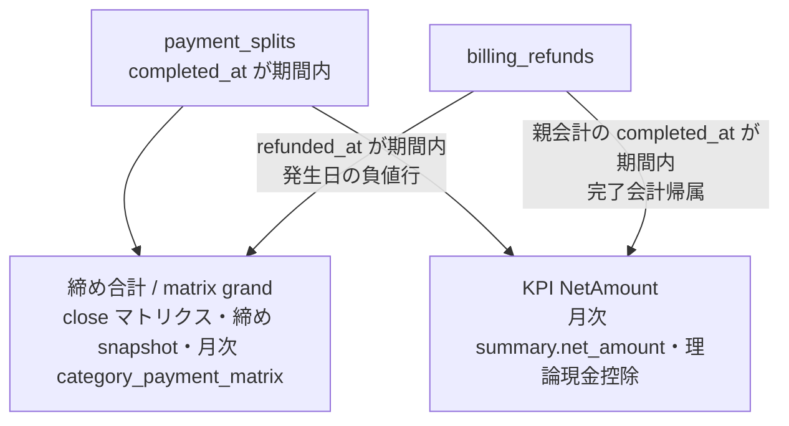

# レジ締め・履歴 仕様書 (Cash Register Close)

| 管理項目 | 記載 |
|:---|:---|
| 文書ID・種別 | page.cash-register.close／画面仕様 |
| 決定状態 | 既存記載を継承（決定根拠未確認の部分を含む）。C1の目標は依頼者2026-10-15承認（Sentinel_7a67fd30e47c819192cd36d416f0a2bf）。追加確認8の実査誤入力訂正は元締めを保持する権限者・理由付き追記として承認済み。既存詳細全体の再承認ではない。 |
| 実装状態 | 現行差を分離。今回実装変更・網羅監査なし |
| 実機検証状態 | 未実施。受入条件は検査定義 |
| 文書確認日 | 2026-10-15 |
## 業務正本と現在の説明範囲

[業務契約・FR／受入条件・例外・未決](../domains/cash-register/business-rules.md)。画面・旧集計と、D10の実受領／実返金event対応目標を分ける。旧completed_at請求額を現金受領額へ読み替えない。

[支払方法停止の追加合意](../domains/accounting/lifecycle.md#accounting-inactive-payment-method)は新しい入金の選択制限であり、停止済み方法の過去記録・方法別集計は保持する。新受領用の有効候補だけで履歴／集計を絞り込まず、既存の無効方法列保持・元取引の安定識別と集計対象額を維持する。期間・配賦・返金帰属の既存契約は変えない。

## 概要
- **画面の目的**: 日次の売上集計、レジ内の現金の突合、および過去の締め記録の管理。
- **URLパターン**: 
  - レジ締め: `/accounting/close`
  - 締め履歴: `/accounting/close/history`
- **アクセス権限**: 会計担当者・医院管理者（`ResourceCashRegisterClose` 権限が必要）

---

## 画面構成

### 1. 当日の売上集計 (`/close`)
- **集計単位選択**: 「午前」「午後」「緊急」のいずれかの区分で集計を実行可能。
- **理論売上表示**: システムが自動計算した、支払方法別（現金、カード等）の売上合計を表示。
- **越日「緊急」の帰属**: 「緊急」区分は当日の診療終了時刻（PM終了）〜翌日の診療開始時刻（AM開始）までの越日レンジで集計される（`resolvePeriodRange`、#215）。そのため深夜0:00〜AM開始前に発生した会計は、日付が変わっていても「前日の緊急」区分に帰属する。過去の締め済みレコードは境界設定（AM開始・PM終了時刻）を変更しても再計算されない。

### 2. 現金突合フォーム (`CashReconciliationCard`)
- **実レジ金額入力**: レジ内の現金の合計額を1つの有限な 0 以上の数値で入力（金種別内訳の入力欄はない）。負値または有限でない値では送信を無効化し、インラインエラーを表示する。
- **過不足算出**: 理論上の現金売上と実際の入力値との差異をリアルタイムに算出。
- **メモ入力**: 追加承認の目標では非0の現金差額がある場合は必須。「原因不明・確認中」でも記録でき、差額0なら任意。現行の任意入力とは区別する。

### 3. 締め履歴一覧 (`/history`)
- **過去の締め記録**: 日付・区分・理論現金・実際の現金・差額・担当者・締め時刻を一覧表示。既定期間は JST 当月。レポートからのドリルダウンは `?date=YYYY-MM-DD` で当該日のみ。
- **区分フィルタ**: AM/PM/緊急は取得済みページ内のクライアント絞り込み。
- **詳細参照**: 各レコードの日付セルのボタンをクリックすると、当時の売上内訳を再確認可能。詳細ダイアログは一覧の snapshot を使い、GET `/:id` は呼び出さない。

### 4. 実査誤入力の訂正（承認済み目標・未実装／未検証）

[D12の実査誤入力訂正](../domains/cash-register/business-rules.md#requirement-fr-closing-actual-input-correction)へ従い、締め履歴の対象医院・営業日・区分・元締めを確認して、訂正操作を許可された担当者が理由と正しい実査額を入力する。保存前に現在の有効実査額、訂正後の額、同じ理論基準での差額を比較する。訂正理由は必須で、初回締めの差額メモ（非0差額では必須、差額0なら任意）とは区別する。

原snapshot／原実査／原差額、追記された訂正、現在の有効実査／差額を区別して表示し、元締めの直接編集・再開・再締めへ誘導しない。版競合は最新値と差分を再確認し、権限不足・理由欠落・保存失敗・結果不明を区別する。結果不明では同じ操作結果を照会し、新しい訂正として連打しない。訂正成功は現金補充・回収・売上・飼主入金を発生させない。

既存履歴詳細の一覧snapshotだけでは最新訂正版を確かめたことにならない。訂正入口では現在の原締め／訂正履歴・版を再取得する目標とし、既存API表を専用訂正の実装済み証拠にしない。

---

## 主要な機能

以下のロック・集計実装説明は既存契約。新しい部分入金／預り金等の受入は業務正本と設計差へ従い、本節を名前だけ変えて流用しない。

### 1. 会計レコードのロック
現行実装では「締める」を実行すると、該当日（同日のいずれかの区分が締め済みなら日単位）の会計レコードが編集不可の状態にロックされます。この日単位判定は追加承認目標の区分単位保護と異なるため、実装適合が必要です。これにより、確定後の不用意な書き換えによる売上不整合を物理的に防止します。修正が必要な場合は、`ResourceAccountingPostCloseEdit`（`accounting-post-close-edit`）権限を持つ担当者が編集理由（`post_close_reason` 必須）を添えて編集します（ロック解除操作は存在しない）。

### 2. 日次報告書の出力
レジ締め画面のプレビュー表示（未締め時）から、「印刷 / PDF出力」ボタンで A4 横形式の「レジ締めサマリー」を印刷・PDF保存できます（`PrintPortal` 基盤を再利用）。院内保管用や本部への提出資料として使用します。締め履歴の詳細ダイアログには印刷導線はありません。

### 3. 部門×支払方法マトリクス（#247 / DEC-16⑥）

> **追記（2026-10-07 監査）**: 本節を DEC-16⑥ 部門×支払方法配賦契約（金額基準・配賦・返金・件数・支払方法列・総額定義と KPI NetAmount との差・回帰テスト）の**正本（契約本文を持つ唯一の節）**とする。[cash-register.md §4](../cash-register.md) と [32-accounting-reports.md ゾーン3](./32-accounting-reports.md) は要約と正本参照に簡約済み。配賦契約の変更は本節のみを更新する。

- **金額基準**: 支払実額（割引適用後）。期間全体の payment 比率による擬似按分は行わない。
- **配賦**: 会計（billing）単位で明細金額比例・最大剰余法によりカテゴリへ配賦。行合計=列合計=総計を円単位で保存する。
- **返金**: 発生日（`refunded_at`）の負値としてマトリクスに載せる。
- **件数**: 会計 distinct（payment split による二重計上なし）。`other` 行は DEC-40 の独立 distinct。
- **支払方法列**: 医院 master の display_order。期間内にデータがある inactive / 削除済み / 不明 method は末尾表示。
- **画面と印刷**: `UnifiedClosingSummaryTable` / `ClosePrintArea` は同一の配賦マトリクスを描画源とする。

#### DEC-16⑥ 返金・総額契約（#247 review MEDIUM / W15）

> ⑥#247 配賦契約: matrix 総額=支払実額基準（割引適用後・締め合計と一致）・割引は明細金額比例で配賦・返金は発生日の負値行・端数は最大剰余法で行合計=列合計=総計を円単位保存・「件数」=会計 distinct・支払方法列は医院 master 順で構築し期間内データを持つ無効/削除済み method は末尾表示。

##### (a) 返金は発生日の負値行（pre-aggregation 禁止）

| 項目 | 内容 |
|:---|:---|
| DEC 引用 | 返金は発生日の負値行 |
| 実装 | `GetCategoryPaymentAllocationData` が `billing_refunds` を `refunded_at ∈ [periodStart, periodEnd)` で **行単位** 取得（`GROUP BY` / 期間内 net 合算なし）。`BuildAllocationBillings` が各返金を `Amount: -ref.Amount` の独立 `AllocationPayment` として `Payments` に append。`AllocateBillingPayments` は payment / 負値 refund を **1 行ずつ** 最大剰余法で配賦する。 |
| 参照 | `backend/internal/billing/accounting_repository_reports_allocation.go`（refund SQL / `BuildAllocationBillings`）、`allocation.go`（`AllocateBillingPayments` / `AggregateCategoryPaymentMatrix`） |
| 判定 | **match** — 同一 billing×method に支払と返金が同居しても、支払へ事前相殺（pre-net）してから配賦しない。親会計が期間外完了でも `RefundParentWeights` でカテゴリ重みだけ補い、返金は発生日の負値行のまま。billing 単位の 1 allocation pass は可（負値行セマンティクスを壊さない）。 |
| 回帰 | `TestBuildAllocationBillings_RefundsRemainSeparateNegativeRows`、`TestAllocateBillingPayments_RefundNegative`、`TestBuildAllocationBillings_Conservation` |

##### (b) matrix 総額 = 締め合計（KPI NetAmount との二重定義）

| 定義 | 算式 | 用途 |
|:---|:---|:---|
| **締め合計 / matrix grand（DEC-16⑥）** | `Σ payment_splits(completed_at ∈ 期間)` − `Σ billing_refunds(refunded_at ∈ 期間)` | レジ締めプレビューの部門×支払マトリクス、締め snapshot の `category_breakdown`、月次 `category_payment_matrix.totals.grand_total`。close / monthly は同一 helper（`GetCategoryPaymentAllocationData` → `BuildAllocationBillings` → `AggregateCategoryPaymentMatrix`）。 |
| **KPI NetAmount（完了会計帰属の返金）** | `Σ payment_splits(completed_at ∈ 期間)` − `Σ refunds(親 billing.completed_at ∈ 期間)` | 月次 `summary.net_amount`（`MonthlyReportResult.GrandTotal`）、`GetCloseAggregate.TotalRefund` 経由の理論現金控除。`sumRefundsForCompletedBillings` / close Query3。 |

| 項目 | 内容 |
|:---|:---|
| DEC 引用 | matrix 総額=支払実額基準（割引適用後・締め合計と一致） |
| 実装 | matrix grand は上記「締め合計」定義そのもの。支払は割引適用後の `payment_splits.amount`（税・保険・会計割引は支払実額側に折り込み済み）。行合計=列合計=総計は最大剰余法で円単位保存。 |
| 判定 | **match（matrix == 締め合計）**。同一期間・同一 clinic では close マトリクス総額と monthly `category_payment_matrix.totals.grand_total` が一致する。 |
| KPI との差 | 返金発生日 ≠ 親会計完了日のとき、`summary.net_amount` / `TotalRefund`（完了会計帰属）と matrix grand（発生日帰属）は **意図的に不一致** になり得る。DEC-16⑥ が正とするのは matrix / 締め合計側。KPI 側は「完了会計に紐づく返金」のレガシー集計であり、matrix を KPI に合わせて書き換えない。 |
| 回帰 | `TestBuildAllocationBillings_Conservation`、`TestBuildAllocationBillings_MatrixGrandEqualsOccurrenceNetNotCompletedAttachedKPI`、`TestAggregateCategoryPaymentMatrix_MultiBillingConservation` |

#### 個別会計明細リスト（EMR-354）

> ※ EMR-354 のチケット要件は確定済みだが、ユーザー報告の**元の紙帳票（ペーパーレポート）実物は未取得**のため、
> 元帳票との完全一致は **未検証**。本節は実装済みの画面・印刷契約を記す。
> 列構成は [accounting-list.md §当日会計](../domains/accounting/pages/accounting-list.md) の
> 日次集計一覧表（A4 landscape）の並びを踏襲する。

- **行単位**: backend は split 明細行（1 会計 × split 数）を返す。画面 `BillingDetailTable` と
  印刷 `ClosePrintArea` は同一の pure 投影（`lib/billing-detail-rows.ts` の
  `projectBillingDetailRows`）で **1 会計 = 1 行** に畳む（`billingId` をキー）。
- **固定列（日次帳票順）**: 領収No（billingId 8桁ゼロ埋め）→ 診療・外科・RV・フード・
  トリミング・ホテル・用品他（部門7バケット、0円セルも残す）→ 支払方法（split を "/" 結合）→
  合計（GROSS = Σ split billing_amount）→ 飼主名 → ペット名。
  日次帳票の部門グルーピング: goods/training/other → 用品他。
- **追加保持列（日次帳票には無いが締め明細として保持）**: 先頭の `時刻`、合計の後の
  `返金額`（全期間スカラを1回）と `純額`（合計−返金）。既存の支払・返金スカラ契約を
  維持するための追加列であり、元帳票への合致を主張しない。
- **`category_amounts`**: 各 split 行の支払額を親会計 billing_items 重みで按分した部門別
  GROSS 内訳（円）。合計はその行の `billing_amount` と一致。返金は含まない（返金・純額は
  従来の全期間スカラ）。フィールド欠落（旧ペイロード）は「記録なし」と表示し、
  MIN(category) への全額寄せは行わない。
- **印刷フッタ**: 明細表の末尾に合計行を1回だけ出力し、可視行の部門 GROSS・合計・
  返金・純額を再集計する。いずれかの行が不明（category_amounts 欠落）なら部門合計も
  「記録なし」（0 捏造しない）。

---

## 技術仕様

### 使用コンポーネント
- **`CashRegisterClosePage`**: レジ締めメイン画面。
- **`CashReconciliationCard`**: 理論現金・実際現金・差額の表示モジュール。
- **`ClosePrintArea`**: 帳票用テンプレートコンポーネント（`cash-register/components/`）。

### API連携
| メソッド | エンドポイント | 用途 | 必須権限 | 必須アクション |
|:---|:---|:---|:---|:---|
| GET | `/api/v1/cash-register/preview` | 指定期間の未確定売上の集計取得 | `cash-register-close` | `view` |
| POST | `/api/v1/cash-register/closes` | レジ締めの確定保存とロックの実行 | `cash-register-close` | `create` |
| GET | `/api/v1/cash-register/closes` | 過去の締め履歴一覧の取得 | `cash-register-close` | `view` |
| GET | `/api/v1/cash-register/closes/:id` | 特定の締め記録詳細の取得（BE実装済みだが本画面からは未呼出） | `cash-register-close` | `view` |

---

## 追加承認目標（2026-10-15）

締め済み保護は実際に締めた区分だけに適用し、午前締めだけで未締めの午後・夜間を保護対象にしない。確定済み会計の訂正条件は維持する。現金差額が残っていても締められるが、非0差額ではメモ必須とし「原因不明・確認中」も許容する。差額合わせの架空入出金は作らない。 [業務正本](../domains/cash-register/business-rules.md#closing-segment-difference-agreement-20261015)。画面は対象営業日・区分・当該境界を表示し、保存時の再集計差額とメモを確認する。提示が古ければ再確認へ戻し、締め保存結果が不明なら履歴・同一操作結果を照会する。差額入力だけで補充／回収を自動登録しない。

## 原資料からの集計内訳追加採用（2026-10-15）

[日次集計原紙](https://drive.google.com/file/d/1IRcdWT7odMxmdH_jC83st8hNBoUjKYxG/view)の往診・病院／トリミング別税と値引き、および[backlog原表](https://docs.google.com/spreadsheets/d/17jaFBv7NmbPzk88lZx94vFxa_G1shGNX2O_lFGt4QdQ/edit#gid=806555289&range=A1:K10)のトレセンを採用する。往診・トレセンを他項目へ合算せず独立表示する。病院／トリミング別の税・値引き内訳を表示する。既存の7バケット説明は現行実装の記録であり、この追加後の目標分類数ではない。

[部門×支払方法の唯一の配賦正本](#closing-allocation-contract)の実支払基準・最大剰余法・返金発生日負値・会計distinct件数・履歴支払方法保持を継承する。部門表示のために税を再計算し元会計額を変えない。元会計の確定済み税／値引きと明細・部門対応を辿って表示し、内訳合計と元会計総額を一致させる。売上・税・値引き・支払実額の異なる基準を同一額と誤認させない。部門の対応が不明な旧明細を名称だけで分類しない。

FR-closing-projectionの追加受入（実機未実施）：

| AC | Given / When | Then |
|:---|:---|:---|
| AC-closing-source-categories | 往診・トレセン明細がある日を表示／印刷する | それぞれ独立表示し二重加算しない。画面と印刷は同じprojectionを使う |
| AC-closing-source-tax-discount | 病院とトリミングの混在・税端数・値引き・返金がある | 元会計の保存済み税／値引きへ突合でき、部門別再計算で金額を変えず、配賦合計が一致する |

明細から部門への対応・確定税の表示配賦の実装照合は残件。未知分類や保存済み内訳不足を勝手な再計算で埋めず、未対応として検出する。
