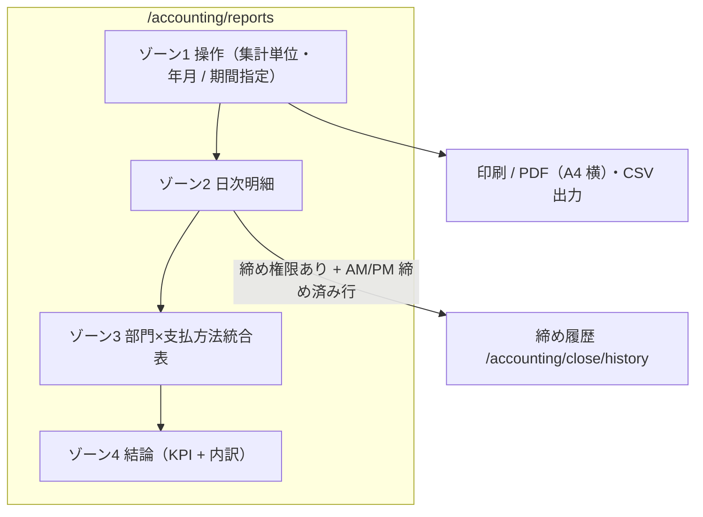

# 月次集計レポート 仕様書 (Monthly Accounting Reports)

| 管理項目 | 記載 |
|:---|:---|
| 文書ID・種別 | page.analytics.accounting-reports／画面仕様 |
| 決定状態 | 既存記載を継承（決定根拠未確認の部分を含む）。個別の承認範囲と根拠は業務正本を参照。 |
| 実装状態 | 現行差を分離。今回実装変更・網羅監査なし |
| 実機検証状態 | 未実施。受入条件は検査定義 |
| 文書確認日 | 2026-10-15 |
## 業務正本と現在の説明範囲

[業務契約・FR／受入条件・例外・未決](../domains/analytics/business-rules.md)。JST暦日と営業日締め、請求・実入金・預り金、matrixと旧KPIの返金帰属を分離する。D10新台帳への適合は未確認。

[支払方法停止の追加合意](../domains/accounting/lifecycle.md#accounting-inactive-payment-method)は新しい入金の選択制限であり、停止済み方法の過去記録・方法別集計は保持する。新受領用の有効候補だけで履歴／集計を絞り込まず、既存の無効方法列保持・元取引の安定識別と集計対象額を維持する。期間・配賦・返金帰属の既存契約は変えない。

## 概要
- **画面の目的**: 月単位または任意期間の売上実績、支払方法内訳、消費税明細を把握し、経営分析や確定申告・会計処理の基礎データを提供する。
- **URLパターン**: `/accounting/reports`
- **アクセス権限**: 経理・医院管理者権限が必要（`ResourceAccountingReports`）

---

## 画面構成

画面は次のゾーンで構成します。上部の「集計単位」セレクタで、月次（年・月の選択）と期間指定（開始日・終了日の入力）を切り替えられます。初期表示は JST 当月（`reportMode = "month"`）。

### ゾーン1. 操作（フィルタ）
集計単位・年月（または開始日・終了日）の選択行。ヘッダー右の「印刷 / PDF出力」「CSV出力」は現状維持。

### ゾーン2. 日次明細
見出しは `{periodLabel} の日次明細`（例:「2026年7月 の日次明細」）。一ヶ月（または指定期間）の推移を日別に詳細表示します。
- **項目**: 日付、曜日、会計件数（午前／午後4列を集約。EMGを含む現行計数の網羅は技術検証事項）、日計、返金、AM締/PM締ステータス。
- **EMR-401 C7-7（2026-10-14 依頼者決定）**: 使われていない午前/午後の件数・売上4列は削除し、会計件数と日計に集約する。午前/午後の集計追加は行わない。印刷の日次明細も同じ列構成とする。AM締/PM締は締め状態のため引き続き表示する。
- **ドリルダウン**: レジ締めの閲覧権限（`ResourceCashRegisterClose`）を保持し、かつ AM/PM いずれかの締めが実行済みの行は、クリックまたは Enter キーで締め履歴（`/accounting/close/history`）の該当日へ遷移できます。

### ゾーン3. 部門×支払方法統合表（#247 / DEC-16⑥）— `CategoryPaymentMatrixTable`
- **目的**: カテゴリ×支払方法を 1 表で確認し、別集計・手計算を削除する。
- **配賦契約**: 支払実額基準（締め合計と一致）・会計単位・明細金額比例・最大剰余法・返金は発生日の負値・件数は会計 distinct・列順は医院 master 順。追記（2026-10-07 監査）: 契約本文の正本は [29-closing-aggregation.md §3](./29-closing-aggregation.md) に一元化したため、本節は画面構成に固有の事項のみ記載する。フッタ件数は期間内完了会計の総 distinct を表示し、行件数の単純合算ではない。
- **印刷**: `MonthlyReportPrintArea` が同一 `category_payment_matrix` を描画（列欠落・横切れを避けるため A4 横）。

### ゾーン4. 結論（KPI + 内訳）— `MonthlySummaryCards`
部門×支払方法統合表より下に配置する。同一データの二重表示を避けるため、上部の支払方法別・消費税セクションは置かない。
- **KPI 4枚**: 診療日数 / 会計件数 / 売上合計（返金併記） / 純売上。
- **内訳3枚**: 支払方法別合計 / 部門別合計 / 消費税内訳（医院設定マスタの標準・軽減税率ごと。医院設定の閲覧権限保持時のみ消費税内訳ヘッダ右に「税率設定を変更」リンクを `taxSettingsLink` として表示）。

---

実現金・現金差額は月次の画面・印刷／PDF・CSVへ掲載しない。[業務正本](../domains/analytics/business-rules.md#requirement-fr-analytics-matrix-report)とAC-analytics-monthly-no-cash-differenceを参照し、締め履歴・日次締め帳票の表示とは分離する。

## 主要な機能

### 1. CSVエクスポート
画面に表示されている集計データ（月次または期間指定）を CSV 形式でダウンロード可能です。外部の会計ソフト（弥生、freee、マネーフォワード等）へのデータ取り込みの補助として利用できます。

### 2. 日別集計とレジ締めステータスの連動
日次明細の各行は `completed_at`（JST変換）の暦日単位で集計されます（医院設定に基づく夜間の日界カットオフは実装されていません）。「AM締」「PM締」列は、当該日の午前・午後区分でレジ締め（`/accounting/close`）が実行済みかどうかを表示します。

### 3. 印刷 / PDF出力
データ取得後、ヘッダーの「印刷 / PDF出力」ボタンからブラウザ印刷（PDFとして保存）で帳票を出力できます。印刷面（`MonthlyReportPrintArea`）は画面表示と同一の集計データを描画源とし、A4 横向きで対象期間・病院名・KPI・支払方法別・消費税・部門×支払マトリクス（`category_payment_matrix`）・日次明細を出力します。

---

## 技術仕様

### 使用コンポーネント
- **`AccountingReportsPage`**: メインページ。
- **`MonthlySummaryCards`**: 指標サマリーのカード部品。
- **`DailyBreakdownTable`**: 日次推移の一覧テーブル。
- **`CategoryPaymentMatrixTable`**: #247 部門×支払方法統合表。
- **`MonthlyReportPrintArea`**: 印刷 / PDF出力用の帳票ビュー（`PrintPortal` 経由・印刷時のみ表示）。

### API連携
| メソッド | エンドポイント | 用途 | 必須権限 | 必須アクション |
|:---|:---|:---|:---|:---|
| GET | `/api/v1/reports/monthly` | 指定年月（`year`/`month`）または期間（`start_date`/`end_date`）の集計データ取得。`category_payment_matrix` を含む | `accounting-reports` | `view` |
| GET | `/api/v1/reports/monthly/csv` | 集計データの CSV 出力（同じく年月・期間の両指定に対応） | `accounting-reports` | `view` |

---

## 日次集計の追加内訳

[原資料採用正本・追加2AC](29-closing-aggregation.md#closing-source-breakdown)へ従い、往診／トレセンを独立表示し、病院／トリミング別の保存済み税・値引きを表示する。分類・税・値引き・支払実額は別概念で、表示配賦で元会計総額を変えない。金額配賦の契約本文は画面29の唯一正本へ維持し、旧分類数を目標の固定数にしない。

## Backlog原条文の補足受入条件

保存済み原Q/Aと既存業務契約の照合による補足。対応済みという旧回答は実装・実機検証の合格証明に用いない。後続の本人合意、医院scope、権限、履歴・会計訂正の既存条件を維持する。

### 月次日次明細から締め履歴へ

| 条件ID | 受入条件 | 根拠 | 検証状態 |
|:---|:---|:---|:---|
| AC-analytics-daily-closing-drilldown | 月次日次明細に対象日があり締め履歴の閲覧認可がある／当該行をクリックまたはEnterする／同じ日付を指定した締め履歴へ移動し、別日や当日既定へ落とさない。 | Phase1 F31:G31 | 未実施 |
