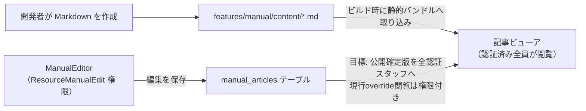

# 取扱説明書（システム内マニュアル） 仕様書 (Internal Manual)

## 概要
- **画面の目的**: システムの操作方法、運用ルール、およびトラブルシューティングをスタッフが院内でいつでも閲覧・検索できる統合ヘルプセンター。
- **URLパターン**: 
  - トップ: `/manual`
  - 記事詳細: `/manual/:category/:slug`
- **アクセス権限**: 認証済み全ユーザー（編集は `ResourceManualEdit` 権限者のみ）

---

## 1. 画面構成

### 1.1 カテゴリ・ナビゲーション (左パネル)
- **2 モード**: トップは `screens`（画面別）と `workflows`（業務フロー）。
- **グループ名**: 各 Markdown の frontmatter `section`。固定の「基本／診療業務…」ラベルではない。
- **閲覧**: 認証済みなら静的バンドルを読む。公開済み版を全認証スタッフが読む。現行実装は `manual-edit:view` がある利用者だけDB overrideを取得するため、公開READ分離への追従は未確認。

### 1.2 記事ビューア (中央パネル)
- **Markdown レンダリング**: 表、リスト、コードブロック、画像を含むリッチなドキュメント表示（`react-markdown` + `remark-gfm`）。

---

## 2. 技術仕様（スタティック import システム）

本マニュアルは、高い保守性と高速な表示を両立するため、Vite の `import.meta.glob` を活用した静的インポートシステムを採用しています。

### 2.1 コンテンツ管理
- **格納場所**: `frontend/src/features/manual/content/` 配下の `.md` ファイル。
- **画像**: 同ディレクトリの `images/` 内に配置し、記事内から相対パスで参照。

### 2.2 検索エンジン
- **クライアントサイド検索**: 全記事のタイトル・セクション名・本文テキストを `fuse.js` で fuzzy search インデックス化し、瞬時の全文検索を実現。

---

## 3. 運用・編集フロー

### 3.1 記事の更新
1.  開発者が `docs/` 配下の正式仕様に基づき、マニュアル用 Markdown を作成。
2.  `src/features/manual/content/` へ配置。
3.  ビルド時に自動的にシステムへ取り込まれます。

### 3.2 DB 連携（編集オーバーライド）
静的 Markdown ファイルを基本としつつ、`ResourceManualEdit` 権限を持つユーザーはシステム画面上（`ManualEditor`）から直接編集が可能です。現行実装の編集内容は `manual_articles` にオーバーライド版として保存されます。2026-10-15合意後の目標は、編集権限者が公開確定した版を全認証スタッフが閲覧・検索・印刷することです。編集・公開・過去版復元の履歴を残し、公開未確定の編集案は一般閲覧に出しません。現行の権限付きoverride取得と履歴APIの存在だけで、この公開・復元の実装済みを主張しません。

---

### API連携
| メソッド | エンドポイント | 用途 | 必須権限 | 必須アクション |
|:---|:---|:---|:---|:---|
| GET | `/api/v1/manual/articles` | 記事メタデータの一覧取得 | `manual-edit` | `view` |
| GET | `/api/v1/manual/articles/:category/:slug` | 特定の記事（コンテンツ）の取得 | `manual-edit` | `view` |
| GET | `/api/v1/manual/articles/:category/:slug/versions` | 特定の記事のバージョン履歴一覧取得（BE実装済みだがフロントエンドからは未呼出） | `manual-edit` | `view` |
| PUT | `/api/v1/manual/articles/:category/:slug` | 記事の追加・更新 | `manual-edit` | `edit` |
| DELETE | `/api/v1/manual/articles/:category/:slug` | 記事の削除 | `manual-edit` | `delete` |

---

## 2026-10-15 公開・履歴の合意

[業務正本](../domains/internal-manual/README.md)・[技術差分](../../design/domains/internal-manual/technical-spec.md)へ従う。編集権限者が公開した版を職員が閲覧し、編集・公開・過去版復元の履歴を残す。ユーザー Sentinel_7a67fd30e47c819192cd36d416f0a2bf の「ok」（確認文 Sentinel_75a3a1bf81b481919ba4c34aa633feb4、対象確認 Sentinel_8d0032ca45b881919b3d2ceb5339f792）。未認証公開・新しい下書き承認workflow・実権限付与を承認したものではない。上のAPI表は現行実装の参照であり、目標の公開READを証明しない。

公開の内容版・公開pointer・履歴・必須監査・receiptは[選定保存契約](../../design/domains/internal-manual/technical-spec.md#manual-selected-save-contract)の同一commit。版競合は原本不変と入力保持、応答不明は同じoperation照合とし、旧版の上書き／重複復元で救済しない。
