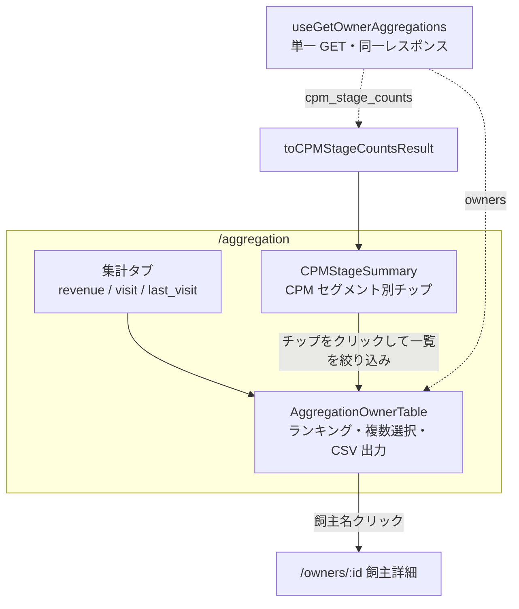

# 顧客集計ダッシュボード 仕様書 (Aggregation Dashboard)

| 管理項目 | 記載 |
|:---|:---|
| 文書ID・種別 | page.analytics.owner-aggregation／画面仕様 |
| 決定状態 | 来院回数は2026-10-15承認6の実来院日基準へ。その他の既存記載と実装差・承認範囲は業務正本を参照。 |
| 実装状態 | 現行差を分離。今回実装変更・網羅監査なし |
| 実機検証状態 | 未実施。受入条件は検査定義 |
| 文書確認日 | 2026-10-15 |
## 業務正本と現在の説明範囲

[業務契約・FR／受入条件・例外・未決](../domains/analytics/business-rules.md)。2026-10-15承認の目標は実来院日基準で、飼主は同日複数ペットでも1回、ペットは各1回。期間・基準・CPM母集団・V1分析とV2配信を区別する。現行SQLのdraftを含むカルテ日distinctは旧記録日数であり、実来院への適合済みとはしない。現行SQLの会計日帰属と実入出金日を混同しない。

## 今期対象外と既存説明の扱い

[Backlog Phase1 No.25・27 F26:G26／F28:G28](https://docs.google.com/spreadsheets/d/17jaFBv7NmbPzk88lZx94vFxa_G1shGNX2O_lFGt4QdQ/edit#gid=0&range=F26:G28)の2026-10-15曽我回答により、年間売上・来院回数ランキングと犬種別集計の画面表示／CSV出力、集計画面のCPMセグメント別人数／一覧表示は今期対象外。以前の「対応済」やサーバエラー修正待ちという記述を今期提供契約へ戻さない。月次売上レポートを今期の集計画面の中心とする（No.28 F29:G29）。以下の対象外機能の計数・母集団・CSVの記述とACは将来再開時の保持条件・既存説明として残し、今期の表示／出力提供や新しい実装完了を意味しない。実来院日を数える後続承認は指標の意味を定めたもので、対象外画面の公開承認ではない。 以下のうち対象外と明記したランキング・犬種別表示／CSV・CPM人数／一覧の説明は旧画面／技術参照と再開時の保持条件であり、今期利用可能な機能の案内として扱わない。最終来院の抽出など、この回答で対象外とされていない機能の既存条件は維持し、/aggregation全体の停止へ広げない。今期の月次売上レポートは[画面32](32-accounting-reports.md)へ。

## 概要（対象外機能は上記区分を参照）
- **画面の目的**: 医院の全顧客を対象とした売上貢献度（LTV）および来院頻度（CPM）の多角的な分析、および優良顧客・離脱懸念顧客の可視化。
- **URLパターン**: `/aggregation`
- **アクセス権限**: 経営・顧客管理権限が必要（`ResourceOwners`）

---

## 1. 画面構成

### 1.1 集計タブ (`UnifiedTabs`)
3つの切り口で顧客を並び替え・絞り込みできます。
- **売上ランキング (revenue)**: 年間診療費でのランキング（既定タブ）。
- **来院回数 (visit)**: 期間内の確認済み実来院日数でのランキングが承認済み目標。未照合の旧値は旧記録日数と表示し、0回や来院なしへ補完しない。
- **最終来院 (last_visit)**: 最終来院日からの経過でのランキング（離脱懸念顧客の抽出に利用）。
- 各タブには専用のフィルタパネル（`AggregationFilterPanel`）があり、金額基準（売上総額／入金額／返金控除後）や期間プリセットを切替可能です。

### 1.2 CPM セグメント別人数サマリー (`CPMStageSummary`)
顧客の定着度をチップ（クリックで一覧を絞り込み可能）で表示します。本画面は `@/lib/cpm-stage` の `AGGREGATION_CPM_STAGE_OPTIONS`（V1 の 6 区分 + 残余 `cpm_unclassified`）を使う。医院設定の CPM バージョンが V2 でもこの一覧は切り替わりません。Lステップタグ同期側は `CPM_STAGE_OPTIONS`（6 区分のみ）を使う。
- **Encounter（初回・新規）**: 初診から間もない顧客。
- **Growing（成長中）**: 定着し始めている顧客。
- **Core（コア顧客）**: 安定して通院している重要顧客。
- **Spot（単発高額）**: 単回高額会計後、来院が途絶えている顧客。
- **Noah（最上位）**: 非常に高い貢献度を持つ最優良顧客。
- **Dormant（休眠）**: 長期間来院のない顧客。
- **Unclassified（未分類）**: V1 の 6 区分に入らない残余（会計実績ゼロだが来院記録がある等）。「すべて」件数は 6 区分 + この残余の合計と一致する。

### 1.3 顧客ランキングテーブル (`AggregationOwnerTable`)
選択タブに応じて列構成が変わる詳細リスト（チェックボックスによる複数選択と CSV 出力に対応）。
- **共通項目**: 飼主名（クリックで `/owners/:id` の飼主詳細ページへ遷移）、CPM セグメント。
- **タブ別項目**: 売上ランキングでは年間診療費・会計件数等、来院回数タブでは期間内/累計/年間来院回数、最終来院タブでは最終来院日・経過日数等。

---

## 2. 主要な分析ロジック

### 2.1 LTV (Lifetime Value) 計算
- **金額基準**: 画面上のフィルタで「売上総額」「入金額」「返金控除後」の3基準を切替可能（既定は売上総額）。

### 2.1a 来院指標の表示・取得基準

期間内／累計／年間の来院回数、同じ指標から導く最終来院日、CSVとCPM入力は[D16の実来院source](../domains/analytics/business-rules.md#requirement-fr-analytics-owner-counts)へ揃える。source基準と照合状況を保持し、下書きの存在だけで来院を加算せず、受付済みの実来院を下書きという理由だけで落とさない。根拠不明・取得失敗を0回／来院なしとして順位や分類を確定しない。旧記録日数表示と新基準を混在させない。既存CPM区分・閾値、rolling365日と選択期間の違いは維持する。

### 2.2 ステージ判定
`aggregation_service.go` 内のロジックに基づき、最新の売上データから動的に判定されます。
- **V1 方式**: 金額と期間を組み合わせた多次元判定。本画面の判定は常にこの V1 方式（`CalculateCPMStage`）で行われます。
- **V2 方式**: 来院回数に特化したシンプルな階層判定（`CalculateCPMStageV2`）。Lステップタグ同期側でのみ使用され、本画面では使用されません。

---

## 3. 技術仕様

### 3.1 パフォーマンス最適化
- **単一リクエスト**: `useGetOwnerAggregations` の1回の GET で一覧 (`owners`) と全7区分の人数 (`cpm_stage_counts`) を同じレスポンスから取得します。人数は `toCPMStageCountsResult` を介してサマリーへ渡します。実来院sourceの未照合で分類が確定できない応答は不完全と示し、不明飼主の除外・0件補完で完全な7区分合計を作りません。
- **人数の母集団**: CPM 区分絞り込み・ページネーション前の母集団全体から算出します。一覧の `total` は CPM 区分絞り込み後の件数です。母集団0件でも全7区分のキーを値0で返します。
- **サーバーサイド集計**: 複雑な LTV 計算は DB レベルで集計を行い、API レスポンスを軽量化しています。

### API連携
| メソッド | エンドポイント | 用途 | 必須権限 | 必須アクション |
|:---|:---|:---|:---|:---|
| GET | `/api/v1/clinics/:clinic_id/owners/aggregations` | 統計サマリ、ランキング、および CPM ステージ分布データの取得 | `owners` | `view` |

---

## 10/19後続承認：同種操作・検索ボタン方式

本画面の既存キーワード欄は[適用台帳 L11](../shared/interaction-scope.md)と[共通FR/8AC](../shared/ui-contracts.md#interaction-consistency-20261019)へ従う。入力中/適用済みを分け、入力/待機/消去だけでは検索せず検索ボタンで適用。既存の明示リセット、独立filter、詳細復帰、認可・検索対象・取得上限/ページ内制限を保持し、全件検索や一律の保存方式へ変えない。取得中/0件/失敗と遅延応答を分け、検索で選択/保存/コピー/送信を確定しない。旧defer/debounceの記載は入力即適用の目標に用いず、適用後の描画最適化と区別する。[S14手順](../../ops/testing/scenarios/S14-search-and-multi-word.md#cross-ui-search-20261019)を各対象IDで実施する受入条件とし、実装適合・実機は未確認。
