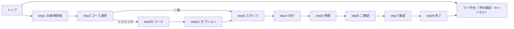

# LINE予約 飼主側フロー 仕様書 (LINE Reserve Owner Flow)

| 管理項目 | 記載 |
|:---|:---|
| 文書ID・種別 | page.line-reservations.owner-flow／D18 業務・画面仕様 |
| 決定状態 | 既存記載を継承。明示済み合意と現行実装説明を分け、2026-10-15通知結果不明時の保留方針は承認済み。実装適合は別 |
| 実装状態 | 既存記載を継承（今回の再監査なし）。既知gapを保持 |
| 実機検証状態 | 今回未実施。テスト名・過去証拠の掲載は再実行を意味しない |
| 文書確認日 | 2026-10-15。本文・参照・FR/AC整理。独立レビュー前 |

17:23 JSTの[LINE予約6点合意](../line/reservation-spec.md#line-agreement-1723)へ従う。公開された診療・トリミング・ホテルは予約対象、入院は医院相談。ホテルには医師指名・医師シフト・通常予約の同日制約を適用しない。受付制限・入力保持・受付前取消・必要設定不足の扱いと受入条件はLINE正本を参照する。ホテル受入基準は17:35合意の医院別同時宿泊頭数・全宿泊期間判定で、実装・実機受入は未確認。

> スタッフ管理側（設定・予約枠・文言編集）は [28-line-reservation.md](./28-line-reservation.md) を参照。本書は飼主が LINE アプリ内で操作する予約フロー（`frontend/line-reserve` 別エントリアプリ）のみを扱う。

## 概要
- **画面の目的**: 飼主が LINE（LIFF）から診療・トリミング・ホテルの予約作成、予約確認、キャンセルを行う。ホテルの承認済み全期間受入と、下記の現行通常／トリミング画面説明の実装状態は分ける。
- **URLパターン**: `/line-reserve/{clinicId}`（pathname から医院 ID を解決。単一ページアプリで内部ステップを切替え、URL は遷移しない）。ローカル dev は Vite rewrite 必須（`/line-reserve/{clinicId}/src/*` を実ファイルへ戻す。末尾スラッシュ付き clinic パス。BUG-402）。
- **メンテナンス**: settings 取得失敗と stopped/maintenance は mock を含め sticky で、LIFF ready/profile 完了が Top へ上書きしない。
- **アクセス権限**: 院内権限は不要。LINE IDトークン認証（`Authorization: Bearer` ヘッダ）を `LiffAuth` ミドルウェアが検証する。`/settings` のみ認証不要（トップ表示用・30回/分の IP レートリミット。`/my-reservations` も 30回/分）。

---

## 画面構成

### フロー全体図

ステップ画面には `ProgressDots`（現在位置ドット・`aria-label` 付き）と `BackButton` が付き、戻っても入力値は `useReservationFlow` の状態に保持される。トリミング分岐（step2b/step2c 経由）では総ステップ数が一般フローより 2 つ多くなるため、`getStepProgress`（`lib/step-progress.ts`）が分岐の有無に応じた一貫した `current`/`total` を算出する（step3 以降の共有ページも含め、分岐前後で番号が後退しない）。step3 スタッフ選択の「戻る」は分岐時のみ step2c（トリミングオプション選択）へ戻る。

### 各画面の役割と入力項目

| 画面 | コンポーネント | 役割・入力項目 |
|:---|:---|:---|
| トップ | `TopPage` | ヘッダー文言（設定の header_text）表示。「新規予約」「予約確認・キャンセル」の 2 導線。電話番号設定時は tel リンクをフッター表示 |
| step1 お客様情報 | `CustomerInfoPage` | お名前・電話番号（必須）、飼主名（任意）、ペット選択。初期値は 戻り操作の入力 → 前回予約時の入力（additional_fields）→ 紐付け済みオーナー情報 の優先順（BUG-387）。紐付け済みオーナーの登録ペットはチェックボックス選択（1頭のみなら自動選択）、新規ペットは名前+種類の自由入力で複数追加可 |
| step2 コース選択 | `CourseSelectPage` | 予約区分一覧（所要時間・紹介文・画像付き）。category が trimming の区分を選ぶと step2b へ分岐 |
| step2b トリミングコース | `TrimmingCourseSelectPage` | トリミングコース一覧（料金・説明付き）から 1 件選択 |
| step2c オプション | `TrimmingOptionSelectPage` | トリミングオプションの複数選択（任意・チェックボックス） |
| step3 スタッフ選択 | `StaffSelectPage` | コース対応スタッフ一覧。設定 show_no_staff_option 有効時は「指名なし」（staff_id=0、サーバー側で no_staff_mode に従い自動割当）を先頭表示 |
| step4 日付選択 | `DateSelectPage` | 月めくり `Calendar`。過去日・booking_window（受付期間）超過日・空きなし日は選択不可。不可日は理由（休診日/祝日休診/スタッフ不在/満席）をツールチップと `aria-label` で提示。日付未選択時は「次へ」を無効化 |
| step5 時間選択 | `TimeSelectPage` | 指定日の空き時間枠一覧。0 件時は「この日の空き時間はありません」 |
| step6 ご要望 | `RequestPage` | 自由記述テキストエリア（任意）。プレースホルダに設定のリクエスト例を表示 |
| step7 確認 | `ConfirmPage` | 入力内容の一覧表示、「まだ予約は完了していません」警告、予約時注意事項・キャンセルポリシー・プライバシーポリシー（設定文言）を表示して確定 |
| step8 完了 | `CompletePage` | 予約番号（notes 中の R-YYYYMMDD-NNNN を抽出）・日時・コース・担当を表示。マイ予約/新規予約への導線 |
| マイ予約 | `MyReservationsPage` | 自分の予約一覧（新しい順）とキャンセル操作 |
| メンテナンス | `MaintenancePage` | 受付停止中の案内（静的表示） |

---

## 主要な機能

### 1. 予約確定までのバリデーション（臨床安全・データ保護）
- **フロント**: step1 で氏名・電話番号の必須チェック（エラーは `role="alert"` で通知）。step4 は日付未選択時に進行不可。送信ボディは axios interceptor で NULL バイト除去（`sanitizeNullBytes`・R-F20）。API レスポンスは全て Zod スキーマで実行時検証（FE5-18）。
- **バックエンド**（`ValidateAndCreate`・`reservation_validators.go`）: 稼働状態 → 営業時間・受付期間・休業日（BUG-LINE-008: API 直叩き対策）→ 予約区分/トリミングマスタの医院所有権検証（クロステナント防止・hard fail）→ 医院単位 advisory lock（`AcquireBookingLock`）下で枠競合・区分定員・同日/同月件数制限をチェックし、通過時のみ INSERT。
- **入力サイズ制限**（`liff_validation.go`）: request_text 1,000 文字以内、customer_fields 全体 10KB・キー 20 個・各文字列値 500 文字以内（DoS・DB 肥大化対策）。

### 2. 枠競合時の挙動（確定時 409）

[状況変化時の入力保持・別日時再選択](../line/reservation-spec.md#requirement-fr-line-reservations-reselect-after-change)が17:23合意の業務契約。現行の画面遷移だけで入力保持まで受入済みとしない。
確定 POST が 409（SLOT_TAKEN / DAILY_LIMIT / MONTHLY_LIMIT / MAINTENANCE）を返すと、`ConfirmPage` がレスポンスの error 文言と redirect_step を読み取り、指定ステップ（4=日付選択、5=時間選択。不明時は 4）へ戻す。通知はブロッキングダイアログではなく画面上部のインライン赤バナー（`role="alert"`・×で閉じる）で行う（FE5-21）。

### 3. 予約完了時の連携
- 確定成功後、LINE トーク画面へ予約番号・日時・コース・ペットを含む確認メッセージを送信（`sendLiffMessage`。LINE アプリ外・失敗時は無視される best-effort）。
- サーバー側でも予約確定/キャンセル通知（飼主 LINE + 病院メール）を fire-and-forget 送信。
- 入力した氏名・電話・ペットは顧客の `additional_fields` に自動保存され、次回予約時に復元される。**氏名+電話番号による `line_customers.owner_id` 自動紐付けは行わない**（SEC-CS2-F02 / `liff_service_reservations.go`）。既に link-token またはスタッフ操作で owner が紐付いている顧客のみ、予約へ `owner_id` / `pet_id` を best-effort で反映する。

### 4. マイ予約のキャンセル可否ルール

業務正本は[来院受付前の飼主取消](../line/reservation-spec.md#requirement-fr-line-reservations-owner-cancel)。以下は現行実装の確定ステータス限定の説明であり、受付前という全業務状態への対応は未確認。飼主による直接変更・取消復元は設けず、医院へ連絡する。
- 一覧は本人（LINE 顧客 ID）の予約のみ。ステータスバッジ（確定/確認中/受付済/診察中/会計中/完了/未来院/キャンセル済）を色分け表示。
- **キャンセルボタンはステータスが「確定」（confirmed）の予約にのみ表示**。来院後ステータス（受付済以降）はこの画面からキャンセル不可。日時による締切はなく、当日でもキャンセル可能。
- 押下するとカード内インラインで「本当にキャンセルしますか？」の確認を挟み、確定するとバックエンドの `CancelByID` が本人・医院スコープで `status=cancelled` のみに更新する。`deleted_at` は設定せず、マイ予約にはキャンセル済として残る。スタッフ側予約カレンダーは `filterCalendarAppointments` で `cancelled` を非表示にする（#116、[reservation-management.md](../domains/reservations/pages/reservation-management.md)）。成功時はマイ予約のバッジを即時「キャンセル済」に更新し、失敗時は `role="alert"` のエラーを表示する。

### 5. メンテナンス・エラー時の挙動
- 起動時に取得した設定の status が running 以外なら `MaintenancePage` を表示（フロー開始不可）。フロー途中に停止された場合は確定時に 409 MAINTENANCE で検出される。
- 医院 ID 欠落・LIFF 初期化失敗・設定取得失敗は共有 `ErrorPage` を表示。未ログイン時は LIFF ログインへ自動リダイレクト（`useLiff`）。
- 各一覧取得の失敗はページ内にステータス別メッセージ + 再試行ボタンを表示（`useFetchState` / `resolveFetchError`。401 はトークン失効のため再試行不可とし LINE アプリの再起動を案内）。

---

## 技術仕様

### 使用コンポーネント・状態管理

- **フォント確認の境界**: Noto Sans JP の webfont 宣言（`frontend/line-reserve/index.html`）と CSS 適用は実装済み。iPhone / Android / iPad の cold・warm・offline 実機確認は [#284](https://github.com/MinoruSoga/AnimalEkarte/issues/284) に残る。コードの存在を実機確認完了として扱わない。
- **`App.tsx`（line-reserve）**: ページ状態機械。設定取得 → LIFF 初期化（`useLiff`・liff/line-reserve 共有）→ プロフィール取得 → トップ表示の 2 段初期化。
- **`useReservationFlow`**（`use-reservation-flow.ts`）: 予約フロー横断の入力状態（顧客情報・コース・スタッフ・日時・要望・トリミング選択）を単一オブジェクトで保持。完了後・新規予約開始時にリセット。URL やストレージには永続化しない。
- **`liffApi`**（`liff-api.ts`）: axios クライアント。全レスポンスを Zod 検証、書込系ボディを NULL バイトサニタイズ。
- **共有 UI（`frontend/src/shared-liff/`）**: `Spinner`・`ErrorPage`・`useFetchState`・`resolveFetchError`・JST 日付ユーティリティを LIFF 2 アプリ（liff / line-reserve）で共用。
- **`ProgressDots` / `Calendar` / `ListItem` / `PrimaryButton` / `BackButton`**: line-reserve 専用のプレゼンテーション部品。

### API連携
認証は `/settings` を除き全て LINE IDトークン（`Authorization: Bearer`）。院内 RBAC 権限は適用されない（`RegisterLiffRoutes`・`internal/reservation/routes.go`）。

| メソッド | エンドポイント | 用途 |
|:---|:---|:---|
| GET | `/api/liff/:clinicId/settings` | 公開設定の取得（認証不要・30回/分レートリミット） |
| GET | `/api/liff/:clinicId/profile` | LINE プロフィール・前回入力・紐付けオーナー/ペットの取得 |
| GET | `/api/liff/:clinicId/courses` | 予約区分（コース）一覧 |
| GET | `/api/liff/:clinicId/trimming-courses` | トリミングコース一覧 |
| GET | `/api/liff/:clinicId/trimming-options` | トリミングオプション一覧 |
| GET | `/api/liff/:clinicId/staffs` | コース対応スタッフ一覧（courseId 指定） |
| GET | `/api/liff/:clinicId/available-dates` | 予約可能日一覧（不可理由・受付期間付き） |
| GET | `/api/liff/:clinicId/available-times` | 指定日の空き時間枠一覧 |
| POST | `/api/liff/:clinicId/reservations` | 予約確定（201 + 予約番号。制限違反は 409 + redirect_step） |
| GET | `/api/liff/:clinicId/my-reservations` | 自分の予約一覧（30回/分レートリミット） |
| DELETE | `/api/liff/:clinicId/my-reservations/:id` | 予約キャンセル（204） |

---

## D18のチャネル全域整理（2026-10-15）

### 目的・対象範囲と読む順

本書はLINE飼主app、[院内設定・文言・枠](28-line-reservation.md)、[予約業務正本](../line/reservation-spec.md)の接続を扱う。D01の確定FRを複製・再承認せず参照する。以下のFRはチャネル固有の既存継承で、D01の合意済み条件と現行実装説明を分ける。公開予約には診療・トリミング・ホテルを含み、入院は医院への相談にとどめる。上のステップ表・状態図の通常／トリミング描写はホテルの承認済み全期間受入フロー実装を証明しない。

「指名なし」の自動割当実装説明から新しい割当方式を承認しない。LINEの空き判定は[予定枠基準](../line/reservation-spec.md#line-scheduled-slot-basis)に従い、実診療中・予定終了超過を追加条件にしない。ホテルの予約済み／実滞在・未退室を含む全期間定員は別契約として保持する。

### 利用者・認証・公開

飼主appはスタッフRBACではなく医院に対応したLINE ID tokenで本人を特定する。公開settingsだけで他の本人データへアクセスできない。名前・電話の一致による台帳の自動統合はしない。スタッフの設定画面と設定APIの既存FE/BE権限差は[設定正本](28-line-reservation.md)で可視化し、画面を開けることを変更権限として扱わない。

### 操作・状態・保存

| 要件ID | 操作・契約 | 根拠と決定状態 |
|:---|:---|:---|
| FR-line-channel-settings-publication | 稼働状態・受付期間・休業日・予約区分公開・文言を区別する。文言の保存は公開反映を伴い、未保存プレビューと同義にしない | 設定正本の既存継承。法的文言の内容は医院が管理 |
| FR-line-channel-auth-scope | 本人・医院scopeでマイ予約を取得／取消する。予約入力の氏名電話からowner_idを自動推定しない | 本文主要機能§3〜4、architecture§2 |
| FR-line-channel-confirm-recheck | 選択時表示だけで確定せず、受付状態・予定枠重複・シフト/休憩・対応能力等の合意済み条件を保存時に再検証する | D01/LINE合意を参照。現行shift再検証gapは実装残件 |
| FR-line-channel-input-retention | 戻る操作・確定時の枠競合では入力を保持して必要な日時再選択へ戻す。受付停止/取得失敗を初期化成功で上書きしない | 本文状態機械、D01の状況変化時合意 |
| FR-line-channel-cancel-boundary | 来院受付前の飼主取消と直接変更/取消復元を区別する。直接変更/復元は医院連絡。確定statusのみの現行実装説明を全業務状態の完成としない | LINE予約正本のowner-cancel |
| FR-line-channel-notification-boundary | 予約保存の結果とLINE/医院メールの通知結果を分離する。現行best-effort通知失敗を予約作成失敗へ読み替えない | 本文主要機能§3の既存継承 |

入力はフロー内状態に保持し、URL/ストレージへ新たに永続化しない。完了後と新規予約開始時のリセットを既存の範囲で維持する。通信が不明な予約作成についてはD01の操作ID/再送・結果確認契約へ引き渡し、チャネル独自に新しい予約を作る回復を定義しない。

### 受入条件

| 条件ID | Given（前提） | When（操作） | Then（期待結果） | 独立確認・成功条件・確認手順／証跡 |
|:---|:---|:---|:---|:---|
| AC-line-channel-public-business | 公開区分が診療/トリミング/ホテル/入院に分類される | 飼主が選ぶ | 前3種は対応する予約、入院は医院相談。公開だけで通常カルテや実入院を生成しない | LINE正本public-business-routingを照合 |
| AC-line-channel-scheduled-only | 先行診療が予定終了後も診療中だが予定枠等は適格 | 空きを判定する | 実診療中だけを理由に予約不可/判定不能にしない | line-scheduled-slot-basisを照合。実装未確認 |
| AC-line-channel-revalidate | 選択後にシフト/能力/予定枠が変化する | 確定する | 保存時の適格性に従い、不適格なら既存入力を保持して再選択を促す | D01確定契約と現行gapを別々に記録 |
| AC-line-channel-hotel | ホテル宿泊が複数日にまたがる | 入退室を選ぶ | 全宿泊期間定員と入退室日時の受付条件を判定し医師指名/通常同日制約を代用しない | LINE正本hotel-concurrent-stay-limitを照合 |
| AC-line-channel-auth | 別本人/別医院の予約IDがある | マイ予約や取消を要求する | 本人・医院scope外の情報や操作を許可しない | 本文本人・医院scopeと認証契約を照合 |
| AC-line-channel-name-match | 氏名/電話が既存台帳と一致する | 予約を作る | 一致だけでowner_id/pet_idを新規リンクしない | 本文主要機能§3を照合 |
| AC-line-channel-maintenance | 設定停止/取得失敗が確定している | LIFF初期化が後から完了する | Topへ上書きせず受付不可を保持する | 本文概要のsticky状態を照合 |
| AC-line-channel-token-expired | 401を受ける | エラーを表示する | 同じtokenの盲目再試行を提示せず再認証案内に従う | 本文主要機能§5を照合 |
| AC-line-channel-cancel | 来院受付前の本人予約がある | 取消を確定する | 取消済みを保持し、直接変更や取消復元を自動で行わない | 業務正本と現行confirmed限定の差を記録 |
| AC-line-channel-notification-fails | 予約保存成功後に通知が失敗する | 完了結果を示す | 通知失敗だけで予約を再作成/取消しない | 本文best-effortとD01再送契約を照合 |
| AC-line-channel-editor | 設定API変更権限を持つ職員が文言を保存する | 飼主表示を取得する | 保存済み文言を反映し、未保存入力を公開値にしない | 設定正本§2を照合。公開操作は本作業で未実施 |
| AC-line-channel-slots | 日別/毎週開始時刻が登録される | 枠を算出する | 営業時間由来枠への加算として扱い、登録外を一括不可にしない。受付制限は別途適用 | 設定正本の加算モードとLINE受付制限を照合 |

### 未決・技術引継ぎ

- 承認済み方針：通知の送信結果が不明な場合は照合まで再送保留、通知失敗で予約を作り直さない。D15のFR-crm-notification-unknown/ACに従う。根拠：2026-10-15確認案 Sentinel_75a3a1bf81b481919ba4c34aa633feb4、再確認 Sentinel_8d0032ca45b881919b3d2ceb5339f792 に対するユーザー承認 Sentinel_7a67fd30e47c819192cd36d416f0a2bf「ok」。
- 技術整理：設定PUTの既定値/秘密保持/期待版なしという現行差は[設定保存契約](28-line-reservation.md#line-settings-write-contract)へ集約。保存失敗時入力保持と予約確定の操作ID/結果不明復旧は各owner/APIの版契約へ接続し、実装済みと推定しない。
- ホテルの画面／API全域、来院受付前取消の全状態、保存時shift再検証、実機フォントなどは実装・検証残件。D01の文書完了をこれらの実装完了へ転用しない。

## 主飼主変更後の予約・LINE連携境界

2026-10-15追加合意5による影響一覧確認は[スタッフ側の台帳操作](04-owners-form.md)で行う。飼主側に新しい移管操作を設けず、予約・LINE通知先の対象は[LINE予約正本](../line/reservation-spec.md#owner-transfer-line-impact)へ従う。元からLINE付きの対象予約だけ確認済み一意対応へ付替え／解除し、未リンクmanual予約を自動連携しない。未確認・未連携を認証済みとして扱わず、共用電話・メールから本人を自動同定しない。過去請求・預り金の帰属は元ownerを保持する。

既存のLINE認証・本人scope・取消権限・通知結果不明の保留を維持する。移管後の表示／通知到達の実装・実機検証は未実施であり、台帳保存成功だけで配信成功とは表示しない。受入条件は[D04正本](../domains/owners-pets/lifecycle.md#owners-pets-acceptance)へ。
