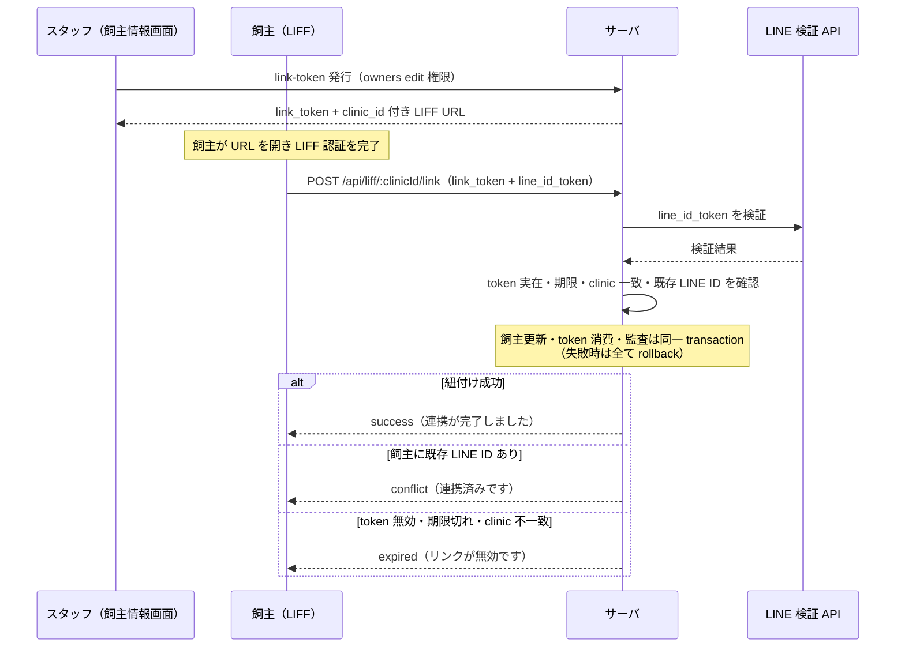

# LIFF 診察券・健康情報 仕様書 (LIFF Pet Health)

| 管理項目 | 記載 |
|:---|:---|
| 文書ID・種別 | page.liff.pet-health／D20 業務・画面仕様 |
| 決定状態 | 既存記載を継承。明示済み合意と現行実装説明を分け、2026-10-15の本人向け表示範囲を承認済み。実装適合は別判定 |
| 実装状態 | 既存記載を継承（今回の再監査なし）。既知gapを保持 |
| 実機検証状態 | 今回未実施。テスト名・過去証拠の掲載は再実行を意味しない |
| 文書確認日 | 2026-10-15。本文・参照・FR/AC整理。独立レビュー前 |

## 概要
- **画面の目的**: 飼主が LINE アプリ内（LIFF）で自身のペットの健康手帳（ワクチン接種記録・最終来院日）を閲覧する。また、スタッフが発行した紐付けトークン付き URL から LINE アカウントと院内の飼主レコードを紐付ける。
- **URLパターン**: 独立エントリ `frontend/liff`（スタッフ画面とは別ビルド・別配信）。`https://liff.line.me/{LIFF ID}` 経由で起動し、クエリで動作が分岐する:
  - `?token=` あり → LINE アカウント紐付けフロー（`LiffLinkPage`）
  - `?token=` なし → 健康手帳表示（`PetHealthPage`）
  - `?clinic_id=` → 対象医院の指定（両フローで必須。LIFF エンドポイント URL 側に含めて運用する）
- **アクセス権限**: スタッフの権限リソースではなく **LINE ID Token 認証**。健康手帳 API は `LiffAuth` ミドルウェア（`liff_auth.go`）が Authorization: Bearer の ID Token を LINE の検証 API へ照合し、`line_customers` の顧客を特定・自動作成する。紐付け API は認証ヘッダ不要で、body 内の link_token + line_id_token による自己認証 + IP レートリミット（10回/分）。

---

## 画面構成

### 1. LoadingPage
LIFF SDK 初期化中に表示される全画面スピナー（`Spinner` + 「読み込み中...」）。

### 2. PetHealthPage（健康手帳）
- **ヘッダー**: LINE プロフィール画像と飼主名。飼主名は院内登録名（owner_name）を優先し、未紐付け時は LINE 表示名にフォールバック。
- **ペットカード**（飼主に紐付く生存ペットごとに 1 枚）:

| 項目 | 内容 |
|:---|:---|
| ペット名・種/品種 | カードヘッダーに表示。 |
| 最終来院日 | 記録がない場合は「記録なし」。 |
| ワクチン記録 | ワクチン名・接種日・次回予定日のテーブル。次回予定日未設定は「—」。記録 0 件のペットではテーブル自体を非表示。 |

- **ペット 0 件時**: 「ペット情報はありません」を表示（LINE 未紐付けの顧客もこの状態になる — 後述）。
- **エラー時**: ステータス別メッセージと再試行ボタン。401（ID Token 失効）は再試行では解消しないため再試行ボタンを出さない（`resolveFetchError` の canRetry 判定）。

### 3. LiffLinkPage（LINE アカウント紐付け）
`useLiffLink` が返す status に応じて 6 状態を表示する。

| status | 表示 | 発生条件 |
|:---|:---|:---|
| loading / linking | スピナー + 「LINEアカウントを連携中...」 | LIFF 初期化中 / API 呼び出し中 |
| success | 「連携が完了しました」+ 閉じるボタン | 紐付け成功（204 No Content） |
| conflict | 「連携済みです」+ 閉じるボタン | 409: 対象の飼主に既に LINE User ID が設定済み |
| expired | 「リンクが無効です」（再試行ボタンなし） | 400: トークン無効・期限切れ・医院不一致 |
| error | 「エラーが発生しました」+ 再試行ボタン | 401（LINE 認証失敗）・その他のエラー・`clinic_id`/`token` 欠落 |

---

## 主要な機能

### 1. 起動から表示までのシーケンス
1. モジュール評価時に `window.location.search` の `token` 有無でフローを分岐（`App.tsx`）。
2. `useLiff`（`frontend/src/shared-liff` の共有フック `use-liff.ts`）が `liff.init` を実行。未ログインなら `liff.login()` で LINE ログインへリダイレクト。
3. ログイン済みなら ID Token と LINE プロフィール（表示名・画像）を取得。初期化失敗時は `ErrorPage` を表示。
4. `PetHealthPage` が `fetchHealthCard`（`liff-api.ts`）で GET `/api/liff/:clinicId/health-card` を呼ぶ。フェッチ状態は共有フック `useFetchState` が管理。
5. サーバ側は `LiffAuth` が ID Token を検証: 医院の LIFF ID からチャネル ID を抽出し、LINE 検証 API の client_id に使用（クロステナントのトークン流用を防止）。検証成功で `line_customers` を FindOrCreate。
6. レスポンスは zod スキーマ（`healthCardResponseSchema`）で形状検証してから描画。不正な形状は描画せずエラー画面に落とす。

### 2. LINE アカウント紐付けフロー
1. スタッフ側 API（POST `/api/v1/owners/:id/line/link-token`、`owners` の edit 権限）が 24 時間有効の単回使用トークンを発行し、`https://liff.line.me/{LIFF ID}?token={token}&clinic_id={clinicID}` 形式の URL を返す（`GenerateLineLinkToken` → `line_link_service.go`）。`LiffLinkPage` は `token` と `clinic_id` の両方をクエリから読むため、`clinic_id` 欠落時は「無効なURLです」で即エラーになる（SD-14 で修正・旧実装は `clinic_id` 欠落のまま発行していた）。飼主情報画面（[04-owners-form.md](./04-owners-form.md)）の LINE/Lステップ連携セクション（`LineIntegrationCard`）の未連携時分岐に、この発行 API を呼ぶ `LineLinkTokenSection`（「連携用URLを発行」ボタン → 発行後は読み取り専用入力欄に URL 表示 + コピー ボタン、`useGenerateLineLinkToken` mutation 経由）を SD-14 で追加した。
2. 飼主が URL を開くと `useLiffLink`（`use-liff-link.ts`）が LIFF 認証完了後に POST `/api/liff/:clinicId/link` へ link_token と LINE ID Token を送信。
3. サーバ側（`LinkLiffAccount`）は ①LINE ID Token 検証 → ②トークンの実在・期限・医院一致検証 → ③飼主の既存 LINE User ID 有無チェック（既設定なら 409）→ ④LINE User ID 更新 → ⑤トークンの単回 CAS 消費 → ⑥監査ログ記録と更新結果の再取得、の順で処理する。④〜⑥は同一 transaction で実行し、いずれかが失敗した場合は飼主更新・トークン消費・監査を全て rollback する。上書き・再リンクはこの endpoint では未対応で、strict JSON decode により `force` などの未知フィールドも拒否する。

### 3. 未紐付け時の挙動
health-card API は LINE 顧客が飼主未紐付けでも 200 を返し、owner_name = LINE 表示名 + pets 空配列にフォールバックする（`liff_service_health_card.go`）。画面上は「ペット情報はありません」となり、紐付け前でもエラーにはならない。

### 4. 臨床安全・データ保護
- **死亡ペットの除外**: status=deceased または死亡日（deceased_at）が設定されたペットは健康手帳に表示しない（EMR-290、現行health-card service静的照合）。
- **レスポンス形状検証**: zod による実行時検証で、想定外データの誤表示を防ぐ。
- **テナント分離**: ID Token の client_id 照合を医院ごとの LINE チャネル ID で行い、トークンには医院一致検証がある。
- **トークン保護**: 新規 raw token は 32 random bytes の unpadded base64url（43文字）で、DB には SHA-256 digest のみを保存する。24 時間期限・単回使用。64桁 hex raw token は、発行済み legacy 行の期限内検索だけに対応する。紐付け操作は監査ログに記録される。
- **レートリミット**: `/link` は 10回/分、認証済みエンドポイント（`/health-card` を含む）は 60回/分のデフォルト上限（IP ベース）。（2026-09-29 訂正: 読み取り系 30回/分 → 認証済み系 60回/分。30回/分が適用されるのは公開 `/settings` と `/my-reservations` のみ。`backend/internal/reservation/routes.go` `RegisterLiffRoutes`）

### 5. アクセシビリティ
- エラーメッセージは role="alert" で通知。装飾絵文字（⚠️ / ✅ / ℹ️）は aria-hidden="true" でスクリーンリーダーから除外。
- プロフィール画像には表示名の alt を付与。

---

## 技術仕様

### 開発サーバー（`frontend/vite.config.ts`）
ローカル dev では `/liff/{clinicId}/src/*` を実ファイルへ rewrite する（`line-reserve` と同型）。rewrite が無いと `GET /liff/{clinicId}/src/main.tsx` が 503 になり画面が白紙になる。

### 使用コンポーネント
- **`PetHealthPage`** / **`LiffLinkPage`** / **`LoadingPage`**: `frontend/liff/src/pages` の 3 画面。
- **`ErrorBoundary`** / **`ErrorPage`** / **`Spinner`**: `frontend/src/shared-liff` の共有部品（line-reserve アプリと共用）。ルート全体を `ErrorBoundary` でラップ（`main.tsx`）。
- **`useLiff`**: LIFF SDK 初期化・ID Token / プロフィール取得の共有フック。
- **`useLiffLink`**: 紐付け API 呼び出しとステータス遷移。
- **`useFetchState`** + **`resolveFetchError`**: GET フェッチ状態管理とステータス別エラーメッセージ解決（`handle-fetch-error.ts`）。
- **モックモード**: `VITE_LIFF_MOCK=true`（FE、`liff-config.ts` の LIFF_MOCK）で LIFF SDK をバイパスしモックトークンで動作。バックエンドも環境変数 LIFF_MOCK=true（release モード以外）で認証をバイパスする。

### API連携
| メソッド | エンドポイント | 用途 | 認証方式 |
|:---|:---|:---|:---|
| GET | `/api/liff/:clinicId/health-card` | 健康手帳データ（飼主名・ペット・ワクチン記録）の取得 | LINE ID Token（`LiffAuth`） |
| POST | `/api/liff/:clinicId/link` | link_token + line_id_token による飼主への LINE User ID 紐付け | body 内トークン自己認証（10回/分） |
| POST | `/api/v1/owners/:id/line/link-token` | スタッフ側：紐付けトークンと LIFF URL の発行（[04-owners-form.md](./04-owners-form.md) の `LineLinkTokenSection` から呼び出し） | スタッフ JWT（`owners` / edit） |

---

## D20の公開・本人紐付け契約整理（2026-10-15）

### 対象と語彙

健康手帳は飼主本人向けの限定読取であり、院内レポートD21の公開版ではない。現行の表示対象は飼主名、生存ペットの基本表示、最終来院日、ワクチン名・接種日・次回予定日。診断・処方・検査詳細・院内備考の全面公開は本書から導かない。

LINE顧客行の作成、院内飼主へのLINEアカウント紐付け、D19のidentity groupを別概念とする。LINE ID tokenの認証成功やline_customersの自動作成だけで、院内飼主・ペットの同一性を確定しない。D19のlink/unlinkはLINEの再リンク許可や台帳統合を兼ねない。

本節は本文の既存契約を受入へ対応付けた整理。明示された決定以外は既存記載を継承し、実装再監査・token発行・実データ公開は行っていない。

### 操作・状態・認可

| 要件ID | 操作・契約 | 根拠と決定状態 |
|:---|:---|:---|
| FR-liff-health-owner-scope | 医院に対応したLINE ID tokenと本人紐付けから健康手帳を取得し、スタッフRBACを本人認証の代用にしない | 本文概要・主要機能§1 |
| FR-liff-health-limited-fields | 現行の健康手帳項目だけを公開し、status=deceasedまたは死亡日ありのペットを除外する。未紐付けは名前fallbackとpets空配列で扱う | 本文表示・§3〜4 |
| FR-liff-health-single-use-link | 職員owners:editによる24時間単回token発行と、飼主のLINE自己認証を分離する。期限・医院・既存LINE IDを検証する | 本文主要機能§2、architecture§2 |
| FR-liff-health-atomic-link | 飼主更新・token CAS消費・監査を同一transactionにし、一部失敗で全部rollback。既存LINE ID上書き/forceを許可しない | 本文主要機能§2 |
| FR-liff-health-error-boundary | 未紐付け/0件、権限やtokenエラー、通信失敗、不正レスポンスを区別し、不正形状を健康情報として描画しない | 本文表示・主要機能§1 |

### 受入条件

| 条件ID | Given（前提） | When（操作） | Then（期待結果） | 独立確認・成功条件・確認手順／証跡 |
|:---|:---|:---|:---|:---|
| AC-liff-health-unlinked | LINE認証済みだが院内飼主未紐付け | 健康手帳を取得する | 200・LINE表示名fallback・pets空配列で、他飼主情報を補わない | 本文§3とAPI形状を照合 |
| AC-liff-health-public-fields | 本人紐付け済みで生存ペットがある | 健康手帳を表示する | 本文の限定項目を表示し診断/処方等へ拡張しない | 画面構成の全項目を照合 |
| AC-liff-health-deceased | status=deceasedまたはdeceased_at非nullのペットがある | 健康手帳を取得する | 対象ペットを表示しない | liff_service_health_card.goの死亡OR条件を照合 |
| AC-liff-health-clinic-token | 別医院に対応するtokenを用いる | 認証/紐付けを要求する | 医院一致・client_id照合に従い拒否し、他医院情報を返さない | 本文テナント分離とarchitecture§2 |
| AC-liff-health-link-expired | tokenが期限切れ/無効/医院不一致 | 紐付ける | expiredとして扱い、同じtokenで再試行を促さない | 状態表と24時間契約を照合 |
| AC-liff-health-link-conflict | 飼主に既存LINE IDがある | 紐付ける | conflictで既存値を上書きしない。forceによる回避も拒否する | 本文主要機能§2 |
| AC-liff-health-atomic-failure | 監査/更新/token消費のいずれかが失敗する | 紐付け処理を終える | 一部だけを保存せず全部rollback | 本文transaction契約。実並行試験は未実施 |
| AC-liff-health-token-storage | 新tokenを発行する | 保存する | rawをDB保存せずdigestを保存、rawは発行時返却。legacyは期限内互換のみ | 本文token保護を照合。実tokenを扱わない |
| AC-liff-health-response-invalid | 取得値が期待形状に不適合 | 描画する | 値を推測せずエラーにする | 本文zod検証を照合 |
| AC-liff-health-auth-expired | health-cardで401 | エラーを表示する | 同じtokenでの再試行ボタンを出さない | PetHealthPageのcanRetry契約。link側401の表示差は現行継承 |

### 公開判断の残件

接種レコード単体に新しいfinalized状態や承認操作を追加しない。D08の独立フォームとカルテタブは同じ接種資源を扱い、カルテへの紐付き有無は公開可否と同義ではない。

承認済み業務方針：本人に紐付く生存ペットの保存済み接種実績・最終来院日を表示する。未保存内容・削除/取消対象は非公開、訂正保存後は新内容へ更新する。診断・処方・検査詳細へ拡大しない。保存済み接種を単位とし、親カルテfinalizedを新たな公開必要条件にしない。根拠：2026-10-15確認案 Sentinel_75a3a1bf81b481919ba4c34aa633feb4、再確認 Sentinel_8d0032ca45b881919b3d2ceb5339f792 に対するユーザー承認 Sentinel_7a67fd30e47c819192cd36d416f0a2bf「ok」。

技術引継ぎ：医院・本人・患者ID・取得版と公開対象の照合、論理削除/訂正版の取得、死亡statusまたは死亡日による除外、通信不明時の紐付け結果確認・二重実行の収束は技術契約で具体化する。上書き禁止・単回CAS・監査原子性を緩めない。これらの実装適合・実機公開は未確認。

### 公開DTO・紐付けの現行技術照合

2026-10-15 `backend/internal/reservation/liff_service_health_card.go` と `backend/internal/lstep/line_link_service.go` を静的確認。

- health-cardは選択医院の認証済LINE customerからowner同期/解決する。未連携はcustomer表示名（なければreal name）と空pets、連携済みはowner名。任意owner ID指定の公開閲覧へ拡張しない。
- pet ID/名前/種/犬種/last_visit、接種名/日付/次回日という限定DTO。最終来院日はpet.last_visitであり、最新draftカルテ日を新たに算出する契約ではない。
- 接種は同医院ownerの保存済みvaccinationsをpet IDで振り分ける。現行health-card service自身には親カルテfinalized条件がない。承認方針も保存済み実績を単位とし、新しい単体finalizedや親カルテ確定条件を追加しない。
- linkはID token検証→token/owner row lock→既存LINE ID拒否→owner更新＋単回token CAS＋必須監査＋reloadを同一txで実施。失敗時は全rollback。検証先のLINE LoginチャネルIDは、`clinic_integrations` のLIFF IDの接頭辞（`-` より前）から導出する。
- 既使用tokenによる再送エラーは初回未成功の証明ではない。新token発行や別ownerへの再紐付けへ飛ばず現在の連携状態を確認する。

| 条件ID | 前提・操作 | 期待結果 | 根拠 |
|:---|:---|:---|:---|
| AC-liff-health-unlinked-empty | 未連携customerでhealth-cardを読む | 他ownerのpetを推測せず空petsと本人表示名 | health-card service |
| AC-liff-health-last-visit-source | draftカルテとpet.last_visitが異なる | 最終来院表示は既存pet.last_visit投影 | health-card service |
| AC-liff-health-link-audit-rollback | token有効だが監査失敗 | owner LINE ID更新とtoken消費ともrollback | line_link_service |
| AC-liff-health-link-retry | link応答不明後にtoken使用済み | 初回失敗と断定せず本人連携状態確認、別ownerへ流用しない | 単回CAS契約 |

FR-liff-health-published-facts: 本人に紐付く生存ペットの保存済み接種実績・最終来院日だけを既存公開範囲とし、未保存/取消/削除済み実績を公開しない。訂正保存後に現内容へ更新する。診断/処方/検査詳細を追加しない。

| 条件ID | 前提・操作 | 期待結果 | 根拠 |
|:---|:---|:---|:---|
| AC-liff-health-saved-facts | 本人紐付き生存petに保存済接種と未保存入力あり | 保存済実績と最終来院日だけを表示 | 2026-10-15承認 |
| AC-liff-health-cancel-delete | 接種が取消/削除済み | 公開対象から除外、以前の表示を現実績としない | 同承認 |
| AC-liff-health-corrected | 接種訂正を保存 | 訂正後内容へ更新、保存前draftは公開しない | 同承認 |
| AC-liff-health-no-extra-finalize | 接種保存済みで親カルテdraftまたは紐付きなし | 新しい接種確定操作/親finalized条件を要求しない | 同承認・D08資源境界 |
| AC-liff-health-no-clinical-expansion | 診断/処方/検査詳細が院内にある | 健康表示へ追加公開しない | 同承認 |

### 来院集計承認との境界

[D16実来院回数](../domains/analytics/business-rules.md#requirement-fr-analytics-owner-counts)の承認は本画面の公開範囲を拡張しない。既存pet.last_visit投影を新しい実来院sourceへ適合済みとは扱わず、患者・医院・実来院根拠の照合を要する。今回の承認だけで新しい指標を公開したり、最終来院日を最新draftカルテ日から補完したりしない。

### カルテの通常編集・タブ復元を受ける範囲

D03の[自動保存維持・通常編集・タブ復元](../domains/medical-records/lifecycle.md#medical-record-agreement-autosave-20261015)でも、本画面は従来どおり同じ患者の保存済み有効接種実績・最終来院日だけを読む。復元に伴う有効状態／保存版の変更はD08の保存結果を再取得して反映し、未保存・結果不明を成功済み投影にしない。D21の診療終了条件を接種公開へ流用せず、親の医師確定や診療終了を新しい公開gateにしない。既に送った通知の回収、診断・処方・検査結果への公開拡大を追加しない。
