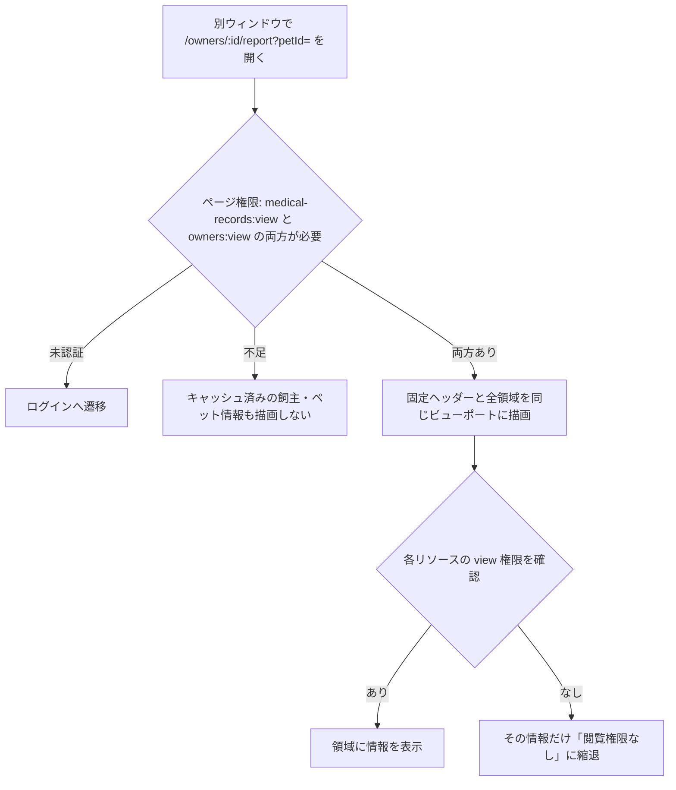

# 飼主カルテレポート 仕様書 (Owner Report)

| 管理項目 | 記載 |
|:---|:---|
| 文書ID・種別 | page.owners.clinical-report／D21 業務・画面仕様 |
| 決定状態 | 既存記載・診療終了済みカルテの履歴対象を継承し、2026-10-15の予防薬専用2帳票の表示・印刷入口を限定追加。未照合の履歴と現行実装差は別に保持 |
| 実装状態 | 既存記載を継承。今回レポート入口と一般薬歴を固定headで静的照合。専用2帳票の実装適合・他部分の再監査は未確認 |
| 実機検証状態 | 今回未実施。テスト名・過去証拠の掲載は再実行を意味しない |
| 文書確認日 | 2026-10-20後日予定の参照接続（従来本文確認2026-10-15）。実装／実機確認とは別 |

## 概要

- **目的**: 選択中ペットの「診療前に確認する情報」「今日の来院」「次の行動」「前回診療」「基本情報」「種類別履歴」を、ページ切替やページスクロールなしで俯瞰する読み取り専用画面。
- **URL**: `/owners/:id/report?petId=`。`petId` が同一飼主のペットでない場合は先頭ペットへフォールバックする。
- **表示形態**: サイドバー付き Layout 外で別ウィンドウ表示するスタンドアロンルート。
- **ページ権限**: `medical-records:view` と `owners:view` の両方が必要。未認証時はログインへ遷移し、権限不足時はキャッシュ済みの飼主・ペット情報も描画しない。
- **個別権限**: 検査・予防接種・健診・トリミング・予約は各リソースの `view` を確認し、権限がない情報だけ「閲覧権限なし」に縮退する。

## 1. 画面構成

### 1.1 固定ヘッダー

- **飼主情報 (`OwnerReportPanel`)**: 飼主No・氏名・ふりがな・電話だけをコンパクトに表示する。住所・勤務先・DM 等の詳細は「基本情報」に集約する。
- **選択中ペット (`SelectedPetContext`)**: ペット名、種別・品種、年齢、性別、体重を表示する。
- **ペット切替 (`PetSwitcher`)**: タブではなくラベル付きネイティブ select を使う。選択時はページ遷移せず、URL の `?petId=` を replace で同期する。

### 1.2 診療ブリーフィング（6領域）

`OwnerClinicalBriefing` は次の6領域を同じビューポート内へ配置する。順序は業務上の確認順に合わせる。

| # | 領域 | 優先情報 |
|:---|:---|:---|
| ① | 診療前の確認 | ペット備考、血液型、直近の薬・処方、最新検査、予防予定 |
| ② | 今日の来院 | 本日の予約時刻、初診/再診、受付状態、予約内容、担当 |
| ③ | 次の行動 | 次回予約（確定・実予約）、次回予定（tentative appointment の意図日・時間未定）、予防予定 |
| ④ | 前回診療 | 最新の診療終了済みカルテにある診療日、担当、主訴、評価、方針 |
| ⑤ | 基本情報 | ペット・飼主属性、初診日、前回来院、保険、住所、勤務先、DM |
| ⑥ | 種類別履歴 | 縦を情報種類、横を新しい日付順とした履歴マトリクス |

### 1.3 種類別履歴

- 縦行は「診療」「検査」「薬・処方」「予防接種」「処置」「ケア」の6種類で固定し、薬・予防接種・処置を混在させない。
- 横列は取得済みデータの全日付を新しい順に並べ、同日の複数種類を同じ日付列へ配置する。画面幅を超える列は履歴領域内の横スクロールで参照する。これは日付による俯瞰であり、別APIのデータを同一診療レコードとして結合したことを意味しない。
- 治療履歴は `filter=all` で1回だけ取得し、`itemType=medicine` を「薬・処方」、それ以外を「処置」に表示する。旧画面の重複した4クエリ・重複掲載は行わない。
- 検査は依頼中・検査中を履歴から除外する。検査結果明細がAPIから返らない場合は「異常なし」と断定せず「結果明細なし」と表示する。
- トリミングは status「完了」の施術だけを「ケア」として表示する。
- 履歴系APIの取得上限は `HISTORY_FETCH_LIMIT`（100件）。上限超過を検知した場合は件数末尾に `+` を付け、打ち切り注記を表示する。
- 上限超過の検知はバックエンド `total` と累積取得 raw 行数の比較で行い、クライアント側フィルタ（検査の下書き除外・トリミングの完了のみ抽出）後の可視件数では判定しない。
- 追加読み込み: 「検査」「薬・処方」「処置」「ケア」の4行は、取得元（検査 API・治療履歴 API・トリミング API の3系統）に残ページがある限り行見出しに「続きを読む」を表示する。押下でのみ次ページを取得して累積表示し、初回マウントで page>1 の自動取得は行わない。「薬・処方」と「処置」は同一治療履歴ソースを共有するため同じ制御を両行に出す。「診療」「予防接種」行は対象外。健診結果は「検査」行に合算表示されるが追加取得対象ではない。
- 治療・予防接種の日付はJST壁日付へ正規化してから表示する。

### 1.4 レイアウト

- デスクトップ・タブレット・モバイルを問わず、ルートをビューポートへ固定し、ページ全体をスクロールさせない。
- 6領域の見出しを常に同時提示する。情報が領域を超えた場合だけ、各パネル本文の内部スクロールを許可する。
- 幅840px以下は6領域を1列6行へ再配分するが、自然高さの縦積みにはせず、利用可能な高さを比率配分する。
- 高さ600px以下は2〜3列の短辺向けグリッドへ切り替え、6領域を2〜3段に収める。
- 種類別履歴は内部だけ横スクロールを許可し、日付列見出しと種類行見出しを sticky に保つ。
- フォントサイズは `docs/spec/design-system.md` の役割に従い、見出し20px、主要値15px、ラベル14px、補助情報12pxを基本とする。メディアクエリで本文文字を縮小しない。

## 2. 主要機能

### 2.1 起動導線

共有ヘルパー `openOwnerReport` が noopener,noreferrer 付きで別ウィンドウを開く。飼主・ペット一覧とカルテ画面ヘッダーから起動できる。ウィンドウタイトルは `飼主レポート - {飼主名}` とする。

### 2.2 同居ペット

`useGetOwnerReportPets` が返す同一飼主のペットだけを select に表示する。画面は常に1頭分で、複数ペットを合算しない。切替後は対象ペットの各クエリをReact Queryキャッシュ経由で取得する。

### 2.3 印刷

一般レポート全体は画面閲覧専用で、全体印刷・共有機能は設けない。固定ビューポートのブラウザ標準印刷を帳票機能の代替としない。2026-10-15の[予防薬専用処方箋・年間投薬表](#owner-report-preventive-output)だけは明示採用された限定例外として、保存済み範囲を選ぶ専用出力入口を持つ。他sectionや一般レポート全体の印刷解禁ではない。

## 3. 臨床安全・アクセシビリティ

### 3.1 臨床安全

- 未設定値は「記録なし」または `-` とし、APIに存在しない情報を他の項目から代用しない。
- 年齢だけは生年月日から `formatPetAge` で導出する。初診日は専用API、前回来院はペットAPIの値を使う。
- 最新検査の異常件数だけを診療前確認へ表示し、過去の異常を現在の要確認事項として累積しない。
- 権限なし・読み込み中・取得失敗を0件や「予定なし」として扱わない。
- 前回診療と診療履歴は、[最新合意](#owner-report-ended-history)により診療終了したカルテだけを対象とする。自動保存済みでも診療中の記録を診療済み履歴へ載せず、医師確定操作を新たな表示条件にしない。
- 本画面は読み取り専用で、入力・保存操作を持たない。

### 3.2 アクセシビリティ

- ペット切替は accessible name「ペット切替」のネイティブ select。tab / tablist / tabpanel は使用しない。
- 6領域は各見出しで命名された region とし、本文は `tabIndex=0` でキーボードによる内部スクロールを可能にする。
- 種類別履歴は table、日付は `scope=col`、種類は `scope=row` とし、読み上げでも縦横の対応を保つ。
- ローディングは `role=status`、取得失敗は `role=alert` で通知する。

## 4. 技術仕様

### 使用コンポーネント

- `OwnerReport`: 認証・ページ権限・ペット選択・URL同期。
- `OwnerReportPanel` / `SelectedPetContext` / `PetSwitcher`: 固定コンテキスト。
- `OwnerClinicalBriefing`: データを一度ずつ取得し、6領域向けに派生する。
- `ClinicalBriefingPanel`: 見出し付き境界内スクロール領域。
- `ClinicalHistoryMatrix`: 縦=種類、横=日付の履歴表。残ページのある行は行見出しに「続きを読む」を出す。
- `useGetPetExaminations` / `useGetPetTreatmentHistory` / `useGetPetTrimmingHistory`: `useInfiniteQuery` ベースの履歴3系統。ページは `fetchNextPage` で手動追加され、消費側には累積済み `{items, isTruncated}` を返す。

### API連携

| メソッド | エンドポイント | 用途 | 必須権限 |
|:---|:---|:---|:---|
| GET | `/api/v1/owners/:id` | 飼主基本情報 | `owners:view` |
| GET | `/api/v1/owners/:id/report/pets` | Owner Report用に絞った同居ペット一覧 | `owners:view` |
| GET | `/api/v1/pets/:id/first-visit` | 初診日 | `medical-records:view` |
| GET | `/api/v1/medical-records?pet_id=&status=finalized&sort=date&order=desc` | 現行の前回診療・診療履歴（最大100件）。目標は診療終了結果に基づく選別へ置換 | `medical-records:view` |
| GET | `/api/v1/pets/:id/treatment-history?page=` | 薬・処方と処置（filter=all・手動追加読み込み） | `medical-records:view` |
| GET | `/api/v1/vaccinations?pet_id=` | 予防予定・予防接種履歴 | `vaccinations:view` |
| GET | `/api/v1/examinations?pet_id=&page=` | 最新検査・検査履歴（手動追加読み込み） | `examinations:view` |
| GET | `/api/v1/checkups/field-results?pet_id=` | 健診履歴 | `checkups:view` |
| GET | `/api/v1/trimmings?pet_id=&page=` | ケア履歴（手動追加読み込み） | `trimming:view` |
| GET | `/api/v1/reservations?pet_id=&start_date=&end_date=` | 今日の来院・次回予約（今日から731日（現行2年予定窓）） | `reservations:view` |

clinic隔離・論理削除除外は各バックエンドAPIが担保する。

## D21の読取専用・患者context契約整理（2026-10-15）

### 目的・対象範囲と状態

診療前の院内スタッフ向け複合読取画面。飼主本人向け公開、共有、一般画面全体の印刷、臨床記録のwriteを追加しない。[予防薬専用2帳票](#owner-report-preventive-output)の参照・出力入口だけを最新採用の限定例外とする。本文のページ権限・section別権限・1頭context・6領域・履歴の取得制約を既存記載として継承する。現コード再監査／実機再受入は行っていない。

### 操作・境界

| 要件ID | 操作・契約 | 根拠と決定状態 |
|:---|:---|:---|
| FR-owner-report-page-section-auth | medical-records:viewとowners:viewの両方をページ前提とし、各sectionは各リソースviewで縮退する | 本文概要・§3 |
| FR-owner-report-single-pet-context | 同一飼主の1頭だけを選択表示し、URLのpetIdをreplace同期する。範囲外petIdは先頭ペットへfallbackし、複数頭を合算しない | 本文概要・§1〜2 |
| FR-owner-report-history-meaning | 診療は診療終了したカルテ、検査は依頼中/検査中を除外、ケアは完了のみ。日付で横断表示しても同一診療IDへ統合した意味にしない | 本文§1.3、§3.1 |
| FR-owner-report-partial-data | 権限なし/読込中/失敗/0件/明細なし/取得上限を区別し、異常なしや予定なしへ代用しない | 本文§1.3、§3 |
| FR-owner-report-manual-pagination | 対象3sourceだけ利用者操作で追加取得し、薬/処置は同一sourceを共有する。上限検知はraw行数とtotalで判定する | 本文§1.3 |
| FR-owner-report-read-only | 別ウィンドウの臨床読取を維持し、保存・一般レポート全体印刷・共有を新設しない。予防薬専用2帳票の参照／出力入口だけを限定追加 | 本文§2〜3・[専用出力](#owner-report-preventive-output) |

### 受入条件

| 条件ID | Given（前提） | When（操作） | Then（期待結果） | 独立確認・成功条件・確認手順／証跡 |
|:---|:---|:---|:---|:---|
| AC-owner-report-page-denied | ページ必須権限の片方がない | 開く | キャッシュ済み飼主/ペット情報も描画しない | 本文概要の両権限条件を照合 |
| AC-owner-report-section-denied | ページ権限はあるが検査viewがない | 6領域を見る | 検査部分だけ閲覧権限なしとし他の許可情報を継続表示する | 各section権限対応を照合 |
| AC-owner-report-pet-switch | 同居ペットが複数いる | 1頭を切り替える | 選択中contextとURLがその1頭に対応し複数頭を合算しない | 本文§1.1/2.2を照合 |
| AC-owner-report-outside-pet | petIdが当該飼主に属さない | 開く | 同一飼主ペットの先頭へfallbackする | 本文概要/OwnerReport.tsx。空配列は専用0ペット表示、詳細query対象なし |
| AC-owner-report-finalized | 診療中の自動保存済みカルテと診療終了済みカルテが混在する | 前回診療/履歴を見る | 診療終了したカルテだけを診療済み履歴として使い、医師確定の有無や自動保存だけで対象にしない | [最新合意](#owner-report-ended-history)。既存IDを保持して期待条件を更新 |
| AC-owner-report-no-result-detail | 検査明細が返らない | 最新検査/履歴を見る | 結果明細なしと表示し異常なしを捏造しない | 本文§1.3 |
| AC-owner-report-truncation | totalがraw取得行数より多い | 履歴を表示する | フィルタ後件数と混同せず打切りを示す | 本文§1.3のraw/可視の区別 |
| AC-owner-report-more | 追加取得対象sourceに次pageがある | 続きを読むを押す | 対応sourceを追加し、薬/処置は共通制御。初回自動page>1取得をしない | 本文§1.3 |
| AC-owner-report-errors | 一部sourceが取得失敗 | 表示する | 失敗を0件/予定なしへ置き換えない | 本文§3.1とrole=alert |
| AC-owner-report-readonly | レポートを開く | 操作を確認する | 臨床write・公開・共有・一般レポート全体印刷がない。専用2帳票の参照／出力だけを明示例外とする | 本文§2.3/3.1・[予防薬出力AC](../domains/medical-records/pages/preventive-medication.md#preventive-medication-ac)。ブラウザ標準印刷の品質とは別 |

### 保存・再取得・遅延応答と引継ぎ

画面自身の保存・取消は該当なし（writeを所有しない）。訂正はD03/07/08/09等の正本で行い、本画面は再取得して表示する。表示中の他画面変更や権限変更を常時即時反映する保証は本文にないため創作しない。

技術整理提案：医院・飼主・ペット・権限contextをquery identityとして、切替前の遅延応答を切替後患者の情報へ混入させず、失敗時に前患者を現在患者として残さない。既存の1頭context・認可・臨床安全を満たす受け手契約であり、新しい業務操作を追加するものではない。現行owner-report-pets query keyはowner IDのみで、共通query-key方針は医院切替時clear＋reload。0ペット時は専用空状態表示がある。遅延応答と全関連queryの実装適合は実機確認対象であり、query keyに医院IDがあると誤記しない。

### 読取操作の静的照合（2026-10-15）

`frontend/src/features/owner-report/routes/OwnerReport.tsx`、`hooks/use-owner-clinical-briefing-data.ts`、`api/get-owner-report-pets.ts`、`frontend/src/lib/query-keys.ts` に基づく。

| 操作 | 現行契約 |
|:---|:---|
| 初期表示 | 認証loading中は表示保留、未認証はredirect。owner/pets読取loadingとerrorを分離する |
| 患者選択 | URL petが現在ownerのpetsに含まれれば選択、なければ先頭へfallback。手動選択はURL replace。fallback自体が必ずURLを書換えるとはしない |
| 0ペット | 「この飼主に登録されたペットがありません」を表示。pet切替/臨床取得対象を作らない |
| カルテ読取 | 現行はfinalizedのみ、取得上限100。目標との差分であり[診療終了結果](#owner-report-ended-history)へ選別を置換する。未取得がない全履歴とは表示しない |
| 他領域読取 | 領域viewなしはpet ID undefined/取得disabledとして対応queryを実行しない。画面のviewを各領域viewへ昇格させない |
| 予約読取 | 当日から731日の窓。従来本文365日は現行2年予定窓へ訂正。D01予定の存在は確定予約や来院実績と同義でない |
| 追加取得 | 対象3履歴の手動追加読込を個別に扱い、1件の失敗で他取得済セクションを空成功にしない |
| cache境界 | owner-report-petsはowner ID key、共通方針は医院切替clear＋reload。患者切替前の結果を別患者へ描画しない契約の実機確認は別途 |

| 条件ID | 前提・操作 | 期待結果 | 根拠 |
|:---|:---|:---|:---|
| AC-owner-report-no-pets | ownerにpetsなしで開く | 専用空状態、架空patientを選ばない | OwnerReport.tsx |
| AC-owner-report-invalid-pet | 別owner/不存在のpet queryで開く | 現ownerの先頭petへfallback、指定IDの他患者記録を表示しない | OwnerReport.tsx |
| AC-owner-report-finalized-only | 旧draft/finalizedと診療終了状態が一致しない記録がある | 目標では診療終了結果を照合して選別し、旧statusだけで対象を決めない。現行queryはfinalized・上限100であり適合差として検出する | clinical briefing hookの現行差・[新読取契約](#owner-report-ended-history) |
| AC-owner-report-section-query-denied | 予約等のviewなし | 該当queryを実行せず情報を漏らさない | 同hookのenabled/undefined |

## 診療終了を基準にした履歴表示（会議追加合意）

質問 Sentinel_6c374f62ed6c8191bc8da84631b884bd「医師が確定したカルテに代えて診療終了したカルテを表示対象にし、診療中の途中保存は載せない」に対するユーザー Sentinel_8199a97373348191a766a6af966812ff「ok」が根拠。医師確定操作の廃止／診療終了後も通常編集できるD03の最新方針と接続し、D21は診療終了したカルテを前回診療・診療履歴へ表示する。自動保存は終了を意味せず、表示のためにカルテを確定・自動終了させない。

### 読取側の判定と版

同じ医院・患者・カルテIDに対応する実効的な診療終了結果と現在の保存済み内容／版を参照する。D01／D03の終了操作の成功結果、取消／再開関係、取得状態を照合し、終了が結果不明・未取得なら保存時刻、旧finalized値、会計確定や予約予定日時で終了を捏造しない。終了取消で診療中へ戻った記録は、再び終了するまでは診療済み履歴の対象から除く。終了・取消の原履歴は消さない。既存の[終了取消と会計保護](../workflows/reservation-to-record-flow.md#consultation-end-undo-before-payment)をD21から変更しない。

診療終了後の通常編集が保存された場合は、その記録の現在保存済み内容／版を再取得して表示する。変更前の記録・変更者・時刻等の履歴はD03に保持し、D21の読取で書換えや復元を実行しない。常時即時更新や新しい通知を保証せず、既存の再取得・患者切替・遅延応答・section認可を維持する。検査自身のconfirmed／固定版保護、ケア履歴の完了条件、接種公開範囲、同日の別リソースを統合しない条件は変更しない。

現行の `status=finalized` queryは5a4c292e基準の既存仕様から把握する適合差であり、終了結果の照合adapterが既に実装済みとはしない。新しいendpoint文字列や物理status値は本合意から創作しない。判定に必要な終了結果・カルテ対応・現在版が不明なら、未確認／取得失敗として示し、診療中や別患者の記録へfallbackしない。

### 追加受入と技術追跡

以下はFR-owner-report-history-meaning／partial-data／read-onlyに対応し、本節の読取判定・版・認可が技術traceとなる。

| 条件ID | Given | When | Then | 対応 |
|:---|:---|:---|:---|:---|
| AC-owner-report-ended-edit | 診療終了済みカルテが通常編集され保存済み | 前回診療／履歴を再取得 | 同じカルテの最新保存版を表示し、元変更履歴は保持。読取からwriteを起こさない | history-meaning／read-only、本節 |
| AC-owner-report-ended-reopen | 診療終了の取消により同じ記録が診療中へ戻った | 履歴を再取得 | 再終了までは診療済み履歴へ載せず、終了／取消の原履歴を削除しない | history-meaning、本節 |
| AC-owner-report-ended-unknown | 終了結果・カルテ対応・取得状態が不明 | 履歴を表示 | 旧finalizedや自動保存・会計結果から終了を推定せず未確認を区別。別患者へのfallbackなし | partial-data、本節 |

## カルテ右上レポートから予防薬専用2帳票を扱う限定追加

Sentinel_0adf405e47508191abf775b6c4af22a3 の回答2により、[D03予防薬専用管理](../domains/medical-records/pages/preventive-medication.md)の参照・予防処方箋／1〜12月年間投薬表の印刷入口を本画面に接続する。固定headのMedicalRecordStickyHeader → openOwnerReport → OwnerReportで同じ入口を確認した。現在表示に関するユーザー申告と静的観察はD03正本で分離しており、一般薬歴表示を専用2帳票の実装済み証拠にしない。

ページ権限・section認可と一頭contextを維持し、選択患者の予防薬専用記録と年表を一般薬歴と区別して表示する。管理・訂正はD03 ownerへ同患者・対象recordを渡す。D21に臨床保存を追加せず、閲覧権限からD03編集権限を作らない。専用2帳票だけ選択・保存済み版のプレビュー・出力を可能にし、D21全体や検査・接種・健診等のsectionを一括印刷・公開・共有しない。

受入本文はD03のFR-medical-records-preventive-report-outputとAC-medical-records-prevention-report-entry／two-print／print-stale／print-cancel／report-viewへ単一管理する。FR-owner-report-read-onlyはこの限定例外と両立させる。scope／版変更・取得失敗・不完全な年間表は出力停止、未保存の自動保存なし、再印刷・取消・完了不明から投薬実績／請求／在庫／配信を生まない。[技術trace](../../design/domains/medical-records/technical-spec.md#medical-record-intake-prevention-contract)のD21 reader／専用印刷projectionが対応し、API・実装・実機受入は未実施。

## 過去カルテの後日予定を確認する追加（2026-10-20本人確定）

業務正本・根拠・受入条件は[D03の後日予定レポートFR／3AC](../domains/medical-records/pages/medical-record-form.md#requirement-fr-medical-records-deferred-plan-report)。本人の「カルテのレポートページだけでいいです」に基づき、カルテ右上から開く本ページで選択患者の過去カルテの後日予定を、元record／元予定identityと現在の実施・中止状態を保って確認する。元記録を移動・上書きせず、状態変更済みを未消化の後日予定と誤表示しない。表示配置・取得方式は技術設計未了、実装適合／実機受入は未確認。

スタッフ専用read・ページ／section認可・医院／飼主／一頭contextと取得失敗の区別を維持する。次回予約画面・受付・来院時の追加表示は対象外。別カルテ実績への関連付けによる消化、来院だけの自動実施済み化、元予定移動／上書き、新しい消化操作や臨床writeは追加しない。一般レポートの印刷／共有・LINE公開も拡張しない。既存実施・取消owner手順、同一record後日入力と新来院選択copyを、このreadで代替又は自動実行しない。

この後日予定表示にも[既存§3.2](#owner-report-accessibility)のaccessible name・見出し・キーボード・status／alertを適用し、元記録・元予定・現在状態を文字で識別する。新しいリンク・modal・自動focusは設けない。現行履歴100件の取得だけで網羅済み／予定なしとせず、未取得／打切りを不完全として識別する。100件より古い対象へ到達できる後日予定readは[D03の取得・受入条件](../domains/medical-records/pages/medical-record-form.md#requirement-fr-medical-records-deferred-plan-report)へ従い設計し、他sectionの取得上限・期間契約は拡張しない。
